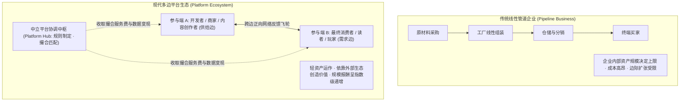
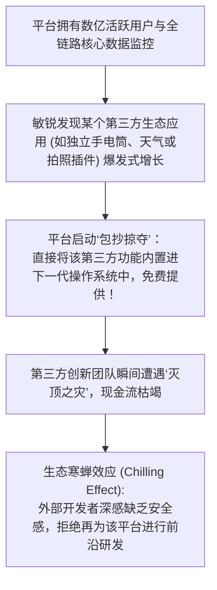

# Lec 16 平台生态系统战略与多边治理 (Strategic Management of Platforms and Ecosystems)

> MIT Sloan School of Management · 15.912 Strategic Management of Innovation · Prof. Fiona Murray & Prof. Rebecca Henderson

## TL;DR

- 单边传统管道业务（Pipes）向多边平台网络（Multisided Platforms, MSPs）的范式大迁移。
- 双边跨边网络效应（Cross-Side Network Effects）的冷启动难题：“先有鸡还是先有蛋”。
- 平台补贴定价经济学：精准识别“补贴边（Subsidy Side）”与“收费变现边（Money Side）”。
- 平台包抄（Platform Envelopment）与生态治理：如何在促进第三方互补创新的同时防止平台反噬。

## 管道型企业 vs. 平台型企业：商业形态的升维 / From Pipes to Multi-Sided Platforms

在过去的一百多年中，绝大多数企业的运作模式都是典型的**“管道型（Pipes）”**：
- 企业在管道的一端投入原材料、雇佣劳动力进行生产加工；
- 沿着线性的价值链将半成品组装为成品；
- 在管道的另一端通过零售渠道将商品推销给买方客户。

然而，在数字化与互联网时代，全球市值最高的顶尖科技企业（苹果、微软、亚马逊、Alphabet、Meta）几乎全部蜕变为了**多边平台（Multi-Sided Platforms, MSPs）**。麻省理工学院斯隆管理学院著名学者马歇尔·范·阿尔斯泰恩（Marshall Van Alstyne）与杰弗里·帕克（Geoffrey Parker）的研究，在 15.912 的第十六课中被系统引入：



平台企业自身并不直接拥有所有的生产要素，其核心价值在于**搭建安全可信的交互基础设施，制定透明公平的治理规则，消除多方交易摩擦，促成海量外部参与者之间的价值交换**。

## “先有鸡还是先有蛋”：跨越双边网络的冷启动鸿沟 / The Chicken-and-Egg Problem

构建多边平台最凶险的考验，是早期阶段的**“冷启动鸿沟（Cold-Start Problem）”**：
- 如果平台上没有海量优质的互补开发者或商户，终端消费者就绝不会下载使用该平台；
- 但如果没有数以百万计的活跃终端消费者，互补开发者也绝不会浪费宝贵的时间为该平台开发软件。

```mermaid
flowchart LR
    NoUsers["没有终端用户"] --> NoDevs["开发者拒绝入驻"]
    NoDevs --> NoApps["缺乏应用与商品"]
    NoApps --> NoUsers
    
    NoUsers -.->|传统死锁恶性循环 (Death Spiral)| Failure["平台初创期夭折"]
```

### 破解冷启动困境的四大经典战略战术
1. **单边启动战术（Single-User Utility）**：让平台在没有任何网络效应的早期，也能作为一个高价值的独立工具为单边用户提供服务（例如：Instagram 早期仅作为一个复古滤镜修图工具，用户修完图后自发分享，逐渐积累起图片社交网络）；
2. **重度自营示范战术（First-Party Seeding）**：在第三方不敢入驻时，平台亲自下场开发第一批核心杀手级内容（例如：任天堂在每款新游戏主机发布时，亲自研发《塞尔达传说》与《马里奥》，靠自营神作卖出几百万台硬件，为第三方开发商趟平道路）；
3. **招安行业领头羊战术（Anchor Tenants）**：对关键的大牌供给方给予极具诱惑力的高额保底与零抽成优惠，利用其品牌声誉吸引大众跟进（例如：微软早期耗资数亿美元拉拢动视暴雪与 EA 为 Xbox 独占大作护航）；
4. **巨额不对称补贴战术（Subsidized Seeding）**：通过烧钱补贴其中一边，快速将网络推过引爆点。

## 平台补贴定价的微观经济学原理 / Two-Sided Pricing and Subsidies

在双边市场中，平台的定价策略彻底颠覆了传统企业的成本加成定价法。平台必须精准识别哪一边是**“补贴边（Subsidy Side）”**，哪一边是**“收费变现边（Money Side）”**：

::: theorem 双边平台定价黄金法则
企业应当对**“价格敏感度极高、能够为另一边带来极强正向跨边网络效应”**的那一边实施零收费甚至高额补贴（补贴边）；而对**“对另一边依赖极度刚性、支付意愿强、且能从庞大网络中赚取超额商业利益”**的那一边收取全额溢价与交易抽成（变现边）。
:::

| 多边平台典型代表 | 补贴边（享受免费甚至倒贴返现） | 收费变现边（承担平台绝大部分利润来源） | 核心经济学机制 |
| :--- | :--- | :--- | :--- |
| **维萨/万事达信用卡网络** | 终端持卡刷卡消费者（免费使用 + 积分返现 + 45天免息） | 线下实体商户（必须缴纳 1.5%-3% 的刷卡刷卡手续费） | 商户如果拒绝刷卡就会损失大量高净值顾客，被动承受费率 |
| **谷歌搜索广告生态** | 全球搜索网民（享受毫秒级免费高精准搜索服务） | 竞价排名的商业广告主（按点击量竞价付费） | 海量免费网民的搜索意图，构成了向广告主收费的最珍贵资源 |
| **苹果 App Store** | 广大 iOS 消费者与普通开发者（免费浏览、提供免费开发 SDK） | 拥有内购付费的数字游戏与增值服务商（缴纳 30% 苹果税） | 苹果垄断了全球最高净值消费者的唯一应用安装通道 |

## 平台包抄与生态治理的微妙张力 / Platform Envelopment and Governance

当平台成长为参天大树时，平台与第三方互补开发者之间的关系就会发生微妙的异化。其中最具争议的战略武器是**平台包抄（Platform Envelopment）**：



### 卓越平台治理的四大平衡红线
哈克斯教授与亨德森教授告诫平台领袖，绝不能因为眼前的贪婪而沦为“生态吸血鬼”：
1. **保护核心资产产权，让利外围生态**：平台应守住底层的撮合基石，将 80% 的商业应用利润留给第三方开发者，绝不轻易下场与生态伙伴争夺垂直细分利益；
2. **规则透明与算法公平**：坚决禁止既当裁判员又当运动员，在应用商店搜索权重中严禁对自营应用进行暗箱流量倾斜；
3. **数据主权与便携性**：允许商户和开发者沉淀并导出自身的客户资产，降低生态锁定带来的反弹抗拒；
4. **反垄断法律红线意识**：警惕滥用市场支配地位（Market Power），提前化解来自欧美反垄断监管机构的巨额拆分风险。

## 我的理解与实践洞察 / Personal Insight

平台的终局，是对权力与道德自律的终极试金石。

::: insight 平台的权力越大，对生态繁荣的敬畏就必须越深
在商业世界中，没有任何一种力量能比多边平台更容易让人产生‘君临天下’的幻觉。你可以随手修改一行代码、调低一个费率参数，就决定成千上万家小商户的生死存亡。
**然而，历史上所有因贪婪而肆意掠夺生态伙伴的平台帝国，最终都无一例外地走向了荒芜与背叛**。
真正的商业至尊，从不把外部开发者当成随时可以收割的韭菜。他们明白，平台的伟大不取决于平台抽了多少税，而取决于这个生态帮助多少平凡的创业者实现了梦想。像守护森林一样守护你的生态，让每一棵幼苗都能在阳光下自由呼吸，你的平台之树才能真正跨越周期，长成遮蔽风雨的万年长青之木。
:::

## 思考题与实战研讨

1. 苹果公司在 iOS 系统更新中频繁推出“系统内置功能”（例如将原有的第三方手电筒 App、录屏 App、乃至跌倒检测直接内置为系统功能），这种现象在硅谷被称为“Sherlocking”。从平台生态治理与创新的角度，分析这种行为对开发者社区的长期创新积极性会产生怎样的负面冲击？
2. 滴滴出行与 Uber 等网约车平台在解决“乘客”与“司机”的双边冷启动难题时，耗费了数以百亿计的巨额风险投资资金进行双向补贴。运用本讲的双边市场定价理论，分析当平台补贴退坡后，为什么这类网约车平台依然难以建立起如同操作系统一样坚固的超额利润护城河？
