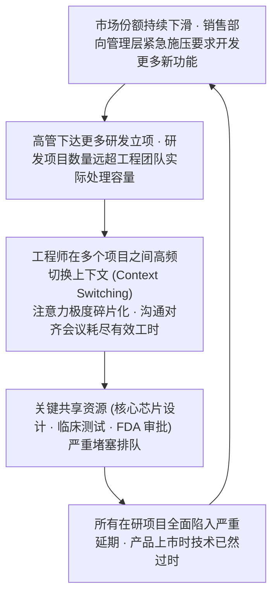
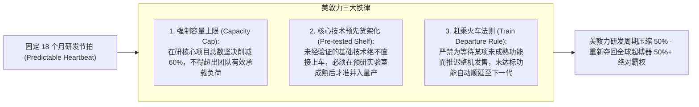

# Lec 17 美敦力（Medtronic）起搏器业务：组织节奏与时间节奏管理 (Medtronic Pacemakers: Rhythm and Time-Pacing)

> MIT Sloan School of Management · 15.912 Strategic Management of Innovation · Prof. Fiona Murray & Prof. Rebecca Henderson

## TL;DR

- 研发项目过载（Overload）的恶性循环：多任务并行导致所有项目全面延期，产品研发周期陷入泥潭。
- 美敦力（Medtronic）心脏起搏器经典案例：“我们找到了节奏（We've got rhythm!）”。
- 事件节奏（Event-Pacing）与时间节奏（Time-Pacing）的本质分野：从被动救火转向可预测的固定节拍发布。
- 确立 18 个月固定发布周期与简单规则（Simple Rules），将开发吞吐量提升数倍，夺回行业霸主地位。

## 研发过载的恶性循环：美敦力的至暗时刻 / The Breakdown at Medtronic

在医疗器械高科技产业中，心脏起搏器（Cardiac Pacemaker）直接维系着患者的心脏跳动与生命安全。在 20 世纪 70 年代至 80 年代初，美敦力（Medtronic）曾经是全球起搏器市场的绝对霸主，占据全美 60% 以上的市场份额。

然而，到了 80 年代中后期，美敦力的研发与交付系统突然陷入了灾难性的系统性瘫痪：
- **市场份额断崖式暴跌**：从 60% 暴跌至 28%，核心产品被后起之秀（如 CPI 和 Pacesetter）全面超越；
- **新产品研发周期失控拉长**：原本计划 18 个月完成的项目，平均拖延至 48 个月以上才能勉强上市；
- **全员疲于奔命却毫无成效**：研发工程师天天加班，但每个工程师同时被分派到 5-7 个不同的研发管线中，所有的技术专家都在前线大客户和合规审批部门之间扮演“紧急救火队员”。

菲奥娜·莫雷教授与丽贝卡·亨德森教授引导学员深入解剖这种在高科技企业中极其普遍的**“研发过载死亡飞轮（Overload Death Spiral）”**：

在这个恶性循环中，没有任何人是在偷懒，每个人都在拼尽全力奔跑；然而，整个研发系统却像堵死的高速公路一样，车流量越大，车速反而越接近于零。

## 从事件节奏转向时间节奏：建立组织的生理脉搏 / Event-Pacing vs. Time-Pacing

美敦力的新任领导层深刻意识到：必须从根本上重塑整个企业的运作节奏。这一场伟大的管理变革，被提炼为经典论文《我们找到了节奏（We've got rhythm!）》。

变革的核心，是彻底废黜**事件节奏（Event-Pacing）**，建立铁打的**时间节奏（Time-Pacing）**：

| 节奏管理维度 | 事件节奏驱动模式 (Event-Pacing - 旧模式) | 时间节奏驱动模式 (Time-Pacing - 美敦力新模式) |
| :--- | :--- | :--- |
| **触发驱动机制** | 由外部随机事件触发（如竞品发布了新功能、大客户突然提出定制要求、FDA 发布了新指南） | 由内部不可动摇的**固定时间节拍（Predictable Rhythm）**触发（如严格每 18 个月发布一代新平台） |
| **项目排产逻辑** | “什么时候所有功能都彻底做完，什么时候再上市”，工期无限推迟蔓延 | “发车时间严格固定，赶上哪节车厢就装哪个功能，赶不上的下期再上” |
| **团队心理状态** | 长期处于焦虑救火状态，精力被突发事件牵着鼻子走，无法专注深耕 | 节奏如同心跳般可预测，工程师能清晰预见未来两年的攻关里程碑 |
| **生态伙伴协同** | 供应商、临床医生和医院采购部门永远猜不透美敦力何时出新品，配套混乱 | 全产业链围绕美敦力的 18 个月发车节拍提前规划资本与临床试验 |

::: definition 时间节奏 (Time-Pacing)
时间节奏是指企业在充满高度不确定性与动态竞争的外部环境中，不被外部竞争对手的微小挑衅或突发事件打乱阵脚，而是像运转严密的机械钟表一样，按照预先设定的固定时间间隔（如每 12 个月、18 个月）有条不紊地推行新产品发布、技术升级、市场开拓与战略复盘的自律性管理范式。
:::

## 美敦力研发流程重构的简单规则 / Simple Rules in Product Development

为了将时间节奏在成千上万名研发人员中严格制度化，美敦力管理层确立了一套简单而刚性的**运作规则（Simple Rules）**。

在很多陷入研发泥潭的大企业中，管理层习惯于制定长达数百页的繁琐审批流程，结果反而制造了更多的等待与官僚摩擦。美敦力的管理层深刻认识到，解决过度拥挤的高速公路，唯一有效的方法不是增加更多的交警，而是实行严格的匝道限流和限时发车机制。通过将错综复杂的工程决策高度抽象为三条不可动摇的底线铁律，美敦力彻底打通了研发管道中的拥堵瓶颈：

美敦力的这场变革取得了惊人的商业奇迹：新产品开发周期从混乱的 48 个月稳定压缩至 18 个月以内，且良品率大幅提升，帮助美敦力在短短五年内夺回了全球心脏起搏器与植入式心律除颤器市场的半壁江山。整个企业的工程师重新找回了科研与交付的尊严，各职能部门在稳定可预测的节拍中实现了高度默契的无缝协同。

## 我的理解与实践洞察 / Personal Insight

组织的节奏感，是科技企业最高维的静气与自律。

::: insight 战略的从容，来自不可动摇的内在节拍
平庸的企业在面对市场竞争时，就像一只惊弓之鸟：对手一降价自己就慌乱跟进，对手推了个新概念自己就立刻逼着研发连夜加班拼凑。这种被外部世界牵着鼻子走的被动应战，只会让组织在疲于奔命中心力交瘁。
**真正卓越的伟大企业，体内都流淌着一台属于自己的强大心肺发动机**。
苹果之所以能每年 9 月精准发布新一代 iPhone、台积电之所以能每两年精准量产新一代先进制程，靠的绝不是运气，而是铁打的时间节奏与高度自律的工程容量管理。任凭外部风吹浪打，我自岿然按节拍行进。拥有内在节奏感的企业，能在惊涛骇浪中给客户、给员工、给整个产业链带来最极致的确定性，而这种确定性本身，就是最坚不可摧的战略护城河。
:::

## 思考题与实战研讨

1. 很多软件互联网公司崇尚“敏捷开发”与“持续集成部署（CI/CD）”，甚至做到每天发布数次微小更新。在汽车、航空航天或植入式医疗器械等涉及人身生命安全的硬科技领域，为什么不能盲目套用纯互联网的敏捷模式，而必须采用美敦力式的“长周期时间节奏”？
2. 结合本讲介绍的“研发容量上限（Capacity Cap）”法则，如果你是一家自动驾驶技术公司的 CTO，面对营销部门同时提报的 15 个客户定制功能需求，你将如何建立一套客观量化的“漏斗过滤机制”以防止研发团队陷入过载瘫痪？
