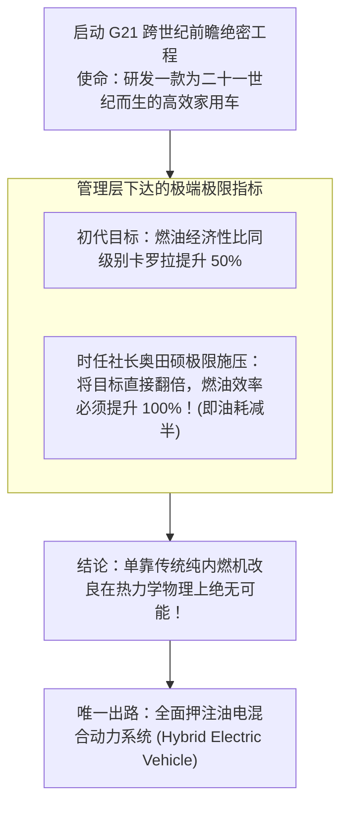
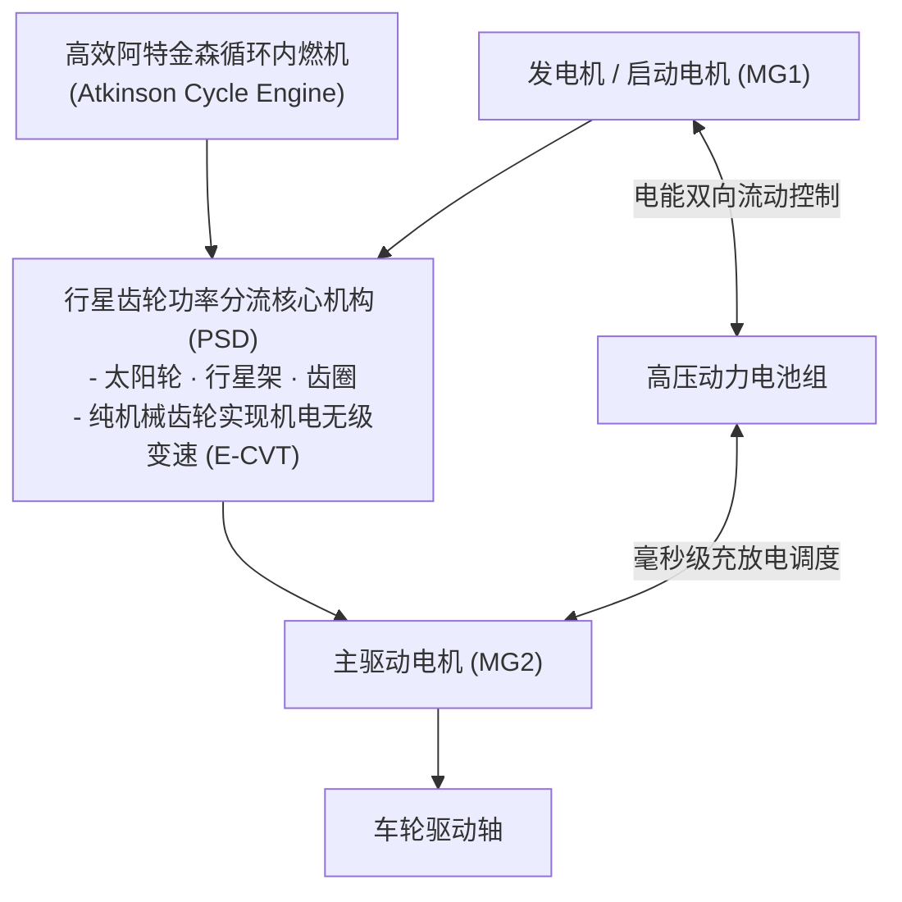

# Lec 18 丰田汽车：普锐斯（Prius）混合动力突破与前瞻布局 (Toyota: Launching the Prius Hybrid)

> MIT Sloan School of Management · 15.912 Strategic Management of Innovation · Prof. Fiona Murray & Prof. Rebecca Henderson

## TL;DR

- 丰田汽车（Toyota）绝密 G21 项目：在传统燃油车如日中天时，前瞻押注二十一世纪低碳环保动力总成。
- 混合动力系统（THS）的双重技术跨越：既要突破行星齿轮功率分流机械极限，又要驯服高压镍氢电池热失控。
- 战略时机抉择（Strategic Timing）：为何丰田管理层力排众议，决定将普锐斯上市时间提前一年（配合 1997 年京都议定书 COP3）。
- 长期主义研发投资：承受数年单台亏损的初期重压，最终构建全球混动垄断专利池与绿色品牌心智霸权。

## 丰田 G21 项目的诞生：未雨绸缪的战略危机感 / The Genesis of the G21 Project

在 20 世纪 90 年代初，丰田汽车凭借精益生产方式（TPS）和卓越的高品质家用车（如花冠 Corolla、凯美瑞 Camry），在全球市场上大杀四方，利润与现金储备冠绝全球汽车工业。

然而，正是在这种顺风顺水的巅峰时刻，丰田的高层领导者（以丰田英二、丰田章一郎为代表）却产生了一种深沉的**存在主义生存危机感**：
- **全球资源与环境的终极拷问**：随着全球汽车保有量向数亿台狂奔，石油枯竭危机与温室气体导致的全球变暖，必将在二十一世纪引发严苛的碳排放法律监管；
- **传统内燃机热效率逼近极限**：如果丰田仅仅停留在对传统发动机进行 1%-2% 的渐进式微调，一旦外部发生颠覆性的能源变革，丰田就会像当年的马车作坊一样被时代无情抛弃。

1993 年，丰田秘密启动了代号为 **G21（Globe 21st Century）** 的跨世纪研发工程：



这项决断，将丰田推上了一条前无古人、充满极端技术不确定性的豪赌之路。

## 混动技术构型的大决战：行星齿轮功率分流奇迹 / The Hybrid Synergy Drive Architecture

在决定开发油电混合动力后，工程团队面临着前所未有的工程绝症：
- **串联式混动（Series）**：发动机只发电，由电机驱动。虽然结构简单，但在高速巡航时能量经历“机械能-电能-机械能”两次转换，损耗极大；
- **并联式混动（Parallel）**：发动机和电机都能驱动车轮，但在电池馈电时无法实现高效无级调速；
- **丰田的划时代发明：功率分流混动（THS / Power-Split Device）**：内山内（Takeshi Uchiyamada）领导的天才工程师团队，发明了以一套**行星齿轮（Planetary Gear Set）**为核心的动力分配机构（PSD）：



这套精妙绝伦的机械系统，彻底取消了传统汽车脆弱易损的变速箱液力变矩器或摩擦离合器，实现了发动机永远运转在最佳热效率工况区间、减速制动能量 100% 回收的工业奇迹。

## 战略发射时机抉择：1997 年京都议定书的历史契机 / Strategic Timing and COP3

在普锐斯研发进入攻坚阶段时，丰田管理层面临着关于**技术发布时机（Technology Timing）**的重大博弈：
- **原定工程时间表**：工程团队原计划在 1998 年底或 1999 年初推出量产车，以便有充足的时间对尚未完全成熟的电池管理算法进行更充分的寿命可靠性测试；
- **历史性的政治机遇窗（1997 年 12 月）**：第三届联合国气候变化大会（COP3）即将在日本本土的**京都**隆重召开，届时全世界所有的国家元首、主流媒体与环保组织将齐聚一堂签署历史性的《京都议定书》。

```mermaid
flowchart LR
    StandardPath["按部就班路线 (保守稳健)<br/>1999 年上市 · 错失全球历史曝光聚光灯"]
    
    -->|社长奥田硕铁腕决断：强制工期提前整整一年！|
    
    BoldPath["普锐斯京都献礼战役 (极限攻坚)<br/>- 数千名工程师三班倒通宵排查电池过热 Bug<br/>- 1997 年 10 月正式量产下线，比 COP3 召开提前两个月！"]
    
    BoldPath --> GlobalTriumph["成为京都气候大会全球领导人官方接待指定用车<br/>瞬间抢占全球‘绿色低碳先锋’无上品牌心智！"]
```

丰田以极具胆魄的技术战略时机决断，将一款原本处于风险中的新车，转化为了全人类迈向绿色环保新时代的伟大工业图腾。

## 长期主义与专利护城河的构建 / Long-term Commitment and the Patent Fortress

普锐斯在商业上的真正神话，在于丰田长达二十年的坚守：
1. **承受初期的单台巨额亏损**：第一代普锐斯在日本售价定为亲民的 215 万日元（约合 1.7 万美元），而实际制造成本高达两倍以上，丰田每卖出一台都在亏损数千美元。但丰田将其视为长远的战略学费，坚决不降产能；
2. **筑牢不可逾越的专利铁幕**：丰田围绕 THS 行星齿轮功率分流架构申请了超过 24,000 项全球核心发明专利，将所有的替代结构堵得水泄不通，迫使通用、福特、大众等欧美巨头在长达二十年内无法绕过丰田的混动壁垒；
3. **规模效应驱动终极盈利**：随着普锐斯在全球累计销量突破千万台，混动电池和电机成本大幅摊薄 80% 以上，混动总成成本被做到了与传统燃油车平齐的惊人水平，普锐斯最终成为了丰田旗下利润最丰厚的全球超级现金牛之一。

## 我的理解与实践洞察 / Personal Insight

普锐斯的传奇，是战略远见战胜短期财报的最伟大史诗。

::: insight 商业的最高境界，是把未来的道德责任转化为今天的竞争武器
平庸的管理者做商业，永远是政策逼一下自己才动一下，甚至为了眼前的几分利润想方设法去公关、去游说、去钻环保法规的空子。
**而像丰田英二与奥田硕这样拥有世界格局的商业领袖，早在全世界环保法规尚未成型的二十年前，就以近乎自虐的极高道德标准来倒逼自身组织进化！**
在别人还在沉迷于大排量皮卡的短期利润时，丰田默默承受了数年的亏损，硬生生把一套人类历史上最复杂的机电一体化系统打磨成了全球公认的绿色黄金标准。当你把企业的命运与全人类文明的绿色未来紧紧绑在一起时，历史的顺风就必然会吹动你的风帆，助你跨越任何艰难险阻。
:::

## 思考题与实战研讨

1. 很多跨国车企（如通用汽车 EV1 项目）在 20 世纪 90 年代也曾研发过前沿新能源汽车，但因为短期无法盈利而草草将项目叫停甚至将车辆全部回收销毁。对比丰田普锐斯的案例，分析为什么在面对前瞻性技术创新时，企业最高管理层的战略定力往往比技术本身更具决定性？
2. 丰田在混动技术（HEV）上构建了极其严密的专利铁幕，导致欧美巨头与中国车企无法绕开。结合本讲理论，分析这种“极度严密的专有专利封锁”，是如何在客观上反向倒逼了全行业跳过油电混动、直接向纯电动（BEV）和插电混动（PHEV）进行更激进的技术范式大跨越的？
