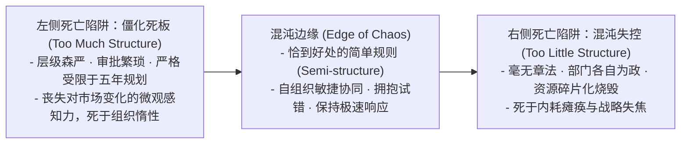
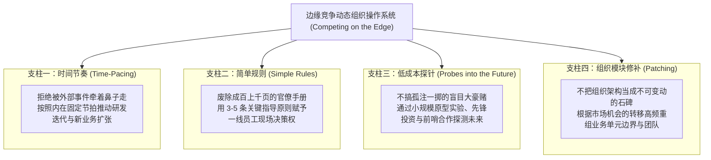
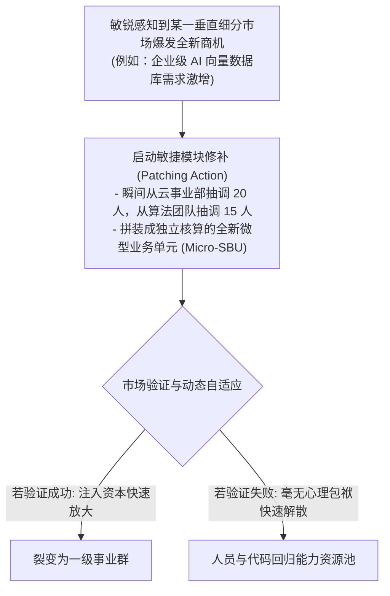

# Lec 19 创新组织动态学：负荷过载、时间节奏、简单规则与探针探测 (Organizational Dynamics: Overload, Time-Pacing, Simple Rules, and Probing)

> MIT Sloan School of Management · 15.912 Strategic Management of Innovation · Prof. Fiona Murray & Prof. Rebecca Henderson

## TL;DR

- 斯坦福大学凯瑟琳·艾森哈特（Kathleen Eisenhardt）边缘竞争理论（Competing on the Edge）。
- 高速动态多变市场（High-Velocity Markets）的生存之道：在僵化官僚与混沌失控之间的“混沌边缘”建立动态平衡。
- 组织动态学四大支柱：时间节奏驱动（Time-Pacing）、低成本未来探针（Probes）、简单规则（Simple Rules）与模块化修补（Patching）。
- 告别五年宏观规划幻觉：将企业视为由敏捷规则驱动的、具备自组织适应能力的复杂生命系统。

## 高速多变市场的生存困境：在僵化与混乱之间 / Competing on the Edge

在传统的相对静态、渐进演化的产业中，管理学界推崇长周期的五年战略规划、层级森严的职能分工以及详尽复杂的标准作业程序（SOP）。

然而，在当今以半导体、移动互联网、生物科技与人工智能为代表的**高速动态市场（High-Velocity Markets）**中，外部环境具有极强的不可预测性与非线性突变特征：竞争对手来自完全不相关的跨界领域、技术主导标准每隔两三年就被彻底推翻、客户需求瞬息万变。

斯坦福大学著名战略学大师凯瑟琳·艾森哈特（Kathleen Eisenhardt）与肖纳·布朗（Shona Brown）提出了享誉全球的**“边缘竞争（Competing on the Edge）”**理论。丽贝卡·亨德森教授与菲奥娜·莫雷教授在 15.912 的第十九讲中，系统解构了现代科技企业驾驭复杂性的组织动态学体系：

卓越的科技企业，必须像杂技演员一样，始终让自己游走在**“混沌边缘（The Edge of Chaos）”**——既不过度设计导致僵死，也不放任自流导致失控。

## 边缘竞争的四大战略管理支柱 / Four Pillars of Organizational Dynamics

艾森哈特教授提炼了企业在不可预测市场中实现持续进化的四大动态机制：

### 1. 简单规则的降维威力（Simple Rules）
复杂多变的环境需要的是简单的行动规则，而不是复杂的官僚流程。例如：
- **思科公司（Cisco）的早期并购简单规则**：“被收购公司员工人数不得超过 75 人，且其中 70% 必须是工程师；收购标的必须在思科现有产品线 50 英里以内”；
- **雅虎（Yahoo!）早期的战略合作规则**：“任何外部合作协议必须在 48 小时内完成初审，且必须满足为雅虎带来百万级独立 UV 的门槛”。

### 2. 低成本探针机制（Low-Cost Probing）
当未来不可预测时，试图在白板上推导最优解是徒劳的。企业必须像潜水艇发射声呐一样，向未来投放多样化的**探针（Probes）**：
- 举办开发者黑客松大赛，测试全新 API 的吸引力；
- 成立小规模前哨实验室，打造简陋但可交互的最小可行性产品（MVP）；
- 以数百万美元的小额股权投资参股 10 家不同技术路线的初创公司。即使其中 8 个探针失败，其沉淀的数据和经验也足以让企业提前看清未来的主流航道。

## 组织模块修补（Patching）：敏捷重组业务单元 / The Art of Organizational Patching

传统企业将组织架构视为每隔三到五年才动一次的“大手术”，每一次部门拆分或合并都伴随着漫长的政治斗争与人员动荡。这种僵化静态的组织观，使得企业在面对瞬息万变的技术细分市场时显得极其笨重。

而在边缘竞争的组织动态学中，组织架构被视为可以随时调整的**乐高积木拼装（Patching）**。当外部市场涌现出全新的技术断层或细分客户需求时，管理层无需召开旷日持久的组织变革委员会，而是像外科手术一样，快速从不同既有部门中抽调精锐骨干，迅速拼装出一个高度自治、直接面向新战场的微型突击作战单元。

艾森哈特教授将这种敏捷修补的动态生命周期过程抽象为严密的微观进化回路：

通过这种高频、低摩擦的微观修补，企业能够让自身的组织形态时刻与外部市场机会的微观拓扑结构保持高精度的同构映射。失败的项目被迅速关停且不带有任何道德污点，成功孵化的种子则立即获得全公司资本的疯狂灌溉。组织不再是一张固定的官僚层级树，而是一张生生不息、随时根据前线战火重新编织的动态神经网。

## 我的理解与实践洞察 / Personal Insight

边缘竞争理论，是治愈企业官僚主义大企业病最透彻的解药。

::: insight 优秀的公司像军队，伟大的公司像生命体
许多管理者有一种致命的“控制狂情结”：渴望把企业打造成一座秩序井然、分毫不差的瑞士钟表，每一位员工都必须按照详尽的手册去打卡、审批和汇报。
**然而，机械钟表在稳定的房间里可以走得很准，一旦遇到大地震就会瞬间散架！**
在技术巨浪呼啸而来的时代，真正能够穿越危机的组织，从来不是冰冷死板的机械城堡，而是像热带雨林一样的自适应生命体。通过简单规则赋予前线细胞充分的自主活力，通过密集探针感知未知的危险，通过模块修补随时蜕变新生。学会在不确定性的刀刃上保持动态平衡，企业才能在狂暴的时代洪流中破浪前行。
:::

## 思考题与实战研讨

1. 很多大型传统企业在面临数字化转型时，引入了厚达两百页的“敏捷转型管理规范手册”并设立了七个新的跨部门审批委员会。运用艾森哈特“简单规则（Simple Rules）”与“混沌边缘”理论，诊断为什么这种“试图用过度官僚流程去推行敏捷”的做法注定会走向惨败？
2. 结合本讲介绍的“低成本探针（Probing）”方法论，为一家面临生成式 AI 冲击的传统教育出版集团，设计一套低成本、高反馈密度的未来探针实验组合（列出至少 3 项具体的微观探针动作）。
