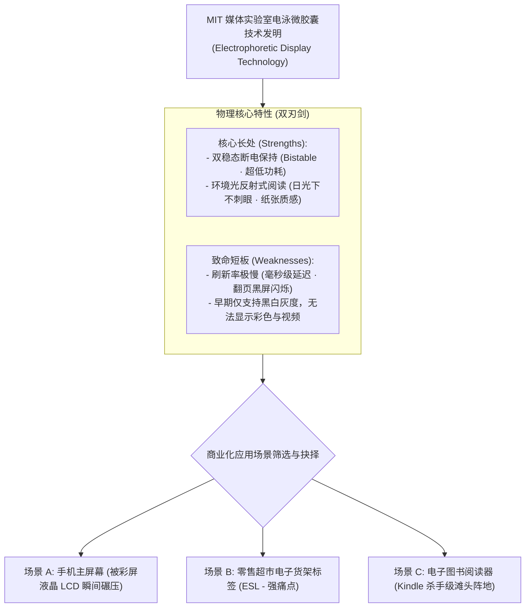
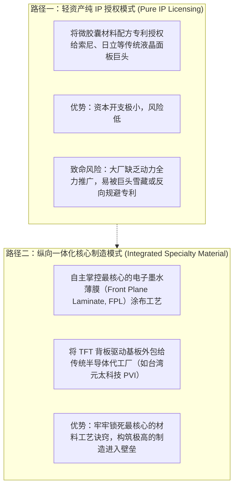

# Lec 02 电子墨水（eInk）商业化：前沿技术的利基破局与能力构建 (Commercializing Emerging Tech: The eInk Case)

> MIT Sloan School of Management · 15.912 Strategic Management of Innovation · Prof. Fiona Murray & Prof. Rebecca Henderson

## TL;DR

- 颠覆性前沿技术在商业化初期普遍面临性能缺陷与高昂成本，必须寻找滩头阵地（Beachhead Niche）。
- 麻省理工学院媒体实验室孵化的电子墨水（eInk）案例：从微胶囊电泳显示技术到商业化场景抉择。
- 场景优先级评估框架：户外强光可读性与超低功耗是 eInk 的核心特性，但刷新率低决定了其无法用于动态视频。
- 初创企业能力构建路线图：在自主建厂制造与授权轻资产运营之间进行审慎的权衡抉择。

## 实验室技术走向市场的生死鸿沟 / The Commercialization Chasm

在大学实验室中诞生的顶尖前沿科学技术，往往面临着严重的“商业化鸿沟（Commercialization Chasm）”：
- 在实验室中，技术只要在理想环境下成功点亮一次即可发表顶刊论文；
- 但在商业世界中，产品必须在零下 20 度到零上 60 度的恶劣环境中、经受数万次摔落与持续使用，依然保持 99.99% 的良品率与极其低廉的量产成本。

很多技术先驱之所以在中途遗憾夭折，并非因为基础原理不够先进，而是因为团队缺乏在混乱模糊的市场中寻找应用切入点的战略敏锐度。一项新技术往往拥有数十种潜在的应用场景，如果企业在每一个场景上都浅尝辄止地投入资源，就会迅速烧光宝贵的初期风险投资。

麻省理工学院媒体实验室（MIT Media Lab）孵化的 **电子墨水公司（E Ink Corporation）**，是探讨前沿硬科技商业化路径的教科书级样本。科学家约瑟夫·雅各布森（Joseph Jacobson）发明了电泳微胶囊显示技术，但初创团队从第一天起就面临着物理特性上的极端矛盾：

创始人团队必须在有限的风险投资资金耗尽之前，为这项奇特的新技术找到最完美的商业化落地土壤。

## 场景优先级评估：寻找非对称竞争优势 / Prioritizing Market Opportunities

在评估 eInk 的潜在应用市场时，菲奥娜·莫雷教授引导学员使用严密的**技术-市场匹配矩阵（Tech-Market Fit Matrix）**：

| 候选商业化场景 | 该场景对显示屏的核心诉求 | eInk 技术的匹配度与竞争格局 | 最终战略优先级评估 |
| :--- | :--- | :--- | :--- |
| **手机与笔记本主屏** | 极高刷新率、全彩高清、支持流畅播放视频与动画 | **严重不匹配**：eInk 刷新率慢如蜗牛，完全无法与彩色 TFT-LCD 竞争 | **坚决放弃**（盲目进入必死无疑） |
| **户外大型广告看板** | 远距离强光可视、耐候性强、低功耗 | **部分匹配**：双稳态低功耗具有优势，但大型户外看板需要极高的物理拼缝精度与高额初始造价 | **战略观察**（作为中远期探索） |
| **超市电子价签 (ESL)** | 数年不换电池、强光下清晰、每天仅需刷新一两次价格 | **高度匹配**：功耗极低且反射阅读体验好，能为零售巨头节省海量更换纸质标签的人工成本 | **高优先级利基市场**（稳健现金流） |
| **电子书阅读器 (E-Reader)** | 长时间沉浸阅读不伤眼、续航数周以上、静态文本为主 | **完美天作之合**：纸质般阅读质感与强光下可读性彻底击中重度书迷痛点，翻页慢的缺陷被完全包容 | **核心滩头阵地 (Beachhead Market)** |

::: definition 滩头阵地市场 (Beachhead Market)
滩头阵地是指新兴前沿技术在进入主流大众市场之前，所攻占的第一个具备极强痛点、客户对技术早期缺陷高度包容、且传统竞品无法有效满足的细分利基市场。一旦占领滩头阵地，企业即可获得生存现金流与真实数据反馈，进而以此为跳板向主流大市场扩张。
:::

## 商业模式与能力构建的决断：重资产自建 vs. 授权 / Business Model & Capability Choices

初创企业在确立了电子阅读器这一滩头阵地后，面临着另一个关乎生死存亡的战略决断：**我们究竟应该成为一家制造重资产显示面板的工厂，还是一家输出专利配方的轻资产公司？**

如果选择轻资产纯 IP 授权模式，公司可以维持极小的团队规模，迅速将专利授权给飞利浦、索尼等显示器巨头收取版税；但这种模式的致命风险在于大厂往往缺乏推广新技术的动力，初创企业随时面临被边缘化甚至被雪藏的命运。而如果选择重资产自建面板工厂，数千万美元的巨额资本开支将瞬间压垮初创企业的现金流。

为了在资本约束与核心技术掌控之间取得精妙平衡，eInk 的管理层深入解构了显示屏制造的价值链条：

eInk 最终选择了**掌握核心材料薄膜、外包标准显示模组总装**的混合战略，并最终被台湾元太科技（PVI）战略并购整合，成功在亚马逊 Kindle 爆发的前夜完成了量产工艺的极限爬坡。这种既保住了核心材料独占性、又借助了外部成熟制造生态的权变路径，为所有硬科技初创企业提供了无价的典范。

## 我的理解与实践洞察 / Personal Insight

前沿技术的商业化，是一场漫长而孤独的战略远征。

::: insight 发现技术的短板，往往比夸大技术的长处更具商业智慧
许多科技创业团队在向投资人推介时，把自己的技术吹得无所不能，试图一下子颠覆全世界所有行业。
**然而，真正能够活下来的科技企业，恰恰是最早对自身技术的局限性保持清醒认知的那一批人**。
eInk 的伟大之处，不在于它有多快，而在于它的管理团队极其清醒地认识到自己“慢得像一张纸”。他们不与强大的液晶彩电正面硬刚，而是专门去寻找那些“原本就需要像纸一样慢、像纸一样安静”的阅读与价签场景。在自己唯一的物理长板上构筑绝杀优势，把短板转化为专注的护城河，这才是硬科技商业化的最高境界。
:::

## 思考题与实战研讨

1. 当苹果 iPad 在 2010 年横空出世并以绚丽的彩色多媒体触控屏席卷全球时，很多人预言搭载黑白 eInk 屏幕的亚马逊 Kindle 必死无疑。然而十几年过去了，Kindle 为何依然能在深度阅读市场保持庞大的忠实用户群？
2. 结合本讲案例，探讨一家研发出新型柔性固态电池的高科技初创公司，在面临消费电子巨头压价与汽车动力电池高昂安全认证壁垒时，应如何选择自己的“滩头阵地市场”？
