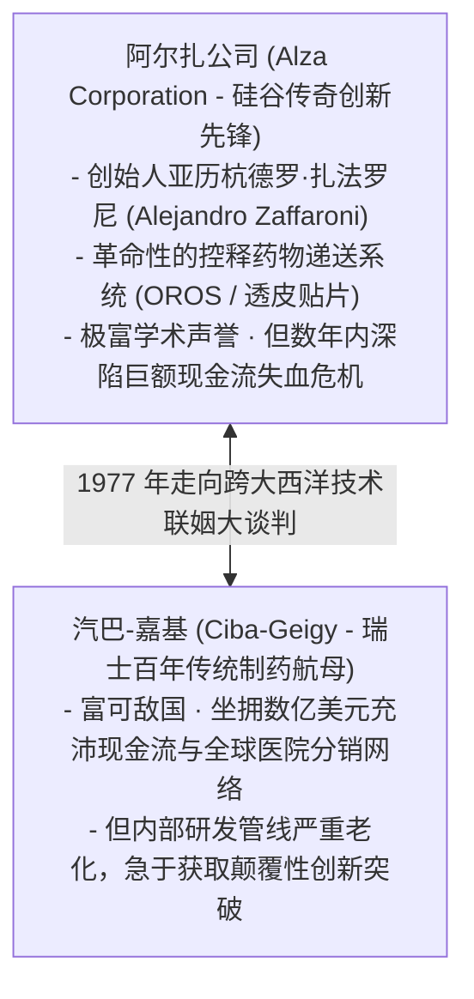
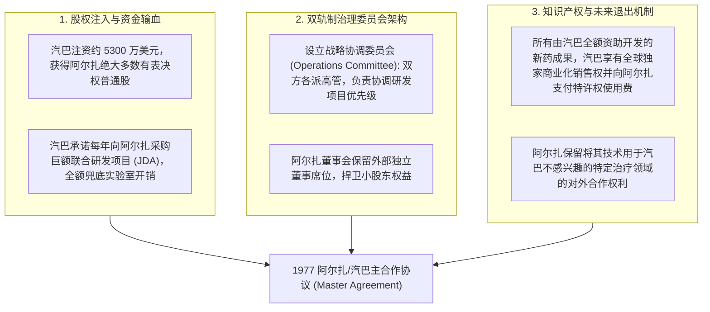

# Lec 08 阿尔扎与汽巴（Alza/Ciba 1）：跨企业技术交易与合作协议结构设计 (Structuring Inter-Firm Technology Deals: The Alza/Ciba Case I)

> MIT Sloan School of Management · 15.912 Strategic Management of Innovation · Prof. Fiona Murray & Prof. Rebecca Henderson

## TL;DR

- 技术交易市场（Markets for Technology）的深刻摩擦：阿罗信息悖论（Arrow's Information Paradox）与敲竹杠风险。
- 阿尔扎（Alza）案例第一部分：药物递送系统（DDS）先驱面临的现金流断裂危机。
- 跨组织技术合作交易架构三难选择：单纯专利授权、少数股权注资 vs. 整体被兼并收购。
- 1977 年阿尔扎与瑞士制药巨头汽巴-嘉基（Ciba-Geigy）世纪大联盟的复杂契约设计。

## 技术交易市场的微观经济学摩擦 / Friction in Markets for Technology

如果技术像大豆或原油一样是一种普通的标准化商品，那么拥有技术的创新者只需在公开市场上挂牌出售，买卖双方一手交钱一手交货，交易即可顺畅达成。

然而，诺贝尔经济学奖得主肯尼斯·阿罗（Kenneth Arrow）揭示了一个著名的**阿罗信息悖论（Arrow's Information Paradox）**：
- 买方在出钱购买某项技术之前，必须充分了解该技术的全部技术细节和秘密原理，才能客观评估其真实商业价值；
- 但一旦卖方把全部技术秘密向买方彻底公开展示，买方就已经事实上掌握了该技术，便不再有动力向卖方支付高昂的采购对价！

加之技术资产具有极高的**资产专用性（Asset Specificity）**，导致跨企业之间的技术交易充斥着信息不对称、道德风险（Moral Hazard）以及被对方敲竹杠（Hold-up）的巨大商业陷阱。

丽贝卡·亨德森教授与菲奥娜·莫雷教授在 15.912 的第二十讲中，引入了商业史上最耐人寻味、最具争议的跨企业技术战略结盟经典标杆——**阿尔扎公司与汽巴-嘉基联盟案（Alza and Ciba-Geigy）**：

这两家在规模、文化、地理与商业诉求上截然不同的企业，究竟该如何设计一份兼顾双方利益的世纪技术合作大契约？

## 阿尔扎的战略困境：弹尽粮绝的硬科技先驱 / The Crisis at Alza

阿尔扎公司开创了现代医学界一个全新的领域——**药物递送系统（Drug Delivery Systems, DDS）**：
- **颠覆性医学价值**：传统服药方式（打针、口服药丸）会导致体内药物浓度经历剧烈的波峰与波谷，容易引发毒副反应或药效中断。阿尔扎通过微孔渗透泵（OROS）和皮肤贴片技术，实现了药物在人体内长达数天甚至数周的平稳恒速微量释放；
- **残酷的财务绝境**：由于医生处方习惯极其保守，加之美国 FDA 对这种前所未有的全新给药器械审查极其缓慢，阿尔扎在市场上推出的首批两款眼科与妇科控释产品销售惨淡。到了 1977 年，阿尔扎的现金流已耗尽至不足三个月，濒临破产倒闭清算的生死关头。

阿尔扎的创始人扎法罗尼必须立刻为公司寻找到充沛的外部战略造血通道。

## 交易结构的三种候选方案深度博弈 / Evaluating Three Deal Structures

阿尔扎与汽巴-嘉基的高管团队围绕三种完全不同的合作交易架构展开了数轮秘密推演：

| 候选交易模式 | 交易契约具体设计条款 | 对初创企业阿尔扎的利弊 | 对跨国巨头汽巴-嘉基的利弊 |
| :--- | :--- | :--- | :--- |
| **方案 A：传统单项产品专利授权 (Standard Product Licensing)** | 汽巴向阿尔扎采购一两个特定药物分子使用 OROS 贴片的全球开发权，支付预付款与里程碑提成 | **利**：保持阿尔扎绝对的组织独立性；**弊**：解不了近渴，单笔授权金无法填平全公司庞大的研发赤字 | **利**：风险极其有限，试错成本极低；**弊**：无法垄断阿尔扎平台技术的全部潜在商业价值 |
| **方案 B：整体兼并收购 (Complete Acquisition / Buyout)** | 汽巴以溢价现金全盘收购阿尔扎 100% 股权，将其并入汽巴作为专属药物递送研发中心 | **利**：股东拿到现金体面套现退出；**弊**：扎法罗尼与数百名硅谷顶尖科学家的创业梦想彻底破灭，沦为跨国大药企的附庸部门 | **利**：完全将这项未来核心技术占为己有；**弊**：硅谷科学家极可能因文化冲突而集体离职，收购可能沦为一地鸡毛 |
| **方案 C：复杂战略联盟与控制权对赌 (Hybrid Strategic Alliance - 最终入围)** | 汽巴注资巨额现金，收购阿尔扎多数有表决权股权，并承诺承担未来数年的巨额联合研发费用；同时设立极度复杂的治理委员会与独立性保护条款 | **利**：瞬间获取数千万美元救命现金，保住上市地位与独立运作；**弊**：随时面临被巨头剥夺研发自主权与商业选择权的巨大风险 | **利**：以相对较低成本锁死全球最顶尖的 DDS 平台技术，分享长期红利；**弊**：跨国跨文化协同管理难度登峰造极 |

## 1977 年阿尔扎/汽巴历史性大契约的精密架构 / Anatomy of the 1977 Master Agreement

经过数月艰苦卓绝的谈判，双方在 1977 年正式签署了一份长达数百页的里程碑合作协议，其契约设计之精密，成为日后高科技跨企业治理的经典教科书。

在这份契约中，阿尔扎的管理团队竭尽全力在获取救命现金与捍卫自身技术灵魂之间搭建一道坚固的防火墙。协议必须解决三个看似不可调和的核心张力：汽巴要求对巨额研发资金拥有绝对的知情权与投向审查权，而阿尔扎则坚决拒绝沦为瑞士总部的纯外包车间；汽巴要求垄断由其资助开发的所有新药的商业化成果，而阿尔扎则必须保留将底层递送技术授权给其他非冲突领域的生命线。

双方最终将复杂的利益平衡抽象为三大互相支撑的支柱性条款体系：

这份协议看似完美兼顾了初创公司的生存与跨国巨头的雄心。在纸面上，阿尔扎保住了上市公司的合法地位与部分研发自主权，而汽巴则以相对极低的价格锁定了可能统治下一代医药市场的关键平台技术。然而，当纸面的法律条文进入活生生的跨国组织执行阶段时，一场震动全球医药界的文化与战略大地震，正在大西洋两岸悄然酝酿。

## 我的理解与实践洞察 / Personal Insight

技术交易的架构设计，是商业智慧在法律与人性层面的最高博弈。

::: insight 商业契约能锁定权利与金钱，却永远无法强行锁定信任
在商业谈判的会议室里，顶尖的华尔街投行家与律师们常常自豪于自己设计了一份天衣无缝、条款严密的完美协议。
**然而，商业世界最残酷的真相在于：合同越是复杂精密，往往越说明双方在骨子里缺乏深层次的信任！**
阿尔扎与汽巴的这份协议，几乎穷尽了人类在跨国公司治理中所能想象的一切防火墙与仲裁机制。扎法罗尼以为只要把规则写得清清楚楚，巨头的资本就能心甘情愿地成为自己科学梦想的仆人。
然而，当硅谷敏捷叛逆的极客文化，撞上瑞士古板层级的日内瓦官僚大机器，纸面的条文就瞬间沦为了双方互相提防、扯皮甚至反目成仇的绞索。技术战略家必须铭记：任何不建立在价值观与战略目标高度共识基础上的商业联姻，其条款越严密，日后破裂时的伤口往往就越深。
:::

## 思考题与实战研讨

1. 运用阿罗信息悖论与交易成本经济学（TCE）中的“资产专用性”理论，分析为什么阿尔扎公司在 1977 年无法通过“在公开市场上向多家跨国药企分别进行小额专利拍卖”的方式来解决自身的财务危机？
2. 在很多高科技初创企业与巨头的合作中，巨头常常要求在注资协议中加入“全面右倾否决权（Right of First Refusal, ROFR）”，即初创企业未来如果与其他第三方开展技术合作，巨头拥有优先匹配否决权。如果你是初创企业的法律战略顾问，你将如何向创始人解释该条款可能潜藏的“战略锁死毒丸”风险？
