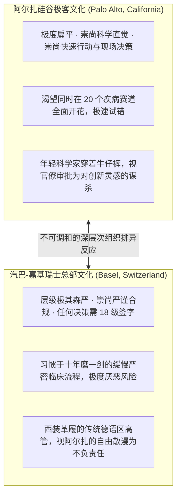
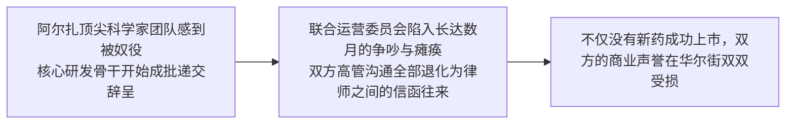
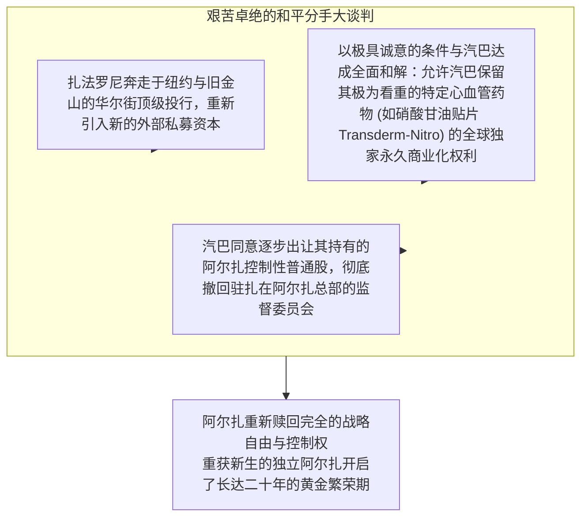

# Lec 21 阿尔扎与汽巴（Alza/Ciba 2）：技术联盟管理与冲突博弈 (Managing Inter-Firm Technology Partnerships: The Alza/Ciba Case II)

> MIT Sloan School of Management · 15.912 Strategic Management of Innovation · Prof. Fiona Murray & Prof. Rebecca Henderson

## TL;DR

- 合作签约只是万里长征第一步，跨企业技术联盟面临长期的投后治理与执行摩擦。
- 1977-1979 年阿尔扎与汽巴合作实战复盘：硅谷敏捷创新文化与瑞士严谨官僚体制的史诗级文化碰撞。
- 战略视界的根本错位：初创企业的生死时速 vs. 跨国巨头的缓慢冗长五年规划。
- 最终的和平分手与教训：扎法罗尼如何通过艰难的资本重组赎回公司控制权，重获新生。

## 蜜月期的终结：大西洋两岸的文化大地震 / The Reality of Post-Deal Implementation

1977 年阿尔扎与汽巴-嘉基签署合作协议时，双方的高管曾在香槟酒与闪光灯前热烈拥抱，宣称这是“现代生物医药科技与全球产业资本最完美的世纪联姻”。

然而，正如菲奥娜·莫雷教授与丽贝卡·亨德森教授在 15.912 第二十一讲中所指出的：**跨企业战略联盟的签约就像婚礼，婚礼再热闹奢华，也无法保证后续柴米油盐日常婚姻生活的幸福！**

协议签署仅仅六个月后，大西洋两岸的联合工作委员会就彻底陷入了冰冷的无休止内耗之中：

这场跨国联姻在组织行为学层面展现出了人类商业史上最剧烈的**文化排异反应（Cultural Rejection）**。

## 战略视界与商业优先级的根本错位 / Strategic Horizon Misalignment

文化冲突只是表象，双方真正致命的裂痕在于**商业利益与战略视界（Strategic Horizons）的根本背道而驰**：

### 1. “救命稻草”与“边角料”的认知差距
- **阿尔扎的视角**：每一款在研的新贴片都是关乎公司生死存亡的命根子，必须集中全公司兵力以秒为单位推进临床申报；
- **汽巴的视角**：阿尔扎的所有项目加起来，在汽巴每年数十亿美元的庞大全球药物销售盘子中，不过是占比不足 2% 的前沿探索实验；汽巴总部的高管根本不会为了阿尔扎的一两个项目去打破自己每年一度的既定预算审批节拍。

### 2. 研发优先级的生死拉锯战
汽巴的高管开始运用协议中赋予的控制权，强行干涉阿尔扎的研发方向：
- 汽巴要求阿尔扎中止具有极高市场前景但处于非汽巴传统优势领域的新药贴片研发；
- 强行将阿尔扎最顶尖的科学家调去攻关汽巴内部那些行将过期的传统老旧小分子药物的微调改剂型项目，以帮助汽巴应对仿制药的专利悬崖挑战；
- 阿尔扎的科学家们深感自己从“改变人类医学未来的探险家”，被降格为了“跨国药企延长专利寿命的流水线苦力”，组织士气跌入冰点。

## 扎法罗尼的救赎：跨国联盟的和平解体大重组 / The Great Unwind and Rebirth

到了 1978 年底，阿尔扎的创始人扎法罗尼终于清醒地认识到：如果继续与汽巴纠缠下去，阿尔扎不仅无法做大，其最宝贵的灵魂——**前沿探索的技术创新活力**——将在瑞士总部的官僚公文中被彻底窒息而亡。

扎法罗尼展现了顶级商业领袖的非凡魄力与卓越的资本运作手腕，开启了一场被哈佛商学院奉为经典的**“跨国联盟和平解体大重组（The Great Unwind, 1978-1979）”**：

重获自由的阿尔扎如猛虎归山，随后十年中凭借 OROS 和贴片技术，先后为强生、辉瑞等全行业巨头成功开发出多款年销数十亿美元的重磅炸弹药物，并在纳斯达克迎来了辉煌的市值爆发。

## 跨企业技术联盟治理的四大传世法则 / Four Lessons for Alliance Governance

丽贝卡·亨德森教授为全课总结了从阿尔扎/汽巴案中淬炼出的跨组织技术治理军规：
1. **警惕“伪装成股权投资的全面控制”**：初创企业在引入大企业战略投资（CVC）时，必须在公司章程中牢牢筑牢“研发技术自主决策权”的防火墙，坚决杜绝大公司高管直接插手实验室日常优先级；
2. **设立明确的文化翻译官（Cultural Translators）**：在两个异质组织交界处，必须选派那些既懂小公司敏捷创新语言、又深谙大集团政治流程的高情商管理者担任联盟联络官；
3. **在签约第一天就必须写明退出机制（Pre-nuptial Agreement）**：在双方关系最好的签约日，就必须以白纸黑字明确约定：一旦未来战略发生不可调和的冲突，双方将依据何种价格公式和资产剥离程序和平分手；
4. **保持小团队的物理与心理边界隔离**：大公司对被投资的技术初创企业最好的支持，是提供资金、渠道与制造资源，而不是把自己的管理制度、差旅报销系统和冗长会议强加在初创团队头上。

## 我的理解与实践洞察 / Personal Insight

技术联盟的艺术，是商业竞合关系中最深刻的照妖镜。

::: insight 商业合作的最高境界，是求同存异，而不是强行改造对方
在很多大企业的高管心智中，有一种根深蒂固的‘殖民者心态’：我既然出了钱、占了大股，你就必须按照我的规矩来，把你改造成我熟悉的样子。
**然而，大企业恰恰忘记了：你当初之所以愿意出巨资投资这家初创公司，正是因为它拥有你所没有的狂野创新活力！**
如果你用大公司的层层审批和官僚制度去强行阉割它，你最终得到的不过是另一个反应迟钝、平庸平庸的内部部门。卓越的战略家深知包容与留白的真谛：保护它的野性、滋养它的灵感，在适当的距离之外为它输送养分。相濡以沫不如相忘于江湖，当合作走向僵局时敢于体面放手，这不仅是一种高尚的商业品格，更是一种能让彼此资产价值最大化的终极理性。
:::

## 思考题与实战研讨

1. 结合本讲案例，探讨为什么在当今科技界，大型跨国科技巨头（如微软对 OpenAI、谷歌对 DeepMind）在开展千亿美元级的战略深度合作时，普遍严格放弃对初创公司的日常运营控制，而是设立了极为特殊的非营利董事会结构或独立治理实体？
2. 如果你是一家拥有全球领先光伏电池新材料专利的初创科技公司的创始人，某全球能源央企提出以现金收购你 51% 的控股权并承诺包销全部产能，对照阿尔扎与汽巴的教训，你将在投资协议的“章程治理”中设立哪三条绝对不可退让的红线条款？
