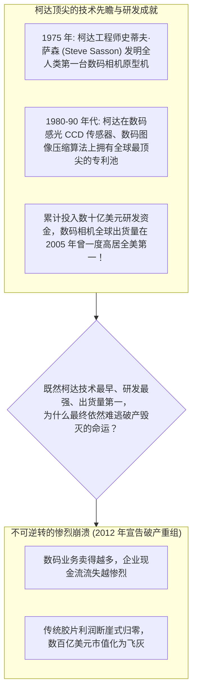
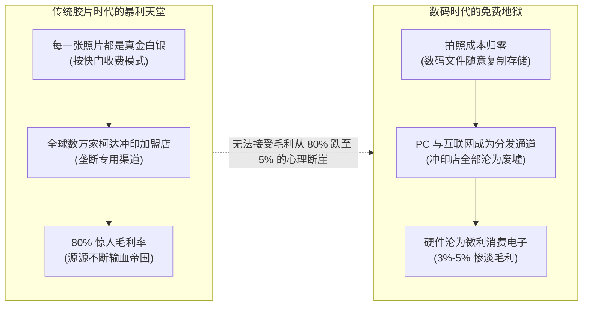

# Lec 22 柯达与数码革命：颠覆性变革下的执行困境与黄昏 (Kodak and the Digital Revolution: Execution Failure in Disruptive Shift)

> MIT Sloan School of Management · 15.912 Strategic Management of Innovation · Prof. Fiona Murray & Prof. Rebecca Henderson

## TL;DR

- 商业史上最震撼的黄昏神话：百年影像胶片霸主伊士曼柯达（Eastman Kodak）的破产启示录。
- 致命的认知误区澄清：柯达并非对数码技术无知，全世界第一台手持数码相机恰恰是柯达工程师在 1975 年发明的！
- 商业模式的吸毒成瘾：胶片与相纸“剃刀与刀片（Razor-and-Blade）”高达 80% 的暴利毒药。
- 执行维度的全面崩塌：从化学文化向电子与软件文化的转型阵痛，最终沦为颠覆性创新的祭品。

## 世纪巨人的轰然倒塌：破除柯达历史的神话误区 / Demystifying the Kodak Myth

在商业教科书和大众媒体的粗浅描述中，百年影像巨头**伊士曼柯达公司（Eastman Kodak）**的破产往往被描绘成一个极其脸谱化的悲剧：“一个沉睡在传统胶卷功劳簿上的傲慢老人，因为盲目无知、忽视了数码科技的崛起，最终被时代列车无情碾死。”

然而，在 15.912 的第二十二讲中，丽贝卡·亨德森教授与菲奥娜·莫雷教授向全体学员展示了真实商业历史血淋淋的残酷真相：**柯达绝不是盲目无知的技术弃儿！柯达是全人类数码影像技术的始祖与开山鼻祖！**

这一悖论将全体学员引向了技术战略最残酷的深水区：**当一家企业在技术研发上毫无过错、甚至遥遥领先时，它究竟是如何在商业模式与组织执行的绞肉机中，一步步把自己推向万劫不复的深渊的？**

## 暴利的毒药：剃刀与刀片商业模式的心理依赖 / The Razor-and-Blade Addiction

柯达真正不可救药的宿疾，深植于其历经百年建立起来的、商业史上最赚钱的商业模式——**“剃刀与刀片模式（Razor-and-Blade Model）”**：
- **剃刀（低价相机硬件）**：柯达以极其低廉、甚至微亏的价格向大众销售简易胶卷相机，把相机普及到全球千家万户；
- **刀片（终身高频暴利耗材）**：消费者每一次按下快门，就必须购买一卷柯达黄盒子胶卷、冲洗一卷底片、打印一张昂贵的相纸并消耗一瓶药水。胶片与相纸的毛利率高达 **70% 到 80%**，为柯达带来了数十亿美元永不枯竭的惊人现金奶牛。

数码相机彻底消灭了“胶卷”和“冲洗相纸”这两个环节！在数码时代，消费者拍一千张照片不需要花费一分钱买耗材。对于习惯了吸食 80% 暴利鸦片的柯达管理层而言，让他们全力以赴去转型做一个单台硬件毛利率不足 5%、还充斥着索尼、三星、松下等代工巨头惨烈杀价的数码硬件组装商，在财务理性上等同于“主动跳下悬崖自杀”。

## 执行维度的全面溃败：化学文化与电子文化的死斗 / Execution Failure and Cultural Clash

在柯达内部，推动数码转型遭遇了组织肌体最深层的抗拒。丽贝卡·亨德森教授深入解构了柯达内部两股文化力量长达三十年的生死内耗：

| 组织维度 | 传统化学胶片阵营（帝国正统掌权派） | 新兴数码影像阵营（边缘被排挤异类） |
| :--- | :--- | :--- |
| **底层核心知识** | 涂布工艺、银盐感光化学、精密配方合成 | 半导体微电子、软件编程、图形压缩算法、通信网络 |
| **组织社会地位** | 盘踞公司董事会与执委会全部要职，掌握 90% 预算 | 办公室被发配至远郊地下室，被嘲笑为“只烧钱不产生利润的玩具” |
| **对产品的终极评判** | 追求在放大镜下颗粒细腻、色彩温润的“柯达一刻（Kodak Moment）” | 接受早期数码仅有数十万像素的粗糙，看重即时预览、分享与便捷性 |
| **管理层的应对动作** | 试图发明“数码与胶片的混合四不像”（如昂贵而鸡肋的 PhotoCD、APS 胶卷系统） | 呼吁彻底砍掉传统胶片生产线，全面向纯数字工作流转型 |

柯达历任 CEO 并非看不到未来，他们甚至任命了数码部门的主管，但每一次当传统胶片部门主管拿出一份显示“本季度胶片依然贡献了全公司 95% 净利润”的财报时，管理层就会再次动摇，把原本批给数码团队的预算悄悄抽调回去补贴那些亏损的老旧胶片工厂。

## 致命的半吊子妥协：APS 系统的战略滑稽剧 / The Tragedy of Half-Hearted Transitions

柯达在转型过程中最令人啼笑皆非的败笔，是耗资超过 10 亿美元研发的 **APS（先进摄影系统）**。

这项技术本质上是一场**“向旧利益集团全面投降的妥协怪胎”**：柯达在胶卷底片上加装了一条磁条，试图用磁条记录数码拍摄信息，但用户依然必须把胶卷拿到冲印店去洗成纸质照片！

柯达试图通过这种“改良版胶卷”，既展示自己的高科技，又死死保住全球数万家冲印店和相纸工厂的既得利益。然而，市场对这种扭捏作态的妥协产品报以无情的嘲笑。就在 APS 胶卷上市仅仅几年后，真正的纯数码相机以不可阻挡之势席卷全球，将柯达最后的遮羞布彻底撕得粉碎。

## 我的理解与实践洞察 / Personal Insight

柯达的黄昏，是商业史上最凄凉、也最具启示意义的挽歌。

::: insight 困死巨头的从来不是技术的无知，而是昨天的辉煌所铸就的心智牢笼
回顾柯达的百年兴衰，最令人毛骨悚然的结论是：柯达做对了几乎所有的技术预判，它最早发明了数码，最早申请了专利，甚至最早推出了商用机。
**但柯达唯一无法战胜的，是自己内心深处对‘暴利模式终将逝去’的恐惧与抗拒**。
它太想保住那个让几代人享尽荣华富贵的胶卷印钞机了，以至于每一次在命运的分叉路口，它都下意识地选择了延缓数码的到来、选择了半遮半掩的温和妥协。当一个企业把‘捍卫旧模式’置于‘满足新需求’之上时，它的死亡倒计时就已经开始了。卓越的战略家必须具备冷酷的断腕意志：在旧时代的废墟上主动点燃一把大火，亲手烧死昨天的功臣，你才能在灰烬中迎来真正的凤凰涅槃。
:::

## 思考题与实战研讨

1. 智能手机在 2007 年后迅速集成了高像素摄像头与美图分享软件（如 Instagram），彻底终结了便携式卡片数码相机（Compact Digital Camera）时代。结合本讲理论，分析佳能（Canon）和索尼（Sony）在面对这一波冲击时，采取了哪些不同于柯达的差异化战略转型路径？
2. 当前全球传统燃油车巨头在面对智能电动汽车转型时，同样面临着传统发动机变速箱工厂与庞大 4S 店经销网络的重资产包袱。对照柯达 APS 系统的教训，分析传统车企推行“油改电（在燃油车底盘上强塞电池）”的做法为什么是一种危险的半吊子妥协？
