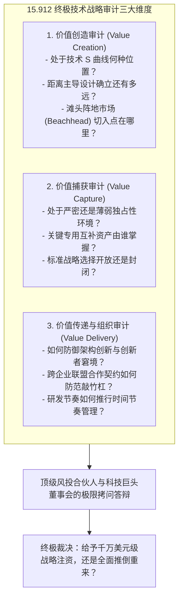

# Lec 23 技术战略实战演练与专题答辩 (Technology Strategy Capstone Presentations)

> MIT Sloan School of Management · 15.912 Strategic Management of Innovation · Prof. Fiona Murray & Prof. Rebecca Henderson

## TL;DR

- 15.912 毕业项目实战答辩：各高管小组针对前沿颠覆性硬科技创业项目的全面技术战略审计。
- 从实验室原型到商业帝国的全景压力测试：价值创造、价值捕获与价值传递三维闭环检验。
- 董事会与顶级科技风投（VC）的极限拷问：独占性壁垒、互补资产控制权、标准之战与组织双元性。
- 提炼实战经验：如何向董事会汇报一份经得起严苛推敲的技术战略路线图（Technology Roadmap）。

## 毕业专题答辩：将前沿硬科技推向商业审判席 / The Capstone Challenge

在 15.912 的第二十三次课程中，全学期的思想激荡迎来了最高潮的实战检验——**毕业专题战略大答辩（Capstone Presentations）**。

丽贝卡·亨德森教授与菲奥娜·莫雷教授邀请了来自波士顿与硅谷的顶尖科技风险投资家（VC）、跨国科技巨头首席技术官（CTO）以及资深知识产权诉讼合伙人组成联合评审委员会。各小组学员必须挑选一项处于当前科技最前沿、具有巨大不确定性的真实技术项目（涵盖合成生物学、量子计算、固态动力电池、边缘 AI 芯片等领域），代入创业公司创始人或跨国巨头战略副总裁的角色，向评审团提交一份**完整的商业落地与技术战略可行性审计报告**：

这场答辩绝不允许学员流于空泛的 PPT 口号，每一个主张都必须经受严密的商业逻辑推演与真实历史案例的对标检验。

## 评审团的极限五重拷问 / The Five Critical Inquiries of the Board

在答辩现场，教授与评审团针对学员汇报的战略方案，抛出了五个令每一位技术创业者冷汗直流的极限拷问：

### 拷问一：独占性机制到底有多坚固？（The Appropriability Test）
> “你们声称拥有三项核心算法专利，但如果谷歌手握 5000 名顶级工程师，在六个月内用完全不同的深度学习框架绕过你们的专利实现相同功能，你们如何阻止这种侵权套利？”

### 拷问二：谁掌控了最要命的互补资产？（The Complementary Assets Test）
> “你们的固态电池实验室能量密度惊人，但量产需要数十亿美元的超高真空干房车间，且需要经过主流车企长达四年的严苛车规级碰撞与高低温寿命测试。在你们耗尽资金之前，如何避免被掌控整车制造和电池供应链的传统巨头活活拖死？”

### 拷问三：为什么你们不会沦为巨头的特洛伊木马？（The Alliance Trap Test）
> “你们提议与微软或亚马逊签订排他性云端分销合作，对照当年谷歌与 AOL、阿尔扎与汽巴的血泪史，你们在协议中设计了何种退路机制，防止你们的客户数据和核心接口被巨头彻底包抄吞噬？”

### 拷问四：主导设计确立后的行业大洗牌准备（The Shakeout Survival Test）
> “当前全行业有 80 家初创企业在搞类似的技术架构。一旦两年后行业主导设计敲定，竞争焦点瞬间从‘产品研发’切换为‘精益制造与单位成本拼杀’，你们这支清一色由博士科学家组成的团队，是否具备下沉到工厂车间压榨每一分钱成本的残酷运营能力？”

### 拷问五：内部组织是否具备双元进化能力？（The Ambidexterity Test）
> “当你们今天押注的技术在五年后遭遇更新一代颠覆性技术的冲击时，你们的组织治理架构能否避免陷入‘柯达式的胶卷暴利毒瘾’？你们是否敢亲手杀死自己今天最赚钱的产品？”

::: example 答辩现场的经典战略逆转
某小组最初汇报了一项针对“新型高精度医疗手术机器人”的轻资产纯软件授权方案。评审团一针见血地指出：在医疗器械领域，缺乏专用制造能力和全美三甲医院临床培训网络的纯软件公司，根本无法建立转换壁垒。在教授的严厉质询下，该小组现场进行了战略重构，将方案调整为“与一家拥有成熟机械臂制造能力的传统工业器械巨头组建合资公司，以软件算法入股绑定 40% 股权，并要求对核心临床数据库享有排他性所有权”，最终获得了评审团的高度赞赏。
:::

## 卓越技术战略路线图（Roadmap）的撰写范式 / Crafting the Winning Technology Roadmap

在答辩的总结讲评中，菲奥娜·莫雷教授向学员传授了一份能够直接提交给科技巨头董事会或顶级投资委员会的**《单页纸技术战略核心路线图（One-Page Strategic Technology Roadmap）》**标准模板：

| 战略模块 | 核心审定标准与关键要素清单 | 常见管理失误与红线预警 |
| :--- | :--- | :--- |
| **1. 科学原理与技术 S 曲线** | 明确标定技术所处的 S 曲线阶段、物理理论极限与关键性能指标（KPI）演进斜率 | 盲目把实验室小试数据当批量工程参数，低估量产良品率爬坡难度 |
| **2. 滩头阵地利基选择** | 明确第一个痛点极度强烈、客户愿意忍受早期缺陷并支付高溢价的微观细分客群 | 一上来就妄图颠覆数万亿的主流大众市场，招致巨头的瞬间围剿 |
| **3. 独占性与防御战术** | 专利池布局、商业秘密隔离、默会制造诀窍与时间压缩不经济屏障 | 单纯依赖一两项未确权的软性专利，忽视逆向工程绕道风险 |
| **4. 互补资产获取矩阵** | 明确列出制造、分销、监管合规、售后支持由谁提供（自建 Build / 并购 Buy / 联盟 Partner） | 盲目追求全产业链纵向一体化，导致资本开支爆炸、现金流断裂 |
| **5. 组织节拍与时间节奏** | 制定严格的 12-18 个月固定发布周期，设立简单规则与低成本探针机制 | 陷入无休止的项目蔓延与研发过载，被外部突发事件牵着鼻子走 |

这份路线图，构成了连接技术天才脑海中的代码与物理定律，走向现实商业世界中资本、市场与组织权力的坚实桥梁。

## 我的理解与实践洞察 / Personal Insight

技术战略的答辩，是一场将理性推向极致的灵魂拷问。

::: insight 商业计划书上的每一行文字，未来都会变成现实中流淌的真金白银
在象牙塔的实验室里，很多科学家习惯了把‘未来的成功’寄托在美好的假设之上：假设客户一定会买、假设对手不会反击、假设工厂一定能量产。
**然而，商业世界是一个高度残酷的复杂反馈自适应系统！**
在这里，所有的假设都会被市场以最残忍的方式进行压力测试。15.912 答辩的伟大价值，就在于提前让创业者经历一次次近乎绝望的理性解剖。唯有在开战之前，把自己最薄弱的软肋暴露在最犀利的目光之下，堵住每一个可能的漏洞，厘清每一处利益博弈的筹码，你才能在真正走出校门、面对狂风暴雨的商业丛林时，带领你的团队活下去、走出来，并最终摘取属于真正战略家的无上桂冠。
:::

## 思考题与实战研讨

1. 假设你受邀担任某知名硬科技风险投资基金的投资决策委员会合伙人，面对一个由常春藤名校教授领衔的“量子计算云平台”创业团队，他们手握 10 项核心发明专利并要求 5000 万美元估值，你会向他们提出哪三个最能刺破虚荣泡沫的“技术战略杀手级问题”？
2. 回顾本讲的“技术战略路线图”标准范式，为你最熟悉的一项当下前沿技术（如具身智能大脑、可控核聚变商业化、或脑机接口）草拟一份核心要素清单，指出其未来三年最致命的“互补资产瓶颈”在哪里？
