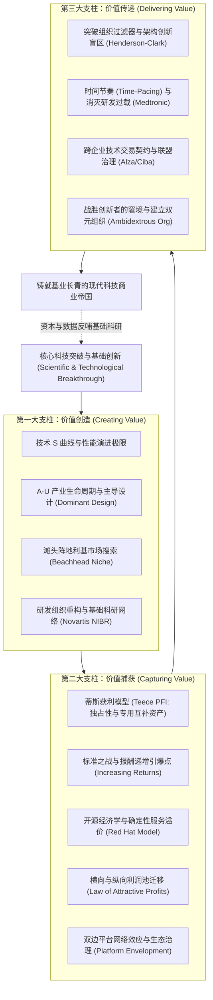

# Lec 24 全课总结与技术战略大师框架 (Course Conclusions and Technology Strategy Synthesis)

> MIT Sloan School of Management · 15.912 Strategic Management of Innovation · Prof. Fiona Murray & Prof. Rebecca Henderson

## TL;DR

- 15.912 创新与创业战略管理全景大收官：统摄技术变迁动力学与商业博弈总法则。
- 技术战略三维一体主架构：价值创造（S 曲线与主导设计）、价值捕获（蒂斯模型与平台生态）与价值传递（组织动态学与联盟治理）。
- 科技领袖必须终身修炼的三种心智张力：技术偏执与商业同理心、长期坚守与敏捷自我颠覆、开放胸怀与核心控制。
- 莫雷-亨德森技术战略大师终极行动守则（The Technology Strategy Master Playbook）。

## 15.912 全景技术战略大厦的终极落成 / The Master Synthesis of Technology Strategy

历经 24 次思想激荡与经典案例解剖，麻省理工学院 15.912 课程终于画上了最壮丽的句号。丽贝卡·亨德森教授与菲奥娜·莫雷教授走上讲台，带领全体学员将分散在全学期的数十个工具、模型与案例，融汇升华为一座严丝合缝、宏伟壮观的**现代技术战略大厦（The Master Technology Strategy Framework）**。

在科技驱动的现代商业世界中，技术从来不是孤立的象牙塔实验，商业也从来不是简单的数字买卖。技术战略是连接科学发现的无尽前沿与人类文明商业化繁荣的最神圣纽带。

很多技术出身的创业者往往陷入一种单向思维，以为只要研发出了性能顶尖的产品，商业成功就会自然降临；而传统的商学院管理者又往往对底层技术演进的物理规律缺乏感知，试图用僵化的财务预算去套裁充满不确定性的前沿探索。15.912 的伟大贡献，在于彻底打破了技术与商业之间的二元鸿沟，构建起一套融汇技术演进规律、市场权力博弈与组织行为进化的全景统一场论。

在这套体系中，技术被置于动态演化的商业生态网络之中进行全局考察。从早期的技术 S 曲线与主导设计探索，到中期的独占性制度防御与互补资产控制，再到后期的组织动态学与时间节奏管理，每一个决策模块都彼此咬合、互为因果。

亨德森与莫雷教授将全课的智慧凝练为三大核心支柱相辅相成的战略飞轮：

这座大厦的三大支柱紧密咬合：没有价值创造，企业只是无源之水；没有价值捕获，企业只是替他人做嫁衣的悲剧烈士；没有价值传递，企业就会在组织内耗与惯性中迅速窒息而亡。唯有三者融会贯通，科技企业才能在熊彼特创造性毁灭的狂风巨浪中屹立不倒。通过对这三大支柱的持续审视与动态校准，商业领航者得以在不可预测的高速变迁环境中，始终掌控属于自己的命运罗盘。

## 科技领袖的终极心智修行：三大永恒张力 / The Three Paradoxes of Technology Leadership

在课程告别寄语中，亨德森教授与莫雷教授引导学员反思科技商业领袖在内心深处必须时刻驾驭的三大终极矛盾：

### 1. 技术偏执狂与极致商业同理心的平衡（Engineering Rigor vs. Radical Empathy）
- 卓越的科技领袖必须在底层物理原理上保持宗教般的偏执，追求极致的工程完美；
- 但在商业界面上，必须彻底放下工程师的技术傲慢，以极度谦卑的同理心去倾听普通消费者的笨拙痛点，绝不强迫客户为无意义的技术复杂性买单。

### 2. 长期主义战略定力与敏捷自我颠覆的平衡（Long-term Stewardship vs. Self-Disruption）
- 在突破核心底层瓶颈时（如丰田研发混动普锐斯、英特尔攻关极紫外光刻），必须具备承受十年不鸣、忍受连续亏损与冷嘲热讽的惊人战略定力；
- 但一旦感受到新一代破坏性技术的引爆点正在到来，必须拥有在二十四小时内推翻昨天一切辉煌、敢于亲手杀死自己现金牛业务的铁血决断力（如苹果亲手颠覆 iPod、安迪·鲁宾重写 Android）。

### 3. 开放生态胸怀与核心控制权的平衡（Ecosystem Openness vs. Proprietary Moat）
- 敢于将底层标准、开源代码和通用接口慷慨地奉献给全天下，以博大的胸怀团结一切可以团结的互补品盟友，把产业蛋糕做成参天大树；
- 但在最核心的数据资产、品牌心智和不可替代的紧耦合瓶颈上，必须构筑起神圣不可侵犯的专有控制权，确保企业能够稳健捕获属于自己的超额繁荣果实。

::: definition 技术战略家 (The Technology Strategist)
技术战略家是指那些不仅能看透前沿物理与代码规律，更能洞悉人性欲望、资本意志与组织政治演化规律的商业领航者。他们以科学家的理性探索未知，以经济学家的严谨配置资源，以政治家的胸怀整合生态，引领科技的伟力真正造福人类文明。
:::

## 莫雷-亨德森技术战略大师终极行动守则 / The Master Playbook for Innovation

作为留给每一位麻省理工学院毕业生的终身管理锦囊，两位教授将全课的智慧提炼为十条黄金行动法则：
1. **永远不要把产品研发当成技术战略，技术战略是全套商业模式的顶层设计**；
2. **在技术 S 曲线的平缓期寻找颠覆萌芽，在主导设计确立的前夜抢先卡位**；
3. **技术不成熟时坚持纵向一体化追求极致，技术过剩时拥抱横向模块化追求规模**；
4. **警惕专利万能论，在薄弱独占性行业，谁掌控专用互补资产谁才是终极赢家**；
5. **打标准之战就是打预期之战，宁可分享大蛋糕的 10%，绝不独占小蛋糕的 100%**；
6. **开源不等于免费慈善，免费的背后是向客户出售高确定性的企业级合规与服务**；
7. **利润永远向价值链中当前技术最不成熟、最难以被替代的紧耦合瓶颈处迁徙**；
8. **用铁打的时间节奏消灭研发过载，多任务并行是杀死创新效率的隐形毒药**；
9. **提防架构创新的无形暗箭，当零部件没有变而连接变了，立刻重构你的组织汇报线**；
10. **在阳光灿烂的日子里修理屋顶，敢于亲手杀死昨天的自己，是你获得明天的唯一途径**。

## 我的理解与实践洞察 / Personal Insight

15.912 是一座照亮所有硬科技创新者前行之路的精神灯塔。

::: insight 技术的最高使命，是拓展人类自由与福祉的边界
在这个科技大爆炸、AI 席卷全球每一个角落的激荡时代，我们比以往任何时候都更容易迷失在算法的狂飙突进与资本的纸醉金迷之中。
**然而，阿诺尔多·哈克斯、丽贝卡·亨德森与菲奥娜·莫雷教授在麻省理工学院的讲台上，赋予了我们一双洞穿浮华迷雾的清醒慧眼**。
他们告诉我们：商业不是零和掠夺的丛林，创新不是孤芳自赏的玩具。真正的商业战略，是把人类最顶尖的智慧与最深沉的关怀融合在一起，把实验室里冰冷的晶体管与分子链，转化为千家万户触手可及的健康、温暖、便捷与尊严。愿每一位从这里走出的战略家，都能秉持这份理性的深邃与道德的崇高，以技术为笔，以商业为墨，在人类波澜壮阔的文明长卷上，写下属于我们这一代人的辉煌篇章！
:::

## 思考题与实战研讨

1. 回顾整个 15.912 课程中所学习的全部案例（摩托罗拉、eInk、苹果、诺华、英特尔、阿布吉尼克斯、Ember、红帽、谷歌、诺基亚、美敦力、丰田、阿尔扎、柯达），挑选两家命运截然相反的企业（一家大获全胜，一家黯然陨落），运用“价值创造、价值捕获、价值传递”三维总模型，进行一场并排对比的终极复盘剖析。
2. 结合《莫雷-亨德森技术战略大师终极行动守则》，为你个人未来五年所要投身的技术赛道（或你所创办的企业），撰写一份《技术战略顶层指导纲要》。
