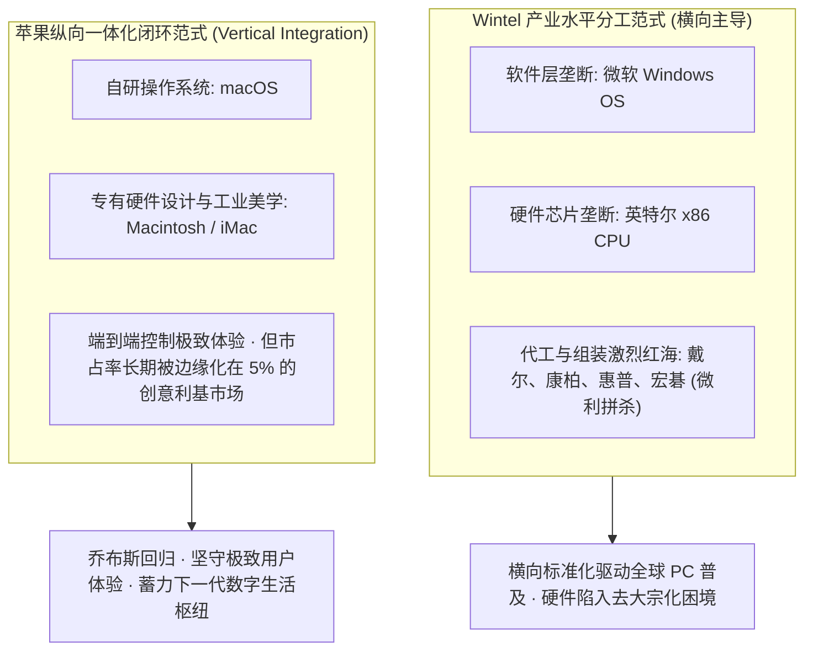
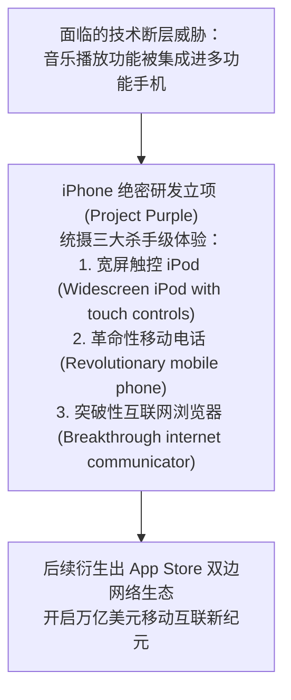

# Lec 03 苹果创新轨迹：从个人电脑、iPod 到 iPhone 的生态跃迁 (Apple’s Innovation Trajectory: PC, iPod to iPhone)

> MIT Sloan School of Management · 15.912 Strategic Management of Innovation · Prof. Fiona Murray & Prof. Rebecca Henderson

## TL;DR

- 苹果公司（Apple 2006 案例）：从濒临破产的个人电脑小众硬件厂商向数字多媒体帝国的战略蜕变。
- 解构个人电脑产业二十年演进轨迹：Wintel 联盟主导水平分工，苹果坚持纵向一体化闭环的痛苦与坚守。
- iPod + iTunes 商业模式突破：以合法版权内容降低摩擦，硬件赚取暴利，开启数字音乐生态闭环。
- iPhone 的战略孕育：将通信、多媒体与移动互联网融于一体，完成从单一硬件向多边移动平台的终极跃迁。

## 个人电脑二十年演进轨迹与苹果的逆境崛起 / Apple and the PC Trajectory

在 20 世纪 80 年代至 90 年代，全球个人电脑（PC）产业发生了一场波澜壮阔的产业架构重组。在个人电脑产业诞生的最初阶段，IBM 曾经依靠强大的品牌号召力和开放的硬件接口，迅速定义了 PC 的初始架构，并催生了一个庞大而生机勃勃的兼容机制造生态。

这场架构革命的最深远影响，在于彻底打破了传统大型机时代由单一巨头垂直垄断整个计算机软硬件系统的旧格局。IBM PC 引入了开放标准架构，促成了微软（Windows 操作系统）与英特尔（x86 芯片微处理器）所构成的 **Wintel 联盟** 的崛起，并将整个 PC 产业推向了极致专业化的水平分工时代：

在 PC 市场上，苹果由于坚持软硬件一体化的封闭系统，被性价比极高、兼容性极强的 Wintel 阵营残酷挤压，市场份额一度跌破 4%，濒临破产边缘。然而，正是这种对“软硬件深度集成与极致用户体验”的病态坚持，为苹果日后开辟全新的数字消费电子帝国保留了最核心的组织基因。无论外部商业环境如何变化，苹果始终将自己定位为能够完美掌控芯片、硬件设计、操作系统与应用软件全流程体验的独特存在。

## iPod 与 iTunes：商业模式与生态协同的惊天破局 / The iPod & iTunes Revolution

2001 年，苹果推出了便携式 MP3 播放器 iPod。在当时的市场上，早已有帝盟（Rio）和创飞（Creative）等先驱推出了容量为数十兆的数码播放器，且互联网上充斥着 Napster 等免费盗版音乐下载。

苹果之所以能凭借 iPod 掀起一场席卷全球的数字音乐革命，核心在于其构建了一套精妙绝伦的**“硬件 + 软件 + 服务”生态闭环**：

### iPod 战略破局的三大核心支柱
1. **重塑客户体验摩擦力**：乔布斯亲自与各大唱片巨头谈判，打破整张 CD 捆绑销售的陈腐规则，推行“单曲 99 美分”合法下载，消除了用户在盗版网站搜寻病毒文件的巨大摩擦成本；
2. **硬件赢取超额暴利**：苹果并不指望靠每首 99 美分的音乐分成发大财（大部分收入返还给唱片公司），iTunes 的本质是为售价高达 399 美元且毛利率超过 40% 的 iPod 硬件充当“最强大的互补品护城河”；
3. **跨平台开放策略（Crucial Pivot）**：乔布斯力排众议，将 iTunes 软件移植至竞争对手的 Windows 平台，使全美 95% 的 PC 用户都能轻松使用 iPod，瞬间引爆了指数级的网络自增强增长。

## iPhone 的战略落子：多媒体帝国向移动平台的终极升维 / The Genesis of iPhone

在 2006 年（本案例设定的历史节点），iPod 业务已经为苹果贡献了超过 40% 的总营收。然而，乔布斯与管理层敏锐地意识到了一场致命的技术威胁：**手机正在快速集成音乐播放功能！如果未来的诺基亚或摩托罗拉手机能够顺畅播放 MP3，谁还会随身携带一台专用的 iPod 播放器？**

苹果做出了商业史上最伟大的自我颠覆决断：**与其被传统手机巨头干掉，不如由苹果亲手终结 iPod！**

苹果在 2007 年发布的 iPhone，彻底打破了传统通信行业由电信运营商死死掌控手机定制权的分销铁律。苹果凭借前所未有的全电容多点触控（Multi-touch）交互界面和桌面级 Safari 浏览器体验，迫使 AT&T 签下了让出软件生态控制权的城下之盟，为日后 App Store 成为全球最大移动应用生态奠定了坚不可摧的基础。

## 我的理解与实践洞察 / Personal Insight

苹果的传奇历程，是技术战略演进最生动的活化石。

::: insight 商业模式的终极护城河，是让不同的构件产生化学反应
平庸的企业做产品，永远是做加法：今天做一个播放器，明天做一款手机，后天做一个应用商店，彼此之间是冰冷割裂的散兵游勇。
**苹果最可怕的威力，在于其全套产品生态之间坚不可摧的飞轮咬合**。硬件为软件提供极致的交互性能载体，软件为硬件注入灵魂与溢价，服务与开发者生态则将客户牢牢锁死在围墙之内。当你购买了一台设备，你便身不由己地走进了整座精心设计的数字游乐园。这种从单一硬件向多边平台的升维跃迁，是所有志在基业长青的科技企业必须穷尽一生参悟的无上秘笈。
:::

## 思考题与实战研讨

1. 索尼（Sony）拥有全球最顶尖的便携式音乐硬件制造技术（Walkman 品牌）并控股全球最大的唱片公司之一（Sony Music），为什么在数字音乐革命中被既无音乐版权也无随身听制造历史的苹果击败得溃不成军？
2. 结合本讲案例，探讨苹果在面临 iPod 被手机替代的威胁时所展现的“自我颠覆（Self-cannibalization）”战略，对当今面对 AI 大模型冲击的传统 SaaS 软件企业具有何种深刻的启示？
