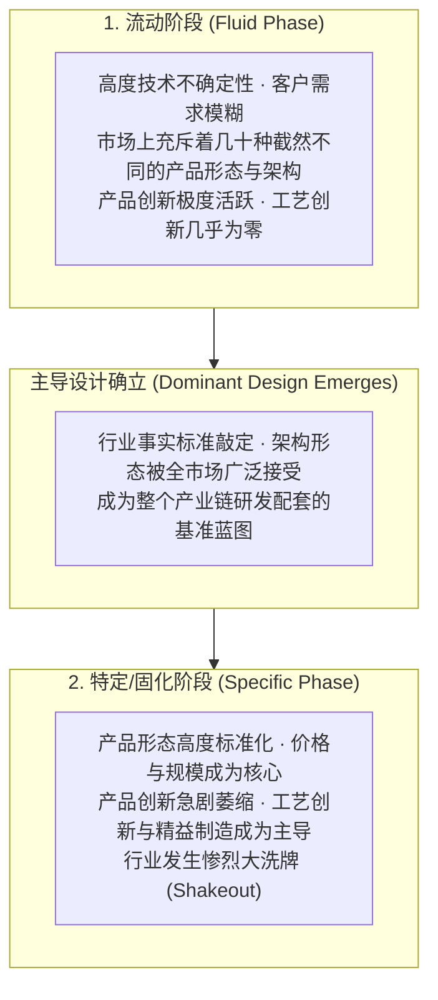

# Lec 04 产业生命周期与主导设计确立 (Industry Life Cycles and Dominant Design)

> MIT Sloan School of Management · 15.912 Strategic Management of Innovation · Prof. Fiona Murray & Prof. Rebecca Henderson

## TL;DR

- 产业演进遵循阿伯纳西-厄特巴克（Abernathy-Utterback）经典模型：流动阶段与特定阶段。
- 主导设计（Dominant Design）的确立是产业生命周期的核心分水岭，彻底终结技术架构之争。
- 主导设计确立前，企业拼的是产品创新与多样化试错；确立后，竞争焦点瞬间切换为工艺创新与规模化成本。
- 产业整合与行业大洗牌（Shakeout）：无法适应制造规模与低成本要求的技术先驱将成批被淘汰出局。

## 阿伯纳西-厄特巴克产业演化模型 / The Abernathy-Utterback Model

技术的发明与产业的演进从来不是杂乱无章的布朗运动，而是遵循着高度可预测的生命周期规律。哈佛商学院威廉·阿伯纳西（William Abernathy）与麻省理工学院詹姆斯·厄特巴克（James Utterback）提出了享誉全球的 **A-U 产业演进动力学模型**。

在 15.912 的第四次课中，亨德森教授与莫雷教授引导学员深入解构技术在产业生命周期中的**产品创新（Product Innovation）**与**工艺创新（Process Innovation）**此消彼长的动态规律：



主导设计的出现，如同一面无形的巨大分水岭，彻底重构了整个产业的竞争游戏规则。

## 什么是主导设计？历史经典案例拆解 / The Concept of Dominant Design

主导设计（Dominant Design）绝不仅指某项单一的技术专利，它是**由一系列关键技术特征组合而成的、获得全市场广泛共识的完整产品架构体系**：

::: definition 主导设计 (Dominant Design)
主导设计是指在一个行业的技术演进历程中，被市场绝大多数厂商、配套供应商以及终端消费者共同接受为事实标准的整体架构。一旦主导设计确立，后续的竞争将不再是对产品基本架构的颠覆，而是在该既定架构下的渐进式微调与成本优化。
:::

### 商业史上的四大经典主导设计确立
1. **汽车工业（1908 年福特 Model T）**：在早期，市场上并存着蒸汽机汽车、电动汽车和内燃机汽车，操控方式有舵柄、踏板和摇杆。福特 Model T 确立了“前置水冷内燃机 + 方向盘左舵驾驶 + 脚踏板控制 + 冲压封闭车身”的主导设计，统治了汽车工业一个世纪；
2. **打字机与计算机键盘（QWERTY 键盘布局）**：早期打字机按键频繁卡滞，设计师通过拉大常用字母物理间距发明了 QWERTY 布局。尽管日后电脑键盘已经不存在机械连杆卡滞问题，但 QWERTY 凭借强大的用户习惯与学习锁定，成为了不可撼动的主导设计；
3. **便携式数码音乐（苹果 iPod）**：在乱七八糟的九宫格按键 MP3 时代，iPod 确立了“超大黑白/彩色屏幕 + 单手滚轮（Click Wheel）物理导航”的主导设计；
4. **现代智能手机（2007 年苹果 iPhone）**：在全键盘（黑莓）、九宫格滑盖（诺基亚）与手写笔电阻屏（Windows Mobile）并存的混乱世界，iPhone 确立了“一块高屏占比电容触摸屏 + 单一物理 Home 键 + 全触摸虚拟键盘”的主导设计，直至今天全球智能手机依然沿用该架构。

## 主导设计确立后的行业大洗牌（Shakeout）机制 / The Industry Shakeout

在主导设计确立之前，整个行业处于百家争鸣的繁荣期，上百家初创企业凭借五花八门的产品创意都能在市场上分得一杯羹。然而，一旦主导设计被市场锁定，残酷的**行业大洗牌（Shakeout）**便瞬间降临：

```mermaid
flowchart LR
    FirmsCount["行业企业数量 (Number of Competitors)"]
    
    -->|在流动阶段达到顶峰 (例如 100+ 家汽车厂)| Peak["百家争鸣的探索顶峰"]
    
    Peak -->|主导设计出现，规模效应开始主导| Shakeout["行业大洗牌 (90% 企业被淘汰出局)"]
    
    Shakeout --> Oligopoly["少数寡头垄断格局 (仅存 3-5 家大型巨头)"]
```

### 为什么大洗牌如此冷酷无情？
- **押错架构的企业直接出局**：那些把全部资本投在非主流架构上的先锋企业（如当年押注蒸汽机汽车或全键盘手机的企业），其专用模具、生产线和专利瞬间沦为一文不值的废铁；
- **竞争维度的降维打击**：竞争从“拼创意”变成了“拼供应链采购成本、流水线合格率和全国分销渠道”。擅长搞发明的科学家团队无法对抗擅长大批量生产与精益管理的工业制造帝国；
- **资本市场的马太效应**：风险投资和银行贷款迅速向符合主导设计的行业前三强集中，处于落后架构的小企业资金链瞬间断裂。

## 我的理解与实践洞察 / Personal Insight

主导设计的演进，是技术创业者最容易产生悲剧英雄情结的修罗场。

::: insight 先驱往往沦为先烈，时机与架构的洞察决定生死
在科技史上，很多企业在技术成熟之前耗尽心血点燃了创新的火种，做出了惊艳世界的第一代原型机。
**然而，最终摘取产业万亿果实的，往往不是最早发明技术的探险家，而是在主导设计确立的前夜、敏锐看清行业标准走向并具备强大制造交付能力的集大成者！**
创业者千万不要沉迷于“标新立异”的虚荣感。在流动阶段，你要大胆试错；但一旦感受到行业主导设计的风口正在形成，你必须以闪电般的速度将战略重心从“天马行空的结构探索”切换为“极致的精益制造、供应链咬合与标准化量产”。读懂了产业生命周期的节拍，你才不会在黎明到来的前一刻倒在血泊之中。
:::

## 思考题与实战研讨

1. 当前全球人形机器人产业正处于什么样的生命周期阶段（流动阶段还是特定阶段）？目前行业在关节驱动路线（电机谐波减速器 vs. 滚珠丝杠电液执行器）与手部感知自由度上是否确立了主导设计？
2. 结合 A-U 模型，分析为什么电动汽车在特斯拉 Model 3 确立了“纯电滑板底盘 + 中央集中式电子电气架构 + 大面积中控一体屏”的主导设计后，全球造车新势力迎来了极其残酷的倒闭整合浪潮？
