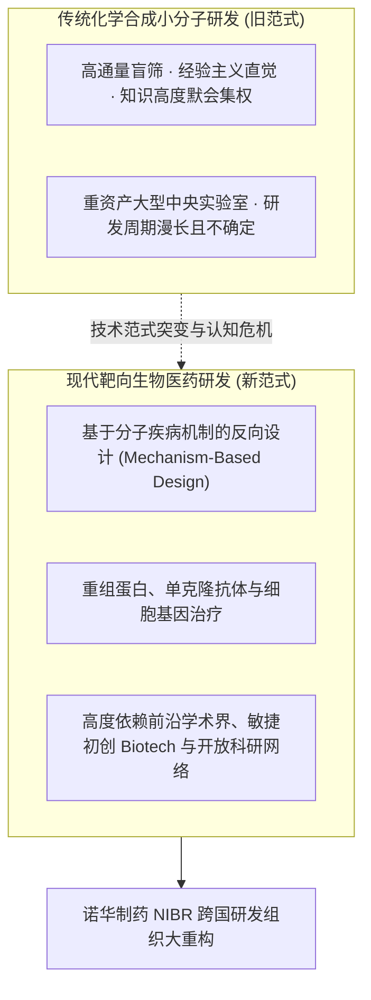
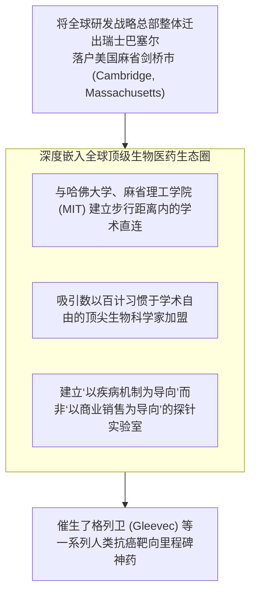

# Lec 05 诺华制药（Novartis）：生物科技变革下的研发组织与重构 (Novartis: Biotech Revolution and R&D Reorganization)'

> MIT Sloan School of Management · 15.912 Strategic Management of Innovation · Prof. Fiona Murray & Prof. Rebecca Henderson

## TL;DR

- 医药产业技术范式大跃迁：从传统化学小分子合成盲筛，向现代分子生物学与靶向生物药转型。
- 诺华制药（Novartis）案例：跨国巨头在技术断层面前面临的研发生产力危机与组织惯性。
- 集中式研发（Centralized R&D）与分布式研发（Decentralized R&D）的深刻权衡与冲突。
- 拥抱外部创新生态：通过全球设立科研前哨所（如剑桥 NIBR），重塑企业基础科学探索网络。

## 制药工业技术范式大地震：从化学筛选到基因靶向 / Paradigm Shift in Drug Discovery

在 20 世纪下半叶，全球跨国制药巨头主要依赖**化学合成小分子药物（Small Molecule Chemistry）**：
- **经典模式**：化学家们在实验室中合成成千上万种化合物分子，然后通过动物实验盲筛（Trial-and-error Screening），寻找能够缓解特定症状的分子结构；
- **面临的瓶颈**：随着易于发现的分子靶点被全部挖掘殆尽，传统研发模式的投资回报率（ROI）出现断崖式下跌，单款新药研发成本突破 10 亿美元，行业深陷“重磅炸弹药物专利悬崖（Patent Cliff）”的巨大恐慌之中。

与此同时，人类基因组计划的完成催生了**分子生物学与生物技术革命（Biotech Revolution）**：

以诺华（Novartis，由瑞士汽巴-嘉基与山德士合并而成）为代表的欧洲传统医药巨头，猛然发现自己原有的数千名传统化学科学家与层级森严的中央实验室，在新兴的生物靶向浪潮面前正在变成沉重的组织负资产。

## 诺华制药案例：集中式 vs. 分布式研发的组织权衡 / Centralized vs. Decentralized R&D

在 15.912 的案例讨论中，丽贝卡·亨德森教授引导学员深入剖析了诺华制药在研发组织架构设计上的经典冲突：

| 组织模式 | 核心设计逻辑与架构特征 | 核心优势 (Pros) | 致命弱点与局限 (Cons) |
| :--- | :--- | :--- | :--- |
| **集中式研发 (Centralized R&D)** | 将全球所有科学家和设备集中在瑞士巴塞尔总部中央研究院 | 避免跨部门重复研发；昂贵的高通量检测仪器与动物实验中心利用率最高；公司最高管能够紧密掌控预算 | 远离全球前沿学术中心；官僚审批层级森严；对新兴生物技术的敏感度极度迟钝；极难吸引硅谷与波士顿的顶尖学术领军人才 |
| **分布式研发 (Decentralized R&D)** | 赋予各治疗领域事业部（肿瘤、心血管、呼吸等）独立的研发管线与决策权 | 极其贴近特定疾病的前沿临床需求；各事业部能独立快速与外部初创公司建立合作 | 容易导致各事业部自建重复的实验室平台；各领域之间的底层科研数据与算法无法跨界共享复用 |

诺华当时的研发掌舵人、著名科学家马克·菲什曼（Mark Fishman）敏锐地指出：**如果诺华继续窝在瑞士巴塞尔的城堡里搞封闭式研发，诺华将彻底错失二十一世纪的生物科技革命！**

## 诺华生物医学研究所（NIBR）的颠覆性重组决策 / The Birth of NIBR in Cambridge

面对这一危机，诺华做出了制药商业史上最富魄力的战略搬迁与组织重构：

诺华成立了**诺华生物医学研究所（Novartis Institutes for BioMedical Research, NIBR）**，并在文化和制度上进行了彻底的激进变革：
1. **打破学术界与工业界的围墙**：允许并鼓励诺华的内部科学家自由发表基础科学论文，将顶尖科学家作为大学教授一样尊重和激励；
2. **重塑项目立项评判标准**：早期临床前项目不再由商业销售总监来评估“未来的市场销售规模”，而是由顶级科学家团队依据“该疾病生物学机制是否被彻底搞清楚”来进行纯粹的科学评审；
3. **将外部初创 Biotech 视作亲密盟友**：设立常设对外合作团队，积极通过早期授权（In-licensing）和联合孵化，把全世界顶尖实验室的专利管线吸纳进诺华的后期临床开发与商业化大机器中。

## 我的理解与实践洞察 / Personal Insight

研发组织的变革，是对大企业最高管理者胸怀与魄力的终极考验。

::: insight 创新的圣杯，永远隐藏在学术与产业碰撞的火花里
很多大企业的 CEO 喜欢把研发中心建在自己办公室的隔壁，以便随时调阅汇报、掌控预算。
**但真正的突破性科学发现，从来不会在官僚化的汇报会议中发生**。
诺华之所以能打破跨国药企的研发衰退诅咒，核心就在于其领导者敢于把研发命脉整体搬出舒适区，直接空投到全球智力密度最高的剑桥生物圈中。让自己的科学家天天和哈佛、MIT 的教授在街角咖啡馆里碰撞思想，让组织暴露在最具颠覆性的学术空气之中。这种敢于打破围墙、拥抱外部前沿生态的大无畏气魄，正是驱动现代科技巨头永葆青春的生命源泉。
:::

## 思考题与实战研讨

1. 很多跨国药企通过兼并收购（M&A）小型生物科技初创公司（Biotech）来补充研发管线，但被收购的初创公司在并入巨头后往往出现核心科学家集体离职、研发生产力骤降的现象。运用本讲的组织设计理论，分析这一现象背后的组织机制根因。
2. 在诺华将研发总部搬迁至麻省剑桥的过程中，瑞士本土的传统化学分析元老高管提出了极其强烈的反对意见，指责此举是在“耗费巨资取悦学术界、抛弃欧洲根基”。如果你是当时的 CEO，你将采取何种战略沟通与激励重构方案平息这一内部风暴？
