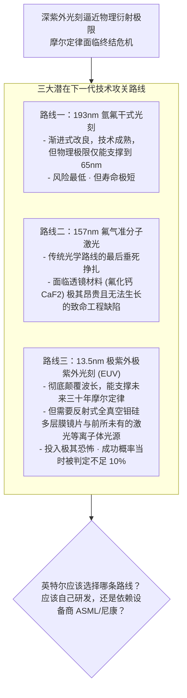
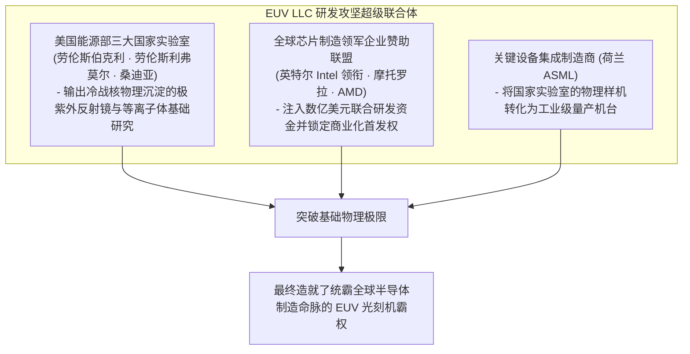

# Lec 06 英特尔光刻危机：前沿技术不确定性与跨组织合作 (Intel’s Photolithography Strategy in Crisis)

> MIT Sloan School of Management · 15.912 Strategic Management of Innovation · Prof. Fiona Murray & Prof. Rebecca Henderson

## TL;DR

- 半导体摩尔定律推进到百纳米以下时，遭遇前所未有的物理光学瓶颈与技术路线大决战。
- 英特尔（Intel）案例：副总裁桑迪·威尔逊（Sandy Wilson）面临的三难抉择（193nm 浸润式 vs. 157nm vs. 极紫外 EUV）。
- 基础研究与应用工程的战略边界：芯片设计制造巨头是否应该亲自下场进行光刻机底层基础物理研究？
- 跨组织研发联盟（R&D Consortia）与设备供应链产业生态的风险共担契约设计。

## 摩尔定律的光学咽喉：光刻技术危机 / The Photolithography Bottleneck

在半导体工业的发展史上，摩尔定律（Moore's Law）要求集成电路上的晶体管数量大约每 18 到 24 个月翻一番，这依赖于光刻机（Photolithography Equipment）将越来越精细的电路图案刻印在硅晶圆上。

然而，在 20 世纪 90 年代末至 21 世纪初，整个半导体产业撞上了一面坚不可摧的物理高墙：传统使用的汞灯深紫外光源（DUV，波长 248nm）逼近衍射极限，无法再雕刻出更小尺寸的芯片栅极。

作为全球半导体产业的绝对霸主，英特尔（Intel）的高级技术规划副总裁桑迪·威尔逊（Sandy Wilson）面临着一场关乎数十亿美元资本和整个产业帝国命运的**“技术路线生死抉择”**：

这场抉择不仅考验着英特尔对底层物理原理的敏锐洞察，更考验着一家商业企业如何驾驭前所未有的**技术不确定性（Technological Uncertainty）**。

## 英特尔的研发哲学：不做纯粹基础科学，做“精确复制”工程 / Intel's R&D Philosophy

在剖析危机之前，菲奥娜·莫雷教授引导学员深入审查了英特尔长期奉行的核心研发哲学：
- **不设立庞大虚浮的贝尔实验室式基础研究院**：英特尔坚信，企业研发的目的必须高度服务于未来 2-3 年内的量产工艺，绝不在不可控的纯基础科学上无休止烧钱；
- **著名的“精确复制（Copy Exactly）”铁律**：一旦研发试产线（如俄勒冈 D1D 厂）跑通了一套芯片制造配方，全球所有量产晶圆厂的每一台机台型号、甚至每一根管路的弯曲角度，都必须百分之百原样复制，以彻底消除制造中的不确定性扰动；
- **对设备供应商的极度依赖**：英特尔自己并不制造光刻机，而是依靠全球光刻设备双雄（当时的日本尼康 Nikon、佳能 Canon 以及荷兰阿斯麦 ASML）提供成熟机台。

然而光刻危机打破了这种舒适区：**当时全行业的光刻机设备供应商，没有一家拥有足够的资本和技术实力能够独立研发出颠覆性的极紫外 EUV 系统！** 如果英特尔继续袖手旁观坐等设备商交付，整个芯片产业就会因缺粮而集体停摆。

## 跨组织研发联盟的治理结构与生态联盟 / Structuring R&D Consortia: The EUV LLC

桑迪·威尔逊最终推动了一场具有划时代意义的跨组织技术结盟与生态构建——**EUV 有限责任公司（EUV LLC 研发联盟）**：

### 跨企业研发联盟的三大制度创新契约
1. **基础科学与工业工程的精准分工**：由美国能源部国家实验室负责最硬核的基础物理光学仿真，由芯片制造巨头提供量产工况指标，由设备商负责精密机械机台集成；
2. **知识产权共享与商业化排他优先权**：出资赞助联盟的芯片企业拥有前三代商业化机台的优先采购权，而设备商 ASML 获得了将该技术商业化制造并向全球销售的独家授权；
3. **分阶段里程碑注资机制**：不搞一次性大水漫灌，设立严格的物理可行性节点（如光源功率阈值、多层膜反射率达到 68%），达成一项指标才释放下一期研发预算。

::: example 极紫外光刻的世纪豪赌与三十年长跑
英特尔在 1997 年牵头成立 EUV LLC 联盟时，很多人认为极紫外光刻纯属痴人说梦。然而，正是在英特尔强大的战略定力牵引下，全行业历经了长达二十年的艰难爬坡，攻克了数千个工程绝症，最终使得 ASML 的 EUV 光刻机在 7nm 和 5nm 时代成为全人类制造最精密芯片的唯一工具，改写了全球半导体的地缘竞争版图。
:::

## 我的理解与实践洞察 / Personal Insight

卓越的技术战略家，必须拥有敢于为全产业链分担风险的领袖担当。

::: insight 当技术深水区来临，领军企业必须成为生态的破冰船
在平庸的商业思维中，采购部门总觉得自己是甲方大爷，理所当然地坐在办公室里等着供应商把造好的机器送上门。
**但在前沿硬科技的极端深水区，没有任何单一供应商能够独自扛起颠覆式创新的滔天巨浪！**
英特尔在光刻危机中展现的高维领导力，在于它不仅是芯片制造商，它更是整个半导体产业生态的总领航员。敢于拿出真金白银联合国家实验室为全行业探索前途，敢于在设备商最绝望的时刻注资入股扶持伙伴前行。当一家企业把自己活成了整个产业不可或缺的底层基石时，它所享有的尊严与超额回报便再无人能够撼动。
:::

## 思考题与实战研讨

1. 在英特尔应对光刻危机的历史中，台积电（TSMC）与林本坚博士另辟蹊径提出了“193nm 浸润式水冷光刻（Immersion Lithography）”，在不改变光源的情况下成功将摩尔定律续命了三代，让台积电在 28nm/16nm 时代实现了对英特尔的惊天超车。从技术战略的技术 S 曲线演进角度，复盘为什么“浸润式微调”在当时能击败高调的“EUV 跃迁”？
2. 跨企业研发联盟（R&D Consortia）在实际运作中极易出现“搭便车（Free-riding）”和“同床异梦”的败局。作为联盟主导者，你应如何设计机制防止盟友窃取核心知识产权后私自单飞？
