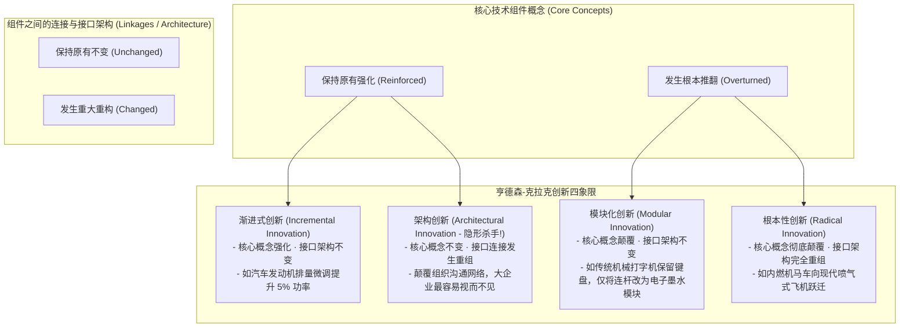
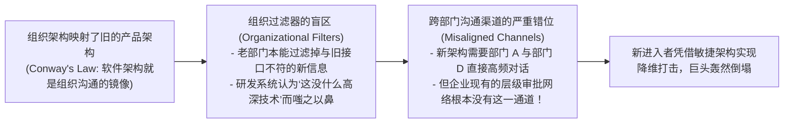

# Lec 07 创新组织设计：架构、流程与激励机制 (Organizational Design for Innovation: Structure, Processes, and Incentives)

> MIT Sloan School of Management · 15.912 Strategic Management of Innovation · Prof. Fiona Murray & Prof. Rebecca Henderson

## TL;DR

- 亨德森-克拉克（Henderson-Clark）四维创新矩阵：解构渐进式、模块化、架构式与根本性创新。
- 架构创新（Architectural Innovation）为何成为成熟巨头最大的“隐形杀手”：组织过滤器与沟通渠道的僵化。
- 创新流程阶段门控系统（Stage-Gate System）的利与弊：如何避免严格的漏斗流程扼杀非共识火花。
- 设计兼具包容性与进取心的创新激励契约，打破大企业“奖励平庸、惩罚失败”的逆向淘汰机制。

## 亨德森-克拉克创新四维模型 / The Henderson-Clark Innovation Typology

为什么许多在传统产品线上拥有极强技术实力的行业领跑者，在面临某种看似“技术原理完全没有变”的微小改动时，却会遭遇不可思议的灾难性惨败？

在以往的商学院研究中，学者们通常把技术变革简单粗暴地划分为两极：要么是循序渐进的“渐进式微调”，要么是翻天覆地的“根本性革命”。这种非黑即白的二元划分，使得许多企业管理者在面对一些介于两者之间的灰色技术变迁时，往往产生严重的误判，以为只要核心零部件没有被推翻，既有的组织阵型就完全不需要做出任何调整。

麻省理工学院斯隆管理学院著名教授丽贝卡·亨德森（Rebecca Henderson）与哈佛大学吉姆·克拉克（Kim Clark）在经典论文中，彻底打破了这一幼稚的传统框架。她们敏锐地洞察到，任何复杂技术系统都包含两个截然不同的知识维度：一是关于各个底层零部件核心物理原理的知识；二是关于这些零部件如何相互连接、协调与交互的架构接口知识。

基于这一深邃洞见，亨德森与克拉克提出了名震全球的**创新分类四维矩阵**：

亨德森教授特别强调，在这四种创新形态中，对成熟大企业最具毁灭杀伤力的，恰恰是看似波澜不惊的**架构创新（Architectural Innovation）**！因为企业现有的组织汇报层级与研发流程完全是围绕旧架构搭建的，一旦零部件连接关系发生重组，企业内部的沟通网络就会陷入全面的认知失调。

## 为什么架构创新会成为巨头的隐形绞肉机？ / Why Architectural Innovation Destroys Incumbents

在架构创新中，构成产品的基本物理零部件并没有改变，改变的只是**零部件之间的相互排列、交互协议与信息流动的逻辑接口**（例如：小型复印机、桌面级硬盘驱动器、模块化台式电脑）。

成熟大企业在面对架构创新时，往往因为以下三大深层组织病理而集体瘫痪：

::: definition 组织过滤器 (Organizational Filters)
组织过滤器是指企业在长期服务既有技术架构的过程中，所演化出的一套自发筛选、加工和传递信息的认知与组织机制。它能够极高效率地处理符合旧架构的日常问题，但会下意识地将所有挑战现有零部件接口逻辑的颠覆性信号视作“无关紧要的杂音”并直接屏蔽。
:::

## 创新流程的阶段门控系统（Stage-Gate）的利与弊 / The Stage-Gate Dilemma

为了控制研发风险，绝大多数跨国企业普遍引入了著名的**阶段门控流程（Stage-Gate Process）**：

### 阶段门控的残酷双刃剑
- **正面价值**：对于技术和市场确定性高的“渐进式创新”，阶段门控能够以极高的纪律性淘汰低质量项目，防止研发资金被滥用；
- **致命负面扼杀**：阶段门控在每一个关口都要求提交详尽的市场规模测算、精确的现金流折现（DCF）与客户访谈报告。而所有真正的破坏性创新与全新物种，在萌芽阶段根本无法预测市场规模！这种流程无情地把所有最富想象力的前沿火花作为“不合格品”在第一道门控处全部掐死。

## 设计激发非共识创新的组织激励机制 / Designing Incentive Contracts for Innovators

在课程模块的总结中，莫雷教授与亨德森教授为企业高管提炼了设计创新激励机制的四大法则：
1. **区分过程考核与结果考核**：对渐进式项目考核严格的交付里程碑，对颠覆式探索项目考核“假设验证的速度与学习反馈的密度”，绝不因最终商业化失败惩罚大胆的探险家；
2. **设立“异见者特区（Skunkworks）”**：为架构创新团队开辟物理与行政独立的试验区，允许其跳出全公司通用的阶段门控审批流程，由公司最高管直接提供预算护航；
3. **长期期权与超额收益对赌**：让主持颠覆性创新的核心骨干拥有该项目孵化实体的拟股权分红权，使其在承担职业风险的同时能够获得与风险相匹配的惊人财富回报；
4. **容忍体面的失败（Honoring Honorable Failure）**：公开表彰那些为了探索全新架构虽败犹荣的年轻团队，将探索过程中沉淀的经验库作为企业最宝贵的制度资产。

## 我的理解与实践洞察 / Personal Insight

创新从来不是孤立的灵光乍现，它本质上是组织架构的镜像投射。

::: insight 企业的组织架构长成什么样，它所能做出的创新就只能是什么样
很多 CEO 困惑为什么公司投入了数十亿研发经费，招聘了全球最顶尖的计算机博士，最终做出来的产品却依然暮气沉沉、缺乏灵魂。
**著名的康威定律（Conway's Law）早已道破天机：组织设计系统的本质，就是对该组织内部沟通结构的复制**。
如果你的公司依然是按机械、电子、软件彼此割裂的行政竖井划分，各部门副总裁为了保住自己的地盘天天扯皮，那么你的工程师就绝不可能协同设计出一款浑然一体的架构创新产品。改变创新的品质，必须首先从打碎组织冰冷僵化的行政藩篱开始。卓越的领导者重构沟通渠道、重塑激励契约，为天才的灵感提供最自由流淌的肥沃土壤。
:::

## 思考题与实战研讨

1. 施乐公司（Xerox）在大型中央复印机领域拥有绝对垄断地位，其工程师掌握全世界最顶尖的复印核心部件技术，为何在面对佳能（Canon）推出的桌面小型个人复印机时，遭遇了长达八年的溃败？运用亨德森-克拉克的“架构创新”理论进行深刻复盘。
2. 某软件企业在推行敏捷创新时，发现传统的阶段门控评审委员会由清一色的老牌业务副总裁组成，所有涉及云原生与开源的新提议全部被否决。作为 CEO，你将如何重新设计立项评审委员会的成员结构与投票规则？
