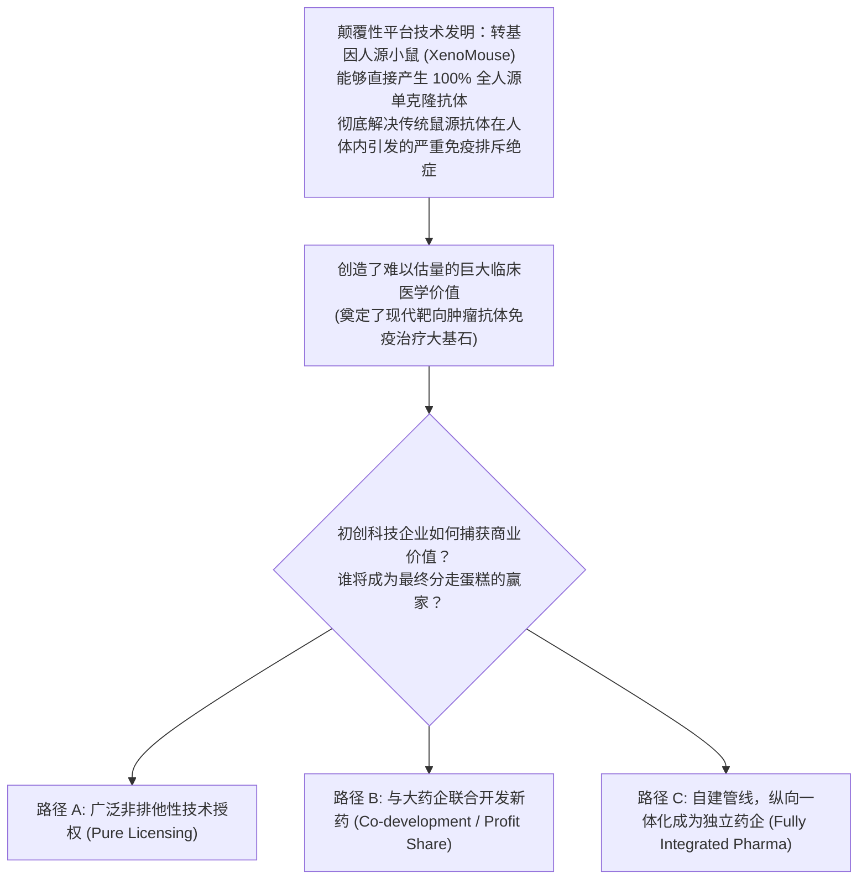
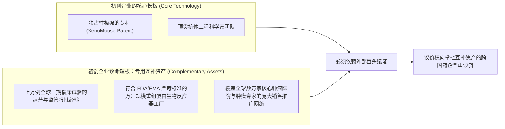

# Lec 08 阿布吉尼克斯（Abgenix）与转基因小鼠：生物医药专利与价值捕获 (Abgenix and the XenoMouse: Capturing Value in Biotech)

> MIT Sloan School of Management · 15.912 Strategic Management of Innovation · Prof. Fiona Murray & Prof. Rebecca Henderson

## TL;DR

- 技术创造了巨大的社会价值，并不意味着技术发明者能够顺理成章地捕获这一价值。
- 阿布吉尼克斯（Abgenix）案例：独占性极强的转基因小鼠（XenoMouse）人源单抗平台技术的商业化博弈。
- 价值捕获的三大商业化路径：纯技术授权（Licensing）、联合研发与利润分成（JDA）、纵向一体化全产业链自研药。
- 互补资产（Complementary Assets）对初创科技企业的致命约束：缺乏三期临床资金与全球销售渠道时的战略妥协。

## 价值创造 vs. 价值捕获：创新者的残酷现实 / The Chasm Between Creation and Capture

在商业世界中，最令科学家和发明家心碎的悲剧莫过于：**你付出毕生心血发明了一项改变全人类历史的颠覆性技术，创造了数以千亿美元计的巨大社会价值，然而最终分走绝大部分商业利润的，却是那些看似毫无科研情怀的设备商、代工厂、分销商或平台巨头！**

从本讲开始，15.912 课程正式步入其最具思想深度的第二大核心模块——**价值捕获（Value Capture）**。

丽贝卡·亨德森教授与菲奥娜·莫雷教授引入了享誉全球的生物科技商业经典案例——**阿布吉尼克斯公司与转基因人源小鼠（Abgenix and the XenoMouse）**：

阿布吉尼克斯拥有无可匹敌的核心专利护城河，但作为一家仅有几十名员工、账面资金紧张的初创公司，它究竟该如何在与辉瑞、罗氏、默克等富可敌国的跨国制药巨头的谈判桌上，捍卫自己的商业利益？

## XenoMouse 商业化三大路径的风险收益大权衡 / Evaluating the Three Strategic Paths

在 15.912 的激烈研讨中，教授引导学员对初创科技企业可供选择的三大商业化模式进行了极限压力推演：

| 商业化战略路径 | 运作机制与契约设计 | 核心战略优势 (Pros) | 致命战略风险与劣势 (Cons) |
| :--- | :--- | :--- | :--- |
| **路径一：纯技术平台授权 (Licensing Platform)** | 向全球药企开放 XenoMouse 授权，收取前期技术使用费（Upfront）、研发里程碑付款与 2%-5% 的极少终端销售提成（Royalty） | 现金流极其稳健；资本开支近乎为零；完全不承担高昂的三期临床失败风险；能快速将平台普及至全行业 | 属于“捡芝麻丢西瓜”；大药企凭借该技术研发出年销百亿美元的重磅炸弹药物，初创企业只能分得微薄的零头残羹 |
| **路径二：联合对等开发 (Co-Development / JDA)** | 阿布吉尼克斯提供抗体候选分子，大药企负责承担临床试验开销，双方五五分成或四六分成全球最终商业利润 | 显著放大了价值捕获的比例；借助跨国药企强大的全球临床申报与学术推广能力；分担了高额研发开销 | 容易在临床决策与推进速度上受制于大药企的优先级排布；大药企可能因为自身战略调整随时雪藏该合作项目 |
| **路径三：全面纵向一体化 (Fully Integrated Biopharma - FIPCO)** | 拒绝外部技术授权，将最顶尖的候选抗体全部保留在自家内部，自主完成一、二、三期临床并自建营销团队 | 商业价值捕获最大化，一旦新药获批即可成为千亿美元市值的独立巨头（如日后的安进 Amgen、基因泰克 Genentech） | 资本消耗极其恐怖，单款药三期临床需耗资数亿美元；一旦三期临床数据揭盲失败，初创企业将瞬间破产死亡 |

学员们在辩论中深刻体会到：**战略选择永远不是在真空里挑选理论上最赚钱的方案，而是在企业现有的风险承受极限与资产储备下寻找最清醒的生存平衡点**。

## 互补资产的残酷法则：缺乏枪炮的发明家 / The Tyranny of Complementary Assets

阿布吉尼克斯案例清晰地揭示了技术战略中的核心铁律：**拥有独一无二的技术（Uniqueness）只是上半场，掌控不可替代的互补资产（Complementary Assets）才是下半场的制胜关键！**

很多科技创业者有一种极其幼稚的幻想，以为只要自己的专利足够坚固、论文足够轰动，全球产业链就会像朝圣一样跪倒在自己门下，心甘情愿地奉上超额利润。然而现实商业世界的权力天平，往往向那些掌控着“脏活、累活、重资产渠道”的传统巨头倾斜。

在生物医药这一极度重资产、长周期且高监管壁垒的特殊行业中，核心技术专利与商业变现之间横亘着一条极其险峻的马里亚纳海沟：

大药企之所以能够对技术初创企业施加巨大的谈判压力，正是因为大药企垄断了药物上市所必需的**昂贵且专用的互补资产**。如果初创企业没有清醒地认识到互补资产的战略力量，盲目拒绝妥协，其核心专利就很可能在漫长的官僚拉锯战中随着专利保护期的流逝而彻底贬值。初创科技企业要想赢得博弈，就必须深入理解戴维·蒂斯（David Teece）的创新获利机制，学会在技术独占性与互补资产杠杆之间寻找最精妙的契约平衡。

## 我的理解与实践洞察 / Personal Insight

技术发明者的商业成熟，始于放下对“全盘独吞”的执念。

::: insight 商业的本质是价值分配的艺术，而不是全知全能的狂妄
很多天才科学家在创立企业时，有一种天生的心理防线：“这是我的孩子，我绝不允许别人碰它，我要从头到尾把它养大。”
**然而，现代商业文明的分工是极其细密而残酷的**。擅长从 0 到 1 搞出新发明的人，往往完全不擅长从 10 到 100 去管理工厂、处理报销单以及和监管机构周旋。
阿布吉尼克斯最终通过务实的技术授权与合作开发，成功活了下来，并催生了全球第一个全人源单抗抗癌药帕尼单抗（Vectibix），最终以 22 亿美元的高价被安进（Amgen）战略溢价收购。懂得何时出让一部分利益、懂得如何借助巨头的互补资产来放大自身技术的社会影响力，这才是商业理性战胜科学家虚荣心的伟大胜利。
:::

## 思考题与实战研讨

1. 结合本讲分析，如果在 2000 年生物医药资本市场泡沫顶峰时期，阿布吉尼克斯凭借二级市场的狂热追捧成功增发募集了 10 亿美元充沛现金，作为其 CEO，你会选择继续做“平台授权商”还是孤注一掷转型做“独立制药巨头（FIPCO）”？说明你的风险评估依据。
2. 在很多高科技行业（如人工智能大模型领域），初创团队拥有顶尖的算法创新，而算力集群、海量清洗数据与万千企业分销网络（如微软、亚马逊云、谷歌）却掌握在科技巨头手中。科技初创企业应如何从阿布吉尼克斯的案例中汲取教训，设计自身与云巨头的竞合价值捕获模式？
