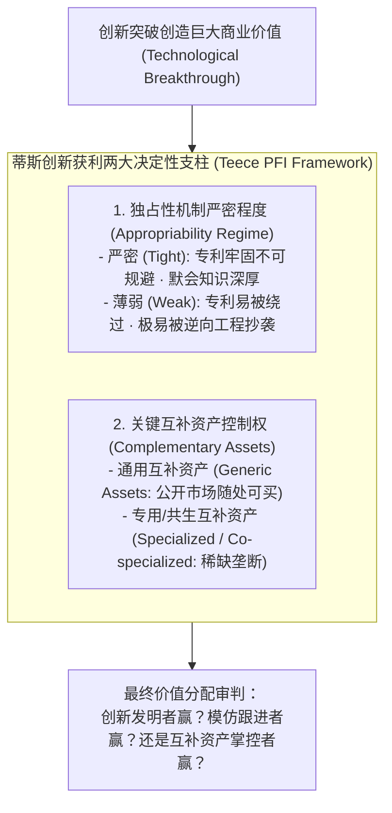
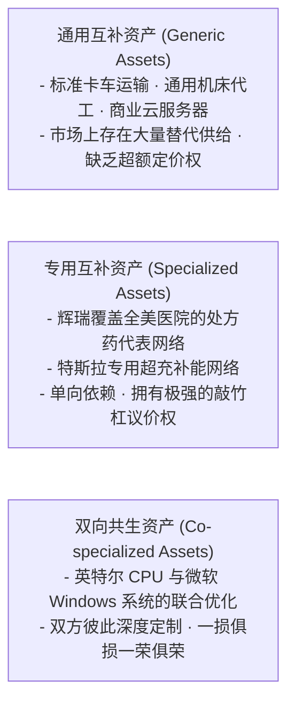

# Lec 09 蒂斯创新获利模型（Teece Model）：独占性机制与互补资产 (Profiting from Innovation: Appropriability and Complementary Assets)

> MIT Sloan School of Management · 15.912 Strategic Management of Innovation · Prof. Fiona Murray & Prof. Rebecca Henderson

## TL;DR

- 戴维·蒂斯（David Teece）1986 年开创性获利框架（PFI）：解开“为什么创新者往往无法捕获商业回报”之谜。
- 独占性机制（Appropriability Regime）：由知识产权法保护力度与技术内在可言明性决定的严密程度。
- 互补资产三分类：通用资产（Generic）、专用资产（Specialized）与双向共生资产（Co-specialized）。
- 蒂斯获利矩阵四大象限：判定先驱发明者、模仿跟随者与互补资产掌控者谁将摘取最终胜利果实。

## 商业史上最残酷的创新者悖论 / The Innovator's Paradox

在科技商业史的漫长画卷中，充斥着无数令人扼腕叹息的悲剧：
- 英国百代公司（EMI）发明了人类历史上第一台计算机断层扫描仪（CT 扫描仪），其科学家戈弗雷·豪斯菲尔德（Godfrey Hounsfield）因此荣获诺贝尔生理学或医学奖。然而短短几年后，通用电气（GE）与西门子（Siemens）凭借强大的医疗器械医院销售网络和制造工程能力，将 EMI 彻底挤出市场，导致 EMI 医疗业务巨亏出售；
- 施乐公司（Xerox PARC）的科学家发明了现代图形用户界面（GUI）、鼠标、以太网和面向对象编程，创造了人类数字文明的底座，然而商业财富的滔天巨浪却被苹果（Apple）和微软（Microsoft）全盘接收。

加州大学伯克利分校著名战略学教授戴维·蒂斯（David Teece）在 1986 年发表了管理学界被引用次数最多的里程碑论文《从技术创新中获利（Profiting from Technological Innovation, PFI）》。菲奥娜·莫雷教授与丽贝卡·亨德森教授在 15.912 中，将**蒂斯模型（Teece Model）**作为解构技术战略价值捕获的核心钥匙：

技术战略的首要任务，绝不是盲目加速研发，而是清醒评估自身所处的技术环境属于哪一种独占性制度，并提前卡位关键的互补资产。

## 独占性机制的两大决定要素：法律与技术自然属性 / Appropriability Regimes

独占性机制（Appropriability Regime）是指外部环境对技术创新成果的保护强度，它独立于企业自身的主观意愿，由两大客观要素共同决定：

### 1. 法律制度保护力度（Legal Protections - IPR）
- **化学与制药行业（极强独占性）**：单款新药的活性分子结构（API）受到精确专利保护，竞争对手只要修改一个官能团往往就会丧失药效，侵权取证极其容易，构成坚不可摧的“严密独占性环境（Tight Regime）”；
- **机械、软件与电子行业（极其薄弱独占性）**：竞品可以通过不同的代码架构、电路设计或结构走线轻易实现相同的功能，绕过专利壁垒（Invent around）。专利诉讼周期漫长且耗资数百万美元，属于“薄弱独占性环境（Weak Regime）”。

### 2. 技术内在的自然属性（Nature of Technology）
- **显性可编码知识（Codified Knowledge）**：技术完全可以通过配方、图纸或软件代码清晰表达，离开实验室后极易被泄露和逆向工程；
- **默会知识（Tacit Knowledge）**：技术深植于顶级老师傅的手艺、团队长年磨合的化学直觉或复杂的微观工艺调校中，竞争对手就算拿到图纸也无法量产。

## 互补资产的三大战略形态分类 / The Taxonomy of Complementary Assets

当一项创新走出实验室时，单靠技术本身无法直接送达客户手中，必须依赖一系列配套基础设施与商业化能力，这些被称为**互补资产（Complementary Assets）**。

在很多高科技产业中，技术发明者往往因为低估了互补资产的构建难度而付出惨痛代价。制造出性能优越的原型机固然困难，但建立一条良品率高达 99% 的自动化量产线、搭建覆盖全国的仓储物流体系，以及培养数千名能为客户排忧解难的驻场工程师，其复杂度和资金消耗往往远超技术研发本身。

蒂斯教授依据技术与互补资产之间的依赖紧密程度，将互补资产严格划分为三大战略形态：

当创新处于薄弱独占性环境时，**谁掌控了不可替代的专用互补资产，谁就拥有了攫取全行业绝大部分商业利润的生杀大权！** 通用资产由于市场上存在成百上千家可替代的供应商，无法成为阻挡对手的护城河；而专用与共生资产往往需要数年甚至数十年的巨额资本沉淀，构成了竞争对手无论如何都无法在短期内跨越的时间压缩不经济壁垒。

## 蒂斯获利矩阵：谁将摘取最终的胜利果实？ / The Teece Appropriability Matrix

蒂斯教授将独占性与互补资产组合成了一个著名的四象限分析矩阵：

| 商业竞争情境 | 关键特征描述 | 典型历史案例 | 最终利益分配结局 (Who Profits?) |
| :--- | :--- | :--- | :--- |
| **象限 I：严密独占性环境 (Tight Appropriability)** | 专利牢不可破，或工艺高度默会保密，对手无法模仿 | 辉瑞万艾可（Viagra）、可口可乐秘密配方 | **创新者通吃 (Innovator Profits)**：创新发明者凭借排他性垄断攫取全部超额利润 |
| **象限 II：薄弱独占 + 通用互补资产** | 技术极易被抄袭，但所需的制造与分销资产随处可买 | 普通轻工业品、简单手机小工具软件 | **竞争最惨烈 (Nobody Profits / Fast Commodity)**：竞品蜂拥而至打价格战，利润迅速归零，客户受益 |
| **象限 III：薄弱独占 + 专用互补资产（创新者掌控）** | 技术容易被模仿，但创新者自己垄断了最核心的专用分销或品牌渠道 | 宝洁（P&G）推出改良洗发水新品、苹果推出新配件 | **创新者赢 (Innovator Profits through Scale)**：虽然技术被抄袭，但创新者凭借渠道先发规模通吃全场 |
| **象限 IV：薄弱独占 + 专用互补资产（外部巨头掌控）** | 技术容易被规避，而初创发明者严重缺乏专用制造、品牌与销售网络 | EMI 推出 CT 扫描仪被 GE 反超、RC Cola 推出无糖可乐被百事碾压 | **掌控互补资产的巨头赢 (Owner of Assets Profits)**：发明先驱沦为悲剧烈士，巨头摘取果实 |

::: theorem 蒂斯创新获利第一定理
在薄弱独占性（Weak Appropriability）的技术赛道中，单纯的技术创新无法保证企业的商业生存。如果创新者未能提前通过并购、自建或长期排他协议锁定不可替代的关键专用互补资产，该创新最终的商业果实必将被掌控该互补资产的行业巨头无情吞噬。
:::

## 我的理解与实践洞察 / Personal Insight

蒂斯模型是每一位科技创业者与 CTO 走向成熟的必修课。

::: insight 商业世界从不奖励发明的智商，只奖励价值捕获的清醒
在许多技术孵化器的路演现场，创业者常常骄傲地宣称：“我们拥有全球排他性发明专利，没有竞品能战胜我们！”
**每当听到这种宣言，有经验的投资人都在心里为他捏一把汗**。
因为在软件、电子和消费领域，绝大多数专利在实战中都脆弱得像一张窗户纸。如果你的技术容易被逆向工程，而你又没有属于自己的品牌心智、大客户信任网络和低成本制造底座，那么巨头只需看一眼你的产品原型，就能在六个月内用强大的供应链和渠道优势将你碾碎。卓越的技术战略家从不把专利当成唯一的防弹衣，他们一手抓技术研发，一手抓互补资产的深耕布局，这才是通往商业胜利的真正正道。
:::

## 思考题与实战研讨

1. 英国皇家消渴饮料公司（RC Cola）早在 1962 年就发明了人类第一款无糖无卡路里可乐（Diet Rite），并在市场上掀起狂潮，为何最终无糖饮料市场的万亿红利全被可口可乐（Diet Coke）和百事可乐（Diet Pepsi）分食殆尽？运用蒂斯模型的第四象限进行详细剖析。
2. 结合蒂斯获利框架，分析在当前自动驾驶算法逐渐开源或同质化的大趋势下，特斯拉（自建整车制造工厂、芯片硬件自研、专有超充补能网络）与纯自动驾驶软件算法初创公司相比，在“价值捕获”能力上展现出了何种压倒性的战略优势？
