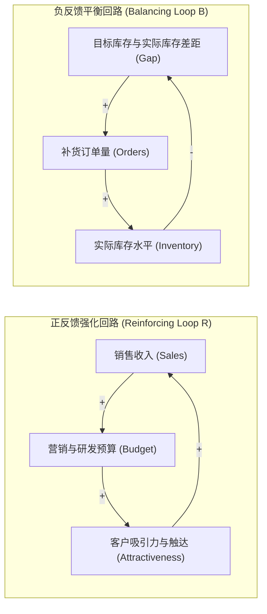
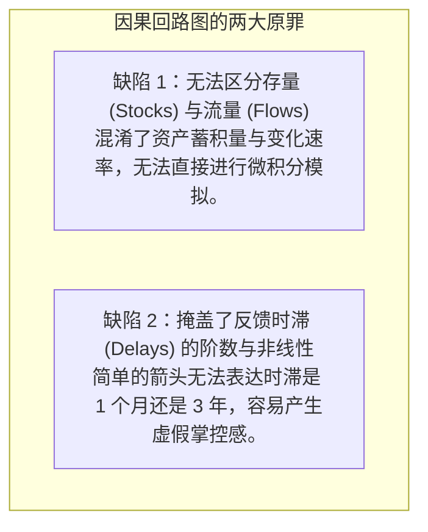

# 因果回路图与反馈极性分析 (Causal Loop Diagrams & Feedback Polarity)

> 知识定位：系统动力学与系统思考的定性建模语言 · 奠基者：Jay W. Forrester & John D. Sterman (MIT Sloan)

## TL;DR

- 因果回路图（CLD）是刻画复杂系统内部因果关系、反馈结构与动态假设的核心图示化建模语言。
- 因果链接极性（+ / -）严格表达变量间偏导数的符号，定义了“同向变动”与“反向变动”的边际因果效应。
- 回路极性由闭环中负链接的数量严格决定：偶数个负链接构成正反馈强化回路（R），奇数个负链接构成负反馈平衡回路（B）。
- 掌握回路主导权转移（Loop Dominance）与时间滞后标记，破除传统线性思维中“原因必然紧邻结果”的认知偏误。

## 概念定义与核心架构

在传统还原论思维中，人们习惯于用“事件-反应”的单向线性因果链条来解释世界：$A \to B \to C$。然而在真实的复杂社会经济系统中，几乎不存在孤立的单向因果；任何决策行动引发的结果，都会沿着因果网络反作用于决策者自身。

MIT 系统动力学创始人杰·福瑞斯特（Jay Forrester）与约翰·斯特曼（John Sterman）指出：**动态复杂性（Dynamic Complexity）的根本源头是系统的反馈结构（Feedback Structure）**。因果回路图正是为了将这些隐性的反馈网络显性化而设计的定性建模工具。

::: definition 因果回路图 (Causal Loop Diagram, CLD)
因果回路图是由一组变量节点以及连接变量的有向因果箭头构成的拓扑网络。它具备三个核心要素：
1. **因果链接 (Causal Link)**：连接原因变量 $X$ 与结果变量 $Y$ 的有向箭头；
2. **链接极性 (Link Polarity)**：箭头旁的“$+$”或“$-$”标记，定义了自变量变动引发因变量变动的方向；
3. **回路极性 (Loop Polarity)**：闭合因果链条的整体属性，标注为强化回路（Reinforcing Loop, 记作 **R** 或 **+**）或平衡回路（Balancing Loop, 记作 **B** 或 **-**）。
:::

如上图所示，强化回路驱动系统的指数增长或恶性崩塌（滚雪球效应），而平衡回路则引导系统走向既定目标或维持稳态（自我调节与抗拒变革）。两者的交互制衡构成了系统动力学的一切行为模式。

## 链接极性与回路极性的严格判定法则

很多初学者容易将链接极性“$+$”和“$-$”误解为“好”与“坏”，或将“$+$”等同于“数值必然上升”。在系统动力学严谨的数学定义中，极性具有无可争议的微积分意义：

::: definition 链接极性的偏导数数学定义
对于因果关系 $Y = f(X, \dots)$：
- **正链接 ($X \xrightarrow{+} Y$)**：表示 $\frac{\partial Y}{\partial X} > 0$。在其他条件不变（Ceteris Paribus）的前提下，若 $X$ 增加，$Y$ 将**高于**其原本应有的水平；若 $X$ 减少，$Y$ 将**低于**其原本应有的水平（即因变量与自变量同向变动）。
- **负链接 ($X \xrightarrow{-} Y$)**：表示 $\frac{\partial Y}{\partial X} < 0$。在其他条件不变的前提下，若 $X$ 增加，$Y$ 将**低于**其原本应有的水平；若 $X$ 减少，$Y$ 将**高于**其原本应有的水平（即因变量与自变量反向变动）。
:::

### 回路极性的数负号法则 (Sign-Counting Rule)
一个闭合回路究竟是强化还是平衡，可以通过微积分链式法则直接推导：
$$\text{Loop Sign} = \text{Sign}\left(\prod_{i=1}^n \frac{\partial X_{i+1}}{\partial X_i}\right)$$
由于正数相乘符号不变，只有负数的出现会翻转乘积符号，因此导出经典实操口诀：

::: theorem 回路极性判断定理
在一个闭合回路中：
1. **若回路中包含偶数个负链接（0, 2, 4, ...），则该回路必然是正反馈强化回路（Reinforcing Loop, R）**；
2. **若回路中包含奇数个负链接（1, 3, 5, ...），则该回路必然是负反馈平衡回路（Balancing Loop, B）**。
:::

::: example 极性判断实战：咖啡与疲劳回路
考查白领的咖啡饮用行为：
- 疲劳感 $\xrightarrow{+}$ 咖啡摄入量（疲劳增加导致喝更多咖啡，正链接）
- 咖啡摄入量 $\xrightarrow{+}$ 血液咖啡因浓度（咖啡摄入增加导致咖啡因增加，正链接）
- 血液咖啡因浓度 $\xrightarrow{-}$ 疲劳感（咖啡因起效后疲劳感被抑制，负链接）  
闭环中包含 1 个负链接（奇数），因此该回路是**负反馈平衡回路 (B)**，其目标是维持精力稳态。

然而紧接着存在次生回路：
- 血液咖啡因浓度 $\xrightarrow{-}$ 深度睡眠质量（咖啡因破坏晚间睡眠，负链接）
- 深度睡眠质量 $\xrightarrow{-}$ 次日清晨疲劳感（睡眠质量差导致疲劳感上升，负链接）
- 次日清晨疲劳感 $\xrightarrow{+}$ 咖啡摄入量（正链接）  
这个次生闭环包含 2 个负链接（偶数），构成**正反馈强化回路 (R)**！它揭示了咖啡因成瘾与慢性疲劳恶性循环的结构机制。
:::

## 因果回路图的核心局限与认知陷阱

虽然因果回路图极度适合向非技术高管和团队直观展示系统反馈假设，但 John Sterman 教授在《Business Dynamics》中严正指出了 CLD 的两大不可逾越的致命缺陷：

::: pitfall 仅凭因果图推断系统行为的幻觉
因果回路图只表达系统的**拓扑结构**，绝不保证唯一的**行为模式**。  
例如：一个由强化回路与平衡回路相互嵌套的系统，究竟会走出指数暴增、平滑趋向目标，还是剧烈震荡崩溃？这完全取决于回路之间谁占据**主导地位（Loop Dominance）**，以及时滞参数的物理大小。仅凭在纸上画 CLD 拍脑袋预测未来，往往会得出灾难性的反向结论。这就是为什么系统动力学必须从 CLD 进化到具备数学可求解能力的**存量流量图（Stock and Flow Diagrams）**。
:::

::: insight 概念升华：因果图作为心智模式的调试器
在商业战略讨论中，团队最大的价值往往不是画出一张复杂的终极因果图，而是**画图过程中暴露出来的认知分歧**。  
当市场总监坚持“降价必然导致利润上升（认为销量弹性的强化回路主导）”，而财务总监坚持“降价导致毛利坍塌（认为单位利润的平衡回路主导）”时，因果回路图迫使双方把各自脑中隐藏的假设完整画出来。通过将隐性的心智模型转变为显性的公共图形，团队才真正拥有了理性辩驳与系统对话的共同语言。
:::
