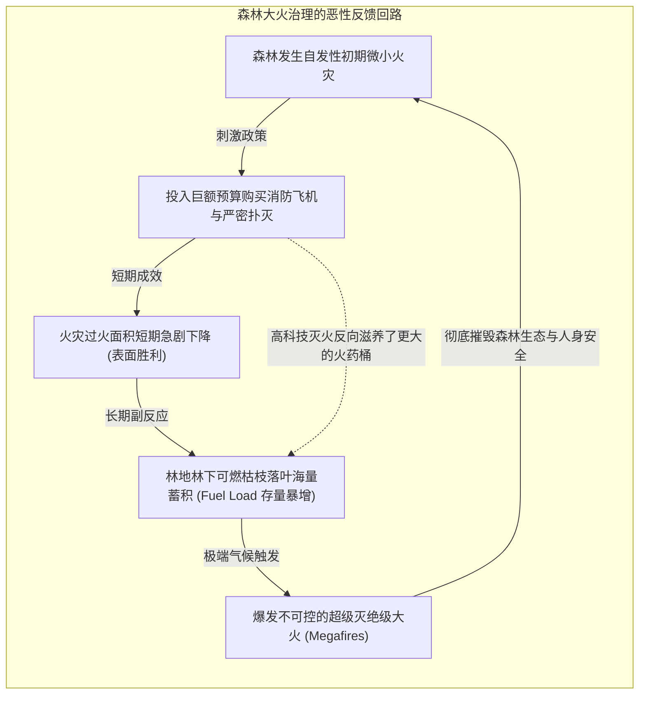

# 政策阻力与反直觉系统行为 (Policy Resistance & Counterintuitive System Behavior)

> 知识定位：复杂系统治理与商业战略设计的核心病理学 · 提出者：Jay W. Forrester & John D. Sterman (MIT Sloan)

## TL;DR

- 政策阻力揭示了复杂社会经济系统的反直觉规律：善意且看似符合逻辑的政策干预，往往会被系统内部的负反馈防御机制所延迟、稀释甚至彻底击溃。
- 确立系统动力学第一黄金律：“今日的问题大多源于昨日的‘英明解决方案’”（Today's problems come from yesterday's solutions）。
- 剖析诱发政策阻力的四大系统机制：隐性侧面回路补偿、长时滞导致的因果错位、非线性临界跃迁与有限理性局部优化。
- 掌握高杠杆解设计协议：放弃在症状层面进行正面硬抗，识别阻碍系统良性演进的深层闭环结构，顺应系统固有动力学实现借力打力。

## 概念定义与系统病理学

在现代企业管理与公共政策制定中，我们频繁目睹这样的怪圈：
- 城市交通拥堵，政府投资百亿拓宽主干道，结果三年后道路拥堵反而比扩建前更为严重（诱导需求效应）；
- 农业部门为了消灭某种害虫喷洒广谱强力杀虫剂，结果不仅未能消灭害虫，反而彻底灭绝了害虫的天敌，引发更具毁灭性的次生虫害爆发；
- 科技公司为了缩短产品延期疯狂往项目组抽调新人，结果老工程师被迫花费 80% 的时间培训新人，项目交付延期进一步恶化（布鲁克斯法则）；
- 医疗界大剂量滥用抗生素消灭细菌，结果加速了“超级耐药菌株”的进化，让传统感染变得无药可救。

MIT 系统动力学宗师约翰·斯特曼（John Sterman）在《Business Dynamics》开篇就将这种普遍的组织宿命定义为**政策阻力（Policy Resistance）**。

::: definition 政策阻力 (Policy Resistance)
政策阻力是指复杂系统表现出的一种普遍趋势：**针对系统特定症状所采取的干预措施，被系统内部未被预见的反馈反应所延迟、稀释、阻滞甚至彻底逆转为更严重的灾难**。  
系统表现得就像具有“免疫系统”一样，顽固地抵抗外部强加的变革意图。
:::

```mermaid
flowchart LR
    subgraph MentalModel["决策者线性心智模型 (Event-Oriented Thinking)"]
        direction TB
        M1["发现系统痛点症状<br>(如项目延期 / 道路拥堵)"] --> M2["采取直觉干预措施<br>(加派人手 / 拓宽道路)"]
        M2 --> M3["预期达成既定目标<br>(项目按期交付 / 交通畅通)"]
    end

    subgraph DynamicReality["系统动力学的客观真实 (Feedback Reality)"]
        direction TB
        R1["政策干预行动"] --> R2["系统显性预期效果"]
        R1 --> R3["【隐性时滞与侧面回路】<br>天敌灭绝 / 诱导新车流 / 沟通负荷激增"]
        R3 -->|"反向抵消并恶化原问题"| R4["引发更严重的次生系统危机"]
    end

    MentalModel =x=|"心智与现实的认知脱节"| DynamicReality
```

## 政策阻力产生的四大系统解剖学机制

为什么人类的高智商决策者总是被政策阻力无情嘲弄？斯特曼教授指出，这并非源于决策者的愚蠢，而是源于人类进化的局部线性思维与复杂多重反馈现实之间的认知断层：

### 1. 补偿性负反馈回路（Compensating Feedback）
复杂系统是一个高度自组织的平衡网络。当你对系统施加外力试图改变某个状态时，外力会激活原本处于休眠状态的**补偿性平衡回路（Balancing Loops）**。系统的内部力量会自动反向发力，抵消你的干预。  
*案例*：低脂食品的流行导致肥胖率飙升。人们误以为吃了“低脂食品”就可以放纵热量，加上食品加工商为了弥补脱脂后的口感损失加入了超额的精制糖，最终导致人体胰岛素暴增与内脏脂肪堆积。

### 2. 空间与时间维度的深层时滞（Delays Across Space and Time）
在复杂系统中，**行动的原因与其导致的最终后果在时间和空间上往往相距甚远**。短期的干预往往会产生极其诱人的“即刻正面成效（Better-Before-Worse）”，麻痹决策者继续加大剂量；而真正致命的负面反馈则潜伏在数月甚至数年之后的长周期尾部（Worse-Later）。

### 3. 非线性临界突变（Nonlinearities and Thresholds）
系统的响应不是简单的按比例放大。在临界阈值以内，系统显得极具容忍度与稳健性；而一旦突破阈值，主导回路会发生戏剧性的**主导权翻转（Shift of Loop Dominance）**，整个系统瞬间陷入雪崩式恶性循环。

### 4. 狭隘边界的外部性转移（Narrow Mental Boundaries）
决策者在定义问题时，人为地将系统划分为“系统内”与“外部环境”。他们自豪地宣布在系统内解决了问题，殊不知只是将熵增与成本无情倾倒给了上下游、未来世代或公共资源（公地悲剧）。

## 葡萄牙森林大火的经典案例剖析

在 15.871 的经典教学案例中，斯特曼教授复盘了葡萄牙国家林业局为期数十年的“灭火悖论”：



::: example 森林灭火政策的悲剧
自然生态系统原本依赖周期性的小型野火清理地表枯枝，维持林木间距与可燃物存量的低位平衡。然而，人类“有火必灭”的绝对化政策，彻底掐断了这种自然泄洪机制。高科技灭火技术创造了长达十年的“虚假繁荣”，但代价是林间干枯可燃物的存量蓄积到了历史极值。最终在 2003 年干燥夏季，一场无法扑灭的超级风暴大火吞噬了葡萄牙 10% 的国土面积。**人类竭尽全力的善意扑救，最终酿成了毁灭性的生态灾难**。
:::

## 破局之道：高杠杆政策设计的系统思考法则

面对顽固的政策阻力，高明的高管该如何打破死局？

::: insight 高杠杆解的设计心法：与其抗拒系统，不如顺势而为
1. **停止在症状表面正面硬拼 (Stop Pushing Harder)**：当一项政策需要消耗越来越巨大的行政、财政与公关力量才能维持勉强成效时，这正是系统发出严重警报的信号。强攻只会让反向补偿回路越绷越紧，最终以断裂告终；
2. **寻找隐性负反馈回路的“刹车片”**：卓越的策略不是往正反馈引擎里猛踩油门，而是找到那个正在死死踩住刹车的平衡回路，并拆除其阻力来源；
3. **将因果边界推向全生命周期**：在出台决策前，强制团队进行“事后反思预演（Pre-mortem System Mapping）”，追问：“如果这个政策获得了 100% 的成功，它将在三年后引发系统其他部门何种防御性反弹？”。顺应系统的反馈物理学，方能达成四两拨千斤的高杠杆治理。
:::
