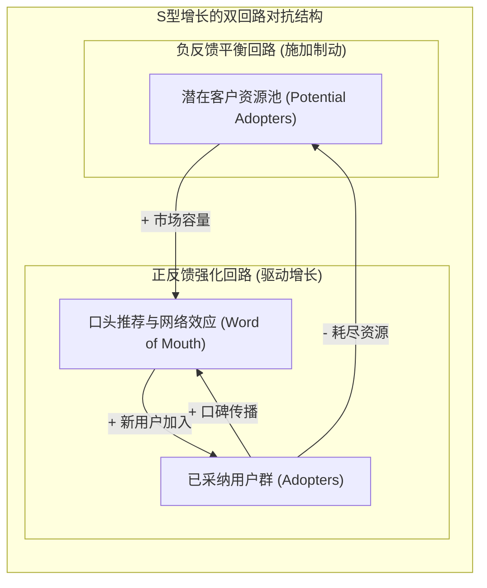
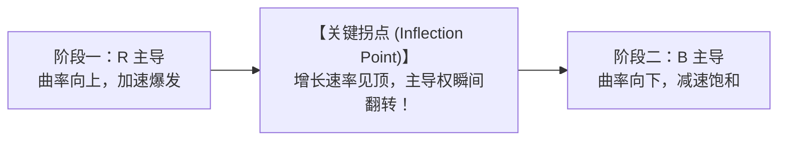

# S 型增长、拐点与承载力限制转移 (S-Shaped Growth & Shifting Loop Dominance)

> 知识定位：创新扩散、市场渗透与生态系统演进的核心非线性动态模型 · 奠基者：Frank Bass, Jay W. Forrester & John D. Sterman

## TL;DR

- S 型增长（Sigmoid Curve）揭示了自然界与商业市场中增长的本质宿命：任何物理系统都不可能实现无限期的纯指数增长。
- 核心动力学机理是“反馈回路主导权的动态转移（Shift of Loop Dominance）”：前期正反馈强化回路主导驱动加速暴增，后期负反馈平衡回路主导逼近承载力上限。
- 拐点（Inflection Point）是增长的最高速度时刻，也是二次导数等于零的临界切换点；跨越拐点后，系统从“加速扩张”骤变为“减速收敛”。
- 揭示企业在拐点时刻最致命的“线性外推悲剧”：盲目在市场见顶前夜大举扩张产能，最终沦为严重产能过剩与资本链断裂的牺牲品。

## 概念定义与核心架构

在科技初创企业与资本市场的叙事中，“指数级曲棍球杆增长（Hockey-Stick Exponential Growth）”被无数创业者顶礼膜拜。然而，在系统动力学严密的物理学世界中，**纯粹的指数增长只是一种短暂的幻象**。任何根植于现实物理世界的系统（新产品用户群、病毒感染者、生态种群、资本积累），其增长必然受制于有限的资源边界与环境承载力（Carrying Capacity）。

当一个系统既包含自我强化的正反馈引擎，又包含环境资源的负反馈硬约束时，系统便会自发走出一条优美的**S 型增长曲线（S-Shaped Growth）**。

::: definition S 型增长 (S-Shaped Growth / Logistic Growth)
S 型增长是指系统状态变量随时间演进呈现出的一种非线性形态：
1. **启动加速期 (Early Acceleration)**：存量水平较低，正反馈强化回路占主导，增长速率随存量增加而指数级加速；
2. **拐点临界期 (Inflection Point)**：增长速率达到全生命周期的历史绝对峰值；
3. **减速饱和期 (Late Deceleration)**：资源枯竭或市场见顶，负反馈平衡回路取代正反馈夺取主导权，增长速率持续下挫，系统状态渐近趋向于环境承载力极限 $K$。
:::

如上图所示，正反馈回路如同一台大马力引擎，促使老用户不断拉动新用户入场；而负反馈回路如同一套灵敏的制动刹车片，随着池子里的潜在用户越来越少，寻找新用户的阻力呈几何级数激增。增长的本质，就是引擎与刹车片在时间轴上的生死角力。

## 回路主导权转移的微积分机理

S 型增长最深刻的数学与管理内涵在于**回路主导权转移（Shifting Loop Dominance）**。考查经典的逻辑斯蒂微分方程（Logistic Equation）：
$$\frac{dN}{dt} = r N \left(1 - \frac{N}{K}\right)$$
其中 $N(t)$ 为存量规模，$r$ 为内生增长率常数，$K$ 为系统终极承载力。

对时间 $t$ 再次求导，考查增长的加速度（二阶导数）：
$$\frac{d^2N}{dt^2} = r \frac{dN}{dt} \left(1 - \frac{2N}{K}\right)$$

这一公式清晰地划分了系统演进的三个截然不同的物理阶段：

| 发展阶段 | 存量区间与主导回路 | 数学一阶与二阶导数 | 典型组织特征与商业感知 |
|---|---|---|---|
| **前期：加速扩张** | $N < \frac{K}{2}$ **强化回路 (R) 主导** | $\frac{dN}{dt} > 0$ $\frac{d^2N}{dt^2} > 0$ (加速度为正) | 业务爆发，招人容易，现金流激增。团队沉浸在“指数神话”中，误以为这种态势将永恒持续。 |
| **临界：最大拐点** | $N = \frac{K}{2}$ **R 回路与 B 回路力量均等** | $\frac{dN}{dt} = \text{Max}$ (流速达到顶峰) $\frac{d^2N}{dt^2} = 0$ (加速度归零) | **单日新增销售额达到历史最高纪录！** 财报极其辉煌，但在动力学底层，制动刹车力量已经开始反超引擎。 |
| **后期：减速收敛** | $N > \frac{K}{2}$ **平衡回路 (B) 主导** | $\frac{dN}{dt} > 0$ $\frac{d^2N}{dt^2} < 0$ (加速度为负) | 客户获取成本（CAC）断崖式暴涨，市场开拓举步维艰，系统逐步逼近天花板。 |

## 弗兰克·巴斯创新扩散模型（Bass Diffusion Model）

在 MIT 15.871 的教学与作业（如 Assignment 4 VCR 市场扩散模型）中，S 型增长被具象化为管理科学著名的**巴斯扩散模型（Bass Model）**。该模型将新用户的来源严格解构为两类不同的人群与机制：

::: definition 巴斯创新扩散方程
$$\text{Adoption Rate } S(t) = p \cdot [\text{Potential Adopters}] + q \cdot \frac{[\text{Adopters}]}{[\text{Total Market}]} \cdot [\text{Potential Adopters}]$$
- **$p$：创新系数 (Coefficient of Innovation)**：表征外部力量（大众媒体广告、公关发布会、尝鲜先锋）驱动的自发购买，是一个外生无反馈过程；
- **$q$：模仿系数 (Coefficient of Imitation)**：表征内部力量（熟人口碑、社交网络示范、人传人效应）驱动的病毒式裂变，这正是驱动前期指数加速的强大正反馈核心。
:::

在录像机（VCR）、智能手机以及各类现代 SaaS 软件的早期普及中，正反馈回路通过网络效应（互补软件越丰富 $\to$ 硬件价值越高 $\to$ 买硬件的人越多 $\to$ 吸引更多软件开发者）瞬间统治市场，将技术从创新孤岛推向大众普及。

## 拐点时刻的致命陷阱：线性外推悲剧

商业史上最悲壮的溃败，几乎无一例外发生在**系统跨越拐点（$N = K/2$）的那一瞬间**。

::: pitfall 线性外推与产能过剩的雪崩
由于信息反馈与物理采购存在漫长时滞，许多企业的高管在大脑中习惯于做“直线外推”：
1. 在拐点时刻，当看到单月新增用户突破历史新高、工厂连轴转依然断货时，高管误以为“爆发才刚刚开始”；
2. 他们基于当期的最高增速，豪掷百亿美元举债扩建全球工厂、租赁万台服务器、招聘数万名销售；
3. 然而，他们完全没有意识到，**拐点的到来意味着增长最快的黄金时代已经结束，随之而来的必然是增速的急剧减速与见顶**；
4. 当两年后庞大的新工厂终于竣工落成时，市场饱和期已经悄然降临。企业背负着天文数字的固定折旧与利息，遭遇需求枯竭，最终瞬间坠入破产深渊（如著名的 People Express 航空崩塌、以及 2000 年代初全球光纤网络电信泡沫破灭）。
:::

::: insight 战略领导者的拐点直觉
卓越的企业家与系统思考者的区别，在于他们对“拐点”具有本能的敬畏。  
当全行业都在为史上最强劲的单季利润狂欢庆功时，拥有系统动力学视野的领导者却在冷静审视潜在市场资源的枯竭曲线与边际获客成本的异动。**真正的战略第二曲线，必须在第一曲线跨越拐点之前就坚决孵化并点燃**。一旦等到第一曲线减速收敛甚至见顶停滞时再去自救，沉重的组织惯性与滞后效应将剥夺你所有的生存空间。
:::
