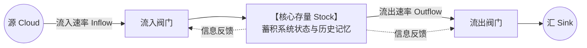
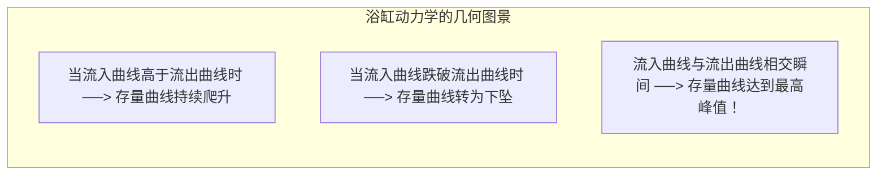

# 存量与流量结构及积分数学本质 (Stocks, Flows & Calculus Foundations)

> 知识定位：系统动力学定量仿真与物理建模的唯一基石 · 奠基者：Jay W. Forrester & John D. Sterman (MIT Sloan)

## TL;DR

- 存量（Stock）表征系统的物质与状态蓄积，流量（Flow）表征状态随时间变化的瞬时速率；两者本质上是微积分中的“积分与导数”。
- 掌握“快照测试法（Snapshot Test）”精准区分存量与流量：当时间瞬间冻结时，依然存在物理数值的为存量，瞬间归零的为流量。
- 确立“浴缸隐喻”的三大数学推论：存量变动仅取决于净流量；流入大于流出时存量必然上升（即使流入正在断崖式暴跌）；存量极值必出现在流入等于流出的交点处。
- 揭示跨学科实证中的“浴缸认知赤字（Bathtub Effect Fallacy）”：高知人群普遍混淆存量与流量，导致气候政策、财政赤字与库存决策的系统性灾难。

## 概念定义与核心架构

在经典物理学与控制论中，任何动力学系统的状态都可以严格表述为状态变量（State Variables）与微分方程组。系统动力学用极其直观、符合工程直觉的图形语言将其定义为**存量（Stocks）**与**流量（Flows）**。

::: definition 存量与流量 (Stocks & Flows)
- **存量 (Stock / Level)**：系统在某一特定历史时刻所蓄积的物理或信息资源。存量赋予系统以记忆、惯性与弹性，表征了系统的瞬时状态（如银行存款余额、仓库中的成品库存、大气中温室气体的累积浓度、技术研发人员总数）；
- **流量 (Flow / Rate)**：单位时间内流入或流出存量的速率。流量改变存量的数值，是驱动系统状态演进的唯一物理原因（如每月存入的工资、每日出库发货量、每年的碳排放速率、每月招聘/离职人数）。
:::



如上图所示，在系统动力学标准符号规范中：
- 存量用**矩形框**表示，相当于蓄水的浴缸；
- 流量用带有**水龙头阀门**的管道箭头表示；
- 虚线箭头表示**信息因果链**，表明阀门的开合决策取决于对存量状态的度量（如库存越低，补货阀门开得越大）；
- 云朵（Cloud）表示模型的边界，即假设系统外的源头（Source）与汇聚点（Sink）具有无限容量。

## 微积分本质：浴缸数学模型

存量与流量的关系在数学上是严密的微积分积分与微分映射：

::: theorem 存量与流量的微积分基本定理
设系统在初始时刻 $t_0$ 的存量水平为 $S(t_0)$，流入速率为 $\text{Inflow}(s)$，流出速率为 $\text{Outflow}(s)$。则在任意时刻 $t$，存量 $S(t)$ 的绝对数值为净流量对时间的积分：
$$S(t) = S(t_0) + \int_{t_0}^t \left[ \text{Inflow}(s) - \text{Outflow}(s) \right] ds$$
对上式两端求导，得到存量随时间的瞬时变化率：
$$\frac{dS(t)}{dt} = \text{Net Flow}(t) = \text{Inflow}(t) - \text{Outflow}(t)$$
:::

基于微积分基本定理，可以推导出关于管理决策的三大反直觉铁律：

| 运行状态 | 净流量条件 | 存量行为轨迹 | 商业与战略管理启示 |
|---|---|---|---|
| **状态一** | $\text{Inflow}(t) > \text{Outflow}(t)$ | **存量 $S(t)$ 必然上升** | **即使流入速率正在急剧下降**，只要流入依然大于流出，存量就绝对不会减少！ |
| **状态二** | $\text{Inflow}(t) < \text{Outflow}(t)$ | **存量 $S(t)$ 必然下降** | 只要流出大于流入，无论你如何加大流入，存量依然在被抽空。 |
| **状态三** | $\text{Inflow}(t) = \text{Outflow}(t)$ | **存量 $S(t)$ 达到局部极值** | **存量的峰值或谷底必然出现在流入等于流出的交点时刻**，此时导数为零。 |



## 快照测试法（Snapshot Test）：存量与流量的判别准则

在实际建模中，初学者常常混淆变量是存量还是流量（例如将“销售额”或“通货膨胀”误设为存量）。John Sterman 教授在 MIT 课堂上总结了一个极为可靠的物理学判别法：

::: definition 快照测试法 (The Snapshot Test)
想象用一台超级高速相机给整个现实世界拍下一张快照，或者让物理世界的时间**瞬间冻结（Freeze Time）**：
- **存量 (Stock)**：在时间冻结的刹那，**依然具有非零客观数值并可以被直接清点度量**。例如：此时此刻工厂仓库里的汽车台数、银行账户里的美元数、水库里的立方米水量；
- **流量 (Flow)**：在时间冻结的刹那，**数值瞬间化为虚无**。因为流量必须依赖时间段 $\Delta t$ 才能定义。例如：瞬间冻结时，“每秒行驶速度”消失了，“每月销售率”消失了，“每秒通水量”也消失了。
:::

此外，量纲分析（Dimensional Analysis）也是硬性判别依据：**流量的单位必须是存量的单位除以时间单位**。若存量单位是“人”，则流量单位必须是“人/年”；若存量是“美元”，流量必为“美元/月”。

## 浴缸效应认知赤字：人类心智的盲区

为什么微积分如此严密的存量流量原理，在现实商业和政治决策中屡屡被违背？John Sterman 与 Linda Booth Sweeney 在《System Dynamics Review》上发表了震撼学术界的系列实证论文《浴缸动力学测试》（*Bathtub Dynamics*）。

他们向拥有名校理工与商学背景的 MIT 研究生展示了最基础的进出水图表，并要求他们根据进水率预测水池水位变化。实验结果令人震惊：**超过 80% 的 MIT 精英学生彻底挂科！**

::: pitfall 典型的模式匹配偏误 (Pattern Matching Fallacy)
绝大多数受试者的大脑自动采用了直觉的“相关性模式匹配”：
- 当他们看到“流入曲线正在从 100 降到 60”时，他们本能地在脑中画出“存量水位也正在下降”！
- 他们完全无视了此时的“流出速率只有 20”这一事实。只要流入（60）依然远大于流出（20），净流量就是正的（+40），浴缸的水位依然在以极快的速度飞涨！
:::

```mermaid
flowchart LR
    subgraph HumanIntuition["直觉心智的致命误区"]
        H1["看到排放量在下降 (Inflow is falling)"] --> H2["错误推论：环境正在好转，浓度正在下降！"]
    end

    subgraph PhysicalReality["客观物理世界的微积分真实"]
        R1["全球年碳排放 400 亿吨 仍远大于 自然吸收 200 亿吨"] --> R2["大气碳浓度存量持续加速暴增，逼近崩溃阈值！"]
    end

    HumanIntuition =x=|"80% 人群的认知脱节"| PhysicalReality
```

::: insight 商业领导者的存量思维修养
在企业高层战略中，混淆存量与流量是导致企业突然暴毙的最常见隐形杀手。  
例如：许多科技公司 CEO 看到本季度的营收现金流（流量）依然处于高位，就误以为公司极其健康；却完全忽视了用户口碑资产、员工组织信任与技术代码架构健康度（深层核心存量）已经因为过度榨取而见底。**流量决定当下，存量决定生死**。卓越领导者的核心胜任力，是穿透喧嚣的当期流量报表，时刻精准把脉系统底层关键存量的蓄积与枯竭。
:::
