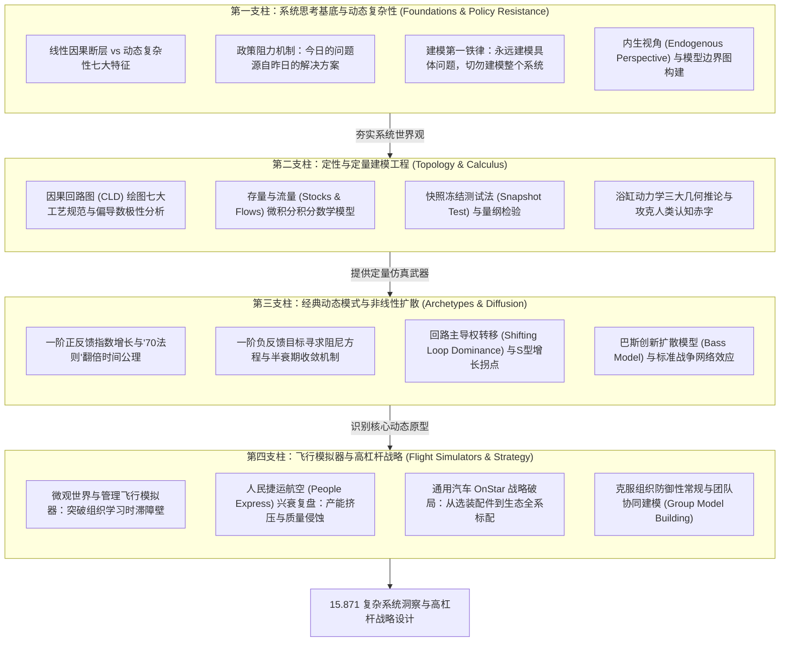

# 15.871 系统动力学导论 (Introduction to System Dynamics)

> **授课院系**：MIT Sloan 管理学院 · 系统动力学学科组（System Dynamics Group）  
> **核心导师**：John Sterman（Jay W. Forrester Professor of Management, MIT Killian Award 获得者）、Hazhir Rahmandad、Nelson Repenning  
> **核心教材**：John D. Sterman, *Business Dynamics: Systems Thinking and Modeling for a Complex World* (McGraw-Hill / Irwin)  
> **课程定位**：MIT Sloan MBA 高阶核心方法论课程（半学期 6 学分，与 15.872 共同构成 MIT 系统动力学基石教学序列），系统思考与仿真建模全球策源地

## TL;DR

- 颠覆传统“事件-反应”的局部线性因果偏见，确立以多重反馈、物理时滞与非线性为核心的系统动力学世界观。
- 确立“永远建模问题，切勿建模系统”的建模铁律，贯彻“内生视角（Endogenous Perspective）”，阻断将系统失败推诿给外部的心理防御。
- 建立从因果回路图（CLD）到微积分存量流量图（Stock and Flow Diagrams）的严密物理仿真桥梁，攻克浴缸认知赤字。
- 全套讲义系统覆盖动态复杂性、问题界定与参考模式、反馈回路极性、存量流量积分方程、指数与目标寻求、巴斯创新扩散、人民捷运航空兴衰模拟与高杠杆政策设计。

## 课程体系与方法论建构

在由全球化供应链、颠覆性技术裂变与地缘博弈构成的当代商业丛林中，企业管理者面临的最严峻挑战从来不是“信息匮乏”，而是**“缺乏理解系统动态复杂性的认知框架”**。无数看似英明、经过严密论证的商业决策，在推行数月或数年后，往往被系统自身未被预见的反馈反应所延迟、稀释，甚至反噬为更惨烈的危机。这种“今日的问题大多源自昨日英明决策”的悲剧宿命，即是管理科学中著名的**政策阻力（Policy Resistance）**。

1956 年，计算机科学先驱、磁芯内存发明者杰·福瑞斯特（Jay W. Forrester）在 MIT Sloan 管理学院创立了**系统动力学（System Dynamics）**这一划时代的跨学科领域。福瑞斯特开创性地将控制论工程学、数字计算机仿真与组织心理学深度熔炼，开辟了人类研究社会复杂系统的新纪元。随后，其弟子、MIT 最高学术荣誉 Killian Award 获得者约翰·斯特曼（John Sterman）教授通过经典巨著《商业动力学》（*Business Dynamics*），将这门严谨的仿真学科拓展至现代企业战略、气候治理与全球产业生态。

MIT 15.871《系统动力学导论》正是这套思想体系的基石入口。课程向学习者宣告：**管理不是静态的教条套用，而是一门关于反馈物理学的具身设计艺术**。

本知识库以 John Sterman 教授领衔的 MIT Sloan 教学大纲为骨架，横向融合微积分微分方程、认知心理学与真实产业战役复盘，构建了一套从定性系统思考跃迁至定量计算机仿真的四支柱方法论模型：

这四大支柱紧密衔接、层层递进：
1. **第一支柱（系统思考基底与动态复杂性）**：帮助管理者破除线性的头痛医头思维，确立“以系统自身内部结构解释系统行为”的内生视角；
2. **第二支柱（定性与定量建模工程）**：构筑严密的微积分建模底座，通过存量流量网络将模糊的商业直觉转化为可计算、可复现的仿真方程；
3. **第三支柱（经典动态模式与非线性扩散）**：解构自然界与商业战场最底层的增长与衰亡原型，掌握在增长拐点来临前夕识别制动阻力的敏锐嗅觉；
4. **第四支柱（飞行模拟器与高杠杆战略）**：将模型投入虚拟微观世界中接受极端检验，识别反直觉的高杠杆政策支点，并通过团队协同建模将系统智慧转化为组织战略共识。

## 讲义全景地图与学习导航

全套课程按照“系统哲学 $\to$ 定性建模 $\to$ 微积分存量流量 $\to$ 一阶线性动态 $\to$ 非线性 S 型增长 $\to$ 飞行模拟器实战 $\to$ 组织高杠杆政策落地”的科学闭环推进：

| 讲次 | 核心模块与理论精要 | 解决的关键痛点 | 对应讲义 |
|---|---|---|---|
| **第 1 讲** | **复杂系统的动态复杂性与政策阻力** *(John Sterman, Business Dynamics Ch. 1-2; Jay Forrester)* | 破除“事件-反应”的线性局限；剖析政策阻力与反直觉行为；掌握管理飞行模拟器与微观世界学习原理。 | [lec1.md](./lec1.md) |
| **第 2 讲** | **建模目的与参考模式：界定动态问题** *(Sterman Ch. 3; Nelson Repenning & Hazhir Rahmandad)* | 贯彻“建模问题而非系统”铁律；掌握建模标准五步法；绘制时间轴参考模式；构建模型边界图与内生视角。 | [lec2.md](./lec2.md) |
| **第 3 讲** | **因果回路图与反馈极性分析：系统拓扑结构与绘图规范** *(Sterman Ch. 5; 15.871 Recitation 2)* | 严格区分因果与统计相关；运用偏导数与数负号法则判定回路极性；落地 CLD 绘图七大工艺规范与时滞标记。 | [lec3.md](./lec3.md) |
| **第 4 讲** | **存量与流量结构：系统的状态与速率** *(Sterman Ch. 6; 15.871 Recitation 3 & Assignment 3)* | 区分状态存量与变化速率；掌握微积分积分方程；运用快照测试法与量纲分析；解构浴缸动力学三大几何推论。 | [lec4.md](./lec4.md) |
| **第 5 讲** | **简单系统动力学：指数增长与目标寻求** *(Sterman Ch. 7-8; 15.871 Recitation 4)* | 求解一阶正反馈微分方程与“70法则”翻倍时间；求解一阶负反馈目标寻求阻尼方程与半衰期；绘制相空间微分轨迹。 | [lec5.md](./lec5.md) |
| **第 6 讲** | **S型增长、网络效应与创新扩散：巴斯模型与标准之争** *(Sterman Ch. 9-10; Frank Bass; Assignment 4 VCR Case)* | 剖析回路主导权转移与拐点二阶导数；建立巴斯创新扩散方程（$p$ 广告与 $q$ 口碑）；复盘 VHS 与 Betamax 网络效应之战。 | [lec6.md](./lec6.md) |
| **第 7 讲** | **动态决策与管理飞行模拟器：People Express 航空兴衰** *(Sterman Ch. 1 & 10; 15.871 Recitation 5)* | 复盘人民捷运航空五年腾飞与瞬间破产悲剧；解构运力资产与服务人力时滞错配；洞察产能挤压恶性循环；破除盲目做大规模迷思。 | [lec7.md](./lec7.md) |
| **第 8 讲** | **鲁棒政策设计与组织学习：从模型到商业战略** *(Sterman Ch. 10 & 22; GM OnStar Case; Chris Argyris)* | 区分参数微调与结构性政策重塑；复盘通用汽车 OnStar 车联网生态战略跃迁；克服组织防御性常规；推行团队协同建模（GMB）。 | [lec8.md](./lec8.md) |

## 核心概念索引

为支持跨学科检索与 RAG 向量关联，本课程独立沉淀了四个高频复用的基础概念页面：

- [因果回路图与反馈极性分析 (Causal Loop Diagrams & Feedback Polarity)](./concept/causal-loop-diagrams.md)：系统思考的定性建模语言，因果连接偏导数定义、数负号极性法则与绘图禁忌。
- [存量与流量结构及积分数学本质 (Stocks, Flows & Calculus Foundations)](./concept/stocks-and-flows.md)：系统动力学定量建模基石，快照测试法、微积分积分基本定理与浴缸效应认知赤字破除。
- [政策阻力与反直觉系统行为 (Policy Resistance & Counterintuitive Behavior)](./concept/policy-resistance.md)：复杂系统病理学，为何对症下药的良方往往沦为剧毒砒霜，以及高杠杆解的寻找协议。
- [S 型增长、拐点与承载力限制转移 (S-Shaped Growth & Shifting Loop Dominance)](./concept/s-shaped-growth.md)：技术创新扩散与组织增长的极限物理学，巴斯扩散模型、回路主导权切换与线性外推悲剧。

## 课程实践大作业与仿真工具链

MIT 15.871 是一门高度注重计算机实操与实验仿真的高强度课程。学员使用全球顶级工业级系统动力学建模仿真软件 **Vensim PLE (Personal Learning Edition)** 与交互式飞行模拟器完成作业：

1. **Assignment 0: 仿真环境部署与初阶运行 (Vensim PLE Setup)**：安装配置建模软件，学习变量定义、单位校验与数值积分求解器（Euler / Runge-Kutta）配置；
2. **Assignment 1: 首个动态系统与流行病扩散仿真 (First Dynamic Models & SARS Case)**：构建传染病 SIR 存量流量模型，观察正反馈传染与负反馈康复之间的非线性相互作用；
3. **Assignment 2: 问题界定与因果回路概念化 (Problem Articulation & CLD Formulation)**：挑选具有战略争议的商业挑战，绘制时间轴参考模式，构建多闭环因果回路图并完成极性数学推演；
4. **Assignment 3: 存量流量网络测绘与量纲分析 (Mapping Stocks and Flows & Pump Network)**：针对大型重工化工厂复杂机泵维护网络，实现守恒物质流与非守恒信息流的严密微积分建模；
5. **Assignment 4: 创新扩散与格式之争定量模拟 (The VCR Market Diffusion Model)**：定量构建巴斯扩散方程，测算录像机历史普及拐点，模拟网络效应与互补片源资产对产业倾斜的决定性影响；
6. **People Express 飞行模拟对抗演练 (The Flight Simulator Debrief)**：在多轮高压决策沙盘中模拟运力调度、票价调整、员工薪酬与招聘节拍，亲身体验系统失衡与破产崩塌。

---

本资料系统整理自 [MIT OpenCourseWare (15.871 Fall 2013)](https://ocw.mit.edu/courses/15-871-introduction-to-system-dynamics-fall-2013/)，深度融合 MIT Sloan 系统动力学学科组经典专著《Business Dynamics》与学术实证，遵循 Creative Commons BY-NC-SA 4.0 许可协议，仅供个人学习与学术研究使用。
