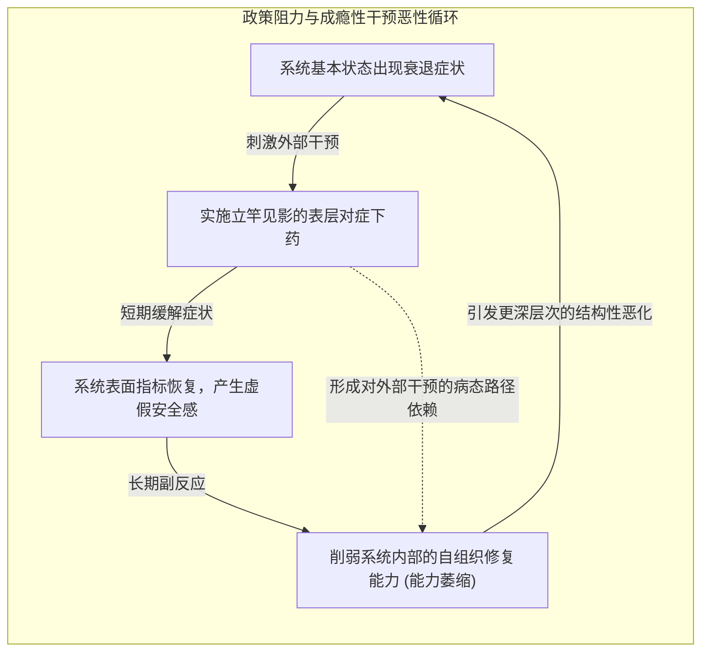

# Lec 1 复杂系统的动态复杂性与政策阻力 (Dynamic Complexity & Policy Resistance)

> MIT Course 15 · System Dynamics · 复杂系统动力学与管理决策

## TL;DR

- 揭示现代管理决策的核心困境：管理者的思维模式以“事件-反应”的局部线性因果为主导，而现实世界充斥着多重反馈、长时滞与非线性。
- 确立系统动力学核心公理：“今日的问题大多源自昨日的‘英明决策’”（Today's problems come from yesterday's solutions）。
- 剖析政策阻力（Policy Resistance）的发生机制：系统的补偿性负反馈与侧面回路如何延迟、稀释并反向击溃管理干预。
- 提出“微观世界与管理飞行模拟器（Management Flight Simulators）”学习范式：压缩时间与空间，突破组织学习的虚拟现实试验场。

## 商业战略的破产怪圈：为什么英明决策总是失败

在商业界与公共政策领域，我们反复目睹令人费解的现象：无数由全球顶尖咨询机构精心设计、由高智商管理团队全力推进的商业变革与政策干预，最终不仅未能解决初衷问题，反而引发了前所未有的系统性灾难。
- 企业为了提升季度利润大幅削减设备维护预算，短期内财报亮眼，两三年后却遭遇设备大面积故障与灾难性停产；
- 硅谷巨头为了加速严重延期的软件项目疯狂招募新程序员，结果老员工被迫花费巨额时间指导新人，项目交付反而进一步崩塌（布鲁克斯法则）；
- 政府出台严厉的农产品价格保护与补贴政策，初衷是保护贫困中小农户，结果补贴全被大型农业垄断资本截留，中小农户反而加速破产。

MIT Sloan 系统动力学系主任约翰·斯特曼（John Sterman）在《Business Dynamics》开篇指出：**这些失败绝非个案偶然，而是源于人类心智模型与物理世界运行法则之间的根本性断层**。

```mermaid
flowchart LR
    subgraph MentalModel["传统线性心智模型 (Linear Mindset)"]
        direction TB
        M1["识别问题痛点 (Problem)"] --> M2["制定直觉干预政策 (Decision)"]
        M2 --> M3["期望达成既定目标 (Goal)"]
    end

    subgraph DynamicReality["系统动力学的客观法则 (Systemic Reality)"]
        direction TB
        R1["管理决策行动"] --> R2["即时显性效果 (Short-term)"]
        R1 --> R3["【隐性侧面回路与长时滞】<br>环境损耗 / 行为代偿 / 竞争对手反应"]
        R3 -->|"反向抵消并恶化原问题"| R4["衍生出更严峻的系统性危机"]
    end

    MentalModel =x=|"心智模型与系统现实的认知鸿沟"| DynamicReality
```

## 动态复杂性（Dynamic Complexity）的七大特征

很多管理者常将“细节复杂性（Detail Complexity）”与“动态复杂性（Dynamic Complexity）”混为一谈。组合一副 52 张的扑克牌有 $52!$ 种可能，这是细节复杂；而哪怕只有两三个变量相互纠缠的系统，也会表现出完全无法凭直觉预测的混沌波动，这才是动态复杂。

::: definition 动态复杂性的七大内在特征 (Sterman Framework)
1. **持续变化 (Constantly Changing)**：系统从不停留在静态平衡点上，演变是系统的绝对属性；
2. **紧密关联 (Tightly Coupled)**：一切事物都直接或间接与其余事物相互连接，不存在真正的孤立孤岛；
3. **反馈驱动 (Governed by Feedback)**：决策者的行动不仅影响外部环境，环境的变化最终会回弹并彻底改变决策者自身的未来情境；
4. **非线性响应 (Nonlinear)**：效应并不与原因成简单正比，在跨越系统临界阈值时会发生剧烈的相变与主导权转移；
5. **历史依赖 (History-Dependent / Path-Dependent)**：系统今天的状态不仅取决于当下的输入，更取决于其过去漫长的演化轨迹；许多演进具有不可逆性；
6. **自组织协调 (Self-Organizing)**：系统的微观局部相互作用会自发涌现出宏观复杂的全局模式；
7. **反直觉行为 (Counterintuitive)**：原因与结果在时间和空间上往往相距甚远，凭借局部症状开出的药方通常会让病情更加恶化。
:::

## 政策阻力：系统的免疫反弹

复杂系统并非一块任人揉捏的橡皮泥。当你试图对系统施加外力以改变其固有轨迹时，系统会自发调动内部的各种代偿机制进行抵抗。

::: definition 政策阻力 (Policy Resistance)
政策阻力是指：**系统对外部干预措施所表现出的抵制、吸收、稀释乃至彻底逆转的固有动力学倾向**。  
正如杰·福瑞斯特（Jay Forrester）在 1971 年开创性论文《社会系统的反直觉行为》（*Counterintuitive Behavior of Social Systems*）中所指出的：社会经济系统的结构极其复杂，以至于直觉上最吸引人、最政治正确的政策，往往也是最致命的毒药。
:::



如上图所示，对症下药的外部干预往往具有强烈的“成瘾性”：它在短期内迅速压制症状（Better-Before-Worse），却在水面之下悄然侵蚀了系统固有的造血与调节能力，最终将组织推向万劫不复。

## 管理飞行模拟器：打破组织学习障碍

为什么人类在漫长的历史中无法通过“试错法”自然学会管理复杂系统？John Sterman 教授指出，传统的科学经验主义学习循环在复杂系统中彻底瘫痪：
- **学习时滞过长**：一项战略投资的灾难性后果可能在 10 年后才爆发，彼时当年的决策者早已升迁或退休；
- **变量混杂与无对照组**：现实世界只发生一次，管理者无法让时钟倒流并在相同条件下测试另一套假设；
- **惩罚成本过高**：在现实中把公司作为试验田，一次重大的战略试错就足以让企业彻底破产清算。

::: definition 微观世界与管理飞行模拟器 (Microworlds & Management Flight Simulators)
系统动力学给出的解药，是构建**管理飞行模拟器（Management Flight Simulators）**。  
正如宇航员在进入太空前必须在模拟舱中经历成千上万次逼真的险情演练，管理者在执掌复杂企业前，也必须在压缩了时间与空间的计算机“微观世界”中，亲身体验自身决策在未来 5 年、10 年乃至 20 年所引发的震荡与连锁反应。
:::

::: insight 系统思考者的第一修养：将因果边界收归内生
平庸的管理者在遭遇失败时，永远在寻找替罪羊：“外部宏观经济下行”、“竞争对手恶意降价”、“消费者不可理喻”、“员工缺乏执行力”。他们把自己当成外部不可抗力的被动受害者。  
**卓越的系统思考者拥有截然不同的世界观：他们坚信系统的大多数灾难都是系统自身内部结构与内生决策规则所必然诱发的结果**。外部环境不过是一颗微小的扰动火星，而真正决定火势是熄灭还是化为滔天火海的，是组织内部自己堆砌的枯枝燃料（反馈结构）。系统动力学不仅是一门严谨的数学仿真科学，更是一种将目光从指责外部转向审视自身内在反馈结构的深沉哲学。
:::
