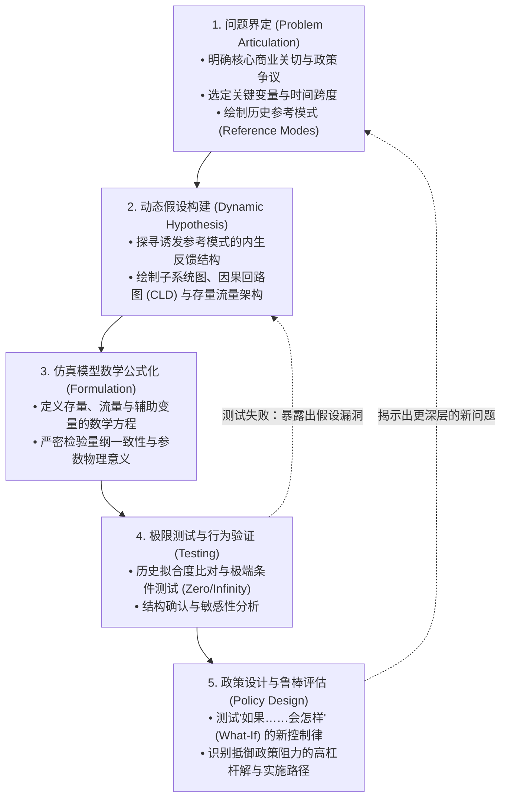
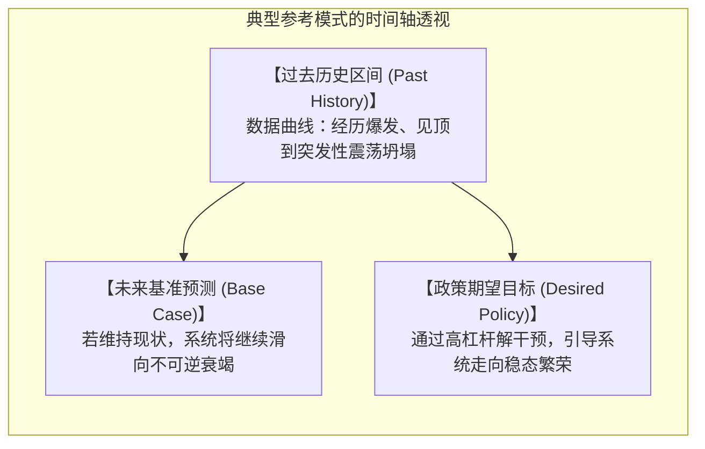

# Lec 2 建模目的与参考模式：界定动态问题 (Problem Articulation & Reference Modes)

> MIT Course 15 · System Dynamics · 复杂系统动力学与管理决策

## TL;DR

- 确立系统动力学建模的第一铁律：“永远建模一个具体问题，绝不要试图建模整个系统（Model a problem, not a system）”。
- 掌握系统动力学建模标准五步法：问题界定、动态假设提出、数学模型构建、严格仿真测试与政策设计评估。
- 绘制参考模式（Reference Modes）：借助时间序列行为图谱锚定核心变量的历史演化与期望未来，科学设定时间跨度（Time Horizon）。
- 建立模型边界图（Model Boundary Chart），贯彻“内生视角（Endogenous Perspective）”，抵制将系统失败归咎于外部扰动的逃避心态。

## 建模第一戒律：永远建模问题，切勿建模系统

初涉系统动力学的学生或商业咨询师最常犯的灾难性错误，是抱有一种将组织“全知全能数字化”的狂妄冲动。他们试图在计算机中复刻一家企业的每一个部门、每一张财务报表、每一台机器乃至每一名员工的心理活动，期望打造一个所谓的“企业全景数字孪生”。

这种做法几乎无一例外以项目破产告终。模型变得如此臃肿庞大，包含数千个互相交织的参数，以至于连建模者自己都无法理解为什么仿真曲线会这样波动。模型彻底沦为不可解释的黑箱。

MIT Sloan 系统动力学学者反复告诫：**没有无目的的模型**。一张地图如果与真实世界同样精细（比例尺为 1:1），这张地图将毫无使用价值。建模的艺术，在于为了解决特定痛点而进行的**高度提炼、结构性抽象与舍弃**。

::: definition 系统动力学建模第一铁律 (Sterman's Golden Rule)
$$\text{Model a problem, never a system! （建模具体问题，绝不建模整个系统！）}$$
建模的唯一目的是为了澄清某个特定的动态困惑（如：“为什么我们的产品良品率每隔 18 个月就发生一次周期性暴跌？”、“为什么我们在研发上的高额投入未能转化为市场占有率的稳步提升？”）。任何与这一动态困惑无直接因果因果反馈的要素，必须坚决从模型边界中剔除。
:::

## 建模五步工程学闭环

系统动力学绝不是随心所欲的作图涂鸦，而是一门拥有严密科学规范的定量工程学。在 MIT 15.871 的课程体系中，整个建模过程被严格规范为五大递进阶段。每一个阶段都有清晰的交付物与检验标准：
- **阶段一（问题界定）**：明确研究的战略问题，拒绝空泛的系统扫描，设定参考模式与时间边界；
- **阶段二（动态假设）**：运用因果回路图与存量流量拓扑，提出解释问题的内生结构假说；
- **阶段三（公式化）**：在 Vensim 中编写微积分微分方程，确保量纲完全一致且所有参数具有现实物理意义；
- **阶段四（严格测试）**：不仅比对历史数据，更进行零输入、无穷大等极限条件检验与模型敏感性测试；
- **阶段五（政策设计）**：在虚拟微观世界中测试全新决策规则，寻找抵御政策阻力的高杠杆解。

如上图所示，建模绝非单向线性的流水线作业，而是一个高度迭代、自我净化的认知闭环。测试失败往往不是坏事，反而是发现颠覆性商业洞察的最佳契机。当模型行为与历史经验发生剧烈偏离时，它迫使建模团队推翻原有自以为是的心理假设，重新审视被遗漏的关键时滞与代偿回路。正是这种在假设、测试与现实之间的无情对抗，锤炼出真正经得起实战检验的战略智慧。

## 参考模式（Reference Modes）：锚定时间轴上的行为图谱

在着手编写任何方程式或拖拽变量之前，建模团队必须在白板上画出**参考模式（Reference Modes）**。

::: definition 参考模式 (Reference Modes)
参考模式是一组刻画核心变量随时间演化轨迹的坐标图谱。它不仅展示了过去长周期内实际发生的历史真实行为（实线），还明确勾勒出管理层所担忧的悲观走向与期望达成的理想未来（虚线）。
:::

### 设定时间跨度的黄金法则（Time Horizon）
许多管理者在分析问题时，眼光只局限于当季或下半年（“本季度财报必须达标”）。然而在系统动力学中，时间跨度的设定必须遵循严格的物理准则：
- **向过去回溯足够远**：必须覆盖到问题最初萌芽并显现的完整历史周期，通常需要包含 1–2 个完整的系统波动周期；
- **向未来延展足够远**：必须给系统内部缓慢起效的长时滞（如基础设施折旧、人才梯队培养、技术研发周期）留出充分的反馈涌现空间。  
如果一个电厂建设时滞是 5 年、设备寿命是 30 年，那么分析电力短缺问题的时间跨度至少应设为 40–50 年，绝不能仅看 3 年短期。

## 模型边界图与内生视角（The Endogenous Perspective）

在界定模型范围时，建模团队必须明确列出**模型边界图（Model Boundary Chart）**，将所有相关概念切分为三类：

| 变量分类 | 定义与特征 | 典型示例（以半导体制造为例） |
|---|---|---|
| **内生变量 (Endogenous)** | **其数值由模型内部的闭环反馈结构直接计算得出。** 它是解释系统行为的核心。 | 产能利用率、晶圆报废率、在制品库存、订单交期、员工疲劳度。 |
| **外生变量 (Exogenous)** | 其数值由模型外部直接输入（常数或外部时间序列），不受模型内部状态反作用。 | 宏观基准利率、基础原材料全球大宗价格、极端天气事件。 |
| **排除变量 (Excluded)** | 团队明确知晓其存在，但判断其与当前研究的特定动态问题无关，坚决予以舍弃。 | 研发人员通勤方式、公司办公楼租赁租金、行政差旅报销流程。 |

::: insight 为什么内生视角是领导力的基石
将问题归咎于“外生原因”，在心理学上极度诱人，因为它让管理层免于承担责任——“这是百年一遇的金融危机，非战之罪”。然而从控制论的角度来看，**如果你坚信问题的根本原因在系统外部，那么你也同时承认了自己对解决这个问题无能为力**。因为你无法控制外生力量。  
系统动力学坚持**内生视角（Endogenous Perspective）**：真正的高效系统，其结构必须强大到能够在面对外部环境风暴时依然维持稳态。系统动力学的最高使命，不是祈求外部环境风调雨顺，而是通过重构组织内部的决策规则与反馈回路，打造对外部扰动具备天然免疫力的高韧性组织。
:::
