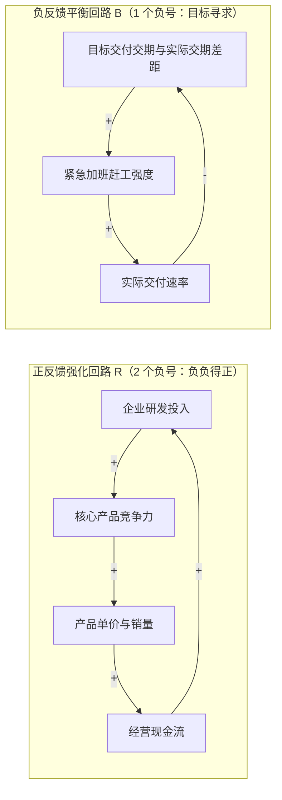
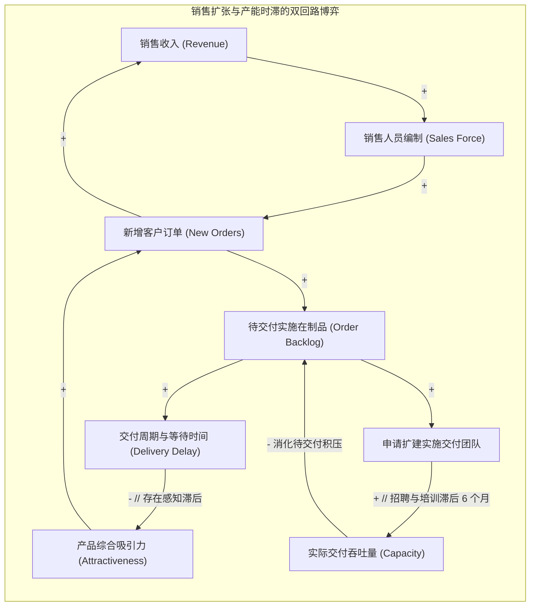

# Lec 3 因果回路图与反馈极性分析：系统拓扑结构与绘图规范 (Causal Loop Diagrams & Feedback Loop Polarity)

> MIT Course 15 · System Dynamics · 复杂系统动力学与管理决策

## TL;DR

- 掌握因果回路图（CLD）作为系统假设定性表征的黄金法则：表达严谨因果机制，坚决拒绝统计相关性与无物理意义的连接。
- 严密贯彻微积分偏导数定义链接极性（+ / -），运用“数负号法则”与“心理巡回推演法”双重判定回路极性（R 强化 vs B 平衡）。
- 落实系统动力学绘图七大工艺规范：变量名词化、箭头圆弧化、时滞显性双道杠标记与回路语义命名。
- 深入解构高科技企业“销售扩张与产能时滞”经典回路张力，揭示增长上限与交付延迟自我毁灭的内生拓扑。

## 因果图的科学底色：因果关系 vs 统计相关

在商业分析中，许多人习惯将数据统计中的“相关系数”直接画成因果箭头。例如：冰淇淋销量与溺水死亡人数高度正相关，但这并不意味着吃冰淇淋会导致溺水（背后的共同隐性变量是夏季高温）。

MIT 15.871 在教授因果回路图（Causal Loop Diagram, CLD）时强调的第一条铁律是：**因果图中的每一个箭头，必须代表现实物理世界中真实存在的物理或信息因果驱动机制**。

::: definition 因果链接的因果律要求 (Causality over Correlation)
因果回路图只允许描绘**可操作的因果机制（Operational Causal Mechanisms）**。  
箭头 $A \to B$ 的物理含义是：“如果决策者或外部力量强行改变了 $A$ 的数值，在物理世界中是否会直接引起 $B$ 的状态改变？”如果答案是否定的，哪怕两者的历史数据相关系数达到 0.999，也绝对禁止在因果图中建立连线。
:::

## 极性判定的双重校验工程

在系统动力学中，回路的极性判定是一项严密的数学逻辑操作。在团队讨论中，推荐同时采用微积分偏导数法则与心理巡回推演法进行双重交叉验证：

### 1. 链接极性的微积分偏导数严格定义
对于关系 $Y = f(X, Z, \dots)$：
- **正链接 ($X \xrightarrow{+} Y$)**：$\frac{\partial Y}{\partial X} > 0$。即当自变量 $X$ 增加时，因变量 $Y$ 会**高于**其原本应有的水平；当 $X$ 减少时，$Y$ 会**低于**其原本应有的水平；
- **负链接 ($X \xrightarrow{-} Y$)**：$\frac{\partial Y}{\partial X} < 0$。即当自变量 $X$ 增加时，因变量 $Y$ 会**低于**其原本应有的水平；当 $X$ 减少时，$Y$ 会**高于**其原本应有的水平。

### 2. 回路极性的数负号法则 (Sign-Counting Rule)
一个由 $n$ 个链接闭合而成的反馈回路，其总极性符号为所有链接符号的代数乘积：
$$\text{Loop Sign} = \prod_{i=1}^n \text{Sign}\left(\frac{\partial X_{i+1}}{\partial X_i}\right)$$
- **偶数个负链接（0, 2, 4, ...） $\implies$ 正反馈强化回路 (Reinforcing Loop, R)**；
- **奇数个负链接（1, 3, 5, ...） $\implies$ 负反馈平衡回路 (Balancing Loop, B)**。

## 系统动力学绘图的七大工艺规范

一张糟糕的因果图不仅无法传递智慧，反而会加剧团队的认知混乱。John Sterman 教授在 MIT 制定了一套被全球系统动力学界通用的绘图规范：

::: definition CLD 绘图七大工艺标准 (Best Practices)
1. **变量命名必须是名词或名词短语**：变量必须代表一个可以上下波动的“量”。严禁使用动词或带有方向性的词汇（例如：必须写成“价格（Price）”，严禁写成“价格上涨”；必须写成“研发成本”，严禁写成“削减成本”）；
2. **选择积极向上的度量方向**：尽量使用具有正面含义的名词（如用“员工士气”而非“士气低下”，用“服务质量”而非“质量缺陷”）；
3. **箭头必须弯曲成优雅圆弧**：避免生硬的直线交叉，用圆弧引导读者的视线沿着顺时针或逆时针自然循环；
4. **回路中心必须标注明确的极性与序号**：在闭环中央清晰标上带有顺时针/逆时针箭头的标志，并注明 $R_1, R_2$ 或 $B_1, B_2$；
5. **赋予回路以业务意义的名字**：如“$R_1$ 客户口碑滚雪球回路”、“$B_1$ 员工倦怠离职制动回路”，帮助管理层瞬间看懂故事；
6. **时滞必须显式标注双横线 ($//$)**：当因果传递存在显著的时间滞后（如从投资建厂到产能投产需 2 年）时，必须在箭头上打上“$//$”标记；
7. **明确模型的因果边界**：切忌无休止展开次生变量，只保留对当前动态问题具有第一因果影响的关键闭环。
:::

## 经典实战案例：高科技扩张与交付崩溃的双回路博弈

考查一家硅谷高成长 SaaS 企业的典型战略扩张架构。许多企业在经历数年的神话般崛起后突然轰然倒塌，其底层的因果回路拓扑具有极高的普遍性：

如上图所示，系统内部蕴含着两个力量悬殊的回路：
- **正反馈引擎 ($R_1$ 销售扩张回路)**：收入增加 $\to$ 扩招销售 $\to$ 签下更多订单 $\to$ 收入进一步增加。这在前期驱动了企业的惊人繁荣；
- **负反馈刹车片 ($B_1$ 交付延迟制动回路)**：订单暴增 $\to$ 交付积压攀升 $\to$ 交付周期从 2 周拉长到 6 个月 $\to$ 市场口碑雪崩、客户取消订单 $\to$ 业务彻底断崖。

::: insight 系统思考者的结构性干预
当交付周期恶化、客户开始大面积退单时，销售总监的本能反应是“加大营销打折力度、再招 50 名销售拉订单”（试图通过加大 $R_1$ 引擎力量来抵消下滑）。  
然而，系统动力学分析清晰揭示：**在产能严重滞后的情况下加大推销，无异于向重度拥堵的高速公路灌入更多车辆**。这不仅无法挽救收入，反而会让待交付积压彻底爆仓，导致服务质量归零。高杠杆的政策是：**主动给销售打折刹车，实行严格的按交付能力限购配给制，将宝贵资金全部调拨给交付团队的标准化培训**。只有先打通交付咽喉，增长的引擎才能安全重启。
:::
