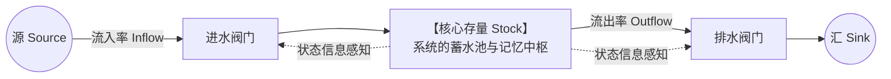
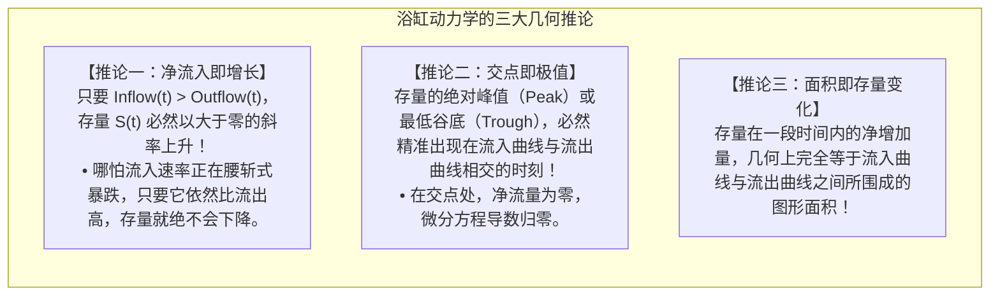

# Lec 4 存量与流量结构：系统的状态与速率 (Stocks and Flows: Structure and Calculus)

> MIT Course 15 · System Dynamics · 复杂系统动力学与管理决策

## TL;DR

- 掌握存量（Stocks）与流量（Flows）作为系统动力学物理建模底座的区分准则：状态变量蓄积历史，速率变量驱动瞬时演化。
- 运用“快照冻结测试（Snapshot Test）”与“量纲除时间法则”彻底终结变量属性混淆，奠定微积分仿真基础。
- 严密推导“浴缸动力学三大几何法则”：净流入为正存量必涨、流入跌破流出存量转跌、出入平衡交点必为存量极值点。
- 拆解化工厂设备检修与运维网络案例，掌握守恒物质流（Conserved Material Flows）与非守恒信息流（Information Links）的工程解耦。

## 为什么因果回路图必须升级为存量流量图

在系统动力学的学习进阶中，因果回路图（CLD）是一个极佳的沟通与头脑风暴工具。然而，约翰·斯特曼（John Sterman）在 MIT 课堂上反复强调：**因果回路图存在一个致命的理论缺陷——它无法在数学上区分“状态的累积（存量）”与“变化的速率（流量）”**。

考查一个最简单的现象：你打开水龙头向浴缸注水。
在因果图中，我们画出一个箭头：水龙头进水速率 $\xrightarrow{+}$ 浴缸水位。
许多人看这张图会产生荒谬的误解：如果我把水龙头的出水流速从每秒 10 升调小到每秒 2 升（进水速率在下降），浴缸的水位是不是就会下降？
显然不会！只要水龙头还在出水且没有拔掉塞子，浴缸里的水就会**继续上涨**。

微积分明确告诉我们：**变量的变化率与变量本身的绝对数值是完全不同的两个概念**。为了进行精确的计算机定量仿真与政策推演，我们必须将因果关系沉淀为具备明确微积分定义的**存量流量图（Stock and Flow Diagrams）**。



## 存量与流量的微积分本质与几何推论

在系统动力学的数学内核中，每一个存量本质上都是对其净流入速率的一阶常微分方程积分：

::: theorem 存量流量的微积分基本方程
对于任意连续时间动态系统，在时间区间 $[t_0, t]$ 内，存量 $S(t)$ 的状态演变严格遵循积分法则：
$$S(t) = S(t_0) + \int_{t_0}^t \left[ \text{Inflow}(s) - \text{Outflow}(s) \right] ds$$
其瞬时变动斜率由净流量唯一决定：
$$\frac{dS(t)}{dt} = \text{Net Flow}(t) = \text{Inflow}(t) - \text{Outflow}(t)$$
:::

基于这一微积分定义，我们可以推导出现实管理中极为关键的“浴缸动力学三大几何推论”：



## 快照测试与量纲分析：双重判别法则

在 15.871 的建模作业中，学生必须通过两项严苛测试来验证其变量属性：

| 检验工具 | 判别规则与操作准则 | 典型案例验证 |
|---|---|---|
| **快照冻结测试<br>(Snapshot Test)** | 想象时间在物理世界中**瞬间凝固（Freeze Time）**：<br>• **存量**：依然存在明确数值，可以用相机拍到或直接称重盘点。<br>• **流量**：数值瞬间消失归零，因为必须有时间段 $\Delta t$ 才有流量。 | • 资产负债表上的“银行现金存款”是**存量**。<br>• 损益表上的“本月营业收入”瞬间消失，是**流量**。<br>• “在校注册学生数”是**存量**；“每年毕业生人数”是**流量**。 |
| **量纲除时间法则<br>(Dimensional Test)** | 考查变量的物理度量单位（Units）：<br>• 设存量的量纲为 $[X]$（如件、人、吨、美元）。<br>• **流量的量纲必须且只能是 $[X] / [\text{Time}]$**（如件/月、人/年、吨/天、美元/季度）。 | • 员工总数单位是“人”（存量）。<br>• 离职率单位必须是“人/月”（流量）。<br>• 若某个变量单位写成“人/月/月”，它必为加速度辅助变量。 |

## 实战案例：化工厂设备维护与健康存量网络

在 15.871 Assignment 3 中，学生需要为拥有数千台关键高压泵的大型炼油化工园区建立设备资产健康度网络。很多工程管理者仅凭直觉调度，导致装置大面积非计划停产。通过存量流量网络建模，底层资产的流转路径被清晰解构：

```mermaid
flowchart LR
    subgraph MaintenanceNetwork["化工厂泵组设备状态存量流量网络"]
        direction LR
        S1["【正常运行中泵组】<br>(Operating Pumps)"] -->|故障损坏流 (Breakdown Rate)| S2["【待修故障泵组】<br>(Awaiting Repair)"]
        S2 -->|进入车间流 (Start Repair)| S3["【维修作业中泵组】<br>(Under Repair)"]
        S3 -->|检修竣工流 (Finish Repair)| S4["【完好备用泵组】<br>(Available Pumps)"]
        S4 -->|启动并网流 (Startup)| S1

        S1 -->|定期预防性保养流 (PM Rate)| S5["【预防性维护中泵组】<br>(Under Preventive Maint)"]
        S5 -->|保养复役流 (Finish PM)| S4
    end
```

### 守恒物质流 vs 非守恒信息流
该案例清晰展示了系统动力学中两类截然不同的连接：
1. **实线箭头（守恒物质流）**：泵组是实体资产，不会在网络中凭空消失或凭空产生。从“运行中”流出的泵，必然完整流入“待修”或“保养”存量中（遵守质量守恒定律）；
2. **虚线箭头（非守恒信息流）**：维修车间主任查看“待修泵组存量”的数字并发起外包抢修订单，读取这一信息并不会让待修的物理泵减少一台。信息可以被无限次复制读取，而物质严格守恒。

::: insight 破除“浴缸认知赤字”的战略眼光
在宏观气候治理与企业资产负债表管理中，人类大脑普遍患有极其严重的“浴缸认知赤字”。  
例如在应对全球变暖时，各国政治家争相宣称“我们已经承诺在未来十年内将碳排放量削减 20%”，公众便误以为气候危机正在缓解。然而系统动力学无情地指出：**地球大气是一个巨大的浴缸，决定温室效应严重程度的是大气中二氧化碳的累积存量，而非当年的排放流量**。自然界的吸收汇容量每年仅有约 200 亿吨，而人类目前的排放流量高达 400 亿吨。即使我们将排放流量削减 20%（降至 320 亿吨），排放依然远高于吸收，大气的温室气体存量仍在加速上升！**战略领导者绝不被流量的微小改善所蒙蔽，唯有彻底实现进出平衡，危机的水位才可能真正停止上涨**。
:::
