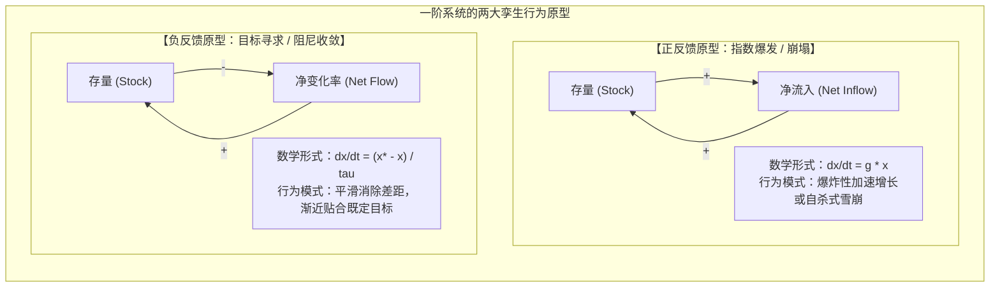
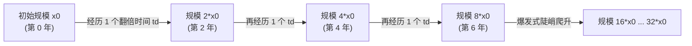

# Lec 5 简单系统动力学：指数增长与目标寻求 (Dynamics of Simple Systems: Positive & Negative Feedback)

> MIT Course 15 · System Dynamics · 复杂系统动力学与管理决策

## TL;DR

- 解构一阶线性动态系统两大最纯粹的原型行为：正反馈驱动的指数增长（Exponential Growth）与负反馈驱动的目标寻求（Goal Seeking）。
- 严密推导指数增长解析解 $x(t) = x_0 e^{gt}$ 与“70 法则”翻倍时间公理（$t_d \approx 0.7/g$），识破复利爆发的非直觉力量。
- 求解负反馈目标寻求阻尼方程，掌握调整时间常数 $\tau$ 与半衰期（$t_h \approx 0.7\tau$）对系统渐近平衡态收敛速度的决定性作用。
- 运用相空间（Phase Space）微分轨迹图解，建立微观反馈回路拓扑与宏观行为模式之间的直接数学映射。

## 一阶系统：动力学世界的基本粒子

在物理学中，理解复杂的量子场论必须从单摆与简谐振子开始；在系统动力学中，理解复杂的跨国商业帝国或全球生态演进，必须从最纯粹的**一阶线性动态系统（First-Order Linear Systems）**开始。

所谓“一阶系统”，是指整个系统只包含**一个核心存量**。它的瞬时变化速率仅由该存量自身的当前状态及其与环境的线性交互所决定。尽管在现实世界中纯粹的一阶系统极为罕见，但正如原子是分子的构件一样，**自然界与社会经济中一切波澜壮阔的复杂动态行为，本质上都是正负一阶反馈回路的非线性组合与主导权交替**。

一阶系统之所以具备基础性地位，是因为它将复杂的因果拓扑高度纯化为两种镜像对立的行为模式。无论是人口爆炸、技术扩散，还是库存调节、体温稳态，都可以映射为以下两大基本原型的相互博弈：



在这两大基本原型中，左侧的正反馈回路扮演着“系统引擎”的角色，它不设任何预定目标，唯一的规律是“多者愈多，少者愈少”；右侧的负反馈回路则扮演着“系统刹车与调温器”的角色，它时刻监控现实与预期的偏差，通过持续施加阻尼力迫使系统平稳回归目标态。掌握这两类原型的数学解析解与几何特征，是破除线性直觉迷思的第一步。

## 正反馈与指数增长动力学（Exponential Growth）

当一个存量的净增加速率与该存量自身的规模成直接正比时，系统便被锁定在一个正反馈强化回路中。

### 1. 微积分方程与解析求解
设存量为 $x(t)$，净增长率常数为 $g$（Fractional Growth Rate，量纲为 $1/\text{Time}$）：
$$\frac{dx}{dt} = g \cdot x(t)$$
这是一个分离变量的一阶微分方程。两端积分：
$$\int \frac{1}{x} dx = \int g \, dt \implies \ln x = gt + C$$
代入初始条件 $x(0) = x_0$，得出严格解析解：
$$x(t) = x_0 e^{gt}$$

### 2. 翻倍时间与著名的“70 法则”（The Rule of 70）
对于指数增长系统，其最核心的直观特征是**翻倍时间（Doubling Time, $t_d$）**——即存量数值翻一倍所需要经历的时间跨度。将 $x(t) = 2x_0$ 代入解析解：
$$2x_0 = x_0 e^{g t_d} \implies \ln 2 = g t_d \implies t_d = \frac{\ln 2}{g} \approx \frac{0.693}{g}$$

在商业战略与宏观经济测算中，这被广泛应用为经典的“70 法则”：

::: theorem 翻倍时间 70 法则 (The Rule of 70)
若一个业务指标或通胀率以每年 $P\%$ 的复利速度稳定增长，则该指标翻一倍所需的大致年数为：
$$t_d \approx \frac{70}{P}$$
*例*：若某 SaaS 企业的年化收入增长率为 35%，则无需计算器，其年收入每 2 年（$70/35 = 2$）就会翻一番；十年后将膨胀为初始规模的 $2^5 = 32$ 倍！
:::



## 负反馈与目标寻求动力学（Goal Seeking）

与正反馈的疯狂自我强化截然相反，负反馈平衡回路的灵魂是**自我调节与稳态维持（Homeostasis）**。它的使命是将系统的实际状态不断推向预设的目标值 $x^*$。

### 1. 负反馈阻尼微分方程
设期望目标为 $x^*$，系统当前状态为 $x(t)$，两者的差距为 $\text{Discrepancy} = x^* - x(t)$。系统通过调节阀门以消除差距，消除差距的特征时间常数为 $\tau$（Adjustment Time，量纲为 $\text{Time}$）：
$$\frac{dx}{dt} = \frac{x^* - x(t)}{\tau}$$

### 2. 解析解推导与半衰期（Half-Life）
分离变量并积分：
$$\frac{dx}{x - x^*} = -\frac{1}{\tau} dt \implies \ln |x(t) - x^*| = -\frac{t}{\tau} + C$$
代入初始值 $x(0) = x_0$，得出系统的显性时间轨迹：
$$x(t) = x^* + (x_0 - x^*) e^{-t/\tau}$$
系统与目标之间的差距 $\Delta(t) = x(t) - x^*$ 呈现出经典的**负指数衰减（Exponential Decay）**：
$$\Delta(t) = \Delta_0 e^{-t/\tau}$$

::: definition 时间常数 $\tau$ 与半衰期 $t_h$
- **时间常数 $\tau$ 的物理意义**：当时间过去一个时间常数（$t = \tau$）时，系统与目标的初始差距已经消除了 $1 - e^{-1} \approx 63.2\%$；
- **半衰期 (Half-Life, $t_h$)**：差距衰减至原始幅度一半所需的时间：
  $$t_h = \tau \ln 2 \approx 0.693 \tau \approx 0.7 \tau$$
经过 $3\tau$ 之后，差距已消除 $95\%$；经过 $5\tau$ 之后，系统在工程上被认为已经完全达到目标稳态。
:::

```mermaid
flowchart LR
    subgraph GoalSeekingPath["目标寻求的渐近收敛过程"]
        direction LR
        S_Init["初始偏差 Delta_0<br>(t = 0)"] -->|衰减 50% (经过 0.7*tau)| S_Half["剩余偏差 0.5*Delta_0"]
        S_Half -->|衰减至 36.8% (经过 1.0*tau)| S_Tau["剩余偏差 0.368*Delta_0"]
        S_Tau -->|衰减至 5% (经过 3.0*tau)| S_Conv["工程稳态平衡 (95% 消除)"]
    end
```

## 相空间轨迹与反馈极性的几何直觉

除了时间序列曲线，系统动力学还借助相空间图谱（Phase Space Plot: $\frac{dx}{dt}$ 对应 $x$）来洞察系统的稳定性机制：

| 系统类型 | 微分方程斜率 $\frac{d(dx/dt)}{dx}$ | 相平面几何形态 | 物理稳定性结论 |
|---|---|---|---|
| **正反馈一阶系统** | **斜率为正 ($+g > 0$)** | 一条斜向上的直线。存量 $x$ 越大，变化速率 $dx/dt$ 越快。 | **绝对不稳定平衡**。系统一旦受到微小扰动，就会沿着直线不可逆地狂奔向无穷大或归零崩溃。 |
| **负反馈一阶系统** | **斜率为负 ($-1/\tau < 0$)** | 一条斜向下的直线。与横轴相交于目标点 $x^*$。 | **自愈型渐近稳定平衡**。若 $x > x^*$，导数为负促使其回落；若 $x < x^*$，导数为正促使其回升。 |

::: insight 为什么人类大脑本能地低估复利、高估线性
进化心理学研究表明：人类远古祖先生活在非洲大草原上，其生存环境充满了近乎线性的物理现实（多跑一步距离增加一米、采摘浆果的收益与时间成正比）。因此，人类大脑的神经网络对“线性因果”具有极其深刻的直觉偏好。  
然而，现代资本市场、流行病学传播、科技创新扩散与社交网络裂变，其底层全部由正反馈的微分方程所统治。**复利是物理世界的第九大奇迹，也是平庸投资者的终极坟墓**。在指数增长的前 80% 时间里，由于基数极小，增长看起来平淡无奇，让人误以为风平浪静；而一旦越过临界点，系统会在短短几个翻倍周期内吞噬整个宇宙。系统思考者的首要定力，就是用冰冷的微分方程抵抗大脑脆弱的线性直觉。
:::
