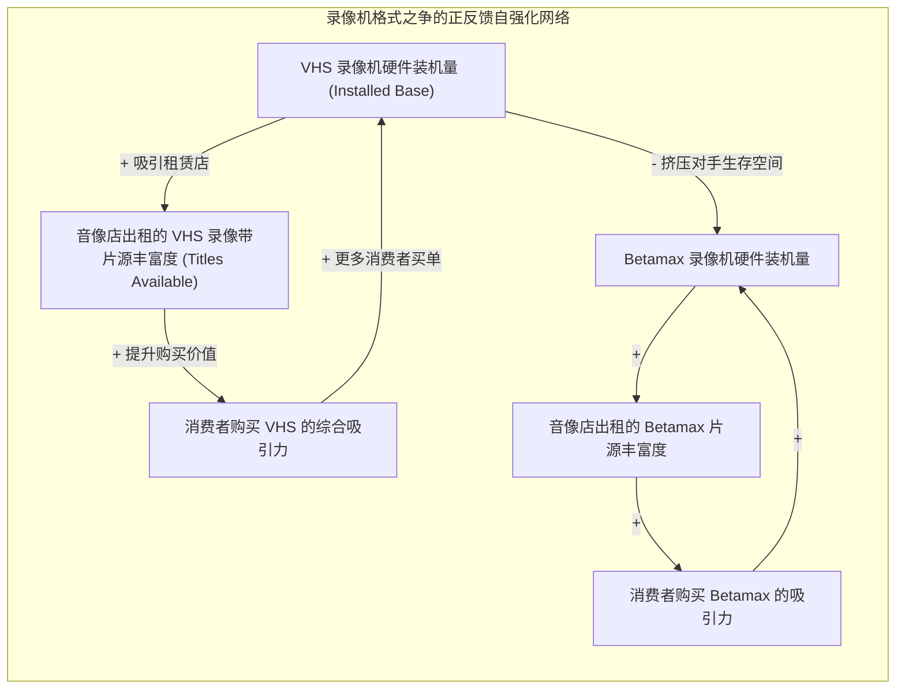

# Lec 6 S 型增长、网络效应与创新扩散：巴斯模型与标准之争 (S-Shaped Growth, Network Effects & Product Diffusion)

> MIT Course 15 · System Dynamics · 复杂系统动力学与管理决策

## TL;DR

- 剖析创新扩散（Innovation Diffusion）背后的双反馈引擎：外部广告驱动的外生采纳与人际口碑驱动的内生病毒式扩散。
- 严密建立弗兰克·巴斯（Frank Bass）创新扩散微分方程，解构创新系数 $p$ 与模仿系数 $q$ 对产品生命周期曲线的控制机制。
- 求解回路主导权转移时刻的拐点方程（Inflection Point），揭示新增采纳率何时见顶以及企业何时面临市场饱和天花板。
- 引入互补资产（Complementary Assets）与直接/间接网络效应，复盘录像机行业著名的“VHS vs. Betamax”格式标准生死决战。

## 创新的扩散物理学：病毒式裂变与市场饱和

当一项突破性科技成果（如智能手机、电动汽车、生成式人工智能）诞生时，它是如何从实验室的极客玩具，演进为席卷全球数十亿人口的普惠基础设施？

传统营销学往往归功于“优秀的广告宣传”或“产品卓越的性价比”。然而，管理科学界最经典的实证模型——由弗兰克·巴斯（Frank Bass）于 1969 年提出的**巴斯扩散模型（Bass Diffusion Model）**，以及 John Sterman 在《Business Dynamics》第 9–10 章中的深化研究表明：**创新的扩散本质上是一个受正负反馈回路此消彼长支配的动力学过程**。

巴斯模型之所以能够极为精确地拟合数十年间数百种颠覆性产品的普及生命周期，是因为它精准捕捉到了驱动用户转化的两股核心力量：一种是由大众传媒主导的外生拉力，另一种是由人际社交网络主导的内生推力。这两种力量在存量流量拓扑中呈现出清晰的结构交互：

```mermaid
flowchart TD
    subgraph BassStructure["巴斯创新扩散的存量流量拓扑"]
        direction LR
        P_Stock["【潜在采纳者存量】<br>(Potential Adopters P)"] -->|采纳流速 Adoption Rate (AR)| A_Stock["【已采纳用户存量】<br>(Adopters A)"]

        subgraph FeedbackEngines["两大采纳驱动引擎"]
            direction TB
            E_Ad["1. 广告与外部营销 (Innovation p)<br>不受已有用户影响，平稳转化早期尝鲜者"]
            E_Wom["2. 口碑与人际网络效应 (Imitation q)<br>老用户通过社交示范感染潜在用户 (正反馈核引擎)"]
        end

        E_Ad -.->|驱动| P_Stock
        E_Wom -.->|驱动| A_Stock
        A_Stock -.->|强化口碑| E_Wom
        A_Stock -.->|"耗尽潜在资源池 (负反馈制动)"| P_Stock
    end
```

如上图所示，当产品刚刚发布时，市场上没有任何老用户，口碑正反馈引擎处于完全熄火状态，此时全靠广告（$p$）进行冷启动。而一旦种子用户积累到临界规模，口碑与网络效应（$q$）便会迅速接管系统主导权，将用户采纳速率推向惊人的指数加速通道。然而，已采纳用户的增加必然以消耗潜在用户池为代价，随着可转化的空白市场逐步耗尽，负反馈制动力量开始占据上风，迫使系统从狂热走向饱和。

## 巴斯模型的数学大厦与参数机理

在系统动力学标准方程中，巴斯模型将总潜在市场容量设为 $N$。在任意时刻 $t$，潜在用户存量为 $P(t)$，已购买用户存量为 $A(t)$，满足守恒条件：
$$P(t) + A(t) = N$$

### 1. 采纳速率（Adoption Rate）的数学表述
单位时间内的产品采纳流速（即当期销售量）由两部分相加构成：
$$\text{Adoption Rate } S(t) = \frac{dA}{dt} = \underbrace{p \cdot P(t)}_{\text{创新采纳流（广告驱动）}} + \underbrace{q \cdot \frac{A(t)}{N} \cdot P(t)}_{\text{模仿采纳流（口碑与网络驱动）}}$$

::: definition 巴斯模型核心参数的物理意义
- **$p$：创新系数 (Coefficient of Innovation)**：表征受大众传媒、品牌公关驱动的自发购买倾向。对于绝大多数消费品，$p$ 的数值通常极小，经验中位值约为 **$0.03$**；
- **$q$：模仿系数 (Coefficient of Imitation)**：表征通过熟人推荐、社交示范与网络效应驱动的传染概率。经验中位值通常在 **$0.38$** 左右（约为 $p$ 的 10 倍以上！）；
- **接触率与传染率乘积**：项 $q \frac{A}{N}$ 表征了任何一个潜在用户在日常社交接触中，遭遇一位已购买老用户并被其成功安利（感染）的瞬时概率。
:::

### 2. 拐点发生时刻与最大销售速率
在扩散初期，由于 $A(0) \approx 0$，模仿项极小，销售主要由广告 $p$ 驱动；随着已购用户存量 $A$ 的蓄积，正反馈口碑回路爆发，驱动销售曲线以指数形态急剧攀升。

然而，随着市场渗透率超过临界线，潜在客户池 $P(t) = N - A(t)$ 开始枯竭，制动平衡回路夺取主导权。通过令销售加速度 $\frac{d^2A}{dt^2} = 0$，可以严格求得**全生命周期销售额达到绝对最高峰（拐点）**的时刻 $t^*$：
$$t^* = \frac{1}{p + q} \ln \left(\frac{q}{p}\right)$$
在拐点时刻，累计用户渗透率达到：
$$\frac{A(t^*)}{N} = \frac{1}{2} - \frac{p}{2q} \approx 50\%$$


## 网络效应与标准之争：VHS vs. Betamax 经典战役

在 MIT 15.871 Assignment 4（录像机市场扩散）中，巴斯模型被拓展到了具备**直接与间接网络效应（Network Effects）**的双寡头格式标准战争中。

1970 年代末，索尼（Sony）推出了技术性能优异、画质无可挑剔的 Betamax 格式录像机；而 JVC 则联合松下推出了画质稍逊但录制时长更长的 VHS 格式。这场商业史上最著名的格式之争，完美展示了正反馈回路如何产生“路径依赖（Path Dependence）”与“赢家通吃（Winner-Take-All）”：



### 倾斜效应（Tipping Market）与互补资产的杀伤力
- **技术优越性不等于商业胜出**：索尼死守自身的技术专有权与紧凑机身设计，导致录像带单盘仅能录制 1 小时（无法录下一场完整的美国橄榄球超级碗比赛）；而 JVC 则开放技术授权，联合全球录像带制造商生产 2 小时以上的录像带；
- **间接网络效应（跨边网络效应）的闭环锁定**：音像租赁店的货架空间是有限的。当 VHS 的装机量稍稍领先时，音像店为了周转率开始腾退 Betamax 货架，将 80% 的位置留给 VHS 片源；
- **正反馈滚雪球的不可逆锁定**：片源丰富度的失衡反过来彻底摧毁了 Betamax 对普通消费者的吸引力。即便索尼后来大幅降价并升级录制时长，整个市场已经发生了“不可逆倾斜（Tipped）”，VHS 最终完全统治全球。

::: insight 战略启示：在正反馈市场中抢占“先机临界质量”
在存在强网络效应与互补资产的现代数字经济（如移动操作系统 iOS vs Android、生成式 AI 模型插件生态）中，市场的竞争规则被彻底改写：
- **微小的历史偶然性被正反馈无限放大**：在初始起跑线上微不足道的领先优势，经过多轮口碑与互补生态的复利强化，最终会演变成对整个赛道的绝对垄断；
- **早期速度远胜于完美主义**：索尼追求单点硬件画质极致的工程师思维，败给了 JVC 迅速拉拢片源制作方构建跨边生态的系统思考。**在网络效应主导的战场上，得生态网络者得天下，孤芳自赏的优质技术终将沦为历史标本**。
:::
