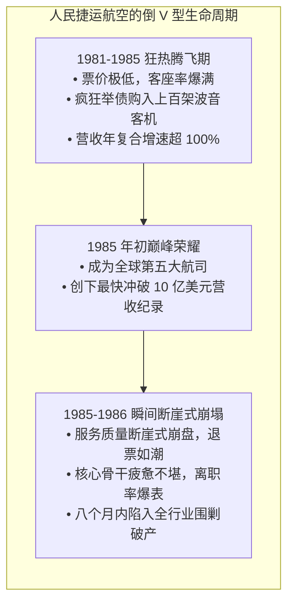
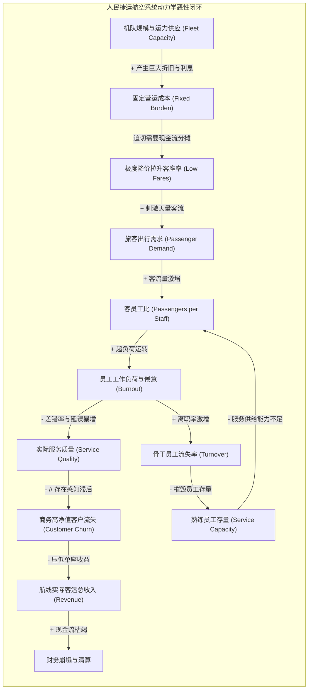

# Lec 7 动态决策与管理飞行模拟器：People Express 航空兴衰 (Microworlds & The People Express Airline Collapse)

> MIT Course 15 · System Dynamics · 复杂系统动力学与管理决策

## TL;DR

- 深度解构商业史上最悲壮的商业陨落案例之一：人民捷运航空（People Express Airlines, 1981–1986）如何在五年内从零狂飙至十亿美元营收，又在八个月内轰然坠入破产深渊。
- 剖析唐纳德·伯尔（Donald Burr）颠覆性管理创新背后的系统致命盲区：全员持股与跨职能轮岗机制无法克服物理世界的“服务产能时滞”。
- 揭示“产能挤压（Capacity Squeeze）”与“服务质量侵蚀”恶性正反馈：飞机资产快速扩张导致客员工比暴增，引发服务质量滑坡、员工士气瓦解与高净值客户流失。
- 体验 MIT People Express 经典管理飞行模拟器（Management Flight Simulator）：在微观世界中破除“盲目做大规模即可摊薄成本”的扩张迷思。

## 商业神话的诞生：民航管制的破局颠覆者

1981 年，美国国会通过《民航客运解除管制法案》（Airline Deregulation Act）不久，传奇创业家唐纳德·伯尔（Donald Burr）在新泽西纽瓦克机场创立了**人民捷运航空（People Express Airlines）**。

伯尔的商业构想在当时极具颠覆性，被哈佛与 MIT 商学院誉为“未来企业组织形态的原型”：
- **极致低廉的票价**：纽瓦克至波士顿仅售 23 美元，纽约至伦敦仅需 149 美元，比传统全服务航司便宜 60% 以上；
- **全员持股的人性化管理**：强制要求所有全职员工购买公司打折股票，消灭管理层特权与专属餐厅，让员工成为真正的主人翁；
- **无边界跨职能轮岗（Cross-Utilization）**：客机飞行员在落地后会走入行李舱协助装卸行李，乘务员在非飞行日会前往票务后台处理客服呼叫，极大提升了人均生产力。

人民捷运航空以人类商业史上前所未有的速度狂飙突进：短短五年内，机队从 3 架猛增至 117 架，年载客量突破 1200 万人次，营收突破 10 亿美元，跃升为全球第五大客运航空公司。伯尔登上了各大商业杂志的封面，被誉为打破传统航空垄断的平民英雄。

然而，神话在 1986 年以更为惊人的速度走向破灭：公司季度亏损高达数千万美元，现金流彻底断裂，客户用脚投票，最终在成立仅五年半后以折价惨遭德克萨斯航空（Texas Air）兼并清算。

## 系统动力学病理解剖：三大回路的致命绞杀

为什么一家拥有崇高文化、极其便宜的票价以及巨大市场需求的明星企业，会在巅峰期瞬间暴毙？MIT 15.871 在 Recitation 5 中，通过著名的 **People Express 飞行模拟器**，彻底揭示了伯尔决策背后的系统动力学结构缺陷：

### 1. 物理时滞的错配：买飞机容易，培养合格员工极难
人民捷运能够用廉价银行贷款在几个月内买下几十架二手波音 727 和 747 客机（**物质资产扩充极快**）；然而，一个真正理解公司文化、能够处理高压危机与复杂调度的成熟员工，其招聘与培训至少需要 12–18 个月（**人力资本存量蓄积极慢**）。  
运力供给的爆炸与服务能力的短缺，拉开了长达数年的“产能鸿沟（Capacity Gap）”。

### 2. 产能挤压下的服务质量崩塌（Capacity Squeeze）
随着机队不断盲目起飞，每位员工必须服务的旅客数量翻了整整三倍。原本充满温情与热忱的乘务员，在每天长达 14 小时的高强度连续压榨下，心智彻底耗竭。  
行李大面积丢失、航班无休止晚点延误、超售退改签现场大打出手、客服电话永远无人接听。人民捷运被媒体讥讽为“人民受难航空（People Distress）”。

### 3. 竞争对手的精准致命一击：美航 SABRE 收益管理
就在人民捷运服务品质滑坡的生死关头，美国航空（American Airlines）祭出了现代航空业最具杀伤力的武器——**SABRE 计算机收益管理系统（Yield Management）**：
- 美航推出“终极超级特惠票（Ultimate Super Saver）”，在同一架高档客机上，美航只拿出后排 20% 的闲置空座，以与人民捷运同样低廉的 25 美元倾销给对价格敏感的背包客；
- 而前排 80% 的座位依然以全价卖给对服务、准点率极度挑剔的商务高管；
- 这一降维打击精准刺穿了人民捷运的心脏：高净值商务客彻底逃回了美航，人民捷运只剩下一帮即便亏损也要坐飞机的超低价客群，单客收益彻底击穿成本底线。

## 人民捷运管理飞行模拟器的核心教训

在 15.871 的课堂模拟中，每一位自负的 MIT 学生坐在模拟器前扮演 CEO 唐纳德·伯尔，大部分人的操作都会在第 30 个月左右将公司引向破产。这一模拟沉淀出四条价值连城的系统思考公理：

::: theorem 管理飞行模拟器的四大战略法则
1. **平衡增长与基础设施能力**：增长的极限不是由市场需求决定的，而是由系统内部最脆弱的那根短板（服务产能与员工培训）决定的。**当内部能力跟不上外部需求时，盲目踩油门等于自杀**；
2. **警惕“做得更好却死得更快”的幻觉 (Better-Before-Worse)**：大幅降价短期内让飞机满座，产生繁荣假象；但它内生种下了服务过载与客户厌恶的剧毒种子；
3. **沉没成本与资产负债表刚性**：通过高额杠杆购置的固定资产（飞机），在繁荣期是印钞机，在萧条期是每秒都在吸血的绞索；
4. **服务质量是具有长时滞的无形存量**：毁掉客户口碑只需两周的糟糕体验，而要重建受损的声誉存量，往往需要三年以上的持续卓越投入。
:::

::: insight 商业领导者的“克制性增长”修养
现代商业社会充斥着对“规模效应”的狂热崇拜，投资人与媒体总在逼迫创始人以不可思议的速度扩张。  
唐纳德·伯尔的悲剧在于，他误将“物理硬件的扩张”等同于“企业真实能力的成长”。**卓越的系统领导者懂得何时踩刹车**。当发现一线员工疲态尽显、客户体验指标出现微小异动时，哪怕外部订单如雪片般飞来，也必须展现出拒绝增长的巨大战略定力。给组织留出喘息、培训与夯实存量的空间，方能穿越剧烈的周期狂浪。
:::
