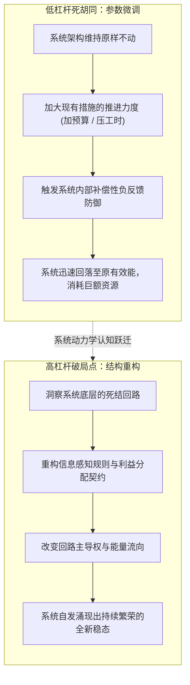
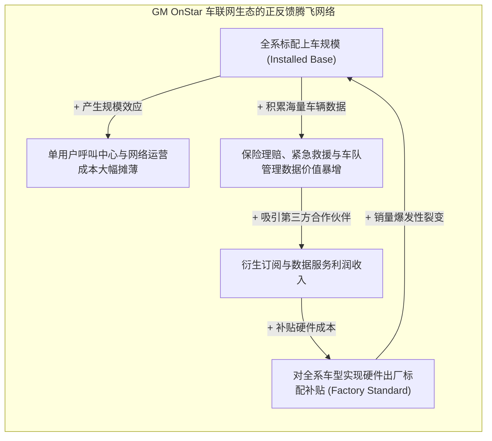
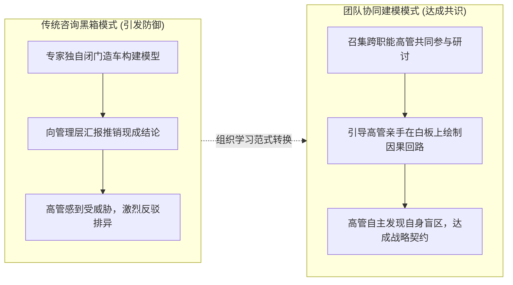

# Lec 8 鲁棒政策设计与组织学习：从模型到商业战略 (Robust Policy Design & Organizational Learning)

> MIT Course 15 · System Dynamics · 复杂系统动力学与管理决策

## TL;DR

- 区分浅层“参数微调（Parameter Tweaking）”与高阶“结构性政策设计（Policy Design）”：真正的战略变革必须改变信息流、决策规则与激励反馈拓扑。
- 确立识别高杠杆政策（High-Leverage Policies）的系统工程学原则，突破低杠杆方案对组织资源的低效空耗。
- 复盘通用汽车（General Motors）OnStar 车载智能网联战略：如何借助系统动力学模型突破传统零部件选配思维，确立全系标配与网络效应临界质量。
- 克服组织防御性常规（Defensive Routines），推行团队协同建模（Group Model Building），将计算机仿真洞察内化为管理层自驱的组织认知跃迁。

## 政策设计的本质：参数调整 vs 结构重塑

在企业遭遇战略瓶颈时，管理层最普遍的反应是“做更多相同的事情，但期望不同的结果”：
- 销售增长乏力，就将销售提成从 5% 提高到 7%（参数微调）；
- 项目进度滞后，就要求员工每周加班从 10 小时增加到 15 小时（强度微调）；
- 客户流失严重，就将售后客服预算追加 10%（资金微调）。

MIT 系统动力学学者明确指出：**在由强大平衡回路统治的复杂系统中，孤立地调整参数几乎从未产生过持久的系统性改善**。系统原有的补偿性反馈机制会迅速吸收这些微小的扰动，让系统重新沉沦回原本的低效均衡态。

::: definition 参数微调 vs 结构重塑 (Parameter Tweaking vs Policy Design)
- **参数微调 (Parameter Tweaking)**：在系统现有的信息通道与决策规则保持不变的前提下，仅仅改变某些常数系数或预算规模。这属于典型的**低杠杆操作（Low-Leverage）**；
- **鲁棒政策设计 (Robust Policy Design)**：重新定义决策者在做出行动时所依据的信息来源，改变决策规则与评估准则，创造全新的反馈闭环，或切断原有的恶性循环。这才是真正的**高杠杆战略（High-Leverage Strategy）**。
:::

## 通用汽车 OnStar 战略复盘：从选配零件到平台生态

在 15.871 的终极战略案例中，John Sterman 教授系统复盘了通用汽车（General Motors）在 1990 年代末打造全球首个车载车联网服务——**OnStar 系统**的里程碑式战役。

当时，传统底特律汽车高管普遍持有狭隘的“零部件销售心智”：将 OnStar 定位为一项昂贵的高端选装配件（售价高达 1000 美元），只面向凯迪拉克等顶级豪华车型推销，并期望通过向少数富裕车主收取选装费来实现单点盈利。结果三年过去，OnStar 的市场普及率不足 5%，服务呼叫中心因为规模不足陷入巨额亏损。

通用汽车联合 MIT 系统动力学团队构建了多方法融合的战略仿真模型，彻底颠覆了底特律百年汽车工业的传统假设：

### 15.871 模型给出的颠覆性高杠杆政策
模型清晰展示了网络效应临界质量（Critical Mass）的动力学规律：
1. **彻底废黜昂贵的选配策略**：宣布将 OnStar 系统作为通用汽车全线数百万辆新车的**出厂标准配置（Factory Standard）**，硬件成本由整车厂全额兜底分摊；
2. **赠送一年免费订阅，培养使用依赖**：消灭购车消费者的心理门槛，让数百万车主习惯于“一键按下即可呼叫人工管家”的安全陪伴体验；
3. **商业模式彻底升维**：放弃赚取微薄的一次性硬件差价，转向长期高毛利的数字化订阅服务（SaaS）以及向保险公司、医疗机构提供数据协同的全新平台生态。  
这一战略决策让通用汽车在汽车智能化浪潮中抢先二十年占据了无可撼动的先发优势。

## 克服组织防御性常规：从模型走向落地

在企业管理实践中，最痛苦的现实往往不是“缺乏精密的数学模型”，而是**“模型给出的最优建议遭到了管理层政治势力的顽固封杀”**。

哈佛大学组织心理学家克里斯·阿吉里斯（Chris Argyris）指出：任何既有的组织架构与汇报关系，本质上都是既得利益者为了保护自身权力而构筑的**组织防御性常规（Organizational Defensive Routines）**。当外部咨询师拿着一份冰冷的报告指出“研发总监的做法正在摧毁生产线”时，研发总监的第一反应必然是动用一切政治资本去质疑模型的假设、挑剔数据的口径，将模型束之高阁。

为了打破这种组织政治僵局，系统动力学开发了一套极其成熟的介入方法论——**团队协同建模（Group Model Building, GMB）**：

::: definition 团队协同建模的核心原则 (Group Model Building)
在团队协同建模中，建模师的定位不再是“无所不知的预言家”，而是**“对话过程的催化剂与引导者（Facilitator）”**。  
通过引导研发、销售、财务与供应链负责人并排坐在一起，让他们亲手绘制各自部门在系统中的回路连接，高管们在激烈的思想碰撞中第一次看清了“彼此的决策是如何在无意中伤害对方的”。**当高管亲手推导出模型的逻辑时，他们就成为了模型的主人**，战略变革的阻力瞬间转化为全员主动自驱的行动力。
:::

::: insight 商业领导者的系统终极境界
系统动力学的终极目标，从来不是制造一个能预测下周股票价格的“水晶球”。物理世界的本质充满了不确定性与混沌扰动，没有任何模型能给出绝对精确的单点预测。  
**系统动力学的真正伟大之处，在于它是一座“心智重塑的磨刀石”**。它强迫我们放弃短期浅薄的线性直觉，让我们学会带着敬畏之心去审视多重时滞、回路反馈与非线性边界。当你能够看清潜伏在复杂业务水面之下的系统暗流，并精准找到那个顺应系统内在规律的高杠杆支点时，你便拥有了带领企业穿越惊涛骇浪的非凡洞察力与领导定力。
:::
