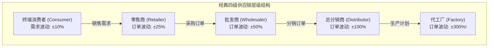
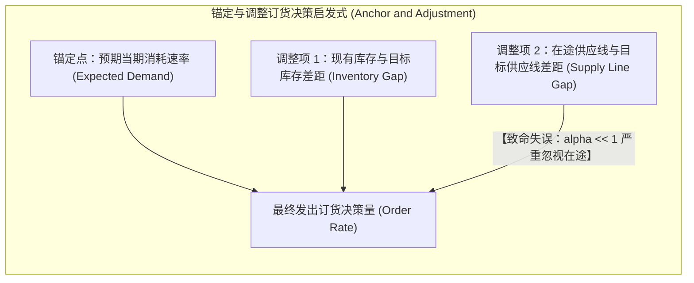

# 牛鞭效应与供应线控制：啤酒分销游戏机制 (The Bullwhip Effect & Supply Line Control)

> 知识定位：供应链管理与产业波动理论的基石模型 · 奠基者：Jay W. Forrester (1958) & John D. Sterman (1989)

## TL;DR

- 牛鞭效应（The Bullwhip Effect）揭示了多级供应链中的物理与行为规律：终端消费需求的微小波动，沿链条向上游传导时被逐级剧烈放大。
- MIT 经典“啤酒分销游戏（The Beer Game）”实证证实：震荡与放大的根源不在于外部随机冲击或参与者的道德风险，而在于系统固有的多重时滞与参与者的“供应线忽视（Supply Line Underweighting）”。
- 确立完整的供应线订货决策控制律（Anchoring and Adjustment）：订货量必须同时修正“当前库存差距”与“在途在制品供应线差距”。
- 掌握破解牛鞭效应的系统工程学准则：信息全链路实时透明共享、压缩物理与信息时滞、以及破除局部博弈囤货。

## 概念定义与系统病理学

在现代工业制造与全球商品流通中，各大行业（从汽车芯片、消费电子到生活用纸）频繁经历着毁灭性的暴风雨：下游零售端需求仅仅发生了 10% 的微小起伏，但在传导至上游批发商、总代理、整机制造商和芯片代工厂时，订单量却被放大为 200% 乃至 500% 的剧烈脉冲震荡；随后紧接着是长达数年的全行业产能过剩、巨额资产减值与工厂倒闭。

这一现象由 MIT 杰·福瑞斯特在 1958 年提出，并在 1990 年代由斯坦福大学李效良（Hau Lee）与宝洁公司（P&G）形象地定名为**牛鞭效应（The Bullwhip Effect）**——如同甩动牧鞭，手腕微小的抖动，会在鞭稍卷起撕裂空气的狂风巨浪。

::: definition 牛鞭效应 (The Bullwhip Effect)
牛鞭效应是指在包含多级阶段的分销与制造网络中，**订单信息的方差与波动幅度，随着沿着供应链向远离最终消费者的上游方向推进而呈指数级逐级放大（Order Amplification）的动态现象**。  
伴随放大的，是严重的相位滞后（Phase Lag）与剧烈的存货周期震荡。
:::

## 啤酒分销游戏实证：有限理性与供应线忽视

为了研究牛鞭效应的微观生成机制，MIT 系统动力学学科组在 1960 年代开发了著名的**啤酒分销游戏（The Beer Distribution Game）**。

在游戏中，四名学生分别扮演零售商、批发商、分销商与工厂。外部消费者需求在第 4 周从每周 4 箱极小幅跳升至 8 箱并永久保持恒定。然而在随后的 30 周里，成千上万场面向全球跨国高管与研究生的实验得出了惊人一致的复现结果：
- 所有角色均经历了惨痛的**大面积缺货积压 $\to$ 恐慌性超额下注 $\to$ 仓库彻底爆仓**的三部曲；
- 工厂的订货峰值往往高达单周 40–80 箱（放大了 10 倍以上！），随后订单断崖式跌至 0，工厂被迫停产数月。

John Sterman 教授在 1989 年《Management Science》发表的里程碑式论文中，通过计量模型解构了参与者的决策行为：

::: pitfall 供应线忽视（Misperception of Feedback / Supply Line Underweighting）
决策者在发出订单后，往往需要经历数周的“生产与运输物理时滞（Delays）”货物才能入库。然而在等待入库的漫长周数里，由于当前货架依然空空如也，**决策者的大脑完全忽视了自己过去几周已经向管道中灌入了多少在途订单（In-Transit Supply Line）**！  
在恐慌心智驱使下，他们误以为上游没有收到订单，于是在本周再次追加下单。这种对在途存量的“选择性失明”，导致数倍于实际需求的海量物资在运输管道中悄然汇聚，一旦管道出水，瞬间将整个供应链淹没。
:::

## 鲁棒供应线控制律（Supply Line Control Rule）

为了在系统动力学与现代供应链控制中彻底扑灭牛鞭效应，Sterman 提出了符合最优控制论的订货决策准则：

::: theorem 理想供应线订货控制方程
在任意采购时刻 $t$，发出订单速率 $O_t$ 必须严格由三部分线性合成，且必须对在途供应线赋予完整的反馈权重（$\alpha_{SL} = 1$）：
$$O_t = \max\left(0, \, \hat{D}_t + \alpha_I \left(I^* - I_t\right) + \alpha_{SL} \left(SL^* - SL_t\right)\right)$$
- **$\hat{D}_t$：预期需求流速（基准置换项）**：补充日常正常流失的消耗；
- **$I^* - I_t$：库存差距修正项**：目标物理库存与当前物理库存之差，$\alpha_I$ 为调整速率；
- **$SL^* - SL_t$：供应线差距修正项**：目标在途量（$SL^* = \hat{D}_t \cdot \lambda$，$\lambda$ 为总交货时滞）与当前管道在途订单存量之差；
- **核心控制律**：**必须令 $\alpha_{SL} = \alpha_I$！** 如果你下了订单，就必须在账本上将在途订单等同于物理库存。
:::

## 根除牛鞭效应的系统工程学药方

传统企业试图通过“提高销售预测精度”来对抗牛鞭效应，但系统动力学证实这往往徒劳无功，甚至会因为预测模型的正反馈外推而加剧波动。真正的系统级高杠杆解在于重构供应链的物理与信息拓扑：

| 破局维度 | 传统运作模式（滋生牛鞭） | 系统动力学高杠杆解决方案 |
|---|---|---|
| **信息可见度** | 各级层级割裂，上游只能看到下游传来的“失真采购订单”。 | **全链路数据穿透 (POS Transparency)**：上游工厂直接通过物联网实时监测终端消费者的实际扫描零售数据，消灭中间信息失真。 |
| **物理与流程时滞** | 慢速批量运输，订单处理存在漫长的人工审批时滞。 | **精益压缩 Lead Time**：时滞每压缩 50%，系统潜在的震荡放大倍数呈几何级数锐减。 |
| **商业激励机制** | 季度末大促、阶梯式批量折扣（Volume Discounts）。 | **每日平价 (EDLP) 与供应商管理库存 (VMI)**：消灭人为制造的脉冲采购冲动，由供应商基于全链路最优原则主动补货。 |

::: insight 商业领导者的系统反思：归因于人还是归因于结构？
在啤酒游戏结束后的复盘会上，学员们最经典的第一反应往往是愤怒地指责队友：“都是那个愚蠢的批发商在瞎下单！”  
然而，当把成千上万次不同背景人群（从 MIT 学生、华尔街精英到军工供应链将军）的实验数据调出来比对时，所有人的波动曲线几乎一模一样。**这证明了系统动力学最核心的信念：坏的行为源于坏的系统结构，而非坏的人**。只要系统的多重时滞、反馈割裂与激励结构不变，换上世界上最聪明的 CEO，他也同样会走出完全一样的牛鞭崩塌曲线。战略家的职责不是去谴责人类脆弱的直觉，而是从制度层面亲手拆除滋生非理性的反馈温床。
:::
