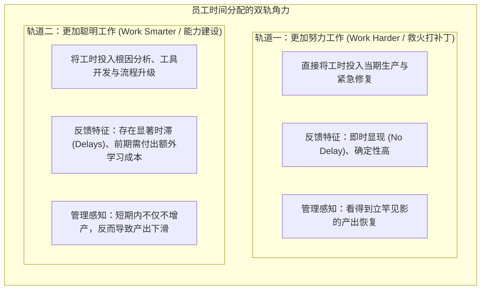
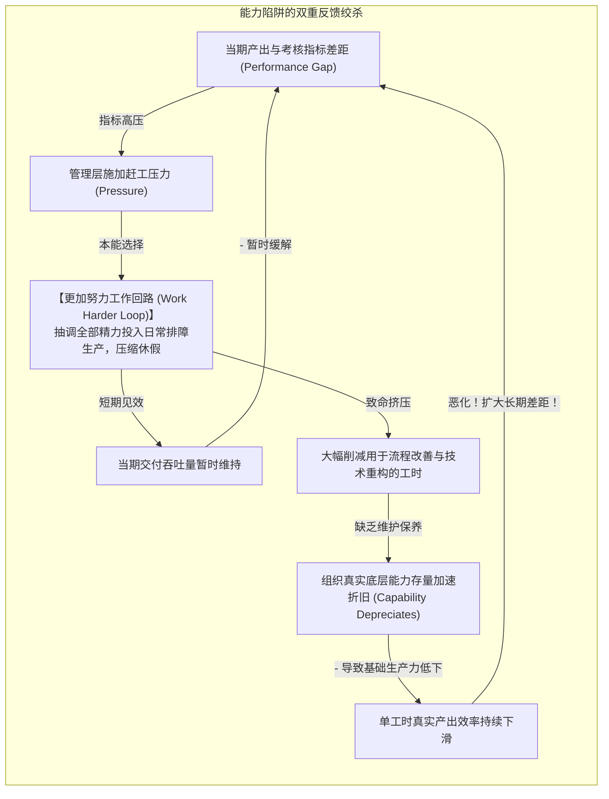
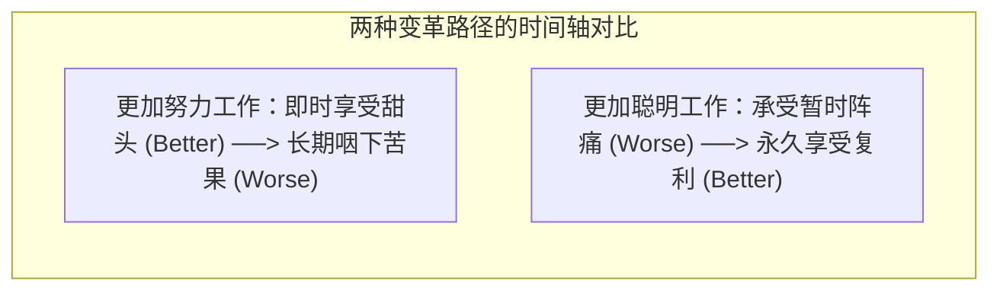

# 能力陷阱与“工作更聪明”悖论 (The Capability Trap & Working Smarter Paradox)

> 知识定位：企业组织运营与精益流程改善的核心动力学模型 · 奠基者：Nelson P. Repenning & John D. Sterman (MIT Sloan)

## TL;DR

- 解构企业最普遍的组织悲剧“能力陷阱（The Capability Trap）”：组织过度沉溺于短效的“更加努力工作（Work Harder）”，彻底挤压了“更加聪明工作（Work Smarter）”的根本能力投资。
- 剖析时间分配的双轨竞争：救火排障具有即时、确定性的短期反馈，而根本性流程改善伴随着漫长时滞与不可避免的“先变差后变好（Worse-Before-Better）”阵痛。
- 揭示管理层最致命的心智偏见——“自证预言归因谬误（Self-Confirming Attribution Error）”：领导误以为员工唯有在高压鞭策下才干活，亲手将组织推向低效均势。
- 确立走出能力陷阱的高管治理契约：制度化隔离并保护流程改善工时预算，为系统穿越暂时的绩效低谷提供坚固的容错缓冲垫。

## 运营改善的困境：没有人因预防了从未发生的灾难而获得升迁

在现代企业中，几乎所有 CEO 都在大会上高喊“要重视长期能力建设、推动流程数字化改造、鼓励技术创新”。然而在微观现实中，我们看到的一线常态却是：
- 工程师团队整天在充当疲于奔命的“救火队员”，为线上突发的系统故障连续通宵数月；
- 哪怕所有人都知道某个旧遗留模块架构极度腐朽，但没有人愿意停下来彻底重构；
- 那些在半夜力挽狂澜修复灾难事故的“英雄”受到了全公司的公开表彰与晋升；而那些默默在幕后把代码写得毫无瑕疵、预防了事故发生的工程师，却因为“没有惊心动魄的事迹”而被组织彻底遗忘。

MIT Sloan 教授纳尔逊·雷彭宁（Nelson Repenning）与约翰·斯特曼（John Sterman）在管理学里程碑论文《没有人因预防了从未发生的灾难而获得嘉奖》（*Nobody Ever Gets Credit for Fixing Problems That Never Happened*）中，深刻揭示了这一组织隐性自杀机制——**能力陷阱（The Capability Trap）**。

## 能力陷阱的系统动力学反馈解剖

任何组织都面临着总工时有限的硬性物理约束。员工在每一天的工作中，必须在“直接干活生产（Work）”与“改善生产流程（Improvement）”之间进行时间分配。Repenning 与 Sterman 构建的系统动力学闭环揭示了恶性陷阱的生成机理：

### 1. 更加努力工作回路（The "Work Harder" Loop）
当考核指标出现缺口时，管理层最直觉的反应是“加大督导、强制加班”。在短期内，多投入 20% 的时间确实能多产出一些零件或代码，指标差距被暂时抹平。这给管理层强化了一个极其有害的心智假定：**“只要我们施压，业绩就能上来”**。

### 2. 流程能力萎缩回路（The "Capability Erosion" Loop）
然而，组织能力的存量（如工装夹具精度、软件模块解耦度、员工专业技能）如同物理资产一样，时时刻刻在发生**自然损耗与折旧（Depreciation）**。如果缺乏持续的工时投入进行升级维护，组织能力就会持续退化。  
当所有时间都被挪去救火时，真实的底层效率每况愈下。为了在低劣的能力底座上维持相同的产出，团队被迫投入更多的时间去加班救火。**系统最终被死死锁死在“高强度加班、零能力提升、危机频发”的低水平内卷陷阱中**。

## 先变差后变好：为什么摆脱陷阱如此痛苦

为什么深陷能力陷阱的企业明知故犯，无法轻易爬出泥潭？其核心根源在于两类行为模式在时间响应上的完全倒置：

| 改善路径 | 行为模式轨迹 | 组织心理感受与评价 |
|---|---|---|
| **更加努力工作 (Work Harder)** | **先变好后变差 (Better-Before-Worse)** 第 1 天加班，第 2 天产量上升（好）；第 6 个月组织能力崩塌，全员离职溃败（差）。 | 容易给领导者带来“执行力强、救火英雄”的虚假控制快感，极具成瘾性。 |
| **更加聪明工作 (Work Smarter)** | **先变差后变好 (Worse-Before-Better)** 第 1 个月停线培训重构代码，当期产量直接暴跌 30%（差）；第 12 个月全新高韧性流程就绪，效率永久翻倍（好）。 | 前期的业绩下滑和学习阵痛，往往导致推动改革的先锋在黎明前夜被董事会撤职。 |

## 自证预言归因谬误（Self-Confirming Attribution Error）

在能力陷阱中，最致命的次生灾害是管理层产生的认知扭曲——**基本归因谬误（Fundamental Attribution Error）**：

::: pitfall 自证预言归因偏误
1. 当管理层施加压力逼迫加班时，他们看到产出立刻上升，于是得出结论：**“我的管理手段无比有效”**；
2. 当管理层尝试给员工留出一点时间搞创新改善时，他们看到当期产出立刻下滑且短期未见成果，于是得出结论：**“搞流程改善全是在扯淡浪费钱，这帮员工就是在摸鱼偷懒”**；
3. 管理层认定员工缺乏职业操守，唯有靠挥舞鞭子才能出活；员工则感到被当成牲口对待，心灰意冷彻底放弃自驱改善。管理层的傲慢偏见在系统的反馈闭环中完成了“完美的自我证实”。
:::

::: insight 战略领导者的破局意志：为“先变差”提供政治安全网
走出能力陷阱，需要的不是更多的口号，而是一套**具有反常识勇气的管理契约**：
1. **强制划分工时红线**：效仿 3M 或 Google 早期著名的“20% 自由时间法则”，任何一线团队必须强制锁定 15%–20% 的时间专门用于技术债务清理与流程优化，这部分工时不计入当期考核；
2. **主动调降短期绩效预期**：在启动流程变革时，高管必须在董事会面前筑起坚固的防火墙，大声宣布：“未来两个季度我们的交付量会有 20% 的战略性下滑，这是系统重铸底座不可逃避的学费”；
3. **奖励预防灾难的沉默英雄**：将考核指标从“排除了多少紧急故障”彻底转变为“系统的无故障连续运行天数”。**唯有让预防者受重奖、让救火者失宠，组织才能从骨子里跳出能力陷阱的死亡螺旋**。
:::
