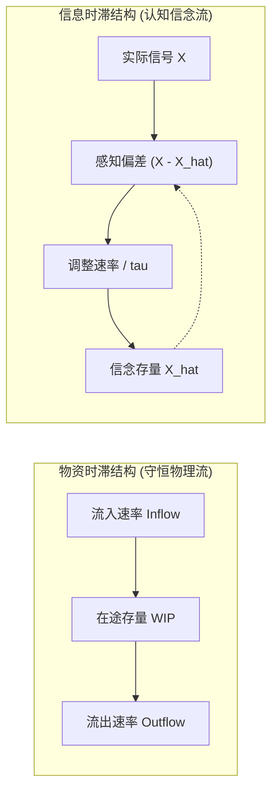
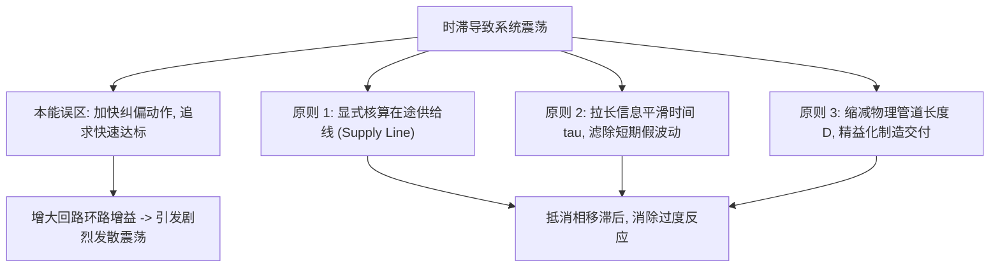

# 时滞与系统震荡 (Delays and System Oscillation)

## TL;DR
- 时滞是系统输入变动与输出响应之间的时间差，分为守恒的物资时滞与非守恒的信息平滑时滞。
- 高阶时滞可用多级一阶存量级联（Erlang 分布）建模，阶数越高输出越接近纯管道时滞。
- 负反馈回路中引入时滞会产生相移与增益失衡，引发阻尼震荡、持续极限环甚至发散震荡。
- 消除震荡的根源不在于加快反应速度，而在于拉长平滑时间或显式核算在途供给线。

## 一、时滞的本质与物理分类

在系统动力学中，时滞（Delays）是动态复杂性与政策阻力的核心来源之一。绝大多数现实系统在接收到决策指令或外部冲击后，都不会立即达到新的平衡，而是经历一段具有特征时间尺度的滞后过程。

Sterman 在《商业动力学》第 11 章指出，根据物理守恒性，时滞可划分为两大基本类别：物资时滞（Material Delays）与信息时滞（Information Delays）。

### 1. 物资时滞 (Material Delays)

物资时滞追踪物理实体（如原材料、在制品、人员、设备、邮件等）在物理管道中的流动过程。物资时滞严格遵循物理守恒定律：流入管道的每一件实体，在经历平均时滞时间后必然流出，中间积压的未完成实体构成在途存量（Work In Process, WIP）。

$$
\frac{d \text{WIP}(t)}{dt} = \text{Inflow}(t) - \text{Outflow}(t)
$$

### 2. 信息时滞 (Information Delays)

信息时滞描述决策者对环境变量、市场信号或绩效指标的感知、滤波与认知调整过程。信息流不遵循物理质量守恒：读取一次数据不会消耗数据本身。信息时滞的核心机制是**指数平滑（Exponential Smoothing）**或自适应预期形成，用以滤除环境中的高频随机噪声：

$$
\frac{d \hat{X}(t)}{dt} = \frac{X(t) - \hat{X}(t)}{\tau}
$$

其中 $X(t)$ 为真实环境输入信号，$\hat{X}(t)$ 为决策者感知或预期的平滑值，$\tau$ 为认知调整时间常数。

::: definition 时滞类型对比
- **物资时滞**：满足物理质量守恒定律，管道内部存在可清点的物理库存，流速受物理吞吐上限约束。
- **信息时滞**：不守恒，状态变量代表决策者的认知信念或对趋势的心理锚定，用于从嘈杂信号中提取长期趋势。
:::

## 二、时滞的数学建模与阶数分布

现实中的时滞并非单一片段的瞬时移动，而是呈现概率分布特征。系统动力学采用线性微分方程级联来近似不同形态的时滞。

### 1. 一阶时滞 (First-Order Delay)

一阶物资时滞假设管道内的实体充分混合（Well-mixed），流出速率与当前存量成正比，反比于平均时滞时间 $D$：

$$
\text{Outflow}(t) = \frac{\text{WIP}(t)}{D}
$$

对阶跃输入 $\Delta U$，一阶时滞的输出呈现典型的指数跃迁特征：$\text{Outflow}(t) = \Delta U (1 - e^{-t/D})$。在 $t=0$ 瞬间流出响应的导数达到最大值，缺乏现实物理管道的“潜伏期”（Latent Period）。

### 2. 高阶时滞与 Erlang 分布 (Higher-Order Delays)

为了模拟具有明确潜伏期和峰值响应的物理传输过程，可将总时滞时间 $D$ 均匀划分为 $n$ 个相互级联的一阶存量，每个存量的特征时间为 $D/n$。

数学上，一个 $n$ 阶线性时滞的脉冲响应对应形状参数为 $n$、尺度参数为 $D/n$ 的 Erlang 分布（Gamma 分布的整数特例）：

$$
f(t) = \frac{(n/D)^n t^{n-1} e^{-n t / D}}{(n - 1)!}
$$

::: theorem Erlang 时滞极限性质
当级联阶数 $n \to \infty$ 时，时滞输出脉冲响应的方差趋近于零：
$$
\lim_{n \to \infty} \sigma^2 = \lim_{n \to \infty} \frac{D^2}{n} = 0
$$
此时系统退化为无形变的纯管道时滞（Pure Pipeline Delay / Shift Operator）：
$$
\text{Outflow}(t) = \text{Inflow}(t - D)
$$
在企业实践中，$n=3$ 的三阶时滞足以逼近绝大多数供应链运输、招聘培训与研发试制的实际过渡曲线。
:::

## 三、负反馈系统中的时滞与震荡生成机制

在没有时滞的线性一阶负反馈系统中，系统轨迹永远是单调趋近平衡态，绝不可能产生震荡。然而，一旦在负反馈回路的控制通道中引入显著时滞，负反馈系统的行为模式将发生质的改变。

### 1. 相移与相位滞后 (Phase Lag)

当系统受到正弦周期扰动 $\omega$ 时，每一个一阶时滞模块都会在输出端引入相位滞后 $\phi = -\arctan(\omega \cdot D/n)$ 并产生幅值衰减。

当回路中的总相位滞后累积达到 $-180^\circ$（即半个周期）时，原本用于“削峰填谷”的负反馈纠偏信号，在到达执行机构时恰好与当前系统偏差同向，负反馈在动态上变质为自我强化的正反馈。

### 2. 震荡的三种典型动态模态

根据反馈控制增益 $G$ 与时滞长度 $D$ 的乘积，系统展现出截然不同的行为模式：

1. **过阻尼 / 欠阻尼衰减震荡 (Damped Oscillation)**：当增益适中且纠偏克制时，系统波动随时间推移逐渐衰减，收敛于目标值。
2. **等幅持续震荡 / 极限环 (Sustained Oscillation / Limit Cycle)**：当非线性饱和约束（如生产能力上限、零库存边界）与时滞平衡时，系统进入不依赖外部扰动的自激震荡。
3. **发散震荡与系统崩溃 (Explosive Oscillation & Overshoot-Collapse)**：当决策者过度激进调整、且环境承载力因超调而被不可逆破坏时，系统陷入崩溃。

::: example 房产投资开发周期的震荡生成
在商业地产市场中，从租金上涨刺激投资决策到新写字楼竣工交付（物资时滞）通常需要 3 到 5 年。
- 当空置率较低、租金高企时，开发商基于当前供需缺口同时立项开工。
- 在长达数年的建造期内，由于在建存量尚未转化为实际供给，市场表现出“持续供不应求”，刺激开发商追加更多项目。
- 一旦大规模楼盘在数年后集中入市，供给瞬间大幅超出真实吸收能力，导致租金暴跌与普遍违约，进入长达数年的消化萧条期。
:::

## 四、克服时滞的工程原则与政策设计

针对时滞引发的系统震荡，直觉上的干预往往不仅无效，反而加剧破坏。系统动力学总结了消除震荡的三项基本工程原则：

::: pitfall 常见思维误区：把“加速反应”当做“解决时滞”
当管理者发现系统响应滞后于目标时，本能反应往往是加大油门（例如发现业绩未达标便数倍追加广告预算或超额招人）。
在存在高阶时滞的系统中，**加大纠偏增益（Gain）等价于将系统极点推向虚轴右半平面**，把原本温和的欠阻尼震荡推向毁灭性的发散超调。正确的做法恰恰相反：必须保持耐受度，调低控制增益。
:::

::: insight 深度洞察：系统相移的认知代偿
物理世界中的物资时滞往往由技术客观规律决定（例如集成电路制造周期、轮船海运航程、高阶人才培养成熟期），短期内难以彻底归零。
震荡的真正罪魁祸首并非物理时滞本身，而是**决策者在信息处理中忽视了“在途管道存量”**。只要决策算法能够将“已发出但尚未到达的订单”作为准资产完整纳入控制负反馈，物理时滞带来的相位延迟就能在数学上被前馈网络完全抵消。
:::

## 思考题与实践

1. **时滞阶数辨识**：某互联网平台发现发布新算法后，用户日活跃度（DAU）在前 3 天几乎完全平稳，第 4 天开始加速下滑，第 7 天达到下滑拐点并逐渐稳定。请问该时滞更接近一阶时滞还是高阶时滞？为什么？
2. **信息平滑权衡**：在自适应预期模型中，平滑时间常数 $\tau$ 若设得极小（如 0.1 天）或极大（如 100 天），分别会导致什么样的决策风险？
