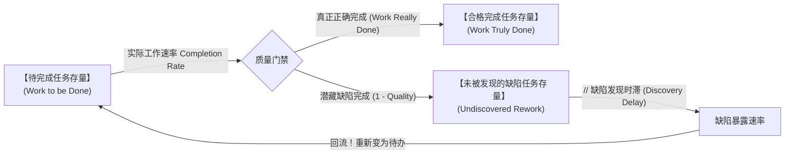
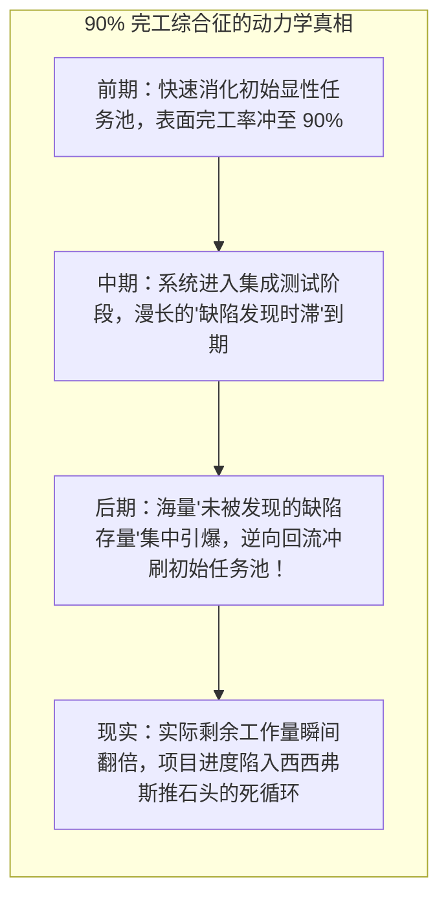
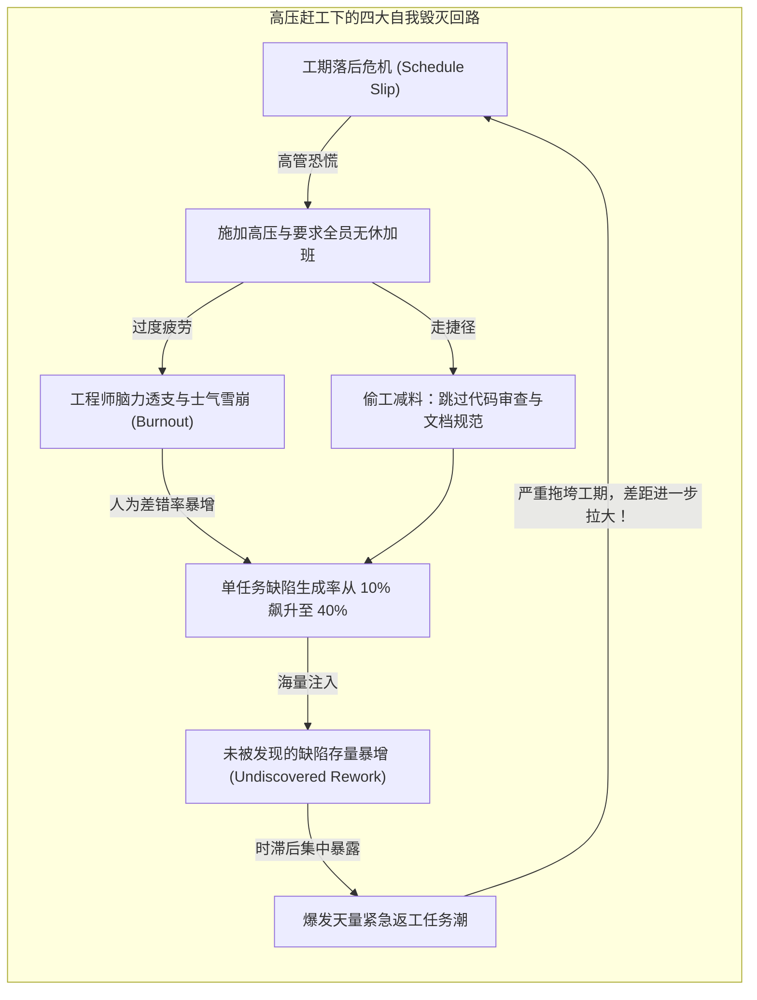

# 返工循环与项目动力学崩塌：LEW 综合征 (The Rework Cycle & Project Dynamics)

> 知识定位：复杂重大工程与大型软件研发项目的核心控制论模型 · 奠基者：Kenneth G. Cooper, John Lyneis & John D. Sterman (MIT Sloan)

## TL;DR

- 揭示全球大型工程与软件研发普遍深陷的“LEW 综合征”宿命：项目几乎必然“延期交付（Late）、严重超支（Expensive）、充满缺陷错误（Wrong）”。
- 确立项目动力学核心结构——“返工循环（The Rework Cycle）”：解构“真实合格成果”与“未被发现的缺陷存量（Undiscovered Rework）”之间的隐性时滞断层。
- 剖析研发工程中臭名昭著的“90% 完工综合征（90% Done Syndrome）”：为什么项目进度总是在漫长的时间里卡在 90% 无法收敛。
- 诊断高压赶工诱发的恶性正反馈：工期落后 $\to$ 施压加班 $\to$ 疲劳与偷工减料导致缺陷率暴增 $\to$ 衍生出更庞大的隐性返工潮。

## 复杂工程的魔咒：Meet LEW

无论是在波音客机研发、军工核潜艇建造，还是在跨国银行的核心系统重构与现代大型云计算平台搭建中，项目管理者始终无法摆脱一个被工业界戏称为“LEW”的残酷魔咒：

::: definition LEW 综合征 (Late, Expensive, and Wrong)
- **Late（严重延期）**：实际交付日期往往比原定排期推迟数月乃至数年；
- **Expensive（严重超支）**：最终研发与采购成本是初始预算的 200% 到 500%；
- **Wrong（充满缺陷）**：哪怕历经千辛万苦交付上线，系统依然千疮百孔，故障频发，甚至需要推倒重来。
:::

传统项目管理理论（如甘特图、关键路径法 CPM、敏捷看板）普遍假设：任务只要被执行了，就会变成“已完成”状态；只要加派人手，进度就会成比例加快。MIT 系统动力学学者 Kenneth Cooper 与 John Lyneis 通过对数百起巨额诉讼仲裁案件（如五大湖造船厂对美国海军的索赔）的司法鉴定仿真研究指出：**传统项目管理完全无视了知识工作的“隐性返工动力学”**。

## 返工循环的核心存量流量结构

真实研发活动绝非简单的单向传送带。John Sterman 教授在《Business Dynamics》中构建了严谨的**返工循环模型（The Rework Cycle）**：

如上图所示，一个研发任务在被工程师标记为“完成”的时刻，系统面临着两个截然不同的物理分支：
1. **真实合格流 (Work Truly Done)**：设计代码无缺陷，一次性通过；
2. **带病伪完工流 (Undiscovered Rework)**：工程师自以为完成了设计，但实际上由于架构设计盲区、接口不兼容或代码逻辑缺陷，**在系统中埋下了一颗隐形地雷**。

::: definition 缺陷发现时滞 (Discovery Delay)
“未被发现的缺陷存量”是项目管理中最具破坏力的隐形刺客。由于缺陷往往潜伏在复杂的边缘场景中，它们无法在日常单元测试中立刻暴露，必须等到数月甚至一年后的**跨模块全量联调测试（System Integration）**或现场客户试运行时，才会以毁灭性的方式集中爆发。  
在这个漫长的时滞窗口内，管理层看着平稳上升的“表面完工曲线”，产生了虚假的安全感。
:::

## 90% 完工综合征的数学解剖

几乎所有软件工程师和项目经理都经历过令人抓狂的**“90% 完工综合征（The 90% Done Syndrome）”**：
- 项目在最初的 6 个月内，进度条飞速从 0% 推进到 90%，管理层对如期交付信心爆棚；
- 然而在随后的整整一年时间里，进度条仿佛被施了定身法，永远卡在“90%”上动弹不得；
- 每天解决 10 个 Bug，第二天却会惊悚地发现新增了 20 个 Bug。

在系统动力学方程中，当缺陷暴露速率（Rework Discovery Rate）超过工程师的日常工作速率时，待完成任务存量不仅不减少，反而开始**绝对净增长**。这就是为什么项目在尾声阶段不仅不能收敛，反而越来越混乱的数学本质。

## 高压赶工引发的四大恶性正反馈

当项目发生延期时，平庸管理者的经典三板斧是：**施加高压、逼迫加班、压缩测试、空降新人**。在系统动力学视角下，这四种干预无一例外启动了极具自杀性的恶性反馈回路：

### 1. 疲劳与差错回路（The Fatigue & Error Loop）
持续高强度的加班（每周超 60 小时）会严重损伤人类大脑的前额叶认知机能。疲惫的工程师在修复昨天留下的一个旧 Bug 时，往往会顺手引入两个更具隐蔽性的新 Bug。

### 2. 蚕食与借调回路（The Cannibalization Loop）
面对火烧眉毛的线上事故，管理者被迫从核心研发组抽调最资深的系统架构师去当“全职消防员”。架构师的精力被日常杂碎排障彻底吞噬，原本负责的前瞻性架构设计严重停滞，引发更深层的延期。

::: insight 卓越技术领导者的项目控制论
面对研发延期，普通管理者在“工作量”上死磕，系统思考者在“缺陷率与时滞”上动手术。  
**在复杂项目中，最快的速度是“从一开始就做对（Do It Right the First Time）”**。高杠杆的项目干预绝非盲目施压加班，而是：
1. **大幅缩短缺陷发现时滞**：推行极限敏捷的持续集成（CI/CD）与自动化测试，让代码缺陷在写完的第 5 分钟内立刻暴露，绝不让带病代码流入未检存量；
2. **坚决抵制虚假的进度妥协**：严禁为了迎合人造的里程碑而偷工减料跳过质量审查；
3. **主动砍掉次要特性范围（Scope Pruning）**：在发现瓶颈时果断断臂求生，通过减少功能复杂度来确保核心资产的绝对纯净。
:::
