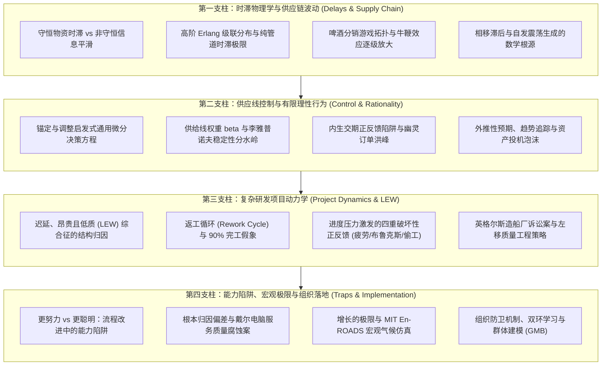

# 15.872 系统动力学二度 (System Dynamics II)

> **授课院系**：MIT Sloan 管理学院 · 系统动力学学科组（System Dynamics Group）  
> **核心导师**：John Sterman（Jay W. Forrester Professor of Management）、Hazhir Rahmandad（Associate Professor of System Dynamics）  
> **核心教材**：John D. Sterman, *Business Dynamics: Systems Thinking and Modeling for a Complex World* (McGraw-Hill / Irwin)  
> **课程定位**：MIT Sloan 高阶系统动力学核心进阶课程（半学期 6 学分，紧密承接 15.871），专注于长时滞物理系统、多级供应链波动、大型研发项目动力学、组织流程能力陷阱与全球宏观生态极限

## TL;DR

- 承接 15.871 基础，深入攻克复杂系统中引发剧烈震荡、超调与崩溃的高阶非线性结构。
- 形式化推导物资与信息时滞的微分方程（Erlang 级联），揭示负反馈相移与幅值衰减的数学本质。
- 深度解构啤酒分销游戏中的牛鞭效应与供应线忽视偏差，形式化锚定调整决策方程。
- 剖析大型复杂工程项目的返工循环（LEW 综合征）、流程改进的能力陷阱以及全球气候 En-ROADS 模拟系统。

## 课程体系与方法论建构

如果说 MIT 15.871《系统动力学导论》帮助学习者建立了多重闭环反馈的世界观与存量流量微积分基础，那么 MIT 15.872《系统动力学二度》则是将这套思想武器直接推向现代产业与复杂组织中最具挑战性的“高深水区”。

在真实经济与工程世界中，系统之所以屡屡陷入毁灭性的周期震荡与交付危机，其根本原因在于**高阶物理时滞与人类有限理性的灾难性共振**。无论是在全球半导体多级供应链、投资数百亿美元的跨国航空航天研发，还是面临数字化转型阵痛的成熟企业，决策者普遍缺乏对在途资产与能力折旧的闭环感知。

在很多时候，管理者往往把系统的震荡和失稳归咎于“市场需求变幻莫测”或“供应商不够配合”。然而系统动力学的严谨仿真证明，即便外部环境扰动极其微小、平缓，系统内部只要存在未受控的长时滞与非线性反馈，系统自身就足以机械地衍生出剧烈的自激震荡与过调。学习 15.872 的核心目的，正是要帮助未来的技术领袖、政策制定者与战略顾问练就一双“看穿深层反馈拓扑”的透视眼。

MIT 15.872 课程大纲以 John Sterman 教授与 Hazhir Rahmandad 教授的前沿实证研究为骨架，构建了四大高阶方法论支柱：

这四大支柱在逻辑上紧密咬合、层层递进：
首先，第一支柱从物理底层夯实时滞微积分与频域相移，为分析多级供应链的自激震荡奠定严谨的数学基础；
第二支柱进而引入行为经济学与实验心理学，解构有限理性决策者如何在库存控制中忽视供给线、在资产定价中陷入趋势外推，从而将微观认知偏差映射为宏观周期的放大器；
第三支柱将视线聚焦于知识密集型的智力研发系统，揭示看不见的“未发现返工”如何通过进度压力正反馈彻底瓦解工程工期；
最终，第四支柱将系统动力学上升至战略组织重塑与全球生态治理的高度，既剖析组织为何在能力陷阱中固步自封，又利用秒级透明的气候仿真器提供面向全人类共同未来的政策沙盘。全套课程展现出从微观物理管道到宏观文明命运的宏大视野。

## 讲义导航全景

全课程 8 篇深度研读讲义覆盖了系统动力学进阶的完整知识脉络，均配有严格的微分方程推导、因果拓扑图示与商业战争实战复盘：

| 讲次 | 讲义主题与核心文献 | 核心研究问题与知识要点 | 快速链接 |
| :--- | :--- | :--- | :--- |
| **第 1 讲** | **物资与信息时滞：结构、阶数与行为模式** *(Sterman Ch. 11; 15.872 Assignment 1)* | 剖析物理守恒流动与信息滤波的本质差异；求解一阶与高阶 Erlang 时滞微分方程；测试阶跃、脉冲、斜坡与正弦相移。 | [lec1.md](./lec1.md) |
| **第 2 讲** | **供应链波动与牛鞭效应：啤酒分销游戏复盘** *(Sterman Ch. 17; Jay Forrester; Beer Game)* | 复盘经典四级供应链桌游实验；剖析需求变异度沿链条逐级放大的牛鞭效应；揭示信息孤岛与局部优化带来的自发震荡。 | [lec2.md](./lec2.md) |
| **第 3 讲** | **供应线控制与库存震荡机制** *(Sterman Ch. 17-18; 15.872 Recitation)* | 形式化推导锚定与调整订货决策方程；证明供给线权重 $\beta < 1$ 必然诱发系统失稳；解构内生交期与幽灵订单正反馈陷阱。 | [lec3.md](./lec3.md) |
| **第 4 讲** | **有限理性、锚定调整与非理性预期** *(Sterman Ch. 15-16; Herbert Simon; Kahneman)* | 批判新古典理性预期假说；构建趋势追踪与外推预期微分方程；分析“追涨杀跌”正反馈如何驱动大宗商品与资产泡沫。 | [lec4.md](./lec4.md) |
| **第 5 讲** | **研发项目动力学与返工循环：LEW 综合征** *(Sterman Ch. 14 & 19; Kenneth Cooper; Brooks's Law)* | 解构待办任务、未发现返工与真实完工三存量网络；破解“90% 完工假象”；形式化疲劳、布鲁克斯法则与偷工减料恶性循环。 | [lec5.md](./lec5.md) |
| **第 6 讲** | **服务质量腐蚀与能力陷阱：戴尔案例与流程重构** *(Repenning & Sterman 2001, 2002; Dell Case)* | 权衡“更努力工作”与“更聪明工作”；揭示能力折旧与先坏后好时滞；剖析管理者根本归因偏差；复盘戴尔客服雪崩悲剧。 | [lec6.md](./lec6.md) |
| **第 7 讲** | **全球极限与气候系统模拟：World3 与 En-ROADS 政策设计** *(Sterman Ch. 4 & 22; Meadows World3; En-ROADS)* | 探讨 World3 宏观物理极限与超调崩溃机制；解构 MIT En-ROADS 秒级透明气候仿真器；揭示气候政策“无银弹”与气球效应。 | [lec7.md](./lec7.md) |
| **第 8 讲** | **组织变革与系统动力学落地挑战：克服深层防御机制** *(Sterman Ch. 21-22; Chris Argyris; Group Model Building)* | 破解实施挑战；区分单环纠偏与双环反思学习；穿透组织防卫性常规；落地群体协同建模（GMB）与管理飞行模拟器。 | [lec8.md](./lec8.md) |

## 核心概念索引

为支持跨学科检索与知识图谱互联，本课程提炼了四个高频应用的核心概念专页：

- [牛鞭效应与供应线控制：啤酒分销游戏机制 (The Bullwhip Effect & Supply Line Control)](./concept/bullwhip-effect-supply-line.md)：多级供应链动态失稳的物理机制，需求方差逐级放大、供给线完全核算定理与抗震荡政策。
- [时滞与系统震荡 (Delays and System Oscillation)](./concept/delays-and-oscillation.md)：系统相移与失稳的数学根源，物资时滞与信息时滞、Erlang 级联分布与管道时滞极限。
- [研发项目动力学与返工循环：LEW 综合征 (Project Dynamics & The Rework Cycle)](./concept/rework-cycle-project-dynamics.md)：复杂工程项目延期超支的物理骨架，未发现缺陷潜伏期、进度压力正反馈与布鲁克斯法则。
- [能力陷阱与流程改进动态学 (The Capability Trap & Process Improvement Dynamics)](./concept/capability-trap.md)：组织变革困境的深层模型，“更努力”对“更聪明”的挤出、先坏后好时滞与自证归因偏差。

## 课程实验与作业体系

MIT 15.872 延续了 MIT Sloan 注重定量建模与决策实验的硬核传统。学员在学期中需独立完成以下实验与战略项目：

1. **Assignment 1: 时滞结构与动态响应分析 (Structure and Behavior of Delays & Shale Gas Glut)**：在 Vensim 中搭建一阶至多阶物资与信息时滞模型，进行阶跃、脉冲与正弦频域测试；并将理论模型应用于分析美国页岩气繁荣期间钻井时滞导致的严重产能过剩。
2. **Project Dynamics Recitation: IT 研发项目返工循环仿真 (Product Development Recitation Model)**：从零构建包含 100 个初始任务的软件开发返工模型，量化测试缺陷率、发现时滞以及进度压力下团队扩招与疲劳对最终交付日期的非线性破坏。
3. **Beer Distribution Game 线上对抗演练 (Online Beer Game Debrief)**：在去中心化网络中扮演零售商、批发商、分销商或酿酒厂，体验在途供给线不透明环境下的恐慌订货，亲身复盘牛鞭效应产生的数据源。
4. **MIT En-ROADS 气候战略沙盘决策研讨 (Climate Pathways Project & En-ROADS Workshop)**：作为跨国政策代表在 En-ROADS 全球模型中联合调试碳税、可再生能源补贴、电气化推广与碳移除技术，探索达成《巴黎协定》2°C 目标的最小成本政策组合。

---

本课程笔记系统整理自 [MIT OpenCourseWare (15.872 Fall 2013)](https://ocw.mit.edu/courses/15-872-system-dynamics-ii-fall-2013/)，严密整合 John Sterman 教授与 Hazhir Rahmandad 教授的专著、论文与实验课件，遵循 Creative Commons BY-NC-SA 4.0 许可协议。
