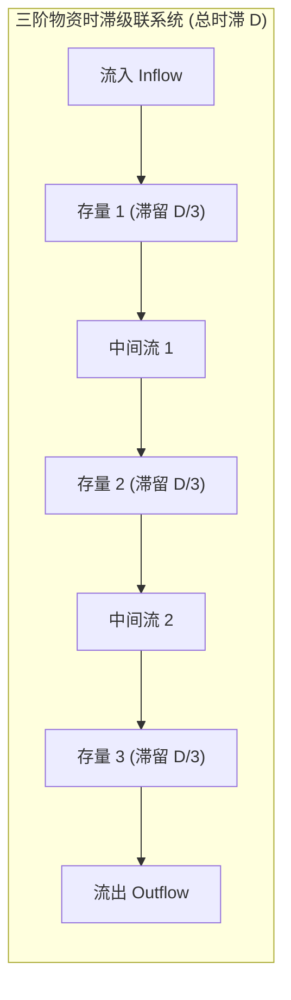
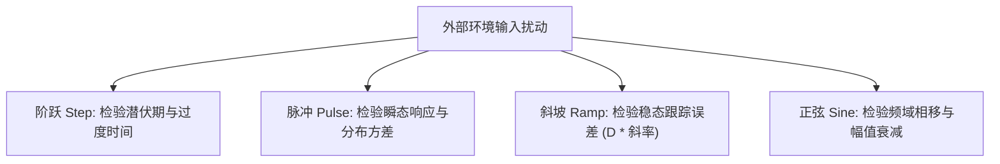

# Lec 1 物资与信息时滞：结构、阶数与行为模式 (Structure and Behavior of Delays)

> MIT Course 15 · System Dynamics II · 时滞结构与动态行为基础

## TL;DR
- 时滞是现实复杂系统动态响应滞后与政策超调的根源，分为守恒的物资时滞与认知平滑的信息时滞。
- 一阶时滞缺乏物理潜伏期，而高阶时滞通过级联存量呈现 Erlang 分布，逼近真实物理管道。
- 系统对阶跃、脉冲、斜坡与周期输入的响应揭示了时滞引起的幅值衰减与相位滞后特征。
- 忽视时滞会导致决策者把暂时的未达标误判为投入不足，从而在系统中引入灾难性的过量补偿。

## 一、时滞的本质：为什么“立竿见影”在复杂系统中不存在

在管理决策与工程控制中，一个最为常见且致命的心理模型假设是“行动与结果在空间与时间上紧密相邻”。然而，真实社会经济系统充满着形形色色的物理沉淀与认知阻滞。从决定招募一名高管到其完全融入团队发挥生产力，从下达晶圆制造订单到成品芯片封装出库，中间都横亘着无法被压缩的时间跨度。

系统动力学创始人 Jay Forrester 指出，系统之所以表现出超调（Overshoot）、震荡（Oscillation）甚至崩溃，其核心催化剂就是**时滞（Delays）**。时滞阻断了决策行为与反馈信息之间的实时同步，使得管理系统极易陷入“盲人摸象”式的过度纠偏。

在深入讨论供应链与项目崩溃之前，我们必须建立对时滞内部微分结构及其数学响应的严格理解。根据 Sterman 在《商业动力学》第 11 章的框架，时滞可根据流动的物理属性精确划分为两类：物资时滞与信息时滞。

## 二、物资时滞与信息时滞的形式化结构

理解时滞首先要辨析流动实体的守恒性。物质实体不可凭空产生或消失，而人类的认知信念可以非对称地被修改与覆盖。

### 1. 物资时滞 (Material Delays)

物资时滞追踪原子世界中的物理对象。设流入速率为 $\text{Inflow}(t)$，流出速率为 $\text{Outflow}(t)$，时滞管道内部积聚的实体总和为在途存量（Work in Process, $\text{WIP}(t)$）。物资时滞满足严格的积分守恒方程：

$$
\text{WIP}(t) = \text{WIP}(0) + \int_{0}^{t} (\text{Inflow}(s) - \text{Outflow}(s)) \, ds
$$

流出速率由管道内部的转运机制与平均时滞时间 $D$ 共同决定。若将管道视为单室充分混合容器，则构成**一阶物资时滞**：

$$
\text{Outflow}(t) = \frac{\text{WIP}(t)}{D}
$$

### 2. 信息时滞与自适应平滑 (Information Delays)

与物资时滞截然不同，信息时滞描述的是决策者从杂乱的外部数据流中提取真实信号的过程。决策者不会对每一次瞬时波动做出神经质反应，而是通过**指数加权平滑（Exponential Smoothing）**来更新心智模型中的“感知状态” $\hat{X}(t)$：

$$
\frac{d \hat{X}(t)}{dt} = \frac{X(t) - \hat{X}(t)}{\tau}
$$

其中 $X(t)$ 为真实信号输入，$\tau$ 为认知调整时间常数（Time to Form Belief）。信息时滞不创造物理在途库存，其状态变量存储的是“主观信念”。

::: definition 时滞双重性判据
- **物资时滞**：满足物理质量守恒。流出受到存量可用性与物理管道吞吐约束，中途不可瞬间撤回。
- **信息时滞**：描述认知信念更新。信息读取不消耗源数据，平滑机制在数学上等价于低通滤波器。
:::

## 三、高阶时滞与 Erlang 级联分布

在实践中，一阶时滞经常遭到工程与管理人员的质疑：当输入发生跳变时，一阶时滞的输出导数在 $t=0$ 瞬间达到最大值。这意味着订单刚刚进入工厂，立刻就有一部分成品从出口流出，这显然违背了装配线的物理常识。

现实中的物理转运具有明确的“潜伏期”（Latent Phase）。为了模拟这种输出延迟，系统动力学通过将 $n$ 个相互级联的一阶存量串联，每个存量的平均滞留时间为 $D/n$：

$$
\frac{d S_1}{dt} = \text{Inflow} - \frac{S_1}{D/n}, \quad \frac{d S_k}{dt} = \frac{S_{k-1}}{D/n} - \frac{S_k}{D/n} \quad (k = 2, \dots, n)
$$

级联阶数 $n$ 的数学本质是时滞输出时间的概率分布。$n$ 阶时滞对单位脉冲输入的响应，严格对应形状参数为 $n$ 的 **Erlang 分布**：

$$
f(t) = \frac{(n/D)^n t^{n-1} e^{-n t / D}}{(n - 1)!}
$$

::: theorem Erlang 分布的统计矩与管道极限
- **数学期望**：$E[t] = D$，无论阶数 $n$ 为何值，平均停留时间恒为 $D$。
- **响应方差**：$\text{Var}(t) = \frac{D^2}{n}$。方差随阶数增加按 $1/n$ 快速衰减。
- **纯管道极限**：当 $n \to \infty$ 时，$\text{Var} \to 0$，输出退化为完全没有形状畸变的纯管道位移（Pipeline Delay / Pure Shift）：
  $$
  \text{Outflow}(t) = \text{Inflow}(t - D)
  $$
:::

在商用建模中，三阶时滞（$n=3$）在计算经济性与物理拟合度之间取得了最优平衡，广泛应用于油气开采投资、高技术产品研发与供应链物料配给模型中。

## 四、测试输入与时滞的特征行为响应

为了全面评估包含时滞系统的抗扰动能力，系统动力学采用四种经典测试函数对时滞模块进行探针测试：

1. **阶跃输入 (Step Input)**：测试系统的阶跃响应时间、拐点分布与达标速度。一阶时滞呈凹函数平滑过渡，高阶时滞呈现典型的 S 型 S-curve 上升，体现出物理潜伏期。
2. **脉冲输入 (Pulse Input)**：测试系统的能量分散特征。一阶时滞在 $t=0$ 达到峰值后指数衰减；高阶时滞则在 $t = \frac{n-1}{n} D$ 处达到峰值输出钟形波。
3. **斜坡输入 (Ramp Input)**：当输入以恒定速率增长时，时滞输出最终也将以相同斜率增长，但在稳态下流出量与流入量之间永远存在恒定为 $D \cdot \text{Slope}$ 的**稳态跟踪误差（Steady-State Tracking Error）**。
4. **正弦周期输入 (Sinusoidal Input)**：揭示系统的频域特征。当时滞接收周期为 $T$ 的波动信号时，输出呈现出两大约束：**幅值衰减（Amplitude Attenuation）**与**相位滞后（Phase Lag）**。

## 五、时滞如何诱发管理盲目性与政策破坏

时滞之所以成为组织管理的致命陷阱，是因为人类心智模型中根深蒂固的**比例偏见（Proportionality Bias）**。当经理人实施了一项扩张政策（例如加大新产品研发预算），而在随后的数月内未观察到预期的营收增长时，有限理性驱使他们得出“现有力度依然不足”的错误推论，进而加倍追加资源。

然而，早期投入的资源并未消失，而是正在高阶物资时滞的管道（WIP）中积聚。等到所有被追加的资源同时穿透时滞管道涌入市场时，供给能力将呈现爆发式井喷，瞬间冲垮市场容纳极限，导致剧烈产能过剩。

::: pitfall 政策阻力陷阱：将时滞潜伏期误读为政策失效
在生态治理、医药研发或重资产投资中，政策见效必然伴随显著的潜伏期。急功近利的考核周期往往在时滞尚未穿透时宣布政策失败，甚至反向采取紧缩措施；这不仅造成前期巨额在途投入沉没，还会诱发系统剧烈的人为震荡。
:::

::: insight 深度洞察：在途透明度是对冲时滞的唯一解
消除时滞带来的系统脆弱性，根本出路并非妄图违背物理定律强行压缩 $D$。在复杂工程中，研发周期与设备调试存在客观的下限。
真正卓越的控制体系，是通过建立对在途管道（WIP）的实时遥测，让决策者将“已经进入管道但尚未流出的物料与项目”视为等同于物理现实的决策输入，从而在认知层面将外生相移完全抵消。
:::

## 思考题与实验

1. **时滞误差计算**：某公司市场需求以每月 100 件的恒定速度线性上升（$\text{Demand}(t) = 1000 + 100 t$）。若公司的供应链生产时滞为 3 个月，在完全缺乏前馈预测的情况下，工厂的实际交付能力在稳态下将比市场需求滞后多少件？
2. **时滞阶数选择**：如果要对“博士生的培养与毕业输出”建立存量流量模型，你应该选择一阶时滞、三阶时滞还是管道时滞？为什么？
