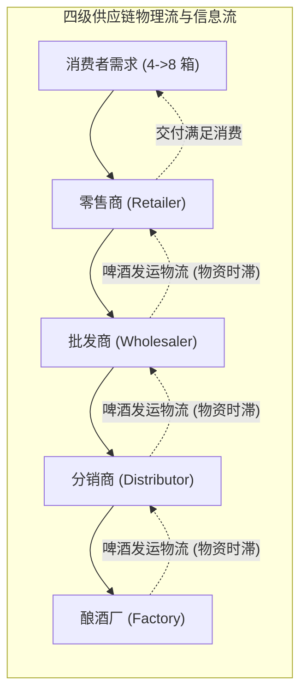
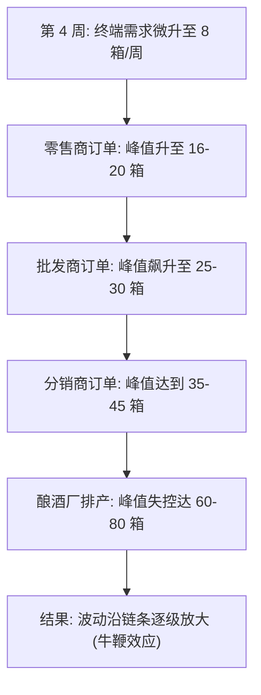
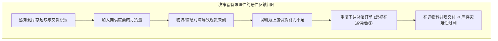

# Lec 2 供应链波动与牛鞭效应：啤酒分销游戏复盘 (Supply Chain Dynamics & The Beer Game)

> MIT Course 15 · System Dynamics II · 产业动力学与经典多级供应链模拟

## TL;DR
- 啤酒分销游戏揭示了多级供应链中需求信号沿链条向上逐级放大的牛鞭效应。
- 下游仅 4 箱/周的微小阶跃扰动，在顶层工厂端被放大至数十倍的剧烈过调与产能震荡。
- 该现象具有极高的跨群体复现性，根源在于有限理性决策者系统性忽视在途供给线。
- 解决牛鞭效应依赖全链条信息共享（如 POS 穿透）与协同补货，而非局部加急催货。

## 一、啤酒分销游戏的拓扑结构与实验设定

在 1950 年代末，麻省理工学院斯隆管理学院系统动力学学科奠基人 Jay W. Forrester 设计了一项经典的桌游实验——**啤酒分销游戏（The Beer Distribution Game）**。该实验旨在探索为什么高度分散、由理性个体组成的去中心化生产与流通网络，会频繁陷入“库存积压”与“严重断货”交替出现的剧烈商业周期。

在经典的实验拓扑中，供应链由四个独立运作的实体沿单向物理流串联组成：零售商（Retailer）、批发商（Wholesaler）、分销商（Distributor）与酿酒厂（Factory）。

### 1. 游戏规则与运营约束

每个节点由独立的学员团队扮演，且游戏在高度受限的信息环境下进行：
- **决策自由度**：每周每个角色只能做出唯一的决策——填写订单，向上游供应商索取啤酒数量。
- **信息黑箱**：禁止横向跨级沟通。除零售商外，上游所有节点均看不到最终消费者的真实需求，只能看到直接下游传递过来的订单。
- **双重时滞**：
  - **订单传递时滞（信息时滞）**：下游填写的订单需要经过 2 周时间才能送达上游。
  - **工厂酿造与物流发运时滞（物资时滞）**：啤酒酿造需要 2 周，物流在各级之间运输各需 1 周。
- **成本函数**：各节点必须按周结算财务成本：每箱现货库存产生 \$0.50/周 的仓储滞纳金；每箱缺货积压（Backlog）产生 \$1.00/周 的信誉违约罚金。

## 二、典型的系统动态行为特征

在数十年的教学实验中，无论参与者是顶级跨国企业高管、MIT MBA 还是初入大学的本科生，实验曲线呈现出近乎完全一致的病态特征。

实验初始时，系统处于平稳稳态：终端消费者需求为 4 箱/周，各级节点库存为 12 箱，订货量为 4 箱/周。在第 4 周，实验组织者引入一个微小且永久的阶跃扰动：消费者需求从 4 箱/周 提升至 8 箱/周，并在随后的 36 周内恒定保持在 8 箱。

实验所记录的典型时间序列展现出四大普遍动力学规律：

1. **逐级放大（Amplification）**：下游终端需求仅发生了 4 箱（100%）的温和增长，但在最上游的酿酒厂，周排产峰值经常达到 60 到 80 箱以上，放大比例高达 15 至 20 倍。这种需求变异度沿链条逆流向上的级联放大现象，被称为**牛鞭效应（The Bullwhip Effect）**。
2. **相位滞后（Phase Lag）**：各层级订单达到峰值的时间随着层级的提升而系统性后移。零售商通常在第 15 周达到峰值，而顶层工厂往往在第 22 到 25 周才迎来订单洪峰。
3. **断货与积压并存（Overshoot and Crash）**：前 20 周全链条陷入严重的现货告罄与交货积压；随后在第 25 至 35 周，前期过度订货的啤酒集中运抵，库存爆发式暴增，工厂和分销商的仓库堆满数倍于年化需求的滞销啤酒。
4. **自发震荡（Self-Generated Oscillation）**：尽管外部环境输入（消费者需求）仅仅是一个静态的阶跃跃迁，系统内部却自发演化出长达数十周的剧烈震荡循环。

::: example 啤酒分销游戏的典型数据对照
在标准实验组中，面对终端从 4 箱增加到 8 箱的平稳需求：
- **零售商**：平均订货峰值 15 箱，累计平均成本约 \$800。
- **批发商**：平均订货峰值 27 箱，累计平均成本约 \$1,400。
- **分销商**：平均订货峰值 42 箱，累计平均成本约 \$2,100。
- **酿酒厂**：平均订货峰值 68 箱，累计平均成本约 \$3,600。
全链条总成本高达近万美金，而理论最优控制下的成本仅需几百美金。
:::

## 三、牛鞭效应的结构归因：为什么聪明的决策者屡屡失败？

当实验结束后，绝大多数学员在复盘会议上的第一反应往往是指责供应链上的其他伙伴：“都是因为下游发神经乱报订单！”或者“上游发货太慢，扣留了我的货！”

然而，John Sterman 在其奠基性论文（1989）中对数千名参与者的决策方程进行了严格的计量经济学回归，证明了问题的核心完全不在于外部环境恶意或特定参与者的愚钝，而在于**去中心化决策结构下的反馈认知缺陷**。

### 1. 忽视在途供给线 (Supply Line Neglect)

决策者在计算本周应发出的订货量时，直觉上只关注自己库房里的“物理现货库存”（On-hand Inventory）与当前的“缺货欠条”（Backlog）。当他们看到库存为零且欠货持续堆积时，焦虑感促使其不仅下单补充消耗，更追加数倍的纠偏订单。

然而，他们之前数周发出的订单已经上路，正在长达 4 周的“在途供给线”（Supply Line）中流动。因为决策者**在心智模型中将这批在途资产遗忘**，导致每一周的缺货都在促发重复订货。

### 2. 局部优化与信息孤岛

每一个层级只对自己的利润和库存安全负责。当下游看到交期拉长时，理性策略是通过“恐慌性囤积”（Gaming & Hoarding）建立安全垫。这种防御性的自保动作，向上游传递了高度失真的假需求，诱导上游工厂投资扩产。

::: definition 牛鞭效应 (Bullwhip Effect)
指供应链中下游微小的需求扰动，由于信息非对称、交期时滞、批量订货以及决策者忽视在途库存，在向供应链上游传递过程中被系统性逐级放大的动态畸变现象。
:::

## 四、政策启示：解耦牛鞭效应的管理干预

系统动力学研究表明，单纯依靠教育和惩戒管理人员无法消除牛鞭效应。只有通过结构重组与信息拓扑重构，才能从根源上平抑系统震荡：

1. **穿透终端 POS 需求（Point of Sale Transparency）**：打破“各级只能看下游订单”的信息壁垒，让上游工厂和分销商直接接入终端零售商的真实结算数据，从而在源头上过滤掉虚假中介信号。
2. **供应商管理库存（VMI, Vendor Managed Inventory）**：由上游核心企业统一监控全链条的实时库存与在途供给线，消除下游重复报单与多头博弈。
3. **压缩物理与信息时滞（Lead Time Reduction）**：精益生产（JIT）和快速响应物流将时滞参数 $D$ 从数周压降至数天，根据系统动力学相移理论，时滞的平方级削减能够成倍提高负反馈回路的阻尼比，彻底抑制震荡发散。

::: pitfall 常见实践陷阱：用加急与惩罚掩盖结构缺陷
当供应链陷入断货时，很多企业习惯性设立“催货小组”，甚至向下游开出违约高额赔偿。这种行政加急手段只会加剧下游的恐慌性多重订货，让牛鞭效应的波峰更为陡峭，最终让企业死于产能暴增后的库存泥潭。
:::

::: insight 深度洞察：结构塑造行为
啤酒游戏最震撼的教学价值在于其深刻地论证了系统动力学的核心公理：**系统的结构决定了系统的动态行为（Structure Produces Behavior）**。
当系统拓扑结构中存在未受控的长时滞和不透明供给线时，哪怕引入世界上最聪明的算法或最高薪的职业经理人，系统也必然演变出剧烈的震荡与衰退。改变系统行为的唯一途径，是重构信息反馈与物理流动的拓扑网络。
:::

## 思考题与实验

1. **参数敏感性推演**：如果将啤酒游戏中的订单传递时滞和物流发运时滞全部设为 0 周（即瞬时到达），在完全相同的非理性参与者操作下，系统是否还会产生牛鞭效应？为什么？
2. **平台经济映射**：在当今以电商平台（如亚马逊、京东、淘宝）和即时配送为代表的数字商业中，牛鞭效应是彻底消失了，还是以新的形式（如云计算算力储备、冷链运力过剩）在更大尺度上演化？
