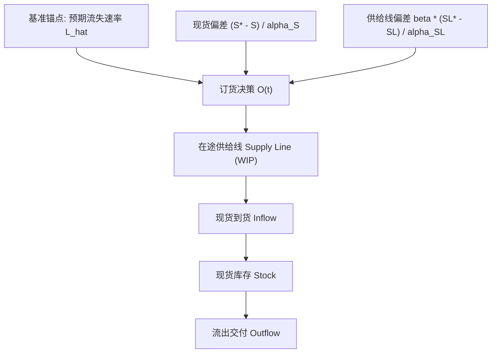
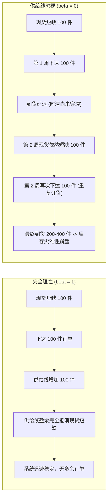
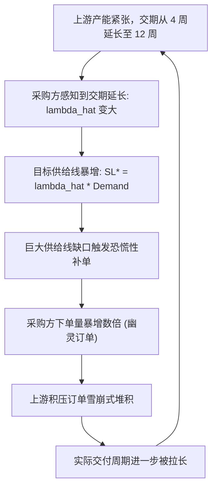

# Lec 3 供应线控制与库存震荡机制 (Supply Line Control & Inventory Oscillations)

> MIT Course 15 · System Dynamics II · 供应线控制微分方程与内生震荡抑制

## TL;DR
- 经典库存控制遵循“锚定与调整”启发式，包含预期消耗补充、现货存量修正与在途供给线修正。
- 决策方程中的供给线权重参数 $\beta$ 是系统稳定性的决定性分水岭，$\beta < 1$ 必然诱发过度订货与震荡。
- 目标供给线是预期采购时滞与预期消耗速率的乘积，是抵消管道相移的前馈抵消变量。
- 当供给受限导致实际交期内生延长时，恐慌性超额订货将触发自我强化的恶性正反馈循环。

## 一、库存订货的启发式决策方程：锚定与调整结构

在管理科学和现代运筹学中，订货决策经常被表述为复杂随机动态规划的最优解。然而，John Sterman 在实验心理学与实证建模中发现，真实世界中的人类管理者（包括高阶智能算法）普遍依赖于一种被称为**锚定与调整（Anchoring and Adjustment）**的通用认知启发式。

在任何包含时滞的物料补给节点，决策者试图维持一个理想的现货库存水平 $S^*$，以平抑需求波动并保障交付率。面对动态环境，订货速率 $O(t)$ 的通用形式化结构包含三大核心组成部分：

$$
O(t) = \max\left(0, \, \hat{L}(t) + \text{AS}(t) + \text{ASL}(t)\right)
$$

其中：
1. **$\hat{L}(t)$（基准锚点：预期流失/需求量）**：为了维持现状，系统首先必须补充当前正在被消耗或销售的物料速率。
2. **$\text{AS}(t)$（现货存量调整，Adjustment for Stock）**：纠正物理现货库存 $S(t)$ 与目标库存 $S^*$ 之间的偏差。
3. **$\text{ASL}(t)$（在途供给线调整，Adjustment for Supply Line）**：纠正在途管道资产 $\text{SL}(t)$ 与目标在途量 $\text{SL}^*$ 之间的偏差。

## 二、供给线（Supply Line）的微积分定义与目标设定

供给线并非抽象概念，它是已经向供应商下单但尚未完成交付检验的全部在途物料存量。在连续时间域中，供给线 $\text{SL}(t)$ 的动态累积满足严格的质量守恒方程：

$$
\frac{d \text{SL}(t)}{dt} = O(t) - \text{Arrival}(t)
$$

其中 $\text{Arrival}(t)$ 为实际到货速率。若供应商的物理交付时滞为 $\lambda$，则理想状态下 $\text{Arrival}(t) = O(t - \lambda)$。

### 1. 目标供给线 $\text{SL}^*$ 的推导

为了在未来维持目标现货库存，管道中应当保留多少在途物料？根据利特尔法则（Little's Law），在吞吐量为 $\hat{L}(t)$、交付时滞为 $\hat{\lambda}$ 的管道中，处于稳态的平均在途数量必须满足：

$$
\text{SL}^*(t) = \hat{\lambda}(t) \cdot \hat{L}(t)
$$

如果预期时滞为 4 周，每周预期出货 100 件，则当前供给线中必须同时保留 400 件在制品。如果供给线少于 400 件，未来数周的物理到货必然低于消耗，最终击穿现货安全库存。

### 2. 供给线偏差修正项

根据上述目标，供给线修正项的具体微分形式为：

$$
\text{ASL}(t) = \beta \cdot \left( \frac{\text{SL}^*(t) - \text{SL}(t)}{\alpha_{\text{SL}}} \right)
$$

其中 $\alpha_{\text{SL}}$ 为供给线调整时间常数，而 $\beta \in [0, 1]$ 则是极其关键的**供给线认知敏感度权重（Weight on Supply Line）**。

::: definition 供给线控制核心参数
- **现货调整时间 $\alpha_S$**：决策者试图在多长时间内弥补现货亏空。$\alpha_S$ 越小，纠偏意愿越激进。
- **供给线权重 $\beta$**：决策者对在途订单的心理重视程度。$\beta = 1$ 代表完全理性核算；$\beta = 0$ 代表完全无视在途库存。
- **目标时滞 $\hat{\lambda}$**：决策者对采购前置期的认知估计。
:::

## 三、稳定性分析：为什么 $\beta < 1$ 必然诱发系统震荡？

参数 $\beta$ 是系统动力学特征根穿越虚轴的决定性分水岭。Sterman（1989）对人类受试者的计量回归显示，人类真实决策中的 $\beta$ 平均值仅在 $0.1$ 到 $0.34$ 之间，存在严重的**供给线忽视（Supply Line Neglect）**。

### 1. 数学机制：相移抵消失效

当 $\beta = 1$ 时，我们将订货方程代入闭环反馈分析。现货的亏空量 $(S^* - S)$ 会立刻被供给线的盈余 $(SL^* - SL)$ 在代数上完全抵消。

换言之，**在途订单在决策方程中充当了虚拟现货的角色**。这在控制理论中构成了完美的前馈补偿（Feedforward Compensation），将物资时滞引入的相位滞后（Phase Lag）提前中和。

### 2. 当 $\beta \to 0$ 时的过调动力学

当 $\beta = 0$ 时，决策者完全不关心在途有多少货物。在订单发出到实际到货的整段时滞跨度内，现货库存始终处于亏空状态，因此纠偏负反馈回路持续处于开启状态，源源不断地向管道注入过量订单。

当这批庞大的累积订单终于穿透时滞到达仓库时，现货库存以不可遏制之势向上暴冲，产生灾难性超调。接着，决策者停止一切订货，系统陷入长期的停工消化期，从而激发出内生极限环震荡。

::: theorem 供给线完全核算定理
在单级线性时滞补给系统中，设物理交付时滞为常数 $D$。若决策者设定 $\beta = 1$ 且 $\hat{\lambda} = D, \, \alpha_{\text{SL}} = \alpha_S$，则系统阶跃响应对任意正调整时间 $\alpha_S$ 均保持绝对渐近稳定，系统严格不发生超调与震荡。
:::

## 四、内生交期与“幽灵订单”正反馈陷阱

在真实工业市场中，交付时滞 $\lambda$ 往往不是恒定不变的外生参数，而是取决于供应商的总产能利用率与积压订单量。这种非线性耦合创造了一个致命的正反馈循环：**内生交期陷阱（Endogenous Lead Time Trap）**。

当行业出现局部短缺时：
1. 供应商排期拉长，实际交期从 4 周飙升到 12 周。
2. 采购方的系统算法重新计算目标供给线：$\text{SL}^* = 12 \times \hat{L}$，目标在途库存瞬间扩大 3 倍。
3. 为了填补高达 8 周的在途缺口，采购方向供应商发出巨额“幽灵订单”（Phantom Orders）。
4. 这批人为制造的订单洪峰再次冲垮供应商产能，导致交期进一步恶化至 20 周。

这种恶性自我强化最终在“虚假繁荣”中戛然而止：一旦终端需求出现微小放缓，前期多下的幽灵订单被集体取消，全行业瞬间从“全线缺芯”断崖式滑向“血亏去库存”。

::: example 半导体行业的周期性产能灾难
2020-2022 年全球汽车与消费电子芯片短缺正是该机制的教科书级重演。由于汽车厂商采用 JIT 模式砍单后突然反弹，晶圆厂交期从 12 周拉长到 50 周以上。各大 Tier 1 厂商为了确保配额，按照 50 周的交期在不同代工厂重复下达 200% 的供给线锁定订单。2023 年当芯片集中入库后，全行业爆发罕见的超级库存减值风暴。
:::

::: pitfall 算法陷阱：将 ERP 默认参数直接用于波动市场
许多现代 ERP 系统（如 SAP 或 Oracle SCM）的自动补货模块虽然包含了在途计算，但其时滞预测模型通常采用简单的滑动平均。在市场发生短缺时，ERP 系统会自动上调 Lead Time 参数，从而程序化地触发幽灵订单洪峰，将算法自身的正反馈放大器推向极致。
:::

::: insight 深度洞察：供应链不仅是物理系统，更是博弈心智系统
解决供给线震荡的终极方案，不能仅仅寄希望于下游采购人员的自律。
当交期内生延长时，供应商必须建立**配额信用分配机制（Turn-and-Earn Allocation）**，即按照历史平稳提货量而非当前订单量来分发产能。只有从机制上剥夺采购方通过“放大订单来争抢现货”的正反馈收益，才能斩断内生交期放大的多米诺骨牌。
:::

## 思考题与实验

1. **代数推导**：若某企业需求为 500 件/月，物理交付期为 2 个月，当前现货库存为 800 件（目标库存 1000 件），当前在途订单为 600 件。设 $\alpha_S = 1$ 个月，$\alpha_{\text{SL}} = 1$ 个月。分别计算在 $\beta = 1$ 与 $\beta = 0$ 两种情况下，企业本月应当发出的订货量 $O(t)$。
2. **制度设计分析**：为什么台积电（TSMC）要求高阶制程客户必须签署带有巨额定金的不可撤销长协（NCNR, Non-Cancelable, Non-Returnable），这一商业契约在系统动力学拓扑上消除了哪一条反馈回路？
