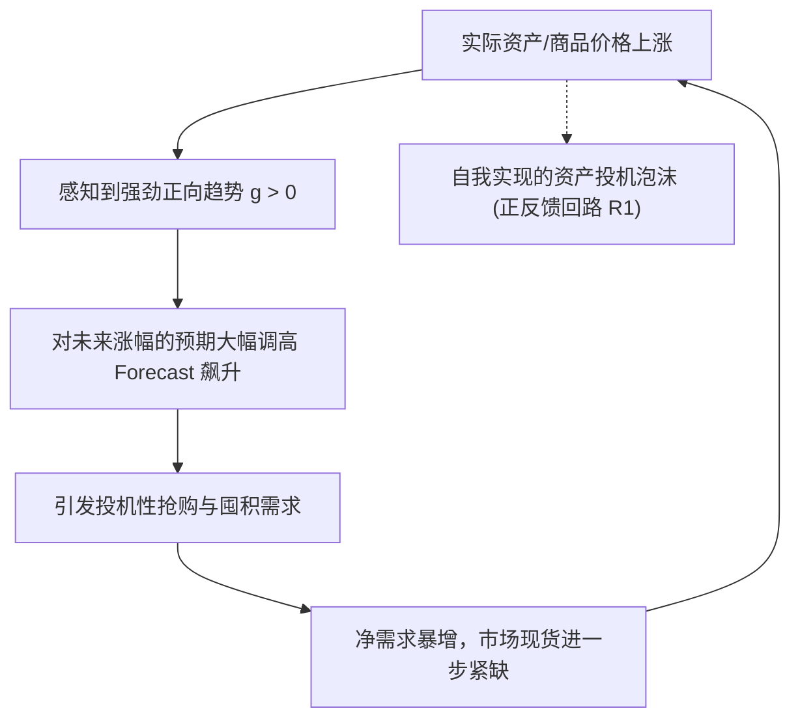
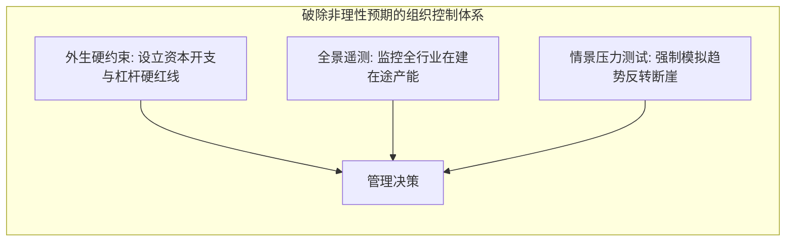

# Lec 4 有限理性、锚定调整与非理性预期 (Bounded Rationality & Heuristic Forecasting)

> MIT Course 15 · System Dynamics II · 行为决策建模与趋势外推正反馈

## TL;DR
- 新古典经济学的理性预期假设在现实复杂动态系统中失效，人类依赖局域启发式进行决策。
- 锚定与调整启发式是人类形成预期的普遍认知底座，通常以历史现状为锚并做不充分微调。
- 趋势追踪与外推预期在系统中构建起“价格上涨引发更多买入”的投机正反馈闭环。
- 系统动力学通过将有限理性决策规则内生化，成功复现了资产泡沫与商品周期的物理与心理共振。

## 一、从完全理性到有限理性：建模心智的范式跃迁

主流新古典经济学建立在**理性预期假设（Rational Expectations Hypothesis, REH）**的基础之上，假定经济主体知晓系统的真实概率分布和全局结构方程，并能无成本地求解跨期贴现极值。

然而，赫伯特·西蒙（Herbert Simon）与丹尼尔·卡尼曼（Daniel Kahneman）等学者的行为研究表明，现实中的人类决策者面临着严重的认知带宽瓶颈与信息不对称。在绝大多数商业情境下，决策者无法获得全局闭环图景，只能依靠简化心智模型（Mental Models）和经验法则进行**满意决策（Satisficing）**而非全局最优。

系统动力学的核心建模信条，正是**将有限理性（Bounded Rationality）作为微分方程的微观决策基础**。我们不假设管理者是全知全能的超级计算机，而是精确复现他们在压力、时滞与局域视野下的真实决策启发式。

## 二、锚定与调整启发式 (Anchoring and Adjustment)

在预期形成与资源分配中，人类认知最普遍的经验法则是**锚定与调整启发式（Anchoring and Adjustment Heuristic）**。决策者首先挑选一个显著且认知负荷较低的基准点作为“锚”（Anchor），然后根据近期掌握的局部边际信息进行小幅“调整”（Adjustment）。

### 1. 静态锚定与自适应预期 (Adaptive Expectations)

当面对一个充满短期随机噪声的环境信号 $X(t)$ 时，最稳健的锚点往往是过去的平滑历史。决策者的感知锚点 $\hat{X}(t)$ 遵循一阶指数平滑滤波：

$$
\frac{d \hat{X}(t)}{dt} = \frac{X(t) - \hat{X}(t)}{\tau_{\text{perc}}}
$$

其中 $\tau_{\text{perc}}$ 为感知平滑时间常数。该方程揭示了人类信念调整的惰性：当前信念 $\hat{X}(t)$ 是历史全部输入信号的指数衰减加权积分，半衰期取决于决策者的记忆刷新率。

### 2. 动态锚定：外推预期与趋势追踪 (Trend-Extrapolating Expectations)

当环境不仅包含水平位移，还展现出持续上涨或下跌的态势时，决策者往往不会停留在水平锚点上，而是试图推断“增长斜率”。

Sterman 在《商业动力学》第 16 章中构建了标准趋势感知结构。首先计算近期平滑变化率，再将其标准化为分数增长率（Fractional Growth Rate, $g(t)$）：

$$
g(t) = \text{SMOOTH}\left( \frac{1}{\hat{X}(t)} \cdot \frac{d\hat{X}(t)}{dt}, \, \tau_{\text{trend}} \right)
$$

进而，决策者基于预测时间视界 $H$ 构造未来的外推预测值 $\text{Forecast}(t, H)$：

$$
\text{Forecast}(t, H) = \hat{X}(t) \cdot (1 + g(t) \cdot H)
$$

::: definition 预期形成的主要模式
- **适应性预期 (Adaptive Expectations)**：假定系统终将回归近期的平均水平，对偏差进行负反馈式修正。
- **外推性预期 (Extrapolative Expectations)**：假定当前的变化趋势将无限期延续，“追涨杀跌”，构成自我强化的正反馈。
- **回归性预期 (Regressive Expectations)**：假定存在一个外生的长期“基本面锚点”，当偏离过大时预期价格将均值回归。
:::

## 三、外推预期诱发的投机正反馈闭环

当市场中相当比例的参与者采用外推预期（Trend Chasing）策略时，系统的宏观拓扑结构将发生致命畸变。

在正常的均衡市场中，价格机制通过负反馈调节供需：价格上涨 $\to$ 需求下降 $\to$ 平抑价格。然而，一旦外推预期主导心智，预期增幅将被代入需求函数，引发**投机性需求（Speculative Demand）**：

### 1. 自我实现的预言 (Self-Fulfilling Prophecy)

在回路 R1 中，预期的上涨直接诱发了更多的购买，从而在物理上推高了现货结算价格。反过来，更高的新价格“验证”了之前乐观预期的正确性，使决策者进一步调高对趋势的置信度。

这种投机正反馈回路打破了传统物理承载力的约束，将系统推入指数级膨胀阶段。这正是从 17 世纪荷兰郁金香泡沫、南海泡沫，到现代互联网科技股狂热和房地产超级繁荣背后的通用动力学引擎。

### 2. 泡沫破裂与非对称反转

外推正反馈永远不可能脱离物理底层无限运转。当价格攀升到极端高位时，系统的真实承载力约束（如实体部门的现金流枯竭、终极负债上限）将强制切断买盘。

一旦价格停止上涨，趋势变量 $g(t)$ 迅速跌落至零，外推预测瞬间坍塌。投机者由“恐慌性买入”瞬间反转为“踩踏式抛售”，正反馈回路瞬间掉头向下，将系统推入灾难性的下行螺旋。

::: theorem 投机系统的非对称崩溃原理
由于物理建设（如写字楼落成、矿山投产、工厂扩建）存在高阶物资时滞，而金融资产与心智信念的变动属于低阻尼信息流，**信心的蒸发速度永远比物理产能的折旧速度快一个数量级**。这种物理时滞与心理时滞的严重失配，注定了泡沫的破裂永远呈现“上升缓慢、下跌断崖”的典型非对称崩塌。
:::

## 四、有限理性对组织管理者的工程启示

系统动力学对有限理性的建模探索，为企业高层在制定长期战略规划时提供了深刻的警示与行动指南：

1. **审慎对待预测模型的“外推自嗨”**：绝大多数商业智能（BI）工具中的自动化时间序列算法（如 ARIMA、LSTM）本质上依然是趋势外推的数学变体。当把基于历史繁荣期训练出的外推模型用于指导长周期重资产投资时，算法本身便沦为了加速牛鞭效应的正反馈部件。
2. **制度化设立反周期“基本面锚”**：成熟组织必须在制度上隔离“市场短期估值波动”对资本开支（CapEx）决策的直接传导，采用穿越周期的长线估值模型与硬性负债率红线，通过人工负反馈抑制管理层的从众狂热。
3. **识别并校准心智模型的局域盲区**：在做战略决策时，管理者必须强制追问三个局域外问题：“我的在途资产有多少？”、“竞争对手是否正在做出完全相同的产能扩张？”、“这批需求的底层是真实终端消费还是中介投机囤货？”

::: pitfall 实践误区：将非理性归咎为道德败坏
当泡沫破灭、企业陷入巨额坏账时，董事会往往习惯于撤换管理层甚至将责任归咎为操盘手的“贪婪与渎职”。
然而系统动力学模型清晰地证明：即使所有当事人都恪守职业道德、并且每一天的决策都严格符合当时局域收益最大化，**外推预期与非线性负反馈时滞的耦合也足以机械地撕裂整个组织**。问题出在激励与控制的拓扑架构，而非人性道德。
:::

::: insight 深度洞察：理性是对系统结构的洞察，而非对局部算力的追求
在复杂动态世界中，真正的“高阶理性”不是去开发更复杂的超短线量化高频外推算法，而是**深刻理解系统多回路交互的反馈极性与时滞边界**。
当众人沉醉于趋势外推正反馈的自我实现狂欢时，能够清醒识别出物理承载极限与时滞管道中积压的幽灵产能，并在潮水退去前建立安全垫，这才是系统动力学赋予决策者的最高心智力量。
:::

## 思考题与实验

1. **模型方程推导**：假设某大宗商品市场中，感知平滑时间 $\tau_{\text{perc}} = 0.5$ 年，趋势感知时间 $\tau_{\text{trend}} = 1$ 年。若价格在过去 2 年内以每年 20% 的速度指数攀升，在第 2 年末，外推预测模型对未来 1 年后的商品价格预期增幅是多少？
2. **反思现实案例**：结合近几年新能源汽车、光伏硅料或大模型算力基础设施的投资热潮，请分析其决策链条中是否存在外推预期的正反馈放大现象？行业目前处于该回路的哪个动力学阶段？
