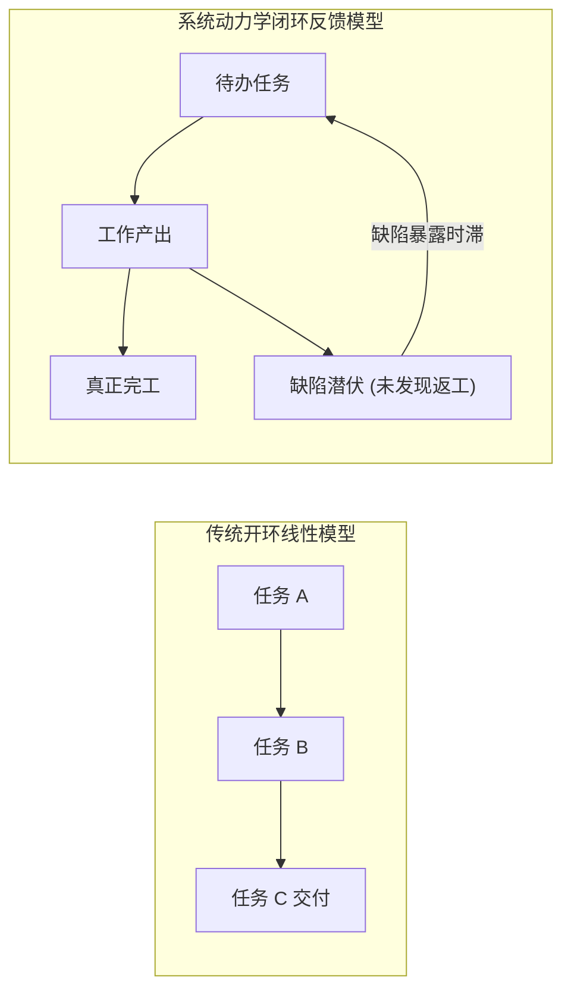
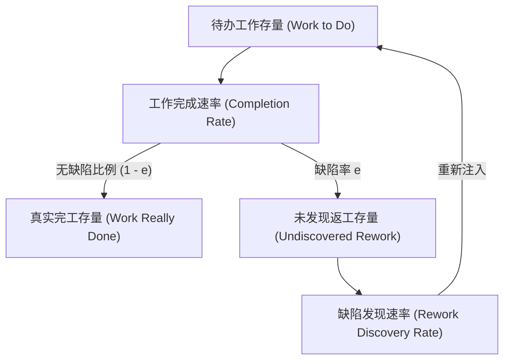
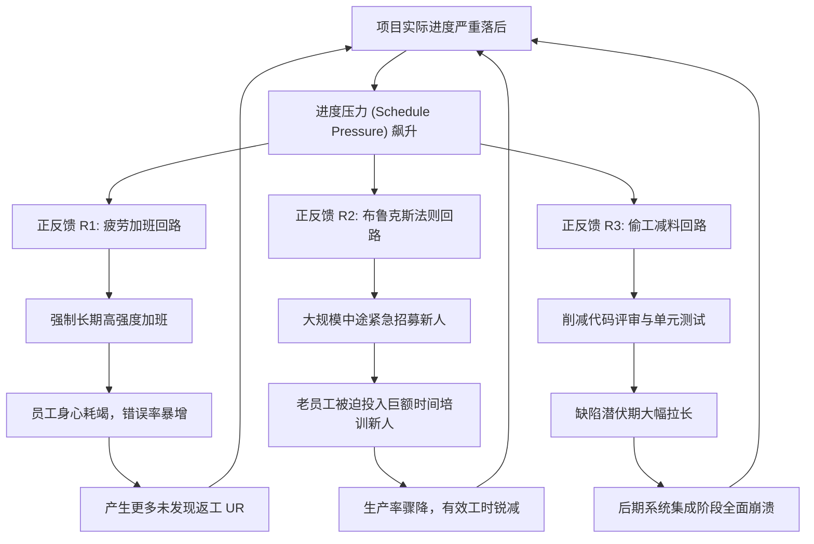
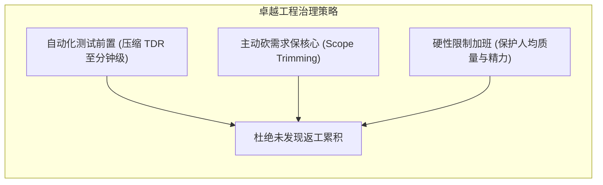

# Lec 5 研发项目动力学与返工循环：LEW 综合征 (Project Dynamics & The Rework Cycle)

> MIT Course 15 · System Dynamics II · 复杂项目管理与返工循环微分动力学

## TL;DR
- 复杂工程项目普遍面临“迟延、昂贵且低质”（LEW 综合征）的系统性交付困境。
- 返工循环是项目动力学的核心引擎，未发现缺陷的潜伏期造成了“90% 完工假象”。
- 进度落后引发管理压力，诱发加班疲劳、仓促招人和偷工减料三重恶性正反馈。
- 布鲁克斯法则证明向延期项目追加人力将增加沟通与培训开销，使项目进一步延期。

## 一、复杂工程的普遍宿命：LEW 综合征

无论是在大型软件研发、国防航空军工建造，还是基础设施和生物制药项目中，项目管理者几乎无一例外地面临着相同的噩梦：预算突破天际、工期数倍延误、交付功能严重缩水。系统动力学界将这种现象统称为 **LEW 综合征（Late, Expensive, and Wrong）**。

传统的项目管理工具（如甘特图 Gantt Chart、关键路径法 CPM、PERT 网络图）均建立在静态、开环的前向任务分解假设之上，将项目视为一系列预定工序的机械组合。然而，真实工程项目本质上是一个高度非线性、由人类行为深度驱动的**反馈动力学系统**。

在 1970 年代，系统动力学先驱 Kenneth Cooper 和 Pugh-Roberts 咨询团队受命代表英格尔斯造船厂（Ingalls Shipbuilding）与美国海军就核动力两栖攻击舰和驱逐舰的数亿美元延期违约金打官司。Cooper 团队首次构建了基于系统动力学的项目全生命周期模型，在法庭上严密证明了海军中途频繁提出细微需求变更如何通过返工恶性循环机械摧毁了造船厂的生产率，最终赢得了历史性的巨额胜诉赔偿。

## 二、返工循环（Rework Cycle）：项目的核心微观拓扑

项目动力学最核心的物理骨架是**返工循环（The Rework Cycle）**。任何工程的开发都可以抽象为任务在不同存量之间的状态迁徙：

1. **待办工作存量（Work to Do, $\text{WTD}$）**：尚未开始动工的任务清单。
2. **已完成工作存量（Work Really Done, $\text{WRD}$）**：经过检验且完全无瑕疵的高质量成果。
3. **未发现返工存量（Undiscovered Rework, $\text{UR}$）**：表面上已经开发完毕，但实际上隐藏着逻辑缺陷、编译错误或接口不兼容的任务。

### 1. 返工循环的微分方程

设团队的总工作产出速率为 $\text{CR}(t) = P(t) \cdot E(t) \cdot W(t)$，其中 $P$ 为人均生产率，$E$ 为工作专注度，$W$ 为团队规模。实际工作质量由缺陷率（Error Rate, $e(t)$）表征：

$$
\frac{d \text{WRD}}{dt} = (1 - e(t)) \cdot \text{CR}(t)
$$

$$
\frac{d \text{UR}}{dt} = e(t) \cdot \text{CR}(t) - \text{RDR}(t)
$$

$$
\frac{d \text{WTD}}{dt} = \text{RDR}(t) - \text{CR}(t)
$$

其中，缺陷暴露速率（Rework Discovery Rate, $\text{RDR}(t)$）取决于测试排查机制与缺陷发现时滞（Time to Discover Rework, $\text{TDR}$）：

$$
\text{RDR}(t) = \frac{\text{UR}(t)}{\text{TDR}(t)}
$$

### 2. “90% 完工假象”的数学根源

在现实软件项目中，项目经理经常看到仪表盘显示“进度已达 90%”，然而这个“90% 状态”往往会停滞长达一年甚至更久。

其本质在于**感知完工率（Perceived Fraction Complete）的计算偏差**。管理层通常将表面产出视为完工：

$$
\text{Perceived Complete} = \frac{\text{WRD}(t) + \text{UR}(t)}{\text{Total Initial Tasks}}
$$

当项目前期快速推进时，$\text{UR}$ 伴随 $\text{WRD}$ 同步暴涨，表面完工率迅速逼近 90%。然而在项目后期进入系统联调与集成测试时，缺陷暴露时滞穿透，海量的 $\text{UR}$ 集中引爆，化作滚滚返工洪流重新灌入待办清单 $\text{WTD}$，导致真实完工率发生断崖式倒退。

::: definition 返工循环核心构件
- **缺陷率 $e$**：新产生任务中存在质量问题的比例。
- **缺陷发现时滞 $\text{TDR}$**：从代码编写到被测试人员或用户发现缺陷的平均潜伏时间。在缺乏自动化测试的团队中，$\text{TDR}$ 通常长达数月。
- **返工级联效应**：修改一个隐藏缺陷往往会导致下游依赖它的另外 3 个模块被迫重构。
:::

## 三、进度压力激发的四重破坏性正反馈

如果系统仅仅包含上述被动的返工结构，项目虽然会延期，但最终仍会收敛。真正导致项目陷入失控灾难的，是**管理层在面对延期时采取的本能干预行为**。

当项目实际进度落后于预定工期目标时，管理层感受到强烈的**进度压力（Schedule Pressure）**。为了“抢回时间”，管理者通常会打出以下组合拳，但在系统闭环中，这些干预无一例外地演变为自我毁灭的正反馈回路：

### 1. 疲劳与加班回路 (The Fatigue Loop, R1)

面对交付延期，最立竿见影的动作是要求工程师加班（Overtime）。在短期（1-2 周）内，加班确实能提升总产出工时。然而一旦加班常态化，人体机能极限将引发严重疲劳：
- 错误率 $e$ 呈指数级上升（可能从 15% 激增至 50% 以上）。
- 离职率暴增，导致团队核心业务上下文永久流失。
表面上每天工作 14 小时的产出，其大部分都是未来需要彻底推倒重来的劣质代码。

### 2. 布鲁克斯法则与新人开销 (Brooks's Law Loop, R2)

在计算机科学经典名著《人月神话》中，Fred Brooks 提出了著名的经验定律：**向一个延期的软件项目追加人力，只会让它延期得更严重（Adding manpower to a late software project makes it later）**。

系统动力学在数学上彻底形式化了布鲁克斯法则：
- **培训分流（Training Overhead）**：新员工不可能第一天就具有独立战斗力。每一位新工程师需要由一名最具经验的核心骨干耗费 20%-30% 的时间进行入职指导。
- **沟通通道组合爆炸（Communication Explosion）**：团队沟通渠道数随人数 $N$ 呈平方级扩张：$C = \frac{N(N-1)}{2}$。团队规模越大，用于跨人协调、对齐接口和会议撕扯的时间越多，纯粹用于编码的有效比例断崖式下跌。

### 3. 偷工减料与测试削减回路 (Corner Cutting Loop, R3)

为了满足下周的里程碑演示，团队最隐蔽的自杀策略是“偷工减料”：跳过测试用例编写、放弃单元测试、忽略安全校验。这在短期内造成了“里程碑圆满达成”的虚假繁荣。然而，这本质上是向未来借高利贷，未发现缺陷以指数级向后潜伏，最终在上线发布前夜彻底失控。

::: theorem 项目控制的非线性分岔
在存在返工循环的系统中，当进度压力突破临界阈值 $\Theta_{\text{crit}}$ 时，由疲劳、布鲁克斯开销和测试削减构成的正反馈回路增益将超越纠偏负反馈回路的增益。此时系统跨越霍普夫分岔（Hopf Bifurcation），项目从“可收敛交付态”跌入“自激返工膨胀态”，无论追加多少预算均无法按期交付。
:::

## 四、项目动力学的破局干预与政策设计

系统动力学不仅诊断了项目的病因，更为高绩效工程管理提供了反直觉但极其强悍的治理策略：

1. **激进前置缺陷发现（Shift-Left Testing）**：
   - 传统模式下 $\text{TDR}$ 往往拖延到项目末期。
   - 现代卓越工程通过自动化持续集成（CI/CD）、测试驱动开发（TDD）和同行代码评审（Code Review），将 $\text{TDR}$ 从“数月”压缩到“分钟级”。缺陷在诞生当天即被扑灭，彻底封死未发现缺陷的复利累积。
2. **严禁在项目危机中途进行“脉冲式扩招”**：
   - 如果项目已经显著落后，追加人手的成本将全面压垮核心骨干。
   - 此时正确的做法是**收缩范围（Scope Descoping）**：砍掉次要特性，锁定最小可用产品（MVP），保护核心团队免受培训分流。
3. **诚实的进度遥测指标**：
   - 抛弃基于甘特图“已完成任务百分比”的虚荣指标。
   - 引入“全链路测试覆盖率”、“自动化集成通过率”和“缺陷发现/修复半衰期”等动态控制变量。

::: pitfall 传统管理陷阱：用严厉问责压迫团队提速
许多外行管理者在项目延期时倾向于召开高压督战会，要求“所有人必须立下军令状”。
在强烈的惩罚威胁下，工程师唯一的自保手段就是隐瞒真实缺陷、伪造虚假测试报告。这种管理高压直接将信息时滞拉长到无穷大，让系统完全失去闭环纠偏能力，直接保送项目走向灾难性暴雷。
:::

::: insight 深度洞察：复杂软件不是砌砖，而是认知生态
把软件开发类比为建筑砌砖或流水线组装，是上世纪工业工程留给现代知识工作最深的毒瘤。
软件项目本质上是高度精密复杂的智力概念编织。**代码行数是负债，而不是资产；返工是认知认知的自然映射**。管理复杂项目的艺术，在于建立透明的缺陷自愈反馈回路，尊重人类认知负荷的生理与拓扑极限。
:::

## 思考题与实验

1. **方程仿真推演**：设某项目总初始任务为 200 个，团队有 4 人，人均每人每月完成 1 个任务。若缺陷率 $e = 0.25$，缺陷发现时间 $\text{TDR} = 4$ 个月。请分析在不追加人力、不加班的基准情况下，该项目大约需要多少个月才能使真实完工率达到 99%？为什么远超理论上的 50 个月？
2. **现实案例研讨**：波音 737 MAX 软件工程故障或医保网（HealthCare.gov）上线初期的全面瘫痪，分别触发了上述哪几条正反馈破坏回路？
