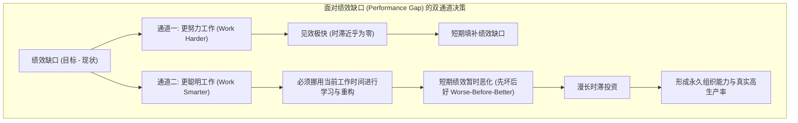
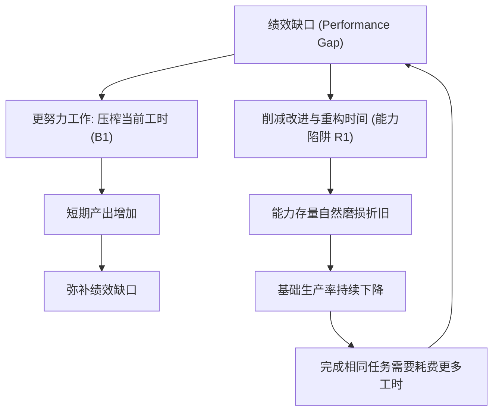
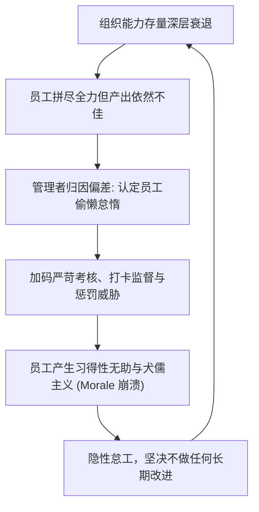
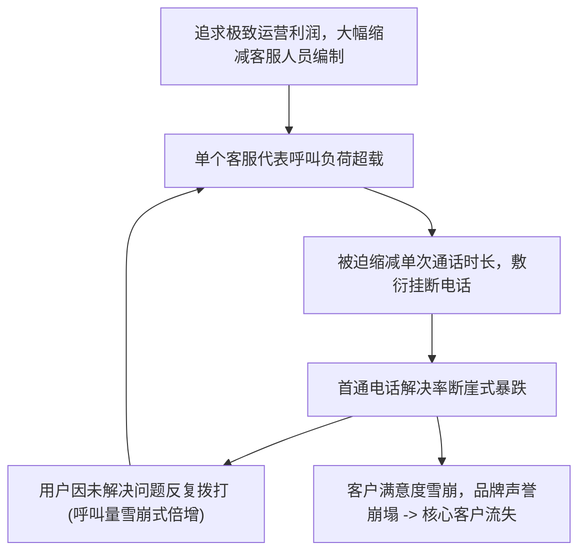

# Lec 6 服务质量腐蚀与能力陷阱：戴尔案例与流程重构 (Service Quality Dynamics & The Capability Trap)

> MIT Course 15 · System Dynamics II · 流程改进动力学与组织能力陷阱

## TL;DR
- 面对业绩达标压力，组织普遍在“更努力工作”与“更聪明工作”之间面临结构性权衡。
- “更努力工作”见效迅速但无持久积累；“更聪明工作”带来复利能力，但存在“先坏后好”的时滞。
- 短视压力迫使员工压缩改进时间，导致组织能力持续折旧并锁死在恶性能力陷阱中。
- 归因偏差促使管理者将系统性能力贫瘠误判为员工怠惰，进一步加码高压监督阻断转型。

## 一、为什么绝大多数流程改进项目以失败告终？

在过去几十年中，全面质量管理（TQM）、六西格玛（Six Sigma）、精益生产（Lean）以及敏捷转型（Agile）等管理理念席卷全球。企业投入了数以千亿计的资金聘请顶尖咨询机构推行流程重构。然而，实证调研显示，超过三分之二的流程改进项目在启动 1 到 2 年后陷入停滞或彻底流产，组织最终退回原有的混乱状态。

麻省理工学院斯隆管理学院教授 Nelson Repenning 与 John Sterman 在其经典论文《没有人会因为解决了从未发生的问题而受到表彰》（*Nobody Ever Gets Credit for Fixing Problems that Never Happened*, 2001）中指出，流程改进之所以屡战屡败，并非因为管理工具缺乏科学性，而是因为组织陷入了深刻的系统动力学结构——**能力陷阱（The Capability Trap）**。

## 二、能力陷阱的反馈拓扑：更努力 vs. 更聪明

任何知识工作团队的时间预算都是严格守恒的：每周 40 小时的总时间，必须在“直接产出生产时间”（Time Spent Working）与“流程与工具改进时间”（Time Spent on Improvement）之间进行分配。

### 1. 两条回路的动态分流

当组织出现绩效亏空（例如每周产出落后于指标）时，管理者面临两条路径的抉择：

- **更努力工作回路（Work Harder Loop, 负反馈 B1）**：要求员工增加加班工时、加快键盘敲击频率、缩短午休时间。这条通道的物理时滞几乎为零：只要今晚全员通宵，明天的交付量就会立竿见影地反弹。
- **更聪明工作回路（Work Smarter Loop, 负反馈 B2）**：抽调资深骨干去重构脆弱的底层代码、编写自动化测试脚本或优化生产模具。这一路径能够永久提升组织的基础能力存量（Capability），从而在未来以更轻松的节奏产出高质量成果。

### 2. 为什么系统会自发滑向能力陷阱？

问题在于两条回路具有严重不对称的动态特征：
1. **时滞不对称**：“更努力工作”的时滞接近于 0，而“能力投资”的时滞长达数月乃至数年。
2. **“先坏后好”陷阱（Worse-Before-Better）**：为了提升能力，团队必须将宝贵的生产时间挪出来用于学习与工具研发。这意味着在投资初期，直接用于生产的时间反而被压缩，导致原本就吃紧的短期绩效**进一步恶化**。

在面临季度 KPI、财报披露或严苛交付 deadline 时，有限理性的管理者本能地选择时滞最短的选项。他们下令“暂停一切非生产性活动”，取消内部技术分享，砍掉代码重构计划，全员扑上一线救火。

随着用于改进的时间被压缩至零，组织的能力存量开始遭遇**无情的自然折旧（Capability Depreciation）**：老员工经验流失、技术债务堆积如山、工具逐渐过时。基础能力的下滑导致完成相同工作所需的有效时间进一步拉长，引发更大的绩效缺口，迫使团队在“更努力工作”的泥潭中越陷越深。

::: definition 组织能力存量微分方程
设组织能力为 $C(t)$，有效改进时间分配为 $T_{\text{imp}}(t)$，能力折旧率为 $\delta_{\text{cap}}$：
$$
\frac{d C(t)}{dt} = \kappa \cdot T_{\text{imp}}(t) - \delta_{\text{cap}} \cdot C(t)
$$
当管理者将 $T_{\text{imp}}$ 归零以应付眼前考核时，$C(t)$ 呈指数衰减：$C(t) = C_0 e^{-\delta_{\text{cap}} t}$，组织在物理上丧失了高效运转的底座。
:::

## 三、根本归因偏差与恶性心理强化的闭环

如果说时滞不对称是能力陷阱的客观物理根源，那么人类心智中的**根本归因偏差（Fundamental Attribution Error）**则是将陷阱焊死的心理枷锁。

管理者通常无法直接肉眼观察到“抽象能力存量 $C(t)$”的衰退，他们只能看到显性的指标：产出下滑、工期延误。此时，管理者形成的心智归因往往不是反思系统投资不足，而是指责员工的个人品质：“一定是这批人缺乏奋斗精神！”或者“员工没有责任心，工作懈怠了！”

当管理者下达惩罚性指令后，员工在恐惧之下短期加大加班力度，产出勉强达标。这一巧合更加“证实”了管理者的偏见：“你看，只要我不狠抓考勤，他们就不好好干；我一严厉督导，产出就上来了！”

这种自我确认的归因偏差（Self-Confirming Attribution Error）彻底掩盖了系统能力的崩溃，将组织推入“低信任、高控制、高内耗、零创新”的死亡螺旋。

## 四、服务质量腐蚀动力学：戴尔电脑案例

能力陷阱与服务质量腐蚀的最具警示意义的商业案例之一是 2000 年代中期的戴尔电脑（Dell Computer）。

在凭借直销（Direct Model）和极端精益供应链打赢 PC 价格战后，戴尔为了在利润率微薄的市场中保持每股收益（EPS）的高速增长，开始将成本削减之刃挥向售后服务与技术支持部门。

### 1. 首通解决率的雪崩反馈

戴尔管理层为客服设立了苛刻的考核指标：严格限制每次通话时长不得超过数分钟。客服代表为了达标，只能仓促应付客户，甚至在问题未诊断清晰前就匆忙建议用户重启或直接挂断。

这引发了灾难性的**重复呼叫反馈循环（Repeat Call Loop）**：由于核心故障未被根治，愤怒的用户在随后数小时内数十次重复拨打。客服呼叫中心瞬间被自己制造的人造洪峰淹没，排队等待时间拉长至数小时。

### 2. 滞后的口碑反噬

尽管客服指标在早期通过压缩单次时长“降低了单次服务成本”，但在长达 1 到 2 年的口碑衰退时滞之后，戴尔客户满意度指数（ACSI）暴跌至行业垫底。

消费者纷纷转投苹果与惠普，戴尔被迫在随后几年中紧急计提上亿美元的挽救预算用于重建客服支持团队。

::: example 戴尔案例的动力学反思
戴尔忽视了“服务质量”是一个具有蓄水池效应的高阶信息存量。服务质量的腐蚀具有漫长的潜伏期；当你在财务报表上看到利润由于砍掉客服开支而短期提升时，品牌资产已经在暗中被永久透支。等到财务报表最终显现出营收断崖时，客户流失已不可逆转。
:::

## 五、逃脱能力陷阱的系统动力学政策

逃离能力陷阱需要极其强大的战略定力与对系统深层结构的透彻认知。卓越组织通过以下三项机制对抗系统的自发堕落：

1. **为改进活动设定“神圣不可侵犯的时间保护区”**：
   - 绝不允许将学习与重构时间作为应对短期波动的缓冲垫。
   - 典型代表如 3M 公司的“15% 自由探索时间”、谷歌早期的“20% 时间”，以及丰田生产方式（TPS）中允许任何工人随时拉动“安灯拉绳”（Andon Cord）暂停整条装配线以排查根因。
2. **跨越“先坏后好”的转型护城河**：
   - 领导层必须在战略上明确预判到：推行新工具与流程重构的头 3 到 6 个月，团队产出**必然会出现短暂下滑**。
   - 必须主动为转型团队提供临时的“指标减免护城河”，杜绝短视的中层管理人员在业绩波谷期过早宣布变革失败。
3. **指标审计：区分“有效产出”与“火灾扑救”**：
   - 将工作性质解耦为“根因预防”与“事后救火”。对频繁通宵救火的英雄主义保持高度警惕，将激励重点转移到建立“从未发生故障的自愈系统”之上。

::: pitfall 转型毒药：一边推行敏捷变革，一边加码交付考核
许多传统企业高管在启动数字化转型时宣布“全员拥抱敏捷与敏捷学习”，但同时宣布“本季度的交付考核指标不仅不能降，还要增长 20%”。
这种精神分裂式的双重束缚直接剥夺了员工实施任何真正改进的物理时间，迫使员工通过在周报中堆砌“敏捷敏捷”等黑话进行表演式配合，实质上把能力陷阱推向了形式主义的极致。
:::

::: insight 深度洞察：英雄主义是组织无能的遮羞布
崇尚“救火英雄”的组织文化，往往是深陷能力陷阱的最确凿表征。
真正高水平的工程与运营，在日常看起来总是平淡无奇、波澜不惊的。**卓越的管理不是在火灾发生时展现神勇的扑救英姿，而是在火星初现时通过严谨的反馈机制从源头上消除火种**。
:::

## 思考题与实验

1. **方程与相平面分析**：假设某团队能力存量的折旧半衰期为 6 个月（即不进行任何重构维护时，6 个月后能力衰减 50%）。若团队在连续 18 个月内将改进时间完全挪用于应付紧急项目交付，其能力存量将退化为初始状态的百分之几？这对其未来的长期交付成本意味着什么？
2. **组织机制诊断**：观察你当前所在的团队或学校，是否存在“平时忙于低效应付日常事务，以至于根本没有时间去开发自动化工具或梳理规范”的现象？如果要打破这个死锁，第一步最小可行阻断措施（Minimal Viable Intervention）应该是什么？
