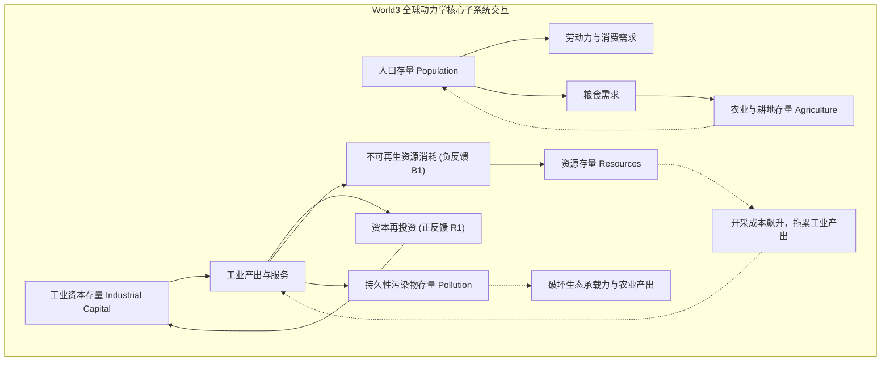
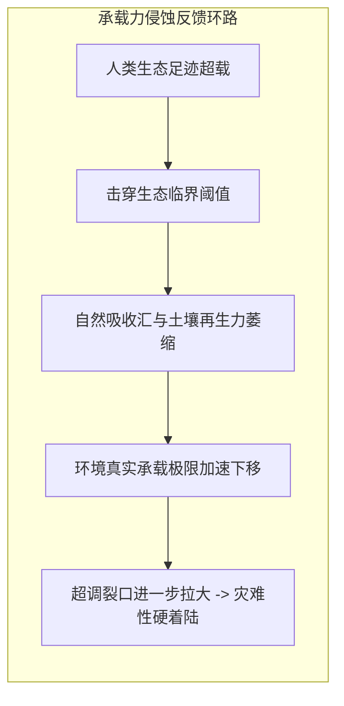
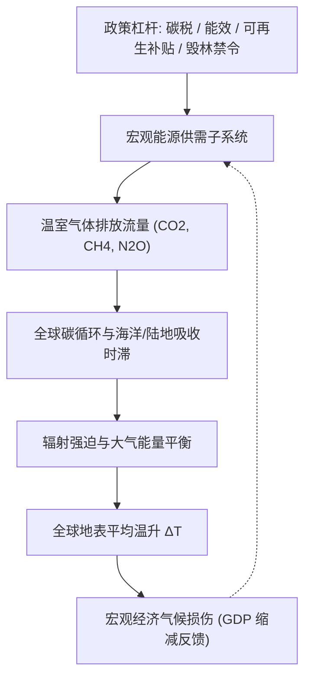

# Lec 7 全球极限与气候系统模拟：World3 与 En-ROADS 政策设计 (Limits to Growth & En-ROADS Climate Simulator)

> MIT Course 15 · System Dynamics II · 大尺度宏观生态物理模型与气候政策模拟器

## TL;DR
- 《增长的极限》World3 模型揭示了人口与资本的指数增长撞击地球物理极限的超调与崩溃动力学。
- 全球生态系统的崩溃并非源于单一资源耗尽，而是由于高阶投资时滞与环境自净时滞导致的系统性过调。
- MIT 研发的 En-ROADS 模拟器将宏观能源、碳循环与气候损伤集成到秒级交互透明模型中。
- 模拟实证表明气候治理“没有银弹”，单项技术补贴常引发气球效应，唯有组合拳政策能守住温控线。

## 一、从《世界动力学》到《增长的极限》：宏观生态系统动力学

1970 年代初，罗马俱乐部（Club of Rome）委托麻省理工学院系统动力学团队探索人类工业文明在有限地球生物圈内的长期演化路径。基于 Jay Forrester 教授在《世界动力学》（*World Dynamics*, 1971）中奠定的理论骨架，Donella Meadows、Dennis Meadows 等人构建了享誉全球的 **World3 模型**，并于 1972 年发布了划时代的报告《增长的极限》（*The Limits to Growth*）。

World3 模型将全球宏观系统抽象为五个高度耦合的核心物理子系统：人口、工业资本、农业与土地、不可再生自然资源以及持久性环境污染。

在标准的基准情景（Business-as-Usual, BAU）仿真中，系统在 21 世纪前半叶展现出持续繁荣；然而在 21 世纪中叶，伴随着高品位矿产与化石能源品位的枯竭、以及工业污染对自然自净能力的压垮，维系农业与工业运转所需的资本开支激增，引发工业产出断崖式崩塌，随后导致人口规模的大幅度锐减——即经典的**超调与崩溃（Overshoot and Collapse）**。

## 二、超调与崩溃的物理机制：时滞与承载力侵蚀

为什么人类社会不能在接近物理极限时实现平稳的 S 型软着陆？系统动力学证明，崩溃不是由极限本身造成的，而是由**系统物理惯性与感知时滞的耦合**决定的。

### 1. 巨大的资本沉淀时滞与人口惯性

重工业设施（如发电厂、炼油厂、远洋货轮、重化工业）具有长达 30 到 50 年的物理服役寿命。这意味着当前的资本投资决定了未来半个世纪的能源与资源消耗下限。

类似地，由于人类世代交替的生物学规律，即使从今天起全球平均生育率降至更替水平，庞大的年轻人口存量依然会推动全球总人口在未来数十年内继续惯性增长。

### 2. 生态承载力的不可逆侵蚀

地球生物圈不是一个被动承受扰动的容器，其自净与自我恢复能力遵循非线性阀值。一旦环境压力突破临界点（Tipping Points），自然资本存量（如森林碳汇、土壤肥力、极地冰盖反照率）将发生不可逆退化：

$$
\frac{d K(t)}{dt} = R_{\text{regen}}(K) - D_{\text{degrade}}(\text{Pollution}, K)
$$

当退化速率超越再生极限，承载力本身开始萎缩。此时，原本处于安全边际内的工业体量突然发现自己已经远远凌驾于正在瓦解的承载基座之上，引发系统性垂直坠落。

::: definition 超调与崩溃判定定理
当一个指数增长系统的反馈控制回路中存在以下三大要素时，系统必然发生超调与崩溃：
1. 系统面临不可逾越的物理硬约束（如热力学与质量守恒上限）；
2. 资源开采与污染累积具有长期且不可逆的承载力侵蚀效应；
3. 从承载力受损到人类社会感知并完成资本重组之间存在显著的高阶时滞。
:::

## 三、现代气候动力学微世界：En-ROADS 模拟器架构

为了将系统动力学深奥的宏观微分方程转化为全球决策者能够实时操作的战略沙盘，MIT 斯隆管理学院联合气候交互组织（Climate Interactive）在 John Sterman 教授领导下开发了 **En-ROADS 气候与能源政策模拟器**。

与运行耗时数周的传统超级计算机大型气候环流模型（GCM）不同，En-ROADS 是一个由数千个非线性常微分方程构成的透明物理反馈系统。它通过对全球 18 个核心政策杠杆进行实时调节，能在 0.1 秒内完成全球从 1990 年到 2100 年的能源、工业、森林与气候轨迹的全生命周期推演。

### 1. 严格质量与能量守恒的碳循环池

En-ROADS 将地球大气、上层海洋、深海与陆地生物圈建模为一个多级级联碳存量系统。碳排放不会瞬间消失，温室气体在大气存量中的滞留半衰期长达一个多世纪：

$$
\frac{d C_{\text{atm}}(t)}{dt} = \text{Emissions}_{\text{fossil}}(t) + \text{Emissions}_{\text{land}}(t) - \text{Uptake}_{\text{ocean}}(t) - \text{Uptake}_{\text{biomass}}(t)
$$

### 2. 宏观资本存量周转时滞（Capital Stock Turnover）

能源系统转型极其缓慢的根本物理原因在于能源资产的服役周期。En-ROADS 严密追踪煤电站、燃油车与工业锅炉的退役与折旧过程。

即使今天全球立法禁止新建任何燃煤电厂，现有全球数千座煤电基础设施仍将通过其设计寿命在未来 30 年内持续锁定数千亿吨的碳排放。

## 四、气候政策的系统动力学洞察：“没有银弹”与“按压气球”

利用 En-ROADS 对全球数千名跨国政要、联合国谈判代表和商业领袖进行仿真推演，揭示了关于气候战略的几项颠覆性动力学公理：

### 1. 技术补贴引发的“按压气球”效应（The Balloon Effect）

政策制定者最热衷的方案往往是向特定清洁技术提供巨额财政补贴（例如高额补贴电动汽车或补贴风电光伏）。然而，孤立的单项补贴往往在系统层面大失所望：
- **电动汽车与电网错配**：如果在电网清洁化尚未完成前激进普及电动车，电动车引发的用电洪峰将直接拉动边际火力发电站满负荷运转，仅仅把排气管排放转移为了烟囱排放。
- **可再生能源的“回弹效应”**：对可再生能源的大额补贴降低了全球综合电力成本。根据微观经济反馈，廉价电力反向刺激了工业与家庭的能源总需求暴涨，抵消了相当一部分脱碳红利。

### 2. 碳定价（Carbon Price）：强效的负反馈杠杆

在系统动力学参数灵敏度分析中，唯一能够同时压制所有化石能源消费、推动全产业链提升能效、并内生激励清洁技术研发的超级杠杆是**高额且普遍适用的碳定价机制**。

碳税直接修改了微观主体的资本重置成本函数，从顶层扭转了正反馈积累方向。

::: theorem 气候政策无银弹公理 (No Silver Bullet)
在高度互联的非线性全球能源系统中，**没有任何单一政策杠杆或单一前沿技术能够独立将 2100 年全球温升控制在 2°C 以内**。
唯有同时部署“高额碳价约束”、“全领域极端能效提升”、“加速电网脱碳”以及“森林陆地碳汇保护”构成的协同组合拳，系统才可能扭转气候崩溃的物理轨迹。
:::

::: pitfall 政策幻觉：寄希望于未来的神奇负碳技术
许多高能耗企业寄希望于 2040 年代出现廉价的“直接空气碳捕集（DAC）”技术，以此作为当前推迟减排的借口。
系统动力学模拟表明：由于高阶时滞，延后 10 年减排所累积在大气中的过剩碳存量，需要未来数十年全球 GDP 5% 以上的巨额工程成本才能抽离。押注未验证的未来技术，是将系统直接推入不可逆生态绝壁。
:::

::: insight 深度洞察：系统动力学是理性希望的载体
《增长的极限》和 En-ROADS 绝非散布末日恐慌的宿命论预言。它们的真正价值在于向人类展示：**灾难并非不可避免，它只是特定结构与特定心智模型的机械产物**。
通过将复杂的反馈、时滞与非线性关系公开化、透明化，系统动力学剥离了政客的口号与自欺欺人，让全人类第一次拥有了看清地球系统物理边界的科学仪表盘，从而在崩溃来临前做出理性的集体救赎。
:::

## 思考题与实验

1. **模拟器实操推演**：访问公开可用的 En-ROADS 官方网页版（en-roads.climateinteractive.org）。如果仅仅将全球可再生能源补贴拉到最大值，全球 2100 年温升能够降低多少度？为什么其减排效果远低于普通人的直觉？
2. **时滞核算思考**：如果一家跨国公司宣布“2050 年实现净零排放”，但计划在 2040 年之前保持现有化石资本投资不变、寄希望于最后 10 年突击采购碳信用，从系统动力学存量流量角度分析，这种声明在物理上是否存在欺骗性？为什么？
