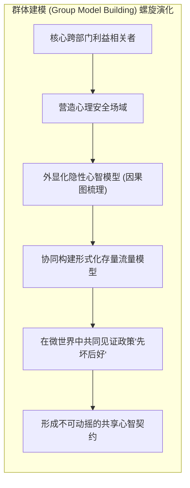
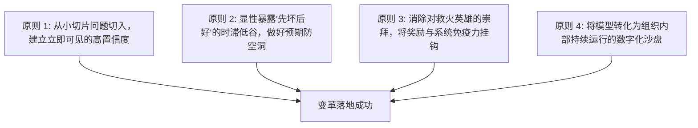

# Lec 8 组织变革与系统动力学落地挑战：克服深层防御机制 (Organizational Change & The Implementation Challenge)

> MIT Course 15 · System Dynamics II · 建模干预哲学与组织双环学习落地

## TL;DR
- 卓越的数学仿真模型如果无法改变组织的心智模型，最终只会沦为被束之高阁的学术报表。
- 组织防卫机制与单环学习习惯构成了抵制变革的核心堡垒，将深层矛盾转化为形式主义妥协。
- 专家式“黑箱交付”模式必然遭遇组织免疫排异，参与式群体建模（GMB）是破除阻力的关键范式。
- 模型不仅是预测工具，更是利益相关者安全检验假设、对齐隐性知识与催化双环学习的过渡客体。

## 一、实施挑战（The Implementation Challenge）：为什么好模型会被搁置？

系统动力学自诞生半个多世纪以来，开发了无数在数学严谨性、数据保真度和政策洞察力上堪称惊艳的仿真模型。然而，资深系统动力学家不得不面对一个残酷的事实：在商业企业与公共治理领域，大量消耗巨资构建的高水平模型在提交最终报告后，并未引发实质性的组织战略重组，而是被迅速遗忘在服务器的角落。

John Sterman 在《商业动力学》第 21 章中将这种现象称为**实施挑战（The Implementation Challenge）**。他指出，建模者的技术傲慢往往让他们产生一种致命幻觉：“只要我的模型足够精确、数据足够扎实，决策者看到客观结论后就会自然而然地采纳并推行变革。”

这种传统模式的破产证明了一项基本公理：**组织变革的瓶颈从来不是技术工具的计算能力，而是人类利益相关者心智模型的防御性阻抗**。

## 二、单环学习 vs. 双环学习：穿透组织防卫机制

为了理解为什么系统性政策建议会遭遇剧烈抵抗，必须引入哈佛大学教授克里斯·阿吉里斯（Chris Argyris）与唐纳德·肖恩（Donald Schön）关于**组织学习（Organizational Learning）**的开创性理论。

### 1. 单环学习（Single-Loop Learning）

在绝大多数日常运营中，组织运行的是单环学习回路：决策者根据既定的心智模型、目标、考核标准和底层价值观，持续监控输出偏差并调整具体行动战术。

例如，当发现生产线次品率偏高时，单环学习给出的方案是“加强出厂质检”、“给工人发更严厉的警告”。单环学习的特征是：**永远不质疑“为什么会产生次品”的深层假设与系统结构**。

### 2. 双环学习（Double-Loop Learning）

双环学习则完全不同，它要求决策者跳出战术动作的修修补补，直接审视、反思并修改支配行动的**核心价值观、心智假设和系统规则**。这种高阶学习模式关注的不是“如何在既定游戏规则下把分刷得更高”，而是追问“我们为什么要玩这个游戏”以及“这套规则是否本身在系统性诱导毁灭”。

在上述次品案例中，双环学习将追问：我们是否为了追求账面产能利用率而采用了劣质原材料？我们的计件薪酬体系是否在惩罚那些主动停线排查故障的工人？为什么管理层会将短期的财务利润指标凌驾于制造质量之上？

双环学习的本质是一场痛苦的认知重组。它迫使组织将那些曾经被奉为圭臬的成功经验、神圣不可侵犯的商业信条以及掌权者的核心心智模型摆上解剖台。阿吉里斯指出，绝大多数组织之所以在危机中表现出极强的僵化性，并不是因为他们不知道具体的操作流程，而是因为缺乏启动双环学习的心理安全感和制度通道。当外部环境发生范式剧变时，固守单环学习的组织只会更加狂热地执行过时的策略，直至彻底撞上现实的南墙。

### 3. 组织防卫机制（Defensive Routines）

双环学习之所以极其罕见且困难，是因为它直接威胁到管理者在组织中的权威、过往政绩与心理安全感。为了逃避面对自身心智缺陷的尴尬与无能感，人类天生会发展出一套被称为**防卫性常规（Defensive Routines）**的潜意识保护盾牌：

- **怪罪外部因素**：“这个季度没做好完全是因为宏观经济大环境太差和友商恶性内卷。”
- **理性化掩盖**：“模型算出来的政策虽然理论上好，但脱离了我们行业的特殊国情，不可行。”
- **封杀危险议题**：将那些真正揭露系统能力陷阱的深层议题列为不可在公开会议上讨论的“禁忌（Taboo）”。

::: definition 组织学习双范式
- **单环学习**：在现有规范和心智模型框架内寻找最佳操作手段，追求“把事情做对（Do things right）”。
- **双环学习**：跳出既有框架，对目标本身的合理性、系统底层结构和主观心智模型进行重塑，追求“做对的事情（Do the right thing）”。
:::

## 三、群体建模（Group Model Building）：从黑箱算命到共创反思

克服组织防卫机制、实现双环学习的唯一有效途径，是彻底摒弃“专家提供答案”的咨询神话，转向**参与式群体建模（Group Model Building, GMB）**。

在 GMB 范式中，系统动力学家不再扮演“无所不知的算命预言家”，而是退居为**认知催化师与共创引导者（Facilitator）**。

### 1. 建模过程比模型产物重要（The Process is the Product）

正如前国际系统动力学学会主席 David Lane 所强调的，**最终提交给客户的那套微分方程模型只占项目价值的 20%，而在共同建模过程中利益相关者心智模型的重构占了 80%**。

当销售副总裁、研发总监、供应链主管和财务总监共同围坐在白板前，亲手将各自领域的局部碎片拼成完整的因果回路图时，他们第一次在物理上看到了自己过去的局域优化是如何摧毁邻近部门的。

### 2. 模型作为“过渡客体”（Transitional Object）

在心理学中，过渡客体（如儿童的泰迪熊）帮助个体在安全的环境中探索未知与分离焦虑。在组织变革中，**系统动力学仿真模型扮演的正是高管团队的过渡客体**。

通过管理飞行模拟器（Management Flight Simulator），决策者可以在完全没有真实财务破产或法律风险的虚拟空间中，自由检验他们最激进的设想；当他们在模拟器中亲眼目睹“加大考核力度导致能力陷阱暴雷”的数据曲线时，他们不是在被外部专家批评，而是**自己在虚拟现实中完成了认知顿悟**。

::: theorem 组织共识的心理所有权定理
人类对外部强加给自己的“最优建议”天生抱有怀疑与排斥心理；但**对参与亲手共创的系统结构，人类会产生坚不可摧的心理所有权（Psychological Ownership）**。
唯有让决策者深度参与模型参数的标定与回路的闭合讨论，他们才会将模型揭示的政策阻力内化为自己的战略意志，从而具备穿越“先坏后好”转型低谷的组织韧性。
:::

## 四、设计具备鲁棒落地力的系统干预政策

为了将系统动力学的智慧真正嵌入组织日常运转的毛细血管中，系统干预必须遵循以下四项工程化实施原则：

1. **提前预告并契约化保护“先坏后好”区间**：
   - 任何涉及双环学习的真实改进必然伴随能力折旧与业绩低谷。
   - 咨询团队必须在仿真阶段精准测算出低谷的深度与持续时间，并在董事会层面白纸黑字锁定保护期豁免权，严防改革在行将见效的前夜被保守派扼杀。
2. **拆除防御性绩效指标的温床**：
   - 许多部门墙和推诿扯皮是孤立考核指标的必然产物。
   - 必须用“全系统吞吐效率”、“端到端在制品总时间”等跨部门闭环指标，替代各业务条线的局部产出考核。
3. **建立常态化的组织心智审计沙盘**：
   - 将系统动力学模型与企业 ERP、CRM 数据流实时联通，演变为企业战略沙盘（Digital Twin for Strategy）。
   - 每季度进行战略复盘时，团队不是对照 PPT 罗列借口，而是在沙盘中复盘：“我们当前的决策是否又在不知不觉中滑向了忽视在途供给线或透支改进时间？”

::: pitfall 落地自杀陷阱：把系统动力学当做政治博弈的打击武器
有时，高管引入系统动力学团队的真实动机并非追求真理，而是希望借助“MIT 科学模型”作为大棒在内部政治清洗中打击政敌部门。
一旦建模团队丧失中立性、沦为特定利益派系的辩护工具，模型的公信力将彻底归零，整个组织反思与系统思考的火种将被彻底扑灭。
:::

::: insight 深度洞察：系统思考是最高阶的组织同理心
系统思考的至高境界，不是冰冷复杂的偏微分方程堆砌，而是一种深邃的组织同理心与谦逊。
当我们能够看穿结构决定行为的铁律，我们就不会轻易将团队的困境轻佻地归咎为个体的平庸或恶意。**真正的领导力，是通过共创透明的反馈结构，赋能普通人在不完美的复杂世界中，持续做出符合系统长期福祉的高尚选择**。
:::

## 思考题与实践

1. **案例反思诊断**：回顾你经历过的一次重大组织或团队变革失败（如公司推行新的协同办公软件、敏捷转型或考勤改革），指出管理层在推行过程中是否采用了“黑箱强推”模式？在这个过程中激发了哪些具体的防卫性常规？
2. **GMB 工作坊设计**：如果让你为一个深陷“跨部门踢皮球、客户投诉激增”的独角兽企业组织一次为期 2 天的群体建模工作坊，你会邀请哪些层级和部门的角色参与？你将如何设计破冰环节以保证参会人员的安全感？
