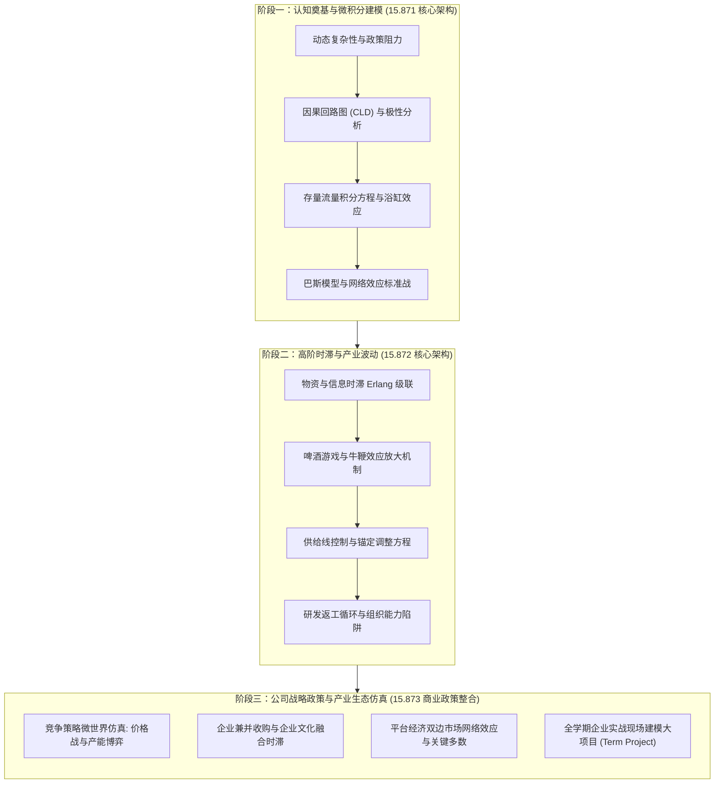
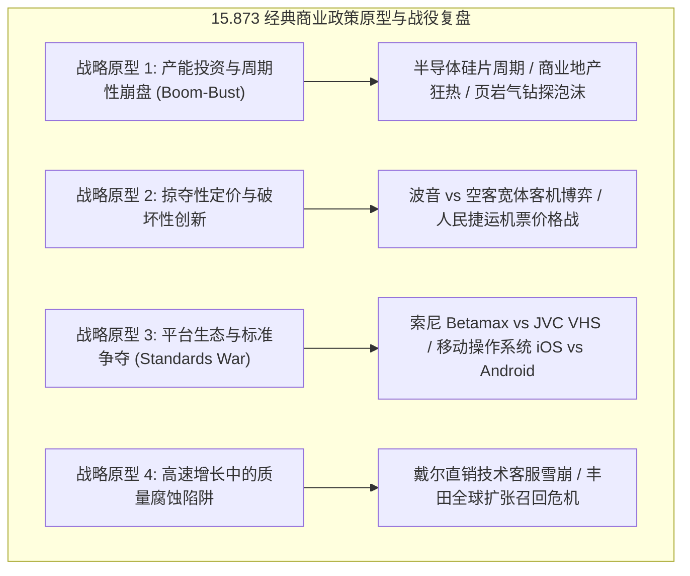

# 15.873 商业政策系统动力学 (System Dynamics for Business Policy)

> **授课院系**：MIT Sloan 管理学院 · 系统动力学学科组（System Dynamics Group）  
> **核心导师**：John Sterman（Jay W. Forrester Professor of Management）、Nelson Repenning（School of Management Distinguished Professor）  
> **核心教材**：John D. Sterman, *Business Dynamics: Systems Thinking and Modeling for a Complex World* (McGraw-Hill / Irwin)  
> **课程定位**：MIT Sloan MBA 与全球运营领袖（LGO）全学期旗舰级商业政策核心课程（12 学分），无缝整合 15.871 与 15.872 全套方法论并贯穿大型战略仿真期末项目

## TL;DR

- 作为 MIT Sloan 全学期旗舰课程，将 15.871（导论）与 15.872（高阶进阶）融会贯通为完整的商业政策设计体系。
- 聚焦商业战略、产业演进与高管决策中的政策阻力，将组织内部博弈与技术物理时滞统一纳入微分仿真。
- 引入贯穿全学期的企业战略现场建模大项目，覆盖医疗、汽车制造、高科技半导体与新能源投资等真实前沿战役。
- 架构以微世界飞行模拟、参与式建模与双环组织学习为核心的战略推演沙盘，赋能未来领袖驾驭动态复杂性。

## 课程体系与战略政策架构

在现代商业竞争中，“商业政策（Business Policy）”与传统日常运营管理的本质区别在于：它决定了组织与外部产业生态在跨越数年乃至数十年的时间跨度内如何演化。优秀的商业政策必须能够穿越商业周期的剧烈波动、规避有限理性的心理陷阱，并在存在显著时滞的环境中精准调动资本与人力资源。

MIT 15.873《商业政策系统动力学》正是为了培养具备这种宏观全局视野的高阶商业领袖而设立。本课程将 15.871 的微积分存量流量基础、创新扩散动力学，与 15.872 的供应链失稳、返工循环以及能力陷阱彻底熔炼为一体，并提升至**公司级战略与产业竞争政策（Corporate Strategy & Industry Policy）**的战略高度。

通过将定性战略框架（如波特五力模型、核心竞争力理论、破坏性创新理论）形式化为严格的系统动力学因果闭环与计算机仿真代码，学员得以在虚拟沙盘中开展大规模政策压力测试，彻底终结了“凭经验直觉拍脑袋做决策”的传统商业模式。

这三大阶段构成了从“个人心智模型的科学化重塑”，到“多级产业系统的物理机制剖析”，最终跃升至“复杂商业生态的战略政策驾驭”的完整三阶升华路径。

## 核心教学模块与课程映射

由于 15.873 在课程大纲上与 15.871 及 15.872 保持高度同源性与连续性，读者可通过以下课程枢纽访问各讲义与核心概念的详细微分推导及案例复盘：

### 1. 基础建模与简单系统动力学（对照 15.871）

- [15.871 系统动力学导论课程总览](../15871_introduction_to_system_dynamics/index.md)
  - [第 1 讲：动态复杂性与政策阻力](../15871_introduction_to_system_dynamics/lec1.md)
  - [第 2 讲：建模目的与参考模式](../15871_introduction_to_system_dynamics/lec2.md)
  - [第 3 讲：因果回路图与极性分析](../15871_introduction_to_system_dynamics/lec3.md)
  - [第 4 讲：存量流量结构与微积分本质](../15871_introduction_to_system_dynamics/lec4.md)
  - [第 5 讲：简单系统动力学：指数与目标寻求](../15871_introduction_to_system_dynamics/lec5.md)
  - [第 6 讲：S 型增长与创新扩散巴斯模型](../15871_introduction_to_system_dynamics/lec6.md)
  - [第 7 讲：人民捷运航空兴衰飞行模拟](../15871_introduction_to_system_dynamics/lec7.md)
  - [第 8 讲：鲁棒政策设计与组织学习](../15871_introduction_to_system_dynamics/lec8.md)

### 2. 高阶时滞、供应链失稳与研发项目动力学（对照 15.872）

- [15.872 系统动力学二度课程总览](../15872_system_dynamics_ii/index.md)
  - [第 1 讲：物资与信息时滞结构与阶数](../15872_system_dynamics_ii/lec1.md)
  - [第 2 讲：供应链波动与牛鞭效应](../15872_system_dynamics_ii/lec2.md)
  - [第 3 讲：供应线控制与库存震荡机制](../15872_system_dynamics_ii/lec3.md)
  - [第 4 讲：有限理性与外推预期](../15872_system_dynamics_ii/lec4.md)
  - [第 5 讲：研发项目动力学与返工循环](../15872_system_dynamics_ii/lec5.md)
  - [第 6 讲：服务质量腐蚀与能力陷阱](../15872_system_dynamics_ii/lec6.md)
  - [第 7 讲：全球极限与 En-ROADS 气候模拟](../15872_system_dynamics_ii/lec7.md)
  - [第 8 讲：组织变革与群体建模落地](../15872_system_dynamics_ii/lec8.md)

## 商业政策专题与实战经典案例

作为一门以“战略政策设计”为终极归宿的高阶 MBA 课程，15.873 深入剖析了现代工商业史上多个标志性的重大战略战役，将其沉淀为兼具实操性与理论深度的商业政策原型：

### 1. 产能过剩与重资产投资周期博弈

在半导体、航运集装箱、化工原材料与新能源等重资产行业，投资决策往往遵循“高景气扩产 $\to$ 集中交付过剩 $\to$ 价格崩跌亏损 $\to$ 停止投资紧缺 $\to$ 景气反弹”的剧烈钟摆循环。
15.873 指导学员构建内生包含订单在途时滞、在建工程时滞（Construction Delay）与预期外推的行业产能模型，设计通过**长期固定供应契约（Take-or-Pay）**与柔性制造能力跨越产业周期的防御性政策。

### 2. 双边市场网络效应与“跨越临界多数”（Tipping Point）

在平台经济时代，产品价值不仅取决于自身效用，更取决于互补品供给与活跃用户规模。课程推演了平台在启动阶段如何通过跨边交叉补贴跨越“临界多数（Critical Mass）”；以及如何防范网络效应在平台衰退期反向沦为“加速踩踏（Reverse Tipping）”的致命毒药。

## 全学期商业现场建模大项目 (Term Project)

MIT 15.873 最具特色的毕业要求是全学期小组现场实战建模大项目（Field Project）。3 到 4 名学员组成咨询顾问团队，深入真实企业客户或公共政策机构一线，经历完整的系统动力学咨询干预闭环：

1. **问题界定与管理层访谈（Week 1-3）**：识别客户面临的核心动态难题，绘制多方共识的基准参考模式，明确时间视界与模型边界图；
2. **因果假设与子系统拓扑构建（Week 4-6）**：厘清核心存量与流量，运用因果回路图梳理主导反馈回路；
3. **形式化微分方程建模与数据校准（Week 7-9）**：在 Vensim 中完成全量方程编写，严格通过量纲一致性检验与极限情况压力测试，校准历史实际运营数据；
4. **管理飞行模拟器封装与政策压力测试（Week 10-12）**：将模型封装为直观的管理飞行模拟器（Microworld），邀请赞助企业高管上机对抗推演，现场观察不同战略政策在多情景下的长期表现；
5. **最终战略答辩与政策交接（Week 13-14）**：向董事会与学术委员会进行正式战略汇报，交付具有深层组织学习价值的可持续政策方案。

---

本课程索引系统整合自 [MIT OpenCourseWare (15.873 Fall 2003)](https://ocw.mit.edu/courses/15-873-system-dynamics-for-business-policy-fall-2003/) 与 MIT Sloan 系统动力学学科组经典教学资源，遵循 Creative Commons BY-NC-SA 4.0 许可协议。
