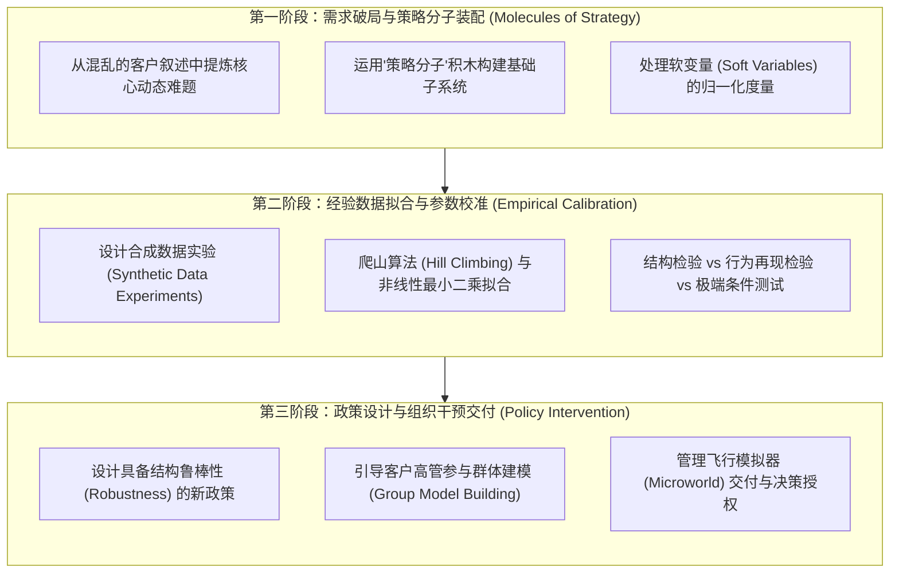
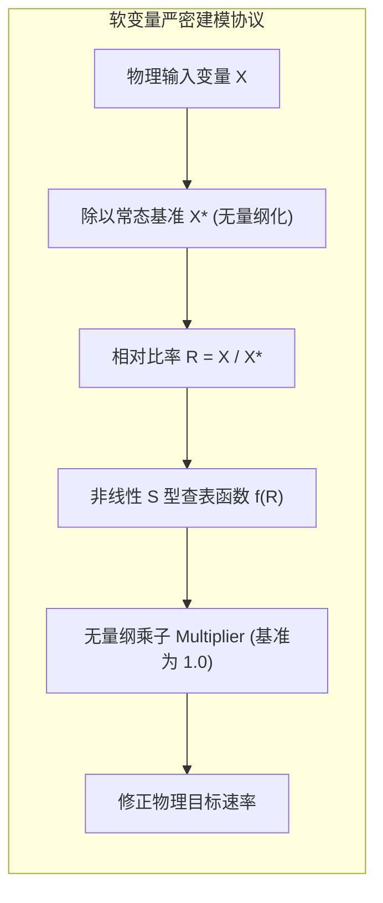
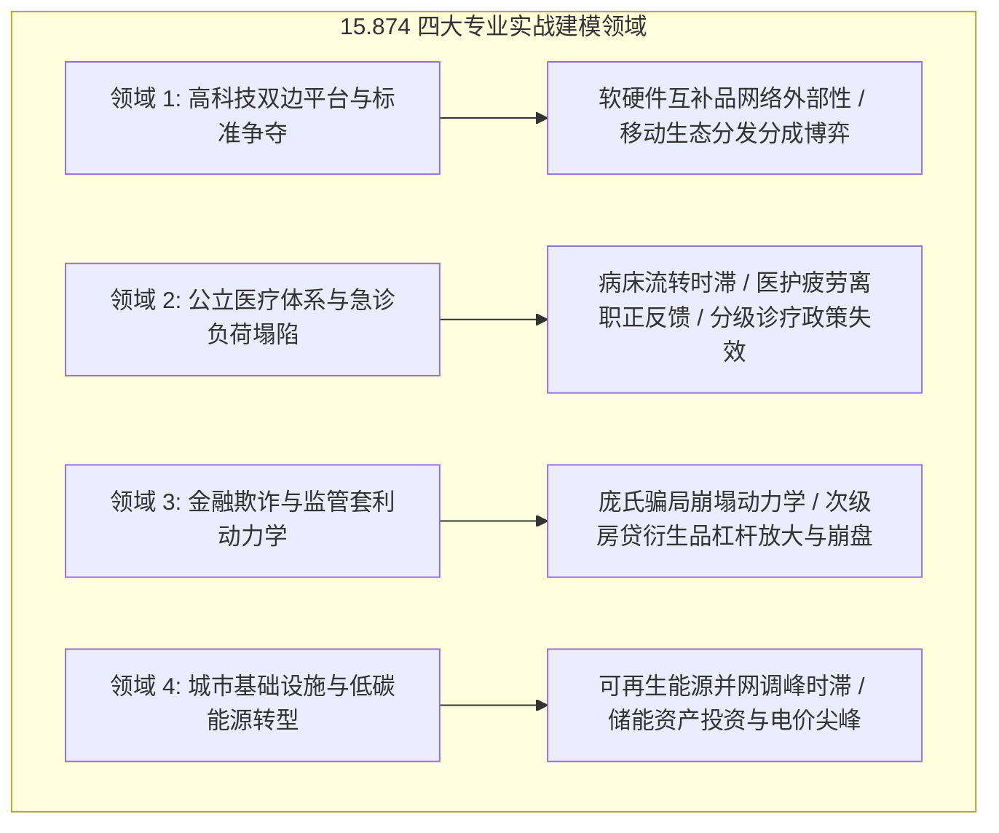

# 15.874 系统动力学实战应用 (Applications of System Dynamics)

> **授课院系**：MIT Sloan 管理学院 · 系统动力学学科组（System Dynamics Group）  
> **核心导师**：James Hines（Senior Lecturer in System Dynamics, 国际系统动力学学会前主席）、John Sterman  
> **核心教材**：James Hines, *Molecules of Strategy: Building Blocks for System Dynamics Modeling*; John D. Sterman, *Business Dynamics*  
> **课程定位**：MIT Sloan 高阶实操研讨与咨询实战实验室课程（9 学分），面向立志成为高级系统动力学咨询顾问、企业战略分析师与政策架构师的研究生，侧重模型校准、实证数据拟合与利益相关者交付

## TL;DR

- 聚焦系统动力学从理论数学模型向高难度真实商业与公共政策场景落地的咨询实战工艺。
- 提炼“策略分子（Molecules of Strategy）”可复用建模模块，实现复杂商业系统的快速模块化装配。
- 深入探索非线性决策方程构建、合成数据实验（Synthetic Data）与非线性参数校准优化技术。
- 覆盖高科技标准竞争、公立医疗体系负荷塌陷、金融监管套利以及低碳能源转型四大经典实战纵深。

## 课程体系与咨询实战工程学

如果说 15.871 与 15.872 侧重于系统动力学基本科学原理的建立与经典原型的推导，那么 MIT 15.874《系统动力学实战应用》则是专门传授**“职业系统动力学家如何面对混乱世界进行咨询破局”**的高阶实战工坊。

在真实的商业咨询与政策顾问现场，建模者所面对的环境往往极其恶劣：客户的数据支离破碎且口径冲突；企业管理层充斥着相互矛盾的政治诉求与深层心理防卫；关键物理变量（如员工士气、品牌商誉、感知质量、政治压力）属于无法直接测量的“软变量”。面对这些挑战，缺乏实战训练的初学者往往陷入“无从下手”或“用伪造数据强行迎合统计软件”的泥潭。

不仅如此，现实咨询项目通常具有极其严苛的时间窗口与预算限制。企业高管团队往往没有耐心等待建模者花费一年半载去追求大而全的数学完美主义，他们迫切需要在数周之内看到对当前战略痛点的穿透性洞见。因此，如何在高压、嘈杂且充满认知防卫的环境中，既保持系统动力学的数学严谨性，又能迅速完成复杂现实的结构抽象，是每一个卓越顾问的核心看家本领。

James Hines 教授在 15.874 中构建了一套严密的**系统动力学咨询工程学闭环（Consulting Engineering Cycle）**：

这套工程学闭环确保了模型不仅在数学上自洽、在统计上经得起经验数据检验，更重要的是能够在组织政治生态中成功着陆，驱动决策层的双环认知跃迁。它将看似天马行空的咨询艺术，彻底转化为一套具有可复现性、量化指标和明确里程碑交付物的严密工程规范。任何复杂项目的推进，都可以清晰映射到这三大阶段的演化阶梯之中。

## 核心方法论专题

在全学期的实战训练中，15.874 重点突破以下四大高阶专业建模壁垒：

### 1. 策略分子（Molecules of Strategy）：模块化系统工程

James Hines 教授提出了“策略分子”概念，将复杂的商业系统解耦为可插拔、可标准化的基础微分积木：
- **产能扩张分子**：处理包含在建工程（WIP）、订单平滑与折旧报废的闭环结构；
- **客户采纳与口碑流失分子**：处理包含潜在客户、活跃客户与流失客户的传染扩散链条；
- **人才招募梯队分子**：处理包含实习生、初级工程师与资深导师的培训开销与流失回路。
通过策略分子的拼装，专业咨询顾问能够将传统耗时数月的初版模型构建周期压缩至数天之内。

### 2. 软变量的形式化与量纲守护

商业决策中最重要的往往是看不见摸不着的因素：员工士气（Morale）、品牌信任度（Trust）、交付恐慌（Panic）。
15.874 严禁使用毫无物理意义的任意评分。课程制定了一套严密的**软变量建模协议**：
- 软变量必须通过无量纲基准比率（Dimensionless Relative Ratio）定义，例如“实际交期 / 期望交期”；
- 运用具有单调性与饱和极限的非线性 Lookup 表（Table Function），并严格定义输入为 0、1 以及极限趋于无穷大时的物理边界；
- 确保微分方程中所有参数与状态变量具有绝对严格的量纲一致性（Dimensional Consistency）。

### 3. 参数校准、爬山算法与历史拟合

在掌握结构化模型后，如何利用不完整的时间序列数据标定未知参数？
- **合成数据实验（Synthetic Data Experiments）**：在真实数据采集前，先用理论模型生成带噪声的伪数据，反向测试参数辨识算法是否能精准还原真实参数，以此检验模型的**结构可辨识性（Structural Identifiability）**；
- **非线性优化器调用**：运用 Vensim 内置的高级优化求解器，结合 Powell 共轭方向法或拟牛顿法，自动最小化仿真轨迹与历史经验数据之间的加权绝对百分比误差（MAPE）与均方根误差（RMSE）。

## 四大实战经典应用纵深

15.874 选取了四个具有高度社会经济代表性的复杂系统工程，开展了深度的现场建模攻坚：

### 1. 公立医疗体系的急诊室拥堵与资源崩塌

公立医院急诊室经常出现患者排队数小时甚至数天的现象。传统行政思维往往归咎为“急诊医生太少”并盲目扩招急诊人员。
系统动力学模型清晰地证明：急诊拥堵的根本症结在于**下游住院病房床位流转时滞（Inpatient Bed Delay）**与养老康复机构转运阻滞。由于缺乏长期护理床位，康复期老年患者被迫滞留住院部，导致住院部无法接收急诊收治患者，急诊室被迫沦为临时留观病房。通过将全院多级流转网络统筹建模，咨询团队设计了“提高下游康复转运补贴”的高杠杆方案，以不到传统扩招预算 20% 的成本彻底根治了急诊积压。

### 2. 金融欺诈与监管套利动力学

金融欺诈（如麦道夫庞氏骗局、加密货币流动性踩踏）本质上是由现金流再投资与虚假收益率驱动的恶性正反馈系统。
15.874 指导学员对庞氏骗局的资产负债表与投资者流入建立微分方程模型，求解维持骗局不崩盘所需的“最小新投资者流入指数增速”，精确预测挤兑崩塌的临界时间视界（Horizon of Collapse），为金融监管部门制定穿透式反洗钱与风险准备金策略提供了强有力的定量工具。

## 职业咨询交付与高管交互艺术

在系统动力学咨询中，向客户交付一份数百页包含海量方程的技术报告是最大的失败。15.874 培养学员掌握专业管理飞行模拟器（Management Flight Simulators）的交互包装工艺：

1. **图形化界面封装（Synthesim & Venapp）**：屏蔽底层的微分积分代码，将关键决策（如招聘节奏、产品定价、产能开工率）提炼为滑块控制器，将核心健康度（如自由现金流、客户流失率、团队士气）呈现为动态仪表盘；
2. **压力对抗演练（Stress Testing Workshops）**：组织赞助方董事会开展闭门决策沙盘演练，在模拟器中设置“竞争对手恶意降价 30%”、“原材料暴涨 50%”等极端情景，让高管亲身经历决策在 5 到 10 年周期内的连锁反应；
3. **政策防御性评估**：帮助企业构建政策防火墙，防止新任管理层在未来因业绩短期承压而擅自撤回长期能力投资。

---

本课程笔记系统整合自 [MIT OpenCourseWare (15.874 Spring 2004)](https://ocw.mit.edu/courses/15-874-applications-of-system-dynamics-spring-2004/) 与 James Hines 教授的经典研究，遵循 Creative Commons BY-NC-SA 4.0 许可协议。
