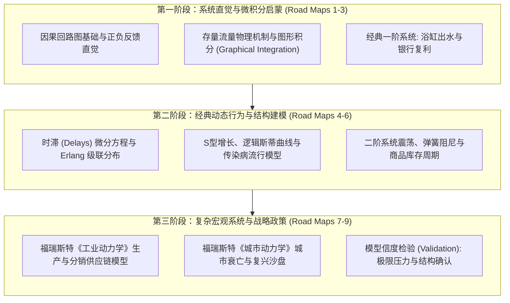
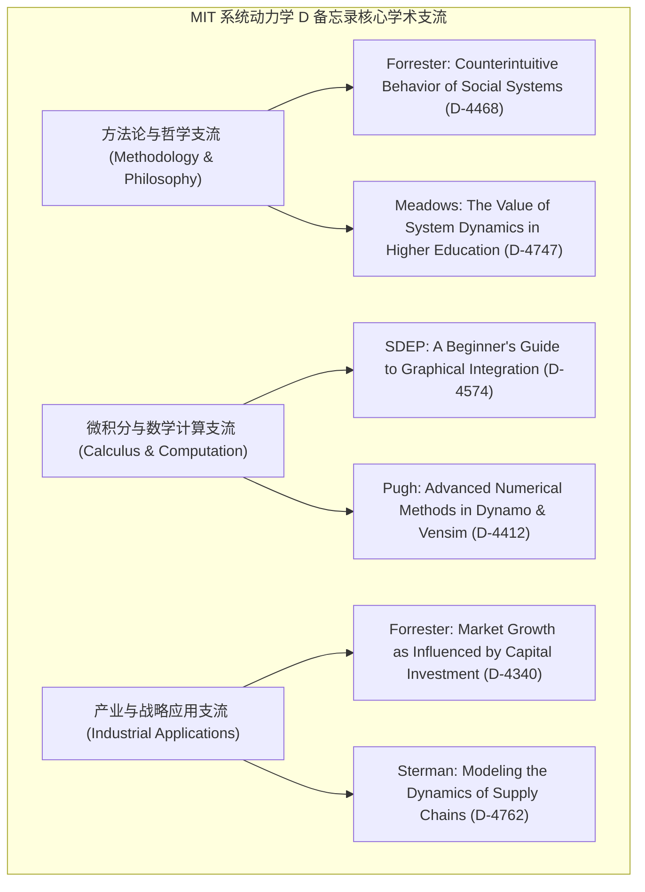

# 15.988 系统动力学自修路线图 (System Dynamics Self-Study: Road Maps)

> **授课院系**：MIT Sloan 管理学院 · 教育系统动力学项目组（System Dynamics in Education Project, SDEP）  
> **学术鼻祖**：Jay W. Forrester（系统动力学学科奠基人、MIT 荣誉退休讲席教授）、Nan Lux  
> **核心教材**：MIT SDEP *Road Maps: A Guide to Learning System Dynamics* (Road Maps 1–9 全卷与经典 D 编号学术备忘录文献库)  
> **课程定位**：MIT Sloan 系统动力学学科组为自学者打造的权威阶梯教程体系（自修学分研究课程），收录半个世纪以来 MIT 内部经典原著与论文，被誉为全球系统动力学界的“百科全书式自修圣经”

## TL;DR

- 由系统动力学奠基人杰·福瑞斯特（Jay W. Forrester）亲自指导编制的九阶段阶梯式自学大纲。
- 收录 MIT 系统动力学学科组数十年来绝密且奠基性的内部研究备忘录（D-Papers 档案库）。
- 从浴缸水流、兔群繁殖等初阶玩具模型，无缝攀登至城市动力学与全球世界动力学宏大物理系统。
- 强调亲手建模与代码逐行推演，系统涵盖图解微积分、欧拉与龙格库塔数值算法以及模型信度检验。

## 路线图（Road Maps）的诞生与学科血统

在系统动力学半个多世纪的发展历程中，杰·福瑞斯特（Jay W. Forrester）教授始终坚信：**系统动力学不是一门听讲座就能被动学会的陈述性知识，而是一门必须通过亲手调试方程、观察模拟失败并反思心智模型的“做中学（Learning by Doing）”工程艺术**。

为了让全世界没有机会亲临 MIT 课堂的学者、工程师与中学生能够自主、系统地登顶这门学科，福瑞斯特教授于 1990 年代初在 MIT 设立了“教育系统动力学项目组”（System Dynamics in Education Project, SDEP）。在长达十余年的时间里，项目组组织了数十位研究人员，将 MIT 系统动力学学科组自 1950 年代以来积累的数百篇内部学术手稿（即著名的 **D 系列文献，D-Papers**）进行了系统性梳理与教学重构。

最终诞生的成果，便是享誉全球的 **《Road Maps》（系统动力学学习路线图）**。全套体系分为 9 个循序渐进的章卷（Chapters 1–9），构建了如同武学秘籍般严密的通关阶梯：

这九大章卷既各自独立完整，又由浅入深、环环相扣，涵盖了从生活日常常识到国家宏观产业政策的全景图谱。

## 九阶路线图（Road Maps 1–9）内容架构全景

对于任何立志彻底精通系统动力学底层物理机制的学者而言，*Road Maps* 提供了全世界最详尽的自学指南：

| 阶次 | 对应卷册与核心文献 | 核心研究技能与仿真挑战 | 核心文献代号 |
| :--- | :--- | :--- | :--- |
| **第 1 阶** | **Road Maps 1: 系统思考导引** *(Introduction to Systems Thinking)* | 建立正反馈滚雪球与负反馈寻优直觉；掌握因果回路图极性判别；初识存量流量浴缸模型。 | D-4139, D-4347 |
| **第 2 阶** | **Road Maps 2: 存量流量积分与图形分析** *(Graphical Integration Foundations)* | 掌握“快照测试法”；学习无数学微积分图形积分（从流量曲线徒手画出存量累计曲线）；搭建首个捕食者-猎物生态模型。 | D-4574, D-4687 |
| **第 3 阶** | **Road Maps 3: 简单正负反馈仿真** *(First Simulation Exercises)* | 求解一阶微分方程；实现指数增长翻倍时间（Rule of 70）；仿真冷热水龙头与淋浴水温目标调节负反馈。 | D-4477, D-4652 |
| **第 4 阶** | **Road Maps 4: 增长的物理极限与 S 型曲线** *(Generic Structures: S-Shaped Growth)* | 剖析回路主导权转移；构建流行病扩散 SIR 存量流量模型；探索技术创新在有限潜在人群中的饱和。 | D-4432, D-4740 |
| **第 5 阶** | **Road Maps 5: 时滞物理学与结构阶数** *(Delays and Oscillation Mechanics)* | 深入推导一阶、三阶与 Erlang 物资/信息时滞；测试正弦相移与幅值衰减；构建温控器超调震荡系统。 | D-4428, D-4615 |
| **第 6 阶** | **Road Maps 6: 非线性函数与二阶系统震荡** *(Nonlinear Functions & Second-Order Systems)* | 掌握非线性 Lookup 查表函数设计规范；仿真机械弹簧振子与商业周期二阶负反馈震荡回路。 | D-4602, D-4726 |
| **第 7 阶** | **Road Maps 7: 产业动态学与供应链管理** *(Industrial Dynamics & Supply Chains)* | 研读 Forrester 1958 经典论文；复盘《工业动力学》三级供应链仿真模型；揭示在途订单与内生交期震荡。 | D-4337, D-4487 |
| **第 8 阶** | **Road Maps 8: 城市动力学与政策反直觉** *(Urban Dynamics & Counterintuitive Behavior)* | 研读 Forrester 1969 巨著《城市动力学》；剖析城市企业、住房与劳动力存量迁移；揭示廉租房政策为何加剧贫民窟恶化。 | D-4433, D-4674 |
| **第 9 阶** | **Road Maps 9: 模型信度检验与政策设计原则** *(Model Testing & Policy Design)* | 掌握边界充分性测试、极端条件测试、行为异常敏感性测试；设计结构性鲁棒管理干预政策。 | D-4463, D-4690 |

## 传奇档案：MIT 系统动力学 D 备忘录（D-Papers）

在系统动力学学科历史上，**D 编号学术备忘录（D-Papers / D-Memoranda）**是一笔无价的学术宝藏。在 20 世纪下半叶，MIT Sloan 系统动力学学科组的所有学术争鸣、未发表的数学手稿、思想实验以及计算机软件架构探讨，均被严格编号记录为 D 系列档案（如 D-4000 等）。

这一档案体系之所以如此珍贵，是因为它忠实记录了从早期的 DYNAMO 仿真语言编译器设计、到《工业动力学》中复杂多级制造链条的连续微分推演，再到后来席卷全球的《增长的极限》World3 模型在面对主流经济学家猛烈抨击时的严密学术辩护。每一篇备忘录都凝聚了一位或多位学者数周乃至数月的专注心血，直击特定理论难题的核心本质。

这些备忘录摒弃了学术期刊繁文缛节的包装，保留了学术大师们最纯粹、最锋利的思维交锋。对于今日深入研读该学科的学者而言，D 备忘录是直接与杰·福瑞斯特、约翰·斯特曼等大师跨越时空进行思维共振的最珍贵原矿。许多在现代教科书中被一笔带过的经典定理，在 D 备忘录中都有着详尽无比的推导草稿与心智反思记录。研读这些文献，能够让自学者在潜移默化中建立起最高标准的严谨学术品位与系统建模审美。

## 自学者通关建议与避坑指南

结合 SDEP 团队数十年的教学辅导经验，自学系统动力学必须牢记以下三条心法：

1. **坚决杜绝“纯看书不建模型”的伪学习**：
   - 系统动力学是具身技能。哪怕最简单的“向水杯倒水”模型，如果不在 Vensim 中亲手拉出存量流量图、填入微分方程并运行一次，就永远无法体会回路延迟对系统轨迹的微妙影响。
2. **警惕“为了画图而画图”的因果回路图滥用**：
   - 很多初学者画出的 CLD 密密麻麻充斥着数十个箭头，看似高深，实则因果混淆、极性未明。
   - 必须坚持从核心存量与流量出发，始终牢记：**存量与流量是物理世界唯一的物理实体，信息连接只是速率的调节器**。
3. **在极端条件测试中打磨模型的物理鲁棒性**：
   - 一个优秀的系统动力学模型，无论输入参数被推向何种极端（例如人口为 0、机器断电、原材料价格趋于无穷大），模型都绝不应该出现“除以零崩溃”或“存量产生负数”等违反物理定律的荒谬结果。

---

本课程笔记与自修大纲系统整理自 [MIT OpenCourseWare (15.988 Fall 1998 / Spring 1999)](https://ocw.mit.edu/courses/15-988-system-dynamics-self-study-fall-1998-spring-1999/) 以及 MIT System Dynamics in Education Project (SDEP) 公开发布的 *Road Maps* 档案库，遵循 Creative Commons BY-NC-SA 4.0 许可协议。
