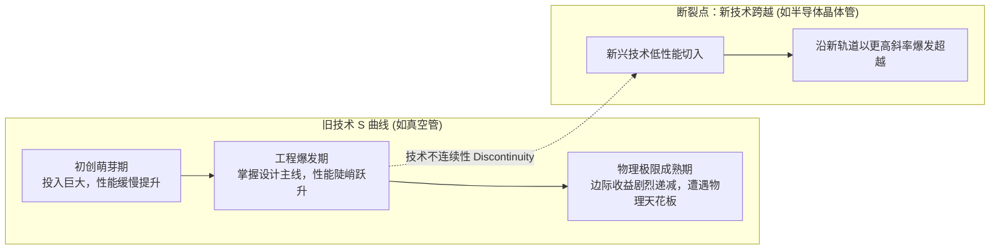

# Lec 1 技术创新的动态规律与 S 曲线 (Dynamics of Technological Innovation: S-Curves and Discontinuities)

> MIT 15.350 · Managing Technological Innovation · 模块一：技术创新的动力学基础与市场演进

## TL;DR

- 技术性能并非随时间线性提升，而是随研发累计投入呈现典型的 S 曲线（S-Curve）演进轨迹。
- 渐进式创新（Incremental）沿既有 S 曲线进行参数优化，激进式创新（Radical）则引发 S 曲线之间的范式跨越。
- 福斯特（Foster）模型揭示：在位巨头往往死于旧曲线成熟期对微小改进的边际过度投资，而忽视了新曲线的萌芽。
- 婴儿纸尿裤与半导体光刻历史案例表明，技术极限往往由底层物理极限或收益递减规律所决定。

## 技术演进的核心动力学：福斯特 S 曲线模型

技术的发展并非时间的线性函数，而是研发工程努力与资本投入的非线性产物。理查德·福斯特（Richard Foster）在其开创性研究中指出，任何技术轨道都遵循从起步、爆发到极限的经典 **S 曲线（S-Curve）**：

::: definition 技术 S 曲线 (Technological S-Curve)
表征技术性能指标（Performance, $P$）与累计研发工程投入（Cumulative R&D Effort / Investment, $E$）之间关系的数学逻辑：
$$P = rac{K}{1 + e^{-a(E - E_0)}}$$
- **初期阶段（Emergence）**：由于对基础科学原理与材料物理特性缺乏认知，大量研发资本用于试错，性能改善极其缓慢；
- **成长期（Growth）**：核心工程瓶颈被突破，主流架构定型，技术性能随单位投入出现指数级陡峭攀升；
- **成熟期（Maturity）**：逼近材料强度、散热极限或香农定律等物理极限，额外投入数倍资本仅能换取微乎其微的边际改善。
:::

## 渐进式创新与激进式创新的本质分野

管理者最常混淆的两类技术创新形态：

| 比较维度 | 渐进式创新 (Incremental Innovation) | 激进式创新 (Radical / Discontinuous) |
| :--- | :--- | :--- |
| **技术轨迹** | 沿现有 S 曲线向上推移，不改变基础架构 | 抛弃旧轨道，开辟具有全新物理原理的新曲线 |
| **知识基础** | 强化既有组织能力与工程专利积累 | 彻底摧毁在位者既有能力，使其核心资产沦为负债 |
| **客户群响应** | 迎合现有主流大客户对高精度、高耐用度的诉求 | 早期性能指标在主流市场极差，仅被边缘小众极客接受 |
| **典型案例** | 汽车发动机从 4 缸向双涡轮增压 6 缸调优 | 锂电池纯电动动力总成对内燃机的全面替代 |

## 经典行业案例：婴儿纸尿裤与芯片光刻的技术极限

课堂深入剖析了看似传统却极具科技含量的**婴儿纸尿裤（Diaper Technology）**技术跃迁史：
- **第一代（棉纤维时代）**：保洁公司（P&G）通过增加蓬松棉厚度提升吸水能力，很快遭遇体积过大、侧漏与婴儿行动受限的物理极限；
- **技术断裂点（高吸水性树脂 SAP）**：日本化学生产商引入交联聚丙烯酸钠高分子化学材料，以自重数百倍的锁水能力彻底开辟了超薄纸尿裤的新 S 曲线，一举重塑了全球数十亿美元的市场格局。

::: insight
在位企业管理者最致命的心理防线是**沉没成本承诺（Escalation of Commitment）**。当新技术萌芽时，在位者高管往往因为对既有资产的眷恋，反而加大对老旧成熟技术的研发投资，试图通过压榨老曲线的最后 5% 潜力来证明自我的正确性，最终在技术换代断崖前轰然倒塌。
:::

::: pitfall
把“时间”直接作为 S 曲线的横坐标。技术不会因为年份的推移自动进步；如果没有高强度、高质量的研发试验与资本投入，技术将在萌芽期停滞数十年（如核聚变与固态电池技术）。
:::
