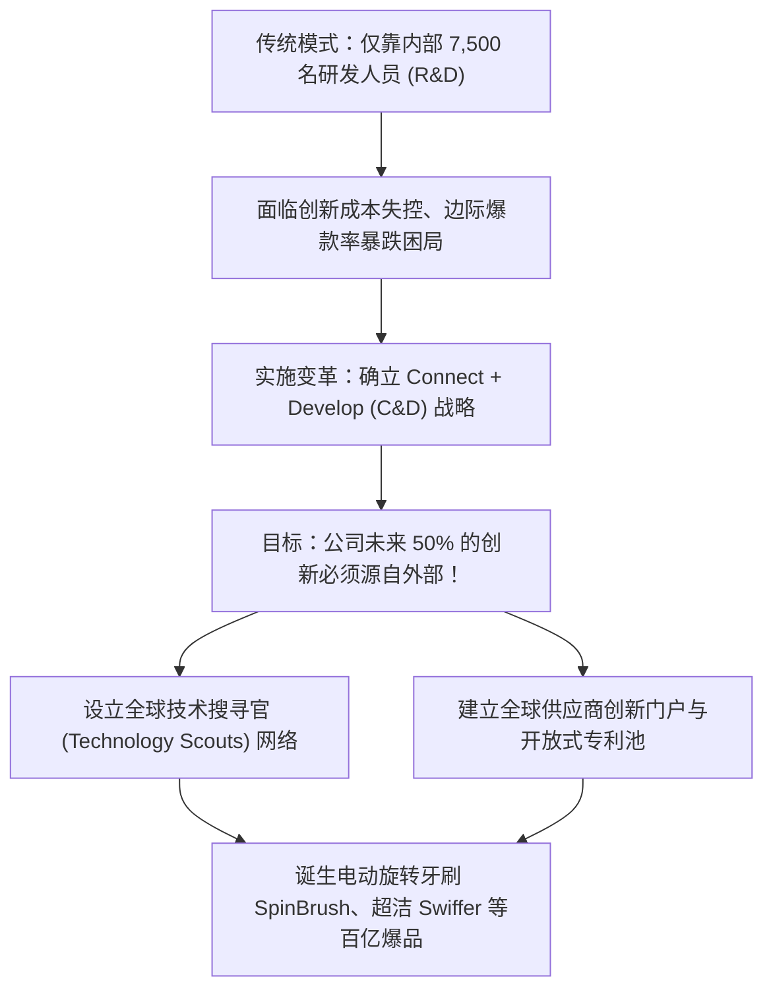

# Lec 13 分布式创新网络与研发协作 (Distributed Innovation Networks: P&G Connect + Develop and D-Wave)

> MIT 15.350 · Managing Technological Innovation · 模块三：创新执行：组织架构与分布式网络

## TL;DR

- 分布式创新网络打破了企业实体边界，将全球独立学者、实验室与供应商编织为协同创新的生态系统。
- 宝洁公司（P&G）通过著名的“联系与发展（Connect + Develop）”计划，实现 50% 创新源于外部的战略转型。
- 量子计算初创企业 D-Wave 通过分布式科学家网络汇聚全球顶尖物理学家，规避了早期自建巨型实验室的重资产包袱。
- 治理分布式网络的核心是设计互利共赢的知识产权（IP）共享、期权激励与产学研收益分配机制。

## 宝洁的战略救赎：从 R&D 转向 C&D

2000 年，消费品巨头宝洁（P&G）陷入增长停滞，股价暴跌 50%。新任 CEO 雷富礼（A.G. Lafley）意识到，宝洁内部虽然拥有 7,500 名顶尖研发科学家，但全球有至少 150 万名化学与材料科学家在宝洁无法企及的领域探索。

::: definition 联系与发展计划 (Connect + Develop, C&D)
宝洁开创的开放式商业模式，其核心原则是：**不追求一切技术由自己亲手发明，而是追求成为全行业最卓越的“技术连接者、工业化转化者与全球渠道商业化放大器”**。
:::

## 经典实操案例：D-Wave 的分布式量子物理科学家网络

加拿大前沿量子计算初创企业 **D-Wave Systems** 探索了深科技领域的分布式研发范式：
- **现实难题**：在早期研发绝热量子退火（Quantum Annealing）芯片时，全球仅有几十位前沿低温超导与量子理论专家，任何一家创业公司都绝无财力将所有教授全职买断；
- **虚拟分布式研究所**：D-Wave 并未盲目开设庞大实体研究院，而是向麻省理工、斯坦福、东京工业大学等顶尖实验室的教授提供充裕的研究专项经费、高精度测试时间与具有吸引力的股权激励，让科学家们留在各自高校实验室攻坚核心理论；
- **IP 契约的精巧设计**：科学家保留发表学术论文的崇高荣誉，但技术形成的全部工程实现专利归 D-Wave 独家所有，实现了学术追求与商业护城河的完美共生。

::: insight
分布式创新网络的精髓在于**轻资产撬动全球顶尖脑力**。初创企业不要试图在办公室里招聘所有天才；只要你能设计出公平的激励规则与清晰的接口规范，全球各地的顶尖大脑都可以成为你虚拟研发军团的特聘先锋。
:::

::: pitfall
在分布式网络中未能清晰界定背景知识产权（Background IP）与前景知识产权（Foreground IP）。如果未在合作第一天签署严密的 IP 归属协议，日后项目一旦估值暴涨，高校与外部合作者往往会发起专利确权诉讼，将企业拖入法律泥潭。
:::
