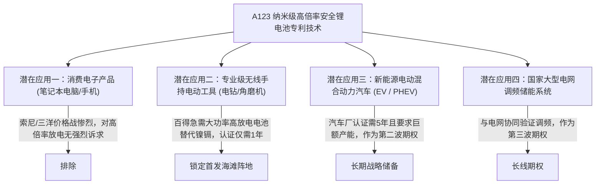

# Lec 18 颠覆性技术专利组合商业化 (Leveraging Portfolio Development: A123 Systems)

> MIT 15.350 · Managing Technological Innovation · 模块四：创新价值榨取：期权、组合与平台

## TL;DR

- 当一项通用基础技术（General Purpose Technology）具备多元应用可能时，必须建立严密的研发项目组合。
- MIT 衍生电池明星企业 A123 Systems 的纳米磷酸铁锂技术展现了从电工工具破局到车规动力电池的演进逻辑。
- 避开汽车主机厂极其严苛且漫长的 5 年认证周期，优先切入百得（Black & Decker）无线电钻利基海滩阵地。
- 项目组合规划必须兼顾“短期现金流造血项目”与“长期天花板战略期权项目”。

## 通用平台技术的多市场组合抉择

通用使能技术（GPT）的核心特征在于其具有跨行业的广泛适用性和颠覆潜力。然而，对于刚走出大学实验室的硬科技初创企业而言，“潜在市场无限大”往往不是祝福，而是致命陷阱。创业团队最容易犯下的战略错误就是试图同时满足消费电子、汽车动力、国防军工和工业储能等多个垂直赛道的要求。每个赛道对能量密度、倍率性能、安全认证、寿命循环和成本结构的要求截然不同，任何一家初创企业都没有足够的资金和工程资源去打赢多线作战。

因此，技术创始团队必须建立清晰的“海滩阵地（Beachhead Market）”筛选框架。理想的首发切入市场必须具备三个关键特征：第一，对新技术的独特性能（如超高放电倍率与极限安全性）具有不可替代的刚性支付意愿；第二，客户认证门槛和监管周期短，能够在 12 至 18 个月内产生稳定现金流；第三，竞争对手在该细分领域尚未筑牢壁垒，初创企业能够迅速拿下主导市场份额并打磨制造工艺，为后续向庞大但漫长的汽车动力电池市场渗透储备资金与信誉资产。

麻省理工学院材料科学系教授蒋业明（Yet-Ming Chiang）联合连环创业家里克·福洛普（Ric Fulop）创立了高能锂电池企业 **A123 Systems**。其核心突破是开发出了纳米级磷酸铁锂阴极材料，充电速度提升 10 倍，寿命大幅延长且永不起火爆炸。

这项革命性底层材料技术面临极其广阔但特性迥异的潜在应用市场组合：



## A123 的双梯队项目组合战略演进

课堂特邀 A123 创始人 Ric Fulop 亲临现场复盘项目组合管理实践：

```text
[A123 阶梯式研发项目组合架构]
第一梯队 (核心造血项目 - Core Breadwinners, 2002-2005):
- 合作客户：百得公司 (Black & Decker) 旗舰级 DeWalt 专业无线重型电钻
- 特征：百得急于摆脱笨重且有毒的镍镉电池，愿支付高额单体电池溢价
- 成果：快速实现数千万美元规模量产出货，验证了纳米浆料批量生产良品率，产生稳定毛利现金流

第二梯队 (战略爆发项目 - Growth Engines, 2006-2009):
- 合作客户：通用汽车 Chevrolet Volt 插电式混动与克莱斯勒纯电动车
- 特征：客单价与合同规模达数亿美元，吸引全球顶级风险投资机构与美国能源部数十亿美元巨额注资
- 挑战：面临整车级抗震、零下 30 度冷启动及百万公里质保的严苛工业考验
```

::: definition 研发项目组合分类矩阵 (Wheelwright & Clark Aggregate Portfolio)
成熟企业管理研发组合的经典四分法：
1. **基础研究与突破型项目 (Radical / Breakthrough)**：开辟全新材料与物理原理，探索未来 5-10 年的新曲线（占预算 10%）；
2. **平台型项目 (Platform Projects)**：构建新一代通用底盘架构，派生出多款衍生产品（占预算 30%）；
3. **衍生型项目 (Derivative / Incremental)**：针对现有成熟产品的换代、降本与增配调优（占预算 50%）；
4. **外部协同合作项目 (Alliances / Partnerships)**：与高校、供应商联合开展的前瞻技术探索（占预算 10%）。
:::

::: insight
一个健康的初创企业研发组合，绝不能只有“明天就能赚钱的平庸外包单”，也不能只有“十年后才能量产的星辰大海”。必须用**短平快的垂直利基产品（如电动工具）跑通供应链并养活团队**，同时用**颠覆性战略期权（如车规动力电池）维持极高估值并吸引顶级资本**。
:::

::: pitfall
在企业羽翼未丰时，贸然将全部赌注直接押注在最大客户身上。A123 后来在车规级市场由于激进扩产遭遇通用 Volt 订单不及预期与菲斯克（Fisker）破产拖累，引发巨额存货减值与资金链断裂，给后来者留下了沉痛的历史教训。
:::
