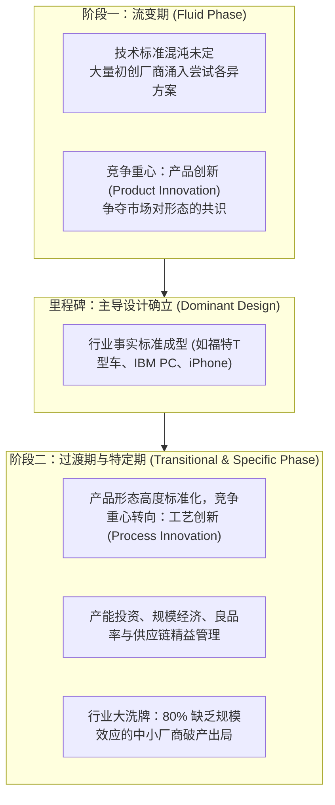

# Lec 2 技术演进与市场产业影响 (Industrial Implications: Dominant Design and Market Evolution)

> MIT 15.350 · Managing Technological Innovation · 模块一：技术创新的动力学基础与市场演进

## TL;DR

- 产业演进遵循阿伯纳西-厄特巴克（Abernathy-Utterback）模型，由“流变期”向“主导设计”确立演进。
- 主导设计（Dominant Design）确立前，企业竞争的核心是产品创新；确立后转向工艺创新与制造成本竞争。
- 模块化架构使专业分工加速，打破传统垂直一体化巨头的垄断护城河。
- 企业在产业周期不同阶段必须动态切换研发战略，由激进概念探索转向精益规模制造。

## 阿伯纳西-厄特巴克（A-U）产业创新演进模型

理解产业演进规律是技术战略制定的基石。任何重大技术突破在进入市场初期，都会经历一段充满高度不确定性的探索期。在这一阶段，没有任何一家企业能够确切预知哪一种技术架构会成为最终的市场共识。因此，市场呈现出高度碎片化的探索状态：初创公司凭借五花八门的工程原型争夺眼球，用户反馈参差不齐，生产方式以小批量手工试制为主。

然而，一旦某种产品形态成功整合了关键用户体验、技术可靠性与规模制造成本，成为全行业心照不宣的事实标准（即主导设计），整个产业的竞争规则就会在一夜之间发生逆转。那些押错技术路线或无法迅速转向主导设计架构的企业将被残酷淘汰出局。随后，资本和研发重兵全面向生产工艺流程优化倾斜，行业迅速进入集约化规模大生产时代。

产业和技术的协同演化遵循清晰的生命周期律。詹姆斯·厄特巴克（James Utterback）与威廉·阿伯纳西（William Abernathy）构建了著名的 A-U 模型：

::: definition 主导设计 (Dominant Design)
在特定的技术与市场领域中，被全行业买卖双方公认为事实标准的单一产品架构与核心要素组合（例如：QWERTY 键盘布局、个人电脑的 Wintel 架构、现代智能手机的电容大触屏+虚拟键盘）。主导设计一旦成型，将在长达数十年内锁定用户的心理预期与生产线资本投入。
:::

## 竞争焦点的大迁移：产品创新 vs. 工艺创新

在产业生命周期的不同侧面，企业研发资源的配置效率存在巨大的临界转变：

| 评估维度 | 流变期 (Fluid Phase) | 特定成熟期 (Specific Phase) |
| :--- | :--- | :--- |
| **产品特征** | 差异极大，定制化程度高，性能不稳定 | 高度模块化、标准化，微小改版与可靠性打磨 |
| **制造设备** | 通用机床、手工装配、依赖高级技工经验 | 高度自动化专用流水线、硬质模具与机器人 |
| **研发开支重心** | 探索性产品功能概念设计（占 80%） | 制造工艺降本、良品率爬坡与供应链协同（占 80%） |
| **进入壁垒** | 技术专利与独创构想，新进入者极易破局 | 庞大的固定资产重资产投资与规模制造学习曲线 |

## 模块化陷阱与垂直一体化瓦解

当技术发展到成熟期，系统往往由过去的**定制耦合集成架构**演进为**标准模块化架构**：
- **IBM PC 的惨痛教训**：IBM 为了快速应对苹果个人电脑的威胁，打破了传统大型机时代的垂直整合自主研发模式，转而采用公开模块化设计（英特尔 CPU + 微软 DOS + 通用总线接口）。这一举措虽然在短期内确立了 PC 主导设计，但彻底剥离了核心利润，催生了成百上千家廉价组装机厂商（Compaq, Dell 等），IBM 自身最终沦为低毛利的组装厂。

::: insight
主导设计往往不是由性能最卓越的纯技术方案赢得的，而是由**生态网络、商业渠道与补足品供应**共同锁定的。索尼的 Betamax 录像带在画质上显著优于 JVC 的 VHS，但由于 JVC 采取开放授权策略迅速拉拢了全球好莱坞电影制片厂提供丰富录像带资源，VHS 最终成为统治全球的主导设计。
:::

::: pitfall
在主导设计已经确立的成熟产业中，继续试图通过推出小修小补的另类非标产品形态来翻盘。此时逆主导设计而行，只会招致供应链成本飙升与消费者的本能抵触。
:::
